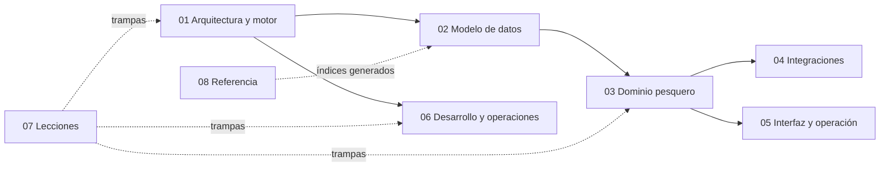

# Liquidación Sueldos Pesca — Manual integral

Extensión AL para **Business Central 25.2 OnPrem** (publisher Grupo Arbumasa, namespace `UAS.Payroll`, IDs 50000–149999) que liquida sueldos de la industria pesquera argentina con un **motor paramétrico**: los conceptos, fórmulas, convenios y vigencias se *configuran*, no se programan. Reemplaza a Meta4.

> [!tip] Si sos Claude
> Leé primero [[Reglas para Claude]]. Después navegá por tarea con la tabla de abajo.

## Por dónde entrar según lo que vayas a hacer

| Tarea | Empezá por |
|---|---|
| Entender el sistema | [[Qué es y para qué sirve este sistema]] → [[Visión general de la arquitectura]] → [[Vision del dominio pesquero]] |
| Cambiar cómo se calcula un concepto | [[Ciclo de cálculo de una liquidación]], [[Evaluador de fórmulas - sintaxis]], [[Acumuladores y fracciones]], [[Orden de cálculo y precedencia]] |
| Tocar una tabla o campo | [[Índice Modelo de datos (60xxx)]], [[Índice Modelo de datos (110xxx)]] |
| Estados, fases, atributos, tipos de liquidación | [[Índice Dominio - empleado y condiciones]] |
| Mareas, francos, novedades, producción | [[Índice Dominio - marea y pagos]] |
| Sincronizar con NAV, migrar de Meta4, SIRADIG | [[Índice Integraciones]] |
| Operar una liquidación mensual | [[Índice Interfaz y operación]], [[Flujo operativo mensual de liquidación]] |
| Compilar, publicar, crear objetos | [[Índice Desarrollo y operaciones]], [[Runbook - tareas frecuentes]] |
| "Esto da cero y no sé por qué" | [[Índice de lecciones]], [[Resolución de problemas frecuentes]] |
| Qué no coincide entre docs y código | [[Divergencias entre documentación vieja y código]], [[Hallazgos abiertos]] |

## Mapa del vault

| Carpeta | Qué hay |
|---|---|
| `01 Arquitectura y motor` | Motor, evaluador, contexto, acumuladores, rendimiento |
| `02 Modelo de datos` | Una nota por tabla, enums, mapas ER |
| `03 Dominio pesquero` | Estados, fases, atributos, convenios, mareas, francos, novedades |
| `04 Integraciones` | NAV, Meta4, SIRADIG, firma de recibos, catálogo de scripts |
| `05 Interfaz y operación` | Manual de usuario, páginas, permisos, recibo |
| `06 Desarrollo y operaciones` | Compilar, publicar, IDs, ConfigPackage, tests, runbooks |
| `07 Lecciones` | 150 trampas y decisiones aprendidas ([[Índice de lecciones]]) |
| `08 Referencia` | [[Objetos AL]] (generado) |

## Principios de diseño que no se discuten

1. **Configurar, no codificar.** Antes de crear una tabla: Parámetro, Fuente de Datos, Condición, variable de sistema o un campo en una tabla de configuración. Ver [[avoid-tables-principle]].
2. **Todo tiene vigencia.** Conceptos, parámetros, atributos y estados se versionan por fecha; nunca se pisa historia. Ver [[conceptos-tres-vigencias]], [[estado-empleado-effective-dated]].
3. **El orden de cálculo lo decide quien configura y fallar es silencioso.** Ver [[acumuladores-orden-calculo]], [[Orden de cálculo y precedencia]].
4. **Manda el código.** Si la documentación vieja dice otra cosa, ver [[Divergencias entre documentación vieja y código]].

## Cómo mantener este vault
Ver [[_Convenciones del vault]]. Los índices de `08 Referencia` y [[Índice de lecciones]] se regeneran con `scripts/GenerarIndiceVault.ps1`.
