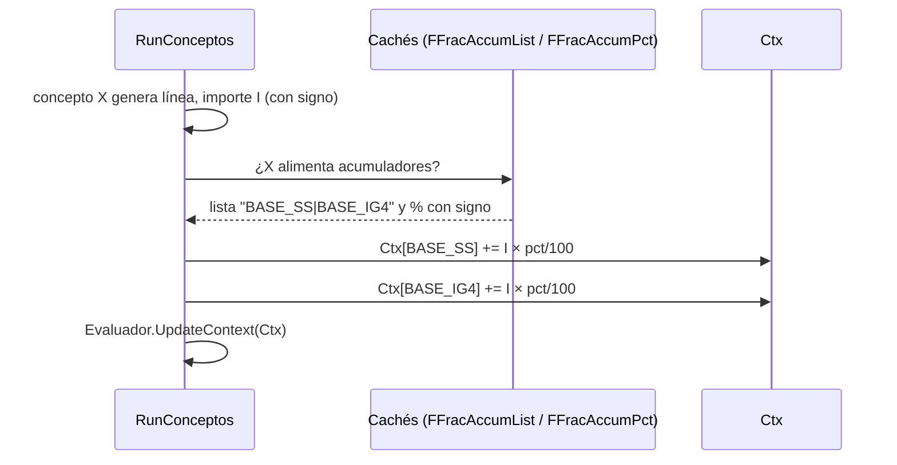

# Acumuladores y fracciones

Un **acumulador** es un `Concepto Liquidación` con **`Es Acumulador = true`**: no tiene fórmula, sólo
**recibe sumas** de otros conceptos. Es la herramienta con la que se arman las **bases** (`BASE_SS_TRAB`,
`BASE_OS_TRAB`, `BASE_IG4`, `BASE_SAC`, `BASE_SINDICAL`, `REMUNERATIVO_BRUTO`…) que después leen las
fórmulas de aportes, impuesto y adicionales. Se configura **por datos**: ningún nombre de acumulador está
cableado salvo dos punteros de `Config. RRHH` (`Cód. Acum. Haberes Gravados` y, por la fórmula, el neto
garantizado). Ver [[avoid-tables-principle]].

## Cómo se alimenta: `Fracción Acumulador` (60017)

Cada fila dice *"este concepto aporta X% de su importe a este acumulador"*:

| Campo | Detalle |
|---|---|
| PK | `Cód. Concepto`, `Vigencia Desde`, `Cód. Acumulador` (+ clave `K2: Cód. Acumulador, Vigencia Desde`) |
| `Porcentaje` | 0 a 100 (0..4 decimales). **Cada fila es independiente**: 100% hacia `BASE_SS` y 100% hacia `BASE_IG4` reciben el importe completo |
| `Invertir Signo` | el aporte **resta** en vez de sumar. Se llama así y no "Restar" porque es una inversión: si el importe de la línea es negativo, invertirlo **suma** |
| `Vigencia Desde` | la distribución se versiona **por su propia fecha**, independiente de la vigencia del concepto ([[conceptos-tres-vigencias]]) |

Un concepto puede alimentar varios acumuladores, cada uno con su vigencia. La suma de porcentajes hacia un mismo acumulador puede superar 100 si muchos conceptos contribuyen: lo que importa es qué porción de *ese concepto* va a *ese acumulador*.

> [!note] El signo ya no sale de `Abs`
> La lección [[acumuladores-orden-calculo]] cuenta que el motor guardaba `Abs(importe)` y que el signo
> sólo vivía en el flag `Restar` de la fracción. **Hoy el importe de la línea lleva su propio signo**
> (ver la nota de cabecera de `Tab60012`) y el flag se llama `Invertir Signo`. El resto de la lección
> (el problema de orden y el control estático/en runtime) sigue vigente.

## Cómo se acumula durante el cálculo

1. `EnsureConceptCaches` → `BuildFractionCache` arma **una vez por `FechaRef`** tres mapas: `FFracAccumList` (concepto → `"ACUM1|ACUM2"`), `FFracAccumPct` (`concepto~acumulador` → porcentaje **con signo**; `Invertir Signo` lo niega) y `FFracAccumVig` (vigencia que ganó). Para cada par `(concepto, acumulador)` se queda con la **última `Vigencia Desde <= FechaRef`**.
2. `UpdateAccumulatorsFromCache`: `Ctx[acum] += Importe × pct / 100`.
3. Para un concepto de **consumo de francos** se acumula el **importe en plata**, no el resultado de la fórmula (que son días).
4. Se acumula también para incidencias manuales y, al final del bucle, para las que `WriteIncidenciasRestantes` escribe (éstas llegan **tarde** por definición; se registran como aporte tardío).

> [!danger] Una fracción hacia un acumulador que no existe no hace nada, sin error
> `UpdateAccumulatorsFromCache` exige `AccumPct.ContainsKey(...) and Ctx.ContainsKey(AccumCode)`. Si el
> acumulador de destino fue borrado o no está vigente a `FechaRef`, el aporte **se descarta en silencio**.
> Pasó con `BASE_SS`/`BASE_OS`: se borraron y 147 y 137 conceptos siguieron apuntándoles, sin que ese
> importe entrara a ninguna base (ver `PROPUESTA_TOPE_SIPA_PERIODO.md` §6 y `scripts/LimpiarFraccionesHuerfanas.sql`,
> que **borra sin reapuntar**). Al borrar el **último** `Concepto Liquidación` de un código, `OnDelete`
> limpia las fracciones huérfanas y bloquea si una fórmula o una variable de sistema todavía lo nombra.

## Cómo se lee

- **Por nombre** en una fórmula: `MIN(BASE_SS_TRAB, TOPE_SIPA) * PCT_JUB`. Vale el **subtotal hasta ese punto** del bucle ([[Orden de cálculo y precedencia]]).
- **Con `#`**: `#BASE_SS_TRAB` es lo mismo (importe ya calculado = `Ctx[código]`). Con `@` se re-evalúa la fórmula del concepto, y un acumulador no tiene fórmula (da 0).
- **Entre liquidaciones**, con variables de sistema `YTD_ACUM` / `PERIODO_ACUM` ([[Variables de sistema]]); sirven para topes mensuales y para el impuesto a las ganancias.
- Un acumulador **arranca siempre en 0** en cada liquidación, aunque otro origen haya sembrado el nombre.

## Qué queda guardado

- `WriteAccumulatorLines` escribe, al final, una `Línea Liquidación` por acumulador vigente: `Tipo Concepto = Informativo`, `Imprime en Recibo = false`, `Importe` = valor final, `Fórmula Evaluada` = el número.
- `SaveResumenVariables` guarda los acumuladores en `Resumen Variable Liq.` (excepto los códigos de conceptos **no** acumuladores).
- El **drill-down** (página *Detalle Acumulador*, Pag50174, tabla temporal `Detalle Acumulador Liq.` 60028) se arma **al final, con todos los aportes** de `Línea Liquidación`: por eso muestra el conjunto completo aunque un lector haya visto un subtotal. Eso hace invisible el error de orden: el detalle y el valor que usó el lector son dos números distintos por construcción. Diagnóstico rápido: sumar *Importe Aportado* del drill-down y compararlo contra el valor de la variable en la línea que lo lee.
- `Línea Liquidación."Vigencias Distribución"` lleva el sello `ACUMULADOR:AAAAMMDD` de la fracción que se aplicó (`DescribirDistribucion`), para auditar con qué distribución se acumuló. Formato fijo, sin separadores, para no depender del idioma.

## Grossing-up

En cada vuelta de convergencia, `ResetAccumuladores` pone en 0 **todos los códigos de concepto** del mapa de versiones (acumuladores y también el `Ctx[código]` que usa `#`), para que un `#` leído temprano en la vuelta 2 no vea el importe viejo. Ver [[Grossing-up y tipo de cambio]].

## Quién valida que esté bien armado

- **Control estático** `Control Orden Acumuladores` (Cod50067, página 50014): sin liquidar, compara por acumulador el orden del último aporte con el del primer lector. Ver [[Orden de cálculo y precedencia]].
- **Control en runtime** (`RegistrarLecturasAcumuladores`/`VerificarOrdenAporte`): también cubre lecturas indirectas por `@`.
- `Concepto Liquidación`: `BorrarFraccionesHuerfanas`, `CopiarEn` (copia **todas** las vigencias de fracciones y las restricciones de convenio).
- La versión vigente de la fracción para YTD/PERIODO tiene la salvedad de [[Variables de sistema]].

## Relacionado

[[Ciclo de cálculo de una liquidación]] · [[Contexto de liquidación y variables]] · [[concepto-negativo-despues-de-sus-consumidores]] · [[tope-sac-por-liquidacion]] · [[tot-remun-27617-es-acumulador]] · [[Tabla - Concepto Liquidación]]

**Tablas relacionadas:** [[Tabla - Fracción Acumulador]] · [[Tabla - Detalle Acumulador Liq]] · [[Tabla - Concepto Liquidación]]
