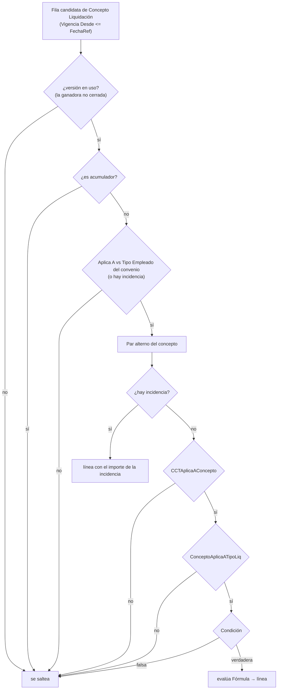

# Aplicabilidad de un concepto a una liquidación

Que un concepto **corra** para una liquidación lo deciden varios filtros encadenados en `RunConceptos`
(Cod50014). Ninguno falla con error: **un concepto que no aplica simplemente no se evalúa y no deja
línea**, por eso las configuraciones mal cargadas se notan como recibos incompletos.

## 1. Versión en uso

`FLatestVersionMap`: por código, la **última** `Vigencia Desde <= FechaRef`; luego se descarta si esa versión ganadora ya no está en vigencia (`VigenteA(FechaRef)`: `Vigencia Hasta` vacío o `>= FechaRef`). Con una **incidencia**, alcanza con que sea la última versión aunque esté discontinuada (`FUltimaVersionMap`). Ver [[Versionado de conceptos y fórmulas]].

El campo `Activo` del concepto está **obsoleto y sin efecto**: la baja se expresa con `Vigencia Hasta`.

## 2. `Aplica A` ↔ tipo de empleado

`TipoEmpleadoDe(Liq)` sale del **convenio de la cabecera** (`Convenio Colectivo."Tipo Empleado"`), **no** del estado del día. Antes salía del estado, y con un estado compartido (vacaciones, `AU9`, que dice «Todos») entraban todos los conceptos de mensualizado a un tripulante (el legajo 00191, CCT 729/15, cobró «Antigüedad mensuales» en enero de 2026 por esto). Valores de `Aplica A Liq.`: `Todos`, `Tripulante`, `Mensualizado`, `Jornalizado`. `Todos` de cualquiera de los dos lados no restringe. Sin convenio configurado devuelve `Todos` (criterio permisivo: un concepto de más se ve; uno de menos no lo nota nadie).

## 3. Restricción por convenio y categoría (`Concepto CCT Vigente`, 60019)

`CCTAplicaAConcepto` (cachea por `concepto, versión, convenio, categoría, FechaRef`; usa el par **efectivo** del concepto, ver [[Par convenio-categoría por concepto]]):

1. **Sin filas** para el concepto (`FlowField "Vigencia CCT Más Reciente"` = 0D) → aplica a **todos**.
2. **Exclusiones primero** (`Excluye = true`): si hay una fila de exclusión del convenio entero (categoría en blanco) o de la categoría, con `Vigencia Desde <= FechaRef` → **no aplica**, y gana sobre cualquier inclusión. Una exclusión no tiene fecha de fin ni se versiona: se **borra** la fila para reincluir.
3. **Sin inclusiones activas** a `FechaRef` (sólo exclusiones, o inclusiones futuras) → aplica a **todo lo no excluido**.
4. **Con inclusiones**: se busca la **última vigencia de ese convenio** (`FindLast` con `Vigencia Desde <= FechaRef`); si el convenio no está → **no aplica**.
5. **Dentro del convenio se busca hacia atrás** la última vigencia que **nombre a la categoría**: coincidencia exacta de `(convenio, categoría)` gana; si no, una fila de "todo el convenio" (categoría en blanco). El resultado es `not Excluye` de la fila hallada. Si ninguna vigencia del convenio nombra jamás a la categoría → **no aplica**.

El versionado es **por convenio** (agregar una vigencia nueva de un convenio no revoca la vigente de otro) y **acumulativo por categoría**: una vigencia nueva agrega y actualiza, no revoca lo que no menciona. Para sacarle un concepto a una categoría hay que cargar una fila **Excluye**; omitirla ya no alcanza (a propósito).

> [!danger] El error clásico: enumerar las categorías de otro convenio
> La vigencia 2026 del 175/75 se cargó listando OF01 y OF02 (categorías de **otro** convenio); con el
> criterio viejo ("manda sólo la más reciente") los OF04 quedaron sin sueldo, antigüedad, francos ni cuota
> sindical desde el 1/1/2026, sin línea en cero ni error. Ver [[convenio-of-depende-de-la-categoria]].

`Concepto Liquidación.CopiarEn` copia también las filas CCT: un concepto restringido que se copia sin ellas **liquidaría a toda la nómina**.

## 4. Tipo de liquidación (`Tipos Liq. Aplicables`)

`ConceptoAplicaATipoLiq(Concepto, TipoLiq)`: `Tipos Liq. Aplicables` es un texto con **códigos separados por `|`** (el campo viejo `Aplica Tipo Liq.` está obsoleto). `Declarado` = el tipo de la liquidación está en la lista.

| Concepto | Tipo de liquidación | Resultado |
|---|---|---|
| `Informativo` | cualquiera | `lista vacía` **o** `Declarado` (los informativos **nunca** se restringen por "Sólo Conceptos Declarados": alimentan bases) |
| otro tipo | `Sólo Conceptos Declarados` marcado | sólo si `Declarado` (el vacío **deja** de ser comodín) |
| otro tipo | normal | lista vacía → **corre en todos**; con lista → sólo `Declarado` |

> [!warning] Lista vacía = comodín
> 185 conceptos activos no declaran tipos y por lo tanto aplican a **todos**. Un tipo nuevo habilitado
> duplica el recibo entero: ver [[vacio-en-tipos-liq-aplicables-es-comodin]] y [[lote-tipo-liq-en-blanco]]
> (enero 2026: 3.604 liquidaciones donde iban ~520). `Sólo Conceptos Declarados` (campo del tipo)
> invierte la regla para tipos como VACACIONES, donde deben correr **sólo** los declarados: 5 asignaciones
> en vez de 185.
>
> Con una liquidación **sin `Cód. Tipo Liq.`** (las anteriores a la migración) un concepto **con** lista
> no corre ([[migracion-tipo-liq-incompleta]]).

## 5. Condición

`Condición` (si está vacía → verdadera) se evalúa con el mismo evaluador, **después** de las anteriores y sólo en la vía de fórmula. Un error en la condición corta con `ErrConceptoFalló`. Una condición **no se valida** en la fase 1 del motor (sólo las fórmulas), pero sí al cargarla en la ficha. `@CÓDIGO` evalúa la condición del concepto referenciado y devuelve 0 si da falso.

## Qué se recorre aunque no aplique

Un concepto con **incidencia** se recorre aunque no le aplique al tipo de empleado, al convenio ni al tipo de liquidación: la incidencia manda y se escribe en su orden. Ver [[Incidencias en el motor]].

## Relacionado

[[Ciclo de cálculo de una liquidación]] · [[Tipos de concepto y su efecto en el recibo]] · [[Tabla - Concepto Liquidación]] · [[cuando-corresponde-una-liquidacion]] · [[exclusividad-vacaciones]]

**Tablas relacionadas:** [[Tabla - Concepto CCT Vigente]] · [[Tabla - Convenio Colectivo]] · [[Tabla - Categoría CCT]] · [[Tabla - Tipo Liquidación]]
