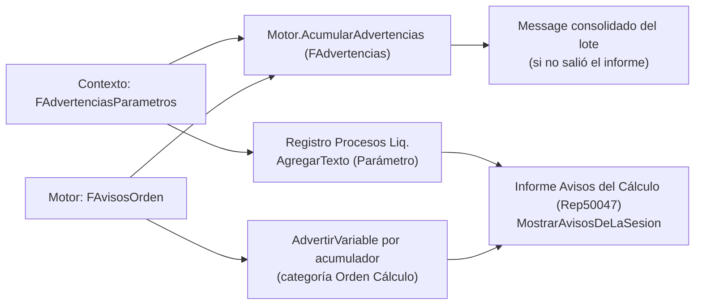

# Avisos y advertencias del cálculo

El motor evita, en lo posible, fallar **en silencio**. Lo que no corta el cálculo pero merece mirarse sale
como **advertencia**: no frena la liquidación, aparece al final (mensaje consolidado e informe) y queda
en el **registro del proceso**. Esta nota lista cada aviso, quién lo genera y qué significa.

## Dónde van

- `Motor.AcumularAdvertencias(LiqNo, texto)` junta los avisos de todas las liquidaciones de un lote con el formato `LIQ-No:` + texto; `GetAdvertencias` los entrega y `LimpiarAdvertencias` los reinicia.
- Cada aviso del contexto va **una vez** (se deduplica por texto), pero el motor lo vuelca al registro como **una entrada** de categoría `Parámetro` con el bloque entero; los de **orden de cálculo** van **una entrada por acumulador** con el acumulador y el concepto lector en sus propios campos (`AdvertirVariable`), para filtrar "todos los problemas de orden del período".
- El de orden se registra desde `LiquidarRecord` y no desde `ConstruirAvisosOrden`: `RunConceptos` corre dos veces con auditoría cuando hay grossing-up y anotar en cada pasada duplicaría.

## Catálogo de avisos

| Aviso | Generado por | Cuándo | Qué significa / qué hacer |
|---|---|---|---|
| **Parámetro sin ningún valor** `X: no tiene ningún valor cargado en Parámetros Vigentes` | `CheckVigenciaDesactualizada` | parámetro con `Antigüedad Máxima Vigencia` y **ninguna** versión vigente en toda la base para ese código | falta una **carga**. No avisa si hay filas pero ninguna aplica a este empleado (alcance por convenio/empleado) |
| **Parámetro desactualizado** `X: el último valor vigente es del … (N día(s))` | idem | última `Vigencia Desde` anterior a `CalcDate(Antigüedad Máxima Vigencia, FechaRef)` | revisar si corresponde una versión más reciente (Ganancias, mínimos). La fórmula de fecha debe **retroceder** o se rechaza al cargarla ([[antiguedad-maxima-vigencia-avisa-de-mas]]) |
| **Cód. Cálculo desconocido** `La variable X tiene el Cód. Cálculo "Y", que el motor no conoce: vale CERO…` | `AvisarCodigoDesconocido` | fila activa de variable de sistema cuyo código no está en el `case` | corregir el código en *Variables de Sistema*. Antes era el único lugar mudo del motor. Ver [[variables-rotas-valen-cero]] |
| **Fuente sin filtros** `La Fuente de Datos X no tiene ningún filtro cargado: está agregando la tabla entera…` | `AvisarSiFuenteSinFiltros` | fuente activa sin filas en `Filtro Fuente Datos Liq.` | casi siempre se perdieron los filtros (varias fuentes empiezan a devolver el mismo número) |
| **Orden de cálculo** `…lee X en el orden N, pero X todavía recibe M aporte(s) más tarde…` | `RegistrarLecturasAcumuladores` / `VerificarOrdenAporte` | un concepto leyó un acumulador que después recibe aportes | el importe del lector quedó sobre un acumulador **incompleto**: ver [[Orden de cálculo y precedencia]] |
| **Cantidad sin línea** `Se cargó una cantidad de N en el concepto X pero el concepto no generó línea… NO se pagó` | `WriteIncidenciasRestantes` | incidencia con importe 0 y cantidad ≠ 0 cuyo concepto no corrió | ver [[Incidencias en el motor]] |
| `Liquidación calculada (tipo, período)` (info, con total de haberes) | `LiquidarRecord` | fin | traza |

Los avisos de contexto **se silencian** durante la recarga por cambio de par (`FSilenciarAvisosParam` en `UsarParCCT`) para no repetirlos por cada concepto marcado.

> [!warning] Dos defectos menores del texto de avisos (4/10/2026)
> - `AvisarCodigoDesconocido` separa los mensajes con una cadena **vacía** (`+= ''`), mientras los demás
>   avisos usan `'\'`: varios códigos desconocidos en la misma liquidación salen **pegados** en una línea.
> - `Motor.AcumularAdvertencias` recibe el texto del contexto **ya concatenado**; si hay mucho volumen se
>   lee mejor en el informe de la sesión que en el cartel.

## Controles que no esperan al cálculo

| Control | Qué detecta |
|---|---|
| Página *Control Orden Acumuladores* (Cod50067) | aportes con `Orden Cálculo` mayor que el primer lector, sin liquidar ([[Orden de cálculo y precedencia]]) |
| `Nombres Variables Liq.`.`Duplicados` / `Catálogo Variables Liq.`.`NombresEnConflicto` | nombres de variable que resuelven a dos cosas (parámetro, variable de sistema, fuente, atributo, y código de concepto) ([[Nombres de variables y conflictos]]) |
| Página *Claves de Parámetro a Revisar* (Pag110016) | claves derivadas mal armadas (repararlas es una decisión de negocio; sólo se recalcula `Nivel`) |
| Página *Versiones inactivas a revisar* (Pag110006) | versiones de concepto con `Activo = false` que **ahora calculan** |
| `ValidarFormulas` (fase 1) | fórmulas con error estructural antes de tocar datos |
| Control de fuentes/fin efectivo | `Test Fin Efectivo Liq.` (prueba) asegura que mapa y recorrido den lo mismo |
| Pruebas en `test/Codeunits` | evaluador (Cod50021), formateador (110034), fin efectivo (110045), correcciones de rendimiento (110046), caché (110047), escritura de auditoría (110048), detalle de cálculo (110056) |

## Relacionado

[[Ciclo de cálculo de una liquidación]] · [[Transaccionalidad y errores del cálculo]] · [[Contexto de liquidación y variables]] · [[Procesos por lotes y progreso]]
