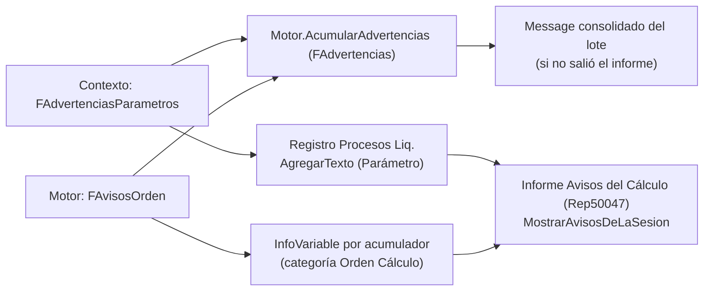

# Avisos y advertencias del cálculo

> [!note] Diagnóstico corregido en 1.0.0.660 (15/10/2026)
> El control dinámico sigue cada lector, aísla las trazas entre conceptos y cuenta sólo aportes efectivos: importe y porcentaje no nulos, fracción vigente y convenio aplicable. Distingue auxiliares informativos sin consumidores, lecturas de presentación y lecturas por etapas. Sigue consumidores por concepto, `#`, fracciones y devengos. El aviso señala una precedencia para revisar; por sí solo no demuestra una diferencia económica ni autoriza a mover órdenes. Ver [[Orden de cálculo y precedencia]].

El motor evita, en lo posible, fallar **en silencio**. Lo que no corta el cálculo pero merece mirarse sale
como **advertencia o control informativo**: no frena la liquidación, aparece al final (mensaje consolidado e informe) y queda
en el **registro del proceso**. Esta nota lista cada aviso, quién lo genera y qué significa.

## Separación del informe desde el 20/10/2026

El informe y el resumen distinguen **Advertencias y errores** de **Control de bases y orden**.
Las precedencias dinámicas se registran mediante `InfoVariable`, con categoría `Orden Cálculo`,
y siguen visibles aunque sean las únicas observaciones de la corrida. Se conservan lector,
acumulador, aportes posteriores y detalle; no se ocultan por importe cero o condición falsa.
El diagnóstico no demuestra por sí solo que el importe deba cambiar.

Si el lector también aporta a la base, el texto lo explica y aclara que eso **no confirma que el
subtotal sea intencional**. La revisión debe contrastar la lógica y el contexto antes de cambiar órdenes.
Una precedencia puede ser una etapa correcta, una lectura irrelevante para ese resultado o un conflicto real.

Los registros históricos no se reescriben: el informe presenta las antiguas advertencias de orden
como **Observación** dentro de su sección. Los errores conservan su severidad. Los avisos antiguos
de cantidad tampoco se borran; el reconocimiento de indicadores se aplica al emitir nuevos avisos.
Estos cambios no modifican fórmulas, órdenes ni resultados guardados.

## Dónde van

- `Motor.AcumularAdvertencias(LiqNo, texto)` junta los avisos de todas las liquidaciones de un lote con el formato `LIQ-No:` + texto; `GetAdvertencias` los entrega y `LimpiarAdvertencias` los reinicia.
- Cada aviso del contexto va **una vez** (se deduplica por texto). `AgregarTexto` separa el bloque por `\` y registra cada aviso de categoría `Parámetro` por separado. Los de **orden de cálculo** conservan el acumulador y el concepto lector en sus propios campos (`InfoVariable`), para filtrar las observaciones de orden del período.
- El de orden se registra desde `LiquidarRecord` y no desde `ConstruirAvisosOrden`: `RunConceptos` corre dos veces con auditoría cuando hay grossing-up y anotar en cada pasada duplicaría.

## Catálogo de avisos

| Aviso | Generado por | Cuándo | Qué significa / qué hacer |
|---|---|---|---|
| **Parámetro sin ningún valor** `X: no tiene ningún valor cargado en Parámetros Vigentes` | `CheckVigenciaDesactualizada` | parámetro con `Antigüedad Máxima Vigencia` y **ninguna** versión vigente en toda la base para ese código | falta una **carga**. No avisa si hay filas pero ninguna aplica a este empleado (alcance por convenio/empleado) |
| **Parámetro desactualizado** `X: el último valor vigente es del … (N día(s))` | idem | última `Vigencia Desde` anterior a `CalcDate(Antigüedad Máxima Vigencia, FechaRef)` | revisar si corresponde una versión más reciente (Ganancias, mínimos). La fórmula de fecha debe **retroceder** o se rechaza al cargarla ([[antiguedad-maxima-vigencia-avisa-de-mas]]) |
| **Cód. Cálculo desconocido** `La variable X tiene el Cód. Cálculo "Y", que el motor no conoce: vale CERO…` | `AvisarCodigoDesconocido` | fila activa de variable de sistema cuyo código no está en el `case` | corregir el código en *Variables de Sistema*. Antes era el único lugar mudo del motor. Ver [[variables-rotas-valen-cero]] |
| **Fuente sin filtros** `La Fuente de Datos X no tiene ningún filtro cargado: está agregando la tabla entera…` | `AvisarSiFuenteSinFiltros` | fuente activa sin filas en `Filtro Fuente Datos Liq.` | casi siempre se perdieron los filtros (varias fuentes empiezan a devolver el mismo número) |
| **Control de orden** `…lee X en el orden N, pero X todavía recibe M aporte(s) más tarde…` | `RegistrarLecturasAcumuladores` / `VerificarOrdenAporte` | una lectura relevante precede a aportes efectivos del acumulador | observación informativa; revisar si requiere el total o una lectura por etapas; no cuantifica una pérdida. Ver [[Orden de cálculo y precedencia]] |
| **Cantidad sin línea** `Se cargó una cantidad de N en el concepto X pero el concepto no generó línea… NO se pagó` | `WriteIncidenciasRestantes` | incidencia con importe 0 y cantidad ≠ 0 cuyo concepto no corrió, salvo indicador informativo acreditado por fuente | se conserva ante casos pagables o ambiguos; ver las guardas de [[Incidencias en el motor]] |
| `Liquidación calculada (tipo, período)` (info, con total de haberes) | `LiquidarRecord` | fin | traza |

Los avisos de contexto **se silencian** durante la recarga por cambio de par (`FSilenciarAvisosParam` en `UsarParCCT`) para no repetirlos por cada concepto marcado.

**Texto completo desde 1.0.0.660:** los códigos desconocidos se separan como los demás avisos. Si un mensaje supera los 250 caracteres de la columna breve, `Registro Procesos Liq.Agregar` conserva el texto completo en `Detalle`, hasta su capacidad existente de 2048 caracteres. El informe agrupa también por ese detalle y lo muestra. El cartel sigue siendo un resumen; para mucho volumen, usar el informe y el registro.

**Depuración aplicada el 15/10/2026:** se inactivaron `DIAS_COBERTURA_30`, `DIAS_HAB_ANIO`, `HAB_EXTORD_ANUAL`, `HAB_GRAV_ANUAL` y `RETENIDO_ANUAL`. Se comprobó que no tenían referencias exactas en ninguna vigencia de conceptos ni en la configuración de consumo auditada. Se conservaron las filas para trazabilidad; no se agregaron resolutores ni se cambiaron fórmulas o liquidaciones. Los avisos históricos se conservan tal como se registraron.

## Controles que no esperan al cálculo

| Control | Qué detecta |
|---|---|
| Página *Control Orden Acumuladores* (Cod50067) | aportes con `Orden Cálculo` mayor que el primer lector, sin liquidar ([[Orden de cálculo y precedencia]]) |
| `Nombres Variables Liq.`.`Duplicados` / `Catálogo Variables Liq.`.`NombresEnConflicto` | nombres de variable que resuelven a dos cosas (parámetro, variable de sistema, fuente, atributo, y código de concepto) ([[Nombres de variables y conflictos]]) |
| Página *Claves de Parámetro a Revisar* (Pag110016) | claves derivadas mal armadas (repararlas es una decisión de negocio; sólo se recalcula `Nivel`) |
| Página *Versiones inactivas a revisar* (Pag110006) | versiones de concepto con `Activo = false` que **ahora calculan** |
| `ValidarFormulas` (fase 1) | fórmulas con error estructural antes de tocar datos |
| Control de fuentes/fin efectivo | `Test Fin Efectivo Liq.` (prueba) asegura que mapa y recorrido den lo mismo |
| Pruebas en `test/Codeunits` | evaluador (Cod50021), formateador (110034), fin efectivo (110045), correcciones de rendimiento (110046), caché (110047), escritura de auditoría (110048), detalle de cálculo (110056) |

## Relacionado

[[Ciclo de cálculo de una liquidación]] · [[Transaccionalidad y errores del cálculo]] · [[Contexto de liquidación y variables]] · [[Procesos por lotes y progreso]]
