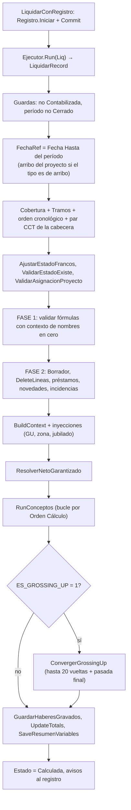

# Ciclo de cálculo de una liquidación

Lo que hace `Motor Liquidación` (Cod50014) cuando se calcula **una** liquidación. Punto de entrada real:
`LiquidarRecord(var Liq)`; `LiquidarConRegistro` lo envuelve con el registro de procesos y la transacción
(ver [[Transaccionalidad y errores del cálculo]]).

## Paso a paso

### 0. Antes de la fase 1

1. **Guardas de estado.** `Contabilizada` corta ("No se puede recalcular una liquidación contabilizada"); período `Cerrado` también.
   *No* corta por `Aprobada`: el motor la pasa a Borrador al arrancar la fase 2. El bloqueo de "ya está aprobada" lo hacen los procesos que lo invocan (el lote sólo toma `Borrador`).
2. **Fecha de referencia (`FechaRef`).** Es `Período."Fecha Hasta"`; si el tipo de liquidación es de arribo (`TipoLiqRec.EsArribo`) y el proyecto tiene `Ending Date`, es la fecha de arribo. `Liq."Fecha Liquidación"` se alinea con ella. Toda búsqueda con vigencia (parámetros, conceptos, TC, estados, YTD) usa esa fecha.
3. **Cobertura.** `Liq.CalcularCobertura()` y `Cobertura Tramos Liq.`.`Recalcular(Liq)` dejan la ventana de días que cubre la liquidación (envolvente + tramos). Va *antes* del contexto porque éste la lee. Ver [[ventana-liquidacion-es-cobertura]] y [[cobertura-en-tramos]].
4. **Orden cronológico.** `ValidarOrdenCronologico`: si el empleado ya tiene **líneas no-Borrador de un período posterior**, el cálculo se rechaza (el motor mira hacia atrás sin techo: francos, YTD, Ganancias). La salida es [[Recálculo en cadena]]. La definición de "posterior" vive en `Recálculo En Cadena Liq.`.`FiltrarPosteriores`.
5. **Par convenio/categoría de la cabecera.** `Convenio Categoría Liq.`.`ParDeEntidad` lo resincroniza en *cada* cálculo desde los atributos del empleado a `FechaRef`; si no hay atributos, se respeta lo que la liquidación ya traía. Ver [[Par convenio-categoría por concepto]].
6. **Estados.** `AjustarEstadoFrancos` (si los francos se agotan en el período, materializa el pase a Órdenes), `ValidarEstadoExiste` y `ValidarAsignacionProyecto` (si hay proyecto, el empleado tiene que estar en `Personal Proyecto`).

### 1. Fase 1 — validación sin resolver valores

- `CtxBuilder.Init(..., LiqNo = '', ...)` y `BuildContextParaValidacion`: **mismos nombres que el contexto real, todos en cero**, sin consultas de valores. Ver [[Contexto de liquidación y variables]].
- Se inyectan `ES_GROSSING_UP`, `NETO_GARANTIZADO`, `COMPLEMENTO_GU`, `COD_ZONA`, `ES_JUBILADO`, `CANT_INCIDENCIA`.
- El evaluador pasa a **modo validación** (`SetModoValidacion(true)`) y `ValidarFormulas` evalúa la **fórmula** de cada concepto que correría (versión en uso, aplica al CCT y al tipo de liquidación, no acumulador, fórmula no vacía). Un error estructural (variable desconocida, función inexistente, sintaxis, tabla escalonada inexistente) corta con la lista completa de conceptos con error (`ErrFormulasInvalidas`). Nota: sólo valida **fórmulas**, no condiciones.
- Lo que depende del valor (dividir por una variable en cero, un tramo inexistente, `ROUND` con precisión cero) **no** es error en esta fase y salta recién en la fase 2.

### 2. Fase 2 — preparación

Con `LiqNo` real:

1. `Liq.Estado := Borrador; Modify` y `DeleteLineas(LiqNo, false)` (líneas, detalle de variables, resumen, detalle de Ganancias).
2. `GestionPrestamos.LimpiarParaRecalculo` y `GestionNovedades.LimpiarParaRecalculo`.
3. `GestionPrestamos.AplicarCuotasEnLiquidacion` (genera incidencias de cuota, sólo en Borrador).
4. `GestionNovedades.AplicarEnLiquidacion` (materializa las novedades pre-liquidación **después** de los préstamos, para que una cuota cuente como carga manual y la novedad no se duplique). Ver [[novedades-pre-liquidacion]].
5. `CargarIncidencias`: las incidencias de la liquidación pasan a un buffer temporal del motor. Ver [[Incidencias en el motor]].
6. `BuildContext(Ctx)` y las inyecciones; `Evaluador.Init(Ctx, FechaRef)` y `SetCodigosAtributos`.
7. `ResolverNetoGarantizado`: evalúa la fórmula del concepto apuntado por `Config. RRHH."Cód. Concepto Neto Garantizado"`; si da > 0 pone `NETO_GARANTIZADO` y `ES_GROSSING_UP = 1`. Ver [[Grossing-up y tipo de cambio]].

### 3. `RunConceptos` — el bucle

Recorre `Concepto Liquidación` por la clave `(Orden Cálculo, Código)` con `FiltrarVigentesA(FechaRef)` (`Vigencia Desde <= FechaRef`). Por cada fila candidata:

| Orden de decisión | Qué se mira |
|---|---|
| 1 | ¿Hay incidencia para este concepto? (decide si el concepto se recorre aunque no aplique) |
| 2 | La fila es **la versión en uso** (`FLatestVersionMap`) — o, con incidencia, la última versión aunque esté discontinuada (`FUltimaVersionMap`) |
| 3 | No es acumulador (los acumuladores no se evalúan) |
| 4 | `Aplica A` del concepto vs `Tipo Empleado` del convenio de la cabecera (`TipoEmpleadoDe`) |
| 5 | Par alterno de ese concepto (`AplicarParDeConcepto`) |
| 6 | Si **no** hay incidencia: `CCTAplicaAConcepto` y `ConceptoAplicaATipoLiq` y `CondicionOk` |
| 7 | `TryEvalFormula`; si falla, **`Error`** que aborta toda la liquidación |

Ver [[Aplicabilidad de un concepto a una liquidación]] para el detalle de 4 a 6.

Si el concepto genera línea, según su tipo de rol:

- **Normal**: `PrepararLineaConcepto` arma la `Línea Liquidación` (copia `Tipo Concepto`, `Grupo Costo Laboral`, `Imprime en Recibo`, `Es Devengo`, par CCT efectivo, `Fórmula Aplicada`, `Fórmula Evaluada`, `Vigencia Concepto`, sello de distribución, `Cantidad`/`Base Cálculo`), la inserta, deja el importe en `Ctx[Código]` (para `#CÓDIGO`) y **aporta a los acumuladores** (`UpdateAccumulatorsFromCache`, según `Fracción Acumulador`).
- **`Rol Franco = Devengo`**: `Cantidad := resultado` (días), `Importe := 0`.
- **`Rol Franco = Consumo`**: la fórmula devuelve **días**; `GenerarLineasConsumoFranco` pide el consumo FIFO y escribe una línea por lote/categoría; si pide más días que el saldo, `Error`. Ver [[francos-fifo-ledger]].

Después del bucle:

- `WriteIncidenciasRestantes`: incidencias cuyo concepto no generó línea (importe ≠ 0 → línea "fuera de orden"; sólo cantidad → advertencia al registro, **no se paga**).
- `WriteAccumulatorLines`: una línea `Informativo` por acumulador vigente, `Imprime en Recibo = false`, con su valor final.
- `ConstruirAvisosOrden` y `CtxBuilder.MarkEnUso(log)` (marca `En Uso` las versiones de parámetro realmente leídas; sólo fuera de las vueltas de grossing-up).

### 4. Grossing-up

Si `Ctx['ES_GROSSING_UP'] = 1`, `ConvergerGrossingUp` itera. Detalle en [[Grossing-up y tipo de cambio]].

### 5. Cierre

1. `GuardarHaberesGravados`: vuelca a `Liq."Haberes Ordinarios Gravados"` el acumulador de `Config. RRHH."Cód. Acum. Haberes Gravados"`.
2. `UpdateTotals`: ver [[Tipos de concepto y su efecto en el recibo]].
3. `SaveResumenVariables`: persiste cada variable del contexto con valor ≠ 0 (o con texto) en `Resumen Variable Liq.`, **excepto** los códigos de concepto no acumulador.
4. `Estado := Calculada`, `Modify(true)`.
5. Avisos: parámetros desactualizados/ sin filtros/ códigos desconocidos y orden de cálculo van al mensaje consolidado y al registro. Ver [[Avisos y advertencias del cálculo]].

## Qué *no* hace el motor

- No aprueba ni contabiliza: eso es `Gestión Liquidación` (ver [[Estados y transiciones de una liquidación]]).
- No crea liquidaciones: eso es el lote (ver [[Procesos por lotes y progreso]]).

## Relacionado

[[Visión general de la arquitectura]] · [[Orden de cálculo y precedencia]] · [[Acumuladores y fracciones]] · [[Rendimiento y caché del cálculo]]
