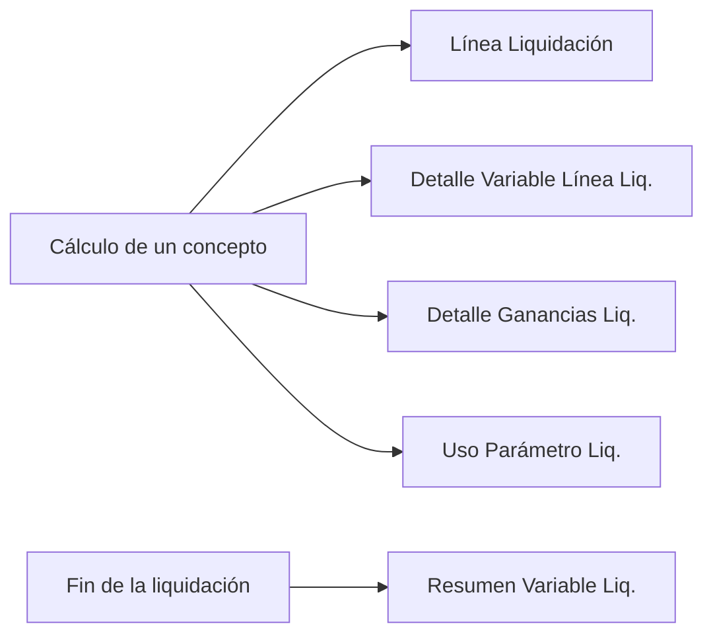

# Detalle del cálculo y trazabilidad

El objetivo: **poder explicar el número que está en el recibo**, no el que saldría si se recalculara hoy
(que puede ser distinto porque cambió una fórmula, un parámetro o una vigencia). Para eso el motor guarda,
al calcular, todo lo necesario para **reproducir** cada línea sin volver a leer la configuración.

## Qué se guarda al calcular

| Dato | Tabla / campo | Contenido |
|---|---|---|
| Fórmula tal como corrió | `Línea Liquidación."Fórmula Aplicada"` | texto del concepto **en ese momento** |
| Fórmula con los valores | `"Fórmula Evaluada"` | `BuildFormulaEvaluada`: cada identificador reemplazado por su valor (hasta 500 caracteres, enteros sin decimales; variables `PCT_*`/`*_PCT*`/`*PORC*` como porcentaje: `<= 1` se toma como fracción y se multiplica por 100); `@X` con el valor que ya calculó el evaluador; `#X` con `Ctx[X]`; el código de un atributo de lista cuando está a la derecha de `=`/`<>` |
| Versión del concepto | `"Vigencia Concepto"` | clave para encontrar la fórmula histórica |
| Distribución en acumuladores | `"Vigencias Distribución"` | sello `ACUM:AAAAMMDD\|…` de las fracciones aplicadas |
| Par con el que se calculó | `"Cód. Convenio"` / `"Cód. Categoría"` | el **efectivo** del concepto (no el de la cabecera) |
| Fuentes de datos y parámetros usados | `"Fuente Parámetros"` | log del contexto (`FDS:`, `DED_FAM:`) + log del concepto (`VAR:`, `TRAMO:`) |
| Valor de cada variable | `Detalle Variable Línea Liq.` (60023) | una fila por variable **usada** por la línea: `Nombre Variable`, `Valor`, `Detalle`, `Código Atributo` |
| Consulta de escala | idem, fila `TRAMO(CÓDIGO)` | valor devuelto, descripción del tramo y **snapshot**: `Tabla Tramo`, `Base Tramo`, `Límite Tramo`, `Fijo Tramo`, `Porcentaje Tramo`, `Vigencia Tramo`, `Snapshot Tramo` |
| Todas las variables con valor | `Resumen Variable Liq.` (60024) | por liquidación: `Valor`, `Valor Texto`, `Etiqueta`, `Mostrar en Recibo`; excluye códigos de concepto no acumulador |
| Pasos de Ganancias | `Detalle Ganancias Liq.` (60025) | `Paso` (de `Etiqueta Det. Ganancias` en conceptos y variables), `Familiar`, `Gasto` |
| Qué versión de parámetro leyó | `Uso Parámetro Liq.` | índice para liberar `En Uso` al reabrir ([[Parámetros y vigencias]]) |

Reglas:

- Las **vueltas intermedias del grossing-up no escriben nada de esto**; la **pasada final** lo reconstruye ([[Grossing-up y tipo de cambio]]).
- Cada concepto vacía su log (`FlushConceptLog`) al cerrar; si no, las variables de uno se le pegan al siguiente. Los conceptos de **consumo de francos** también cierran su log (antes salían con el drill-down vacío y sin acumular a las bases).
- `WriteVariableDetail` arma las filas en un **buffer temporal** (la clave tiene `Nombre Variable`, así que una colisión conserva la **primera**) y recién después las inserta; escribe una fila con **0** para una variable sin valor (un cero visible dice "el concepto referenciado no aplicó"; una fila ausente no dice nada).
- Una consulta `TRAMO` repetida con la misma tabla y bases distintas en una línea se desambigua con sufijo ` #2`, ` #3`…; la **idéntica** se saltea.
- `SaveResumenVariables` busca la etiqueta en `Fuente Datos` → `Variable Sistema` → `Tipo Atributo` (por **Nombre Variable**, no por código) → `Parámetro` → acumulador; sólo estas tres primeras tienen `Mostrar en Recibo`. No recorta un nombre de 23 caracteres para buscarlo como código de concepto de 20 (encontraría **otro** concepto).

## Cómo se explica una línea: `Detalle Cálculo Línea` (Cod110044)

`Construir(LinLiq, Pasos)` **re-evalúa la fórmula guardada** con los **valores guardados**:

1. `Formula := LinLiq."Fórmula Aplicada"`; sin fórmula: nota "nada que explicar".
2. `CargarContexto`: arma un contexto sólo con las filas de `Detalle Variable Línea Liq.` de esa línea, **conservando los prefijos** (`@2403` y `#2403` pueden tener valores distintos).
3. `Evaluador.UsarDatosGuardados()` (modo **histórico**): no resuelve nada contra la base ni reemplaza faltantes por cero; una variable no conservada → error *"No se conservó el valor de X…"*. `SembrarReferencias` siembra `TRAMO` desde los snapshots (`SembrarTramoGuardado`) y los códigos de atributo.
4. `ActivarTraza(true)` y `TryEvalFormula`. La **traza** registra cada término de las **sumas y restas** (nivel de anidamiento, orden, signo, valor, acumulado, texto del término, "es base de escala"). Se traza en `ParseAddSub` y no en `ParseMulDiv` porque una cadena de `+`/`-` es donde el signo de cada término significa algo y tiene sentido un total corriente; el orden y el signo salen **de la fórmula**, no de una configuración aparte, por lo que **no puede desincronizarse**.
5. `VolcarTraza` ordena **en el orden en que se calculó** (el bloque anidado antes del término que lo consume), agrega una fila **«Subtotal del bloque»** cada vez que baja el nivel, y lleva `Nivel` en base 0 para `IndentationColumn`/`ShowAsTree`. Los decimales se leen con `Evaluate(..., 9)` (formato invariante).
6. `AgregarTotal` compara el resultado reconstruido contra `LinLiq.Importe` con **tolerancia de un centavo**: *"Coincide con el importe de la línea"* o *"NO COINCIDE… Revisar ajustes, incidencias y redondeo"*. **El control es parte del producto**: si no coincide, la página lo dice en vez de mostrar una explicación que no corresponde al número pagado.

`DescribirTermino` traduce el término a castellano (concepto → variable de sistema → parámetro) cuando es un nombre suelto; `BuscarDetalle` pega el texto del tramo aplicado (normalizando espacios/comillas/paréntesis de las dos puntas). `Resumir` recorta términos de más de 60 caracteres a `FUNCIÓN(primer arg …)`.

### Qué no se puede explicar

- Una línea **sin fórmula** (incidencia manual, línea de acumulador, consumo de francos, incidencia fuera de orden).
- Fórmulas con `IF`/`CASE`: las ramas **no tomadas** no dejaron variables en el detalle; el modo histórico se saltea la rama muerta como el evaluador normal, así que funciona mientras la rama elegida sea la misma.
- Una comparación de atributo por código sin código conservado (error).
- Importe de la línea ≠ resultado de la fórmula (redondeos por `Variable Base`/incidencias): la fila total lo marca.

> [!note] `SeedConceptoRef` no se usa
> El evaluador expone `SeedConceptoRef(código, valor)` para precargar `@`/`#`, pensado para el detalle
> de cálculo, pero **nadie lo llama** (4/10/2026). Hoy funciona porque `CargarContexto` conserva los
> valores con prefijo en el diccionario. Es código muerto.

## Pantalla (`Presentación Cálculo Liq.` → Pag110046)

`Abrir(Línea)` despacha: concepto con `Rol Franco = Consumo` → *Lotes de Franco Consumidos*; el resto → *Detalle del cálculo* (`Detalle Cálculo Línea`, Pag110046, `PageType Card`, no editable). Para **Ganancias** (`EsGanancias`: fórmula normalizada contiene `TRAMO('TAB_IMP_4CAT',`, o el detalle trae `TRAMO(TAB_IMP_4CAT)`, o hay `Paso` en `Detalle Ganancias Liq.`, o el concepto tiene `Etiqueta Det. Ganancias`) se muestran **tres bloques**: *1. Formación de la base imponible* (pasos con `Es Base Escala`), *2. Aplicación de la escala* (snapshot del tramo: base, límite inferior, excedente, porcentaje, impuesto sobre el excedente, importe fijo) y *3. Retención de esta liquidación*; más la acción *Desglose de deducciones* (filas `Familiar`/`Gasto`). Para el resto: *Datos utilizados* (`CargarDatos`) y *Desarrollo y resultado* (los pasos). En históricos incompletos (sin comprobación) sólo se muestran los insumos "sin inventar una secuencia".

## Relacionado

[[Evaluador de fórmulas - sintaxis]] · [[Tablas escalonadas]] · [[Ciclo de cálculo de una liquidación]] · [[Rendimiento y caché del cálculo]] · [[Tabla - Línea Liquidación]]

**Tablas relacionadas:** [[Tabla - Detalle Variable Línea Liq]] · [[Tabla - Resumen Variable Liq]] · [[Tabla - Detalle Ganancias Liq]] · [[Tabla - Uso Parámetro Liq]]
