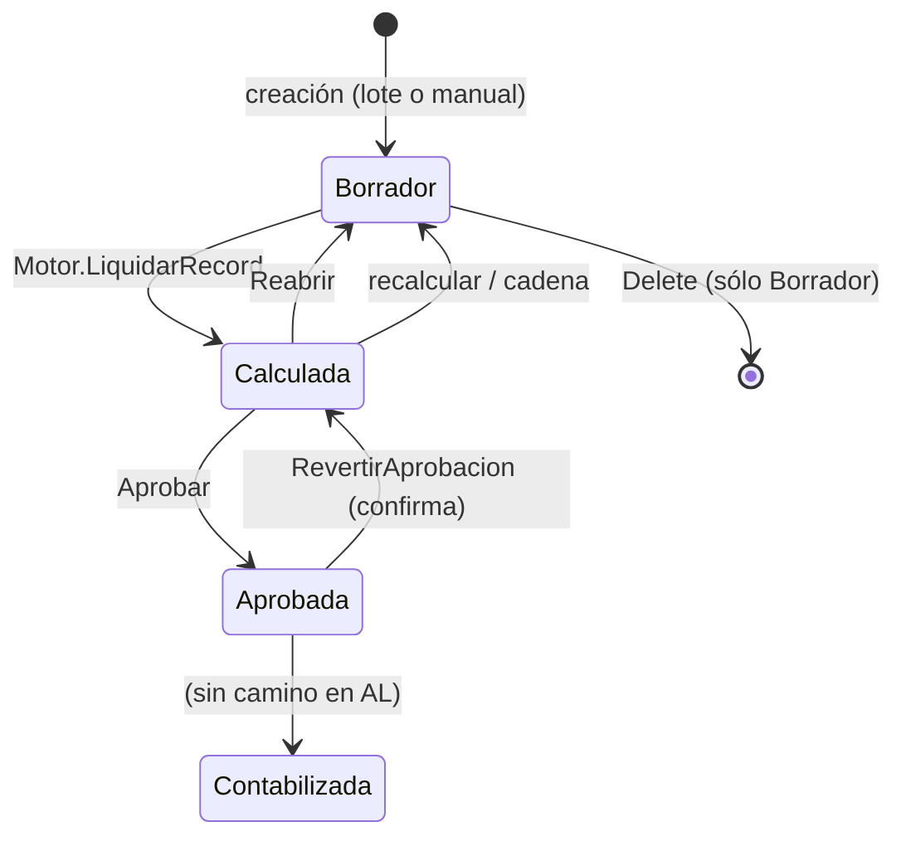

# Estados y transiciones de una liquidación

`Gestión Liquidación` (Cod50019) es el **punto único de verdad** de las transiciones de estado: las
páginas (lista, ficha, árbol) y los lotes llaman a estos procedimientos para que validación, confirmación
y efectos colaterales sean los mismos.

Enum `Estado Liq.` (50304): `Borrador` (0), `Calculada` (1), `Aprobada` (2), `Contabilizada` (3).

## Qué hace cada transición

| Transición | Procedimiento | Efectos |
|---|---|---|
| Borrador → Calculada | `Motor Liquidación.LiquidarRecord` | arma líneas, totales, resumen; ver [[Ciclo de cálculo de una liquidación]] |
| Calculada → Aprobada | `Aprobar` | sólo desde `Calculada` (si no, error); estado de la cabecera **y de todas sus líneas** = Aprobada; `Gestión Préstamos.MarcarCuotasAplicadas`; registro `Aprobación` |
| Aprobada → Calculada | `RevertirAprobacion` | sólo desde `Aprobada`, **con confirmación**; líneas a `Calculada`; `RevertirCuotasLiquidacion`. **No** libera novedades: la liquidación sigue Calculada y sus incidencias siguen siendo válidas |
| Calculada → Borrador | `Reabrir` | sólo desde `Calculada`; **rechazada si el empleado tiene posteriores** (`ValidarSinPosteriores`); líneas a Borrador; revierte cuotas de préstamo; `GestNov.RevertirLiquidacion` (devuelve las novedades materializadas a disponibles); **libera `En Uso`** de parámetros; registro `Reapertura` |
| cualquier → Borrador | el propio `LiquidarRecord` | arranca fase 2 con `Estado := Borrador` para que `AplicarCuotasEnLiquidacion` (que sólo actúa en Borrador) no saltee las cuotas en un recálculo que no pasó por Reabrir |
| Borrador → (borrada) | `Liquidación.OnDelete` | sólo en Borrador; borra detalle de variables, líneas (sin disparar su `OnDelete`), tramos de cobertura, registro de uso de parámetros; devuelve novedades (`GestNov`) |
| → Contabilizada | **ninguna** | no hay asignación de `Estado::Contabilizada` en el AL del repo (4/10/2026); sólo se la **lee**: el motor la rechaza, los controles de uso de parámetros la cuentan como "activa" |

> [!note] Contabilizada es un estado sin camino de entrada visible
> Está contemplado en las guardas (`LiquidarRecord`, `Parámetro Vigente`, `Liquidación.OnDelete`,
> páginas y recibo), pero ningún proceso del repo la asigna: se pone por fuera (datos/SQL) o
> es trabajo pendiente. Sin verificar contra la base.

## Reabrir, en detalle

1. Valida `Estado = Calculada` y que no haya posteriores (salvo `PermitirFueraDeOrden`, sólo para el [[Recálculo en cadena]]).
2. Cabecera y líneas a `Borrador`; revierte cuotas; revierte novedades.
3. Cierra el registro del proceso (`Registro.Finalizar`) **antes** de la liberación de parámetros, que tiene varios `exit` tempranos.
4. **Libera `En Uso`** de las versiones de parámetro, sólo de las que **ninguna otra liquidación activa** (Calculada/Aprobada/Contabilizada) sigue usando:
   - *camino rápido*: `Uso Parámetro Liq.` (si esta liquidación tiene registro). Por cada versión usada, un `IsEmpty` sobre `(Cód. Parámetro, Vigencia Desde, No. Liquidación)` excluyendo la propia y mirando el estado de la otra (estado leído **una vez** por liquidación);
   - *camino viejo* (liquidaciones calculadas antes de que existiera la tabla): lee los tokens `VAR:` de `Fuente Parámetros` de **todas** las líneas ajenas; se arma **una sola vez** el índice `liquidación → variables usadas` (`CargarUsosDeOtrasLiquidaciones`) para no releerlas por variable. Necesita reconstruir la fecha de referencia como el motor (fecha de arribo en tipos de arribo) y la clave efectiva (`Claves Parámetro Liq.`.`ResolverEnTabla`).

## Operaciones masivas (`Lotes Liquidación Liq.`)

A diferencia de `Gestión Liquidación`, que corta con `Error` si el estado no es el esperado, los lotes **omiten** las que no corresponden y las informan al final (en un lote conviven estados; abortar por la primera dejaría el resto sin procesar):

| Operación | Alcance real |
|---|---|
| Calcular | sólo `Borrador` (las demás se omiten) |
| Reabrir | `Calculada` **sin posteriores** (las bloqueadas se cuentan) |
| Aprobar | sólo `Calculada` |
| Eliminar | sólo `Borrador`, con confirmación |

Ver [[Procesos por lotes y progreso]].

## Por qué una línea replica el estado de la cabecera

`Línea Liquidación.Estado` se sincroniza al aprobar, reabrir y revertir. Así los consumidores (versiones de concepto "en uso", acumuladores históricos, ledger de francos, comparador) filtran por línea sin hacer *join* con la cabecera. Los acumuladores históricos **excluyen Borrador**; el **ledger de francos lee líneas sin mirar el estado** (de ahí la regla de que "posterior" incluya Borrador al rehacer: ver [[Recálculo en cadena]]).

## Relacionado

[[Ciclo de cálculo de una liquidación]] · [[Parámetros y vigencias]] · [[Versionado de conceptos y fórmulas]] · [[Tabla - Liquidación]] · [[Tabla - Línea Liquidación]]

**Tablas relacionadas:** [[Tabla - Período Liquidación]]
