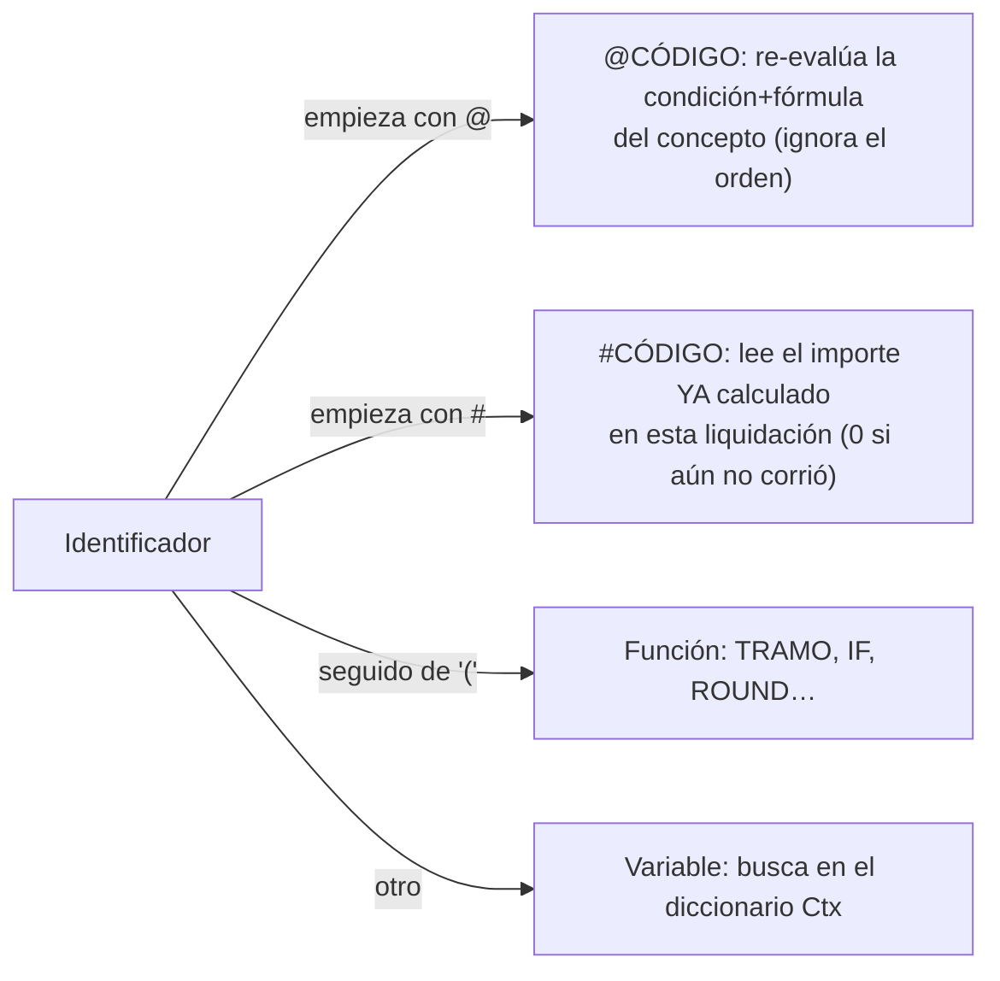

# Evaluador de fórmulas - sintaxis

`Evaluador Fórmula` (Cod50015) es un **parser de descenso recursivo** que evalúa mientras parsea (no
construye un árbol). Una *fórmula* y una *condición* usan **la misma gramática**; la diferencia es el
resultado: `EvalFormula` devuelve el decimal, `EvalCondicion` devuelve `resultado <> 0`. Catálogo de
funciones: [[Evaluador de fórmulas - funciones]].

## Gramática real (precedencia de menor a mayor)

```
Formula  = OrExpr
OrExpr   = AndExpr  ( OR  AndExpr )*
AndExpr  = NotExpr  ( AND NotExpr )*
NotExpr  = NOT NotExpr | Compare
Compare  = AddSub ( ('=' | '<>' | '<' | '>' | '<=' | '>=') AddSub )?     ← UNA sola comparación
AddSub   = MulDiv ( ('+' | '-') MulDiv )*
MulDiv   = Unary  ( ('*' | '/') Unary )*
Unary    = '-' Unary | '+' Unary | Primary
Primary  = Numero | '(' OrExpr ')' | Ident [ '(' args ')' ]
```

Consecuencias que conviene saber:

- **Los booleanos son decimales**: verdadero = `1`, falso = `0`; toda condición es verdadera si el resultado es `<> 0`. Por eso `AND`, `OR`, `NOT` y las comparaciones **funcionan en cualquier fórmula**, no sólo en `Condición` (la `GUIA-LIQUIDACION.md` dice lo contrario: ver [[Divergencias entre documentación vieja y código]]).
- **`NOT` es más flojo que la comparación**: `NOT DIAS_MAREA = 0` es `NOT (DIAS_MAREA = 0)`.
- **`AND` pesa más que `OR`**: `a OR b AND c` es `a OR (b AND c)`.
- **No hay comparaciones encadenadas**: `a < b < c` corta con *"Se esperaba token EOF…"*. Hay que escribir `a < b AND b < c`.
- **`AND`/`OR` evalúan siempre los dos lados** (AL no cortocircuita, ver [[al-sin-cortocircuito]]; además el parser tiene que consumir los dos). Un error en el lado derecho (división por cero, variable inexistente) se dispara aunque el izquierdo ya decida. Sólo `IF`, `IFZERO` y `CASE` son perezosos.
- **Menos unario**: `-x`, `- -x` y `2 - -3` son válidos. El `+` unario existe y no hace nada.

## Léxico

| Elemento | Regla (según `NextTok`) |
|---|---|
| Espacios | espacio, tab, LF y CR se ignoran (las fórmulas se guardan formateadas en varias líneas) |
| Mayúsculas | **toda la fórmula se pasa a mayúsculas antes de parsear**, incluidos los literales entre comillas |
| Número | dígitos y **punto**. La **coma es siempre separador de argumentos**: `IF(c,0,x)` son tres argumentos |
| Identificador | arranca con letra (incluye `Ñ`, `Á`, `É`, `Í`, `Ó`, `Ú`, `Ü`), `_`, `@` o `#`; sigue con letras, dígitos y `_` |
| Cadena | entre comillas simples; `''` adentro es una comilla. No cerrarla: *"Falta cerrar la comilla simple del código."* |
| Operadores | `+ - * / = <> < > <= >=` y las palabras `AND`, `OR`, `NOT` |
| Otro carácter | token `None` → *"Token inesperado"* |

> [!warning] Decimal con punto, no con coma
> `0.0001` es un número; `0,0001` son **dos** argumentos. La `GUIA-LIQUIDACION.md` escribe `0,11` y
> `ROUND(x, 0,01)`: está desactualizada (el cambio fue deliberado para que `IF(cond,0,otra)` no se lea
> mal). El editor marca el problema. No hay separador de miles: `1.000` es `1,0`.

> [!warning] Límites del literal numérico (deducido del código, sin probar)
> `ParseDecimalLiteral` lee la parte entera y la fraccionaria con `Evaluate` a `Integer`: una parte
> entera mayor a 2.147.483.647 o más de ~9 dígitos decimales falla con *"Número inválido en la
> fórmula"*. Para importes grandes, usar parámetros o variables, no literales.

## Nombres: tres clases de identificador



### Variable

Se busca en `FContext` (el diccionario del [[Contexto de liquidación y variables]]). Si no está:

- modo normal → *"Variable desconocida en la fórmula: X. Ningún Parámetro, Variable de Sistema, Fuente de Datos ni Tipo de Atributo la define con ese Nombre Variable."*
- modo tolerante (`SetLenientMode`) → `0`.

Cada variable resuelta se anota **una vez por concepto** en el log (`VAR:NOMBRE`), que después alimenta `Fuente Parámetros`, `Detalle Variable Línea Liq.` y la marca `En Uso` de los parámetros.

Como la fórmula se pone en mayúsculas, **un `Nombre Variable` configurado con minúsculas no se encuentra nunca** (el editor lo marca en rojo).

### `@CÓDIGO` — referencia por reevaluación

`ResolveConceptoRef`: busca el concepto con `Vigencia Desde <= FFechaRef` (la última), evalúa su **Condición** (si da falso, el resultado es 0) y luego su **Fórmula**, en el contexto *actual*. Por eso **no depende del `Orden Cálculo`**.

- Es **reentrante**: guarda y restaura el estado del tokenizador (`FExpr`, `FPos`, `FTokKind`…) alrededor de la evaluación anidada.
- **Memoiza** el resultado por concepto en `FLastConceptoRefValues` durante una evaluación de nivel superior (`TryEvalFormula`/`TryEvalCondicion` la limpian al arrancar). Antes, referencias anidadas explotaban combinatoriamente.
- Corta **referencias circulares** con una pila (`FResolvingConceptos`): *"Referencia circular en la fórmula: @X depende, directa o indirectamente, de sí mismo."*
- Concepto inexistente → error *"…no existe ningún concepto "X" vigente"*.
- **Ignora el "Convenio/Categoría a usar" del concepto referenciado**: re-evalúa con el par de quien llama. Ver [[arroba-ignora-el-par-del-concepto]] y [[Par convenio-categoría por concepto]].

### `#CÓDIGO` — importe ya calculado

`ResolveConceptoCalculado`: verifica que el concepto exista (vigente a la fecha) y devuelve `Ctx[código]`, que el motor deja ahí cuando el concepto genera línea (`RunConceptos`) — **incluida la incidencia que lo haya sobrescrito**. Si el concepto todavía no corrió, o su condición dio falso, vale **0 sin error**. Por eso **depende del `Orden Cálculo`**: ver [[Orden de cálculo y precedencia]] y [[control-precedencia-formulas]].

Un `#` sobre un acumulador devuelve su subtotal *hasta ese punto*; sobre un concepto con novedad devuelve el importe de la novedad.

## Comparación de un atributo contra un código

Si a la derecha de `=` o `<>` hay una **cadena entre comillas**, el evaluador descarta el valor numérico de la izquierda y compara el **código** del atributo de lista:

```
IF(SINDICATO = 'PAT', 1, 0)
```

Reglas (`CompararCodigoAtributo`, `ValidarCodigoAtributo`):

- Sólo `=` y `<>`; otro operador → *"Los códigos de atributo solo admiten = y <>."*
- El texto de la izquierda **tiene que ser exactamente el nombre** del atributo (se recorta del original entre el inicio de la comparación y el operador). Una expresión a la izquierda no sirve.
- El atributo debe ser de tipo `Lista` con ese `Nombre Variable`, y el código debe existir entre sus valores; si no, error al validar (no en silencio). El resultado bueno se cachea por liquidación (`FCodigosValidos`).
- Se compara contra `FCodigosAtributos`, que llena `LoadAtributos`. Si un parámetro o fuente le pisó el nombre al atributo, **no hay código cargado**: error *"No se cargó el código vigente de X…"* (o `0` en tolerante). Ver [[parametro-y-atributo-mismo-nombre]] y [[atributo-comparar-por-codigo]].
- En modo histórico (detalle de cálculo) exige que el código se haya conservado.
- Una cadena fuera de ese contexto (por ejemplo `'X' + 1`) → *"Un código entre comillas solo puede usarse como argumento de texto o a la derecha de una comparación de atributo."* El único otro uso legítimo es el primer argumento de `TRAMO`.

## Modos del evaluador

| Modo | Cómo se activa | Qué cambia |
|---|---|---|
| Normal | por defecto | todo error corta |
| **Validación** | `SetModoValidacion(true)` | tolera lo que depende del VALOR (división por cero, tramo inexistente, `ROUND` precisión 0, condición de atributo) y **parsea** la rama no elegida de `IF`/`CASE`/`IFZERO` en vez de saltearla, para detectar variables inexistentes escondidas |
| **Tolerante** | `SetLenientMode(true)` | variable/función/concepto/tabla desconocidos valen `0`; división por cero da `0`. Lo usan la validación de sintaxis de la ficha y `Variable Cantidad`/`Variable Base` |
| **Histórico** | `UsarDatosGuardados()` | sólo lee valores del contexto guardado; nada de base. Lo usa el [[Detalle del cálculo y trazabilidad]] |
| **Traza** | `ActivarTraza(true)` | anota cada término de las sumas/restas (ver detalle) |

Puntos de entrada: `Init`, `UpdateContext` (cambia sólo los números; conserva códigos de atributos, log y variables resueltas), `EvalFormula`/`EvalCondicion`, y las versiones `[TryFunction]` `TryEvalFormula`/`TryEvalCondicion`, que además **vacían la memo de `@`** al arrancar.

## Dónde se valida el texto al cargarlo

- `Concepto Liquidación.Fórmula` y `.Condición` (OnValidate): primero `Formateador Fórmula Liq.`.`Formatear` (forma canónica, ver [[Formateador de fórmulas]]), después **pasada 1** (sintaxis, tolerante) y **pasada 2** (existencia de variables con todas en 1, modo validación). La pasada 2 sólo da un `Message` ("variables que no existen"), no un error; la pasada 1 sí es error.
- `Variable Cantidad` / `Variable Base`: sólo sintaxis.
- El editor con IntelliSense evalúa contra el catálogo en cada pausa de escritura. Ver [[Editor de fórmulas]].

> [!note] El comentario de cabecera del evaluador está desactualizado
> Dice "Built-in functions: TRAMO(code, value)". Hoy hay 12 funciones; ver [[Evaluador de fórmulas - funciones]].

## Relacionado

[[Visión general de la arquitectura]] · [[Contexto de liquidación y variables]] · [[Tablas escalonadas]] · [[Rendimiento y caché del cálculo]]
