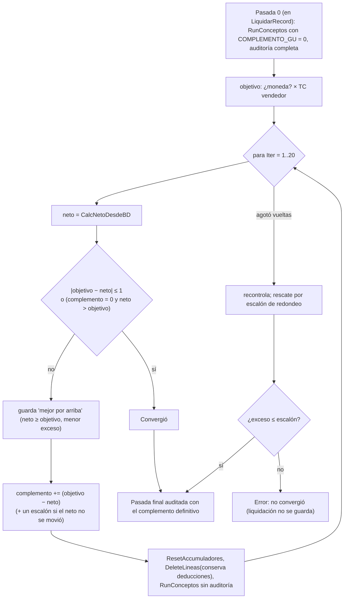

# Grossing-up y tipo de cambio

El **grossing-up (GU)** garantiza un **neto**: el motor itera hasta que el neto de la liquidación iguala a
un objetivo, ajustando un *complemento* que se vuelve a calcular con todo el recibo (impuesto y aportes
incluidos). Lo usan, por ejemplo, empleados de tierra con sueldo neto pactado en divisa.

> [!warning] En una liquidación con GU el neto siempre sale bien
> El neto es una **restricción**; cualquier error de impuesto o aportes se manifiesta como un **bruto**
> que no coincide, no como un neto distinto. Comparar contra Meta4 el bruto y la base imponible, nunca
> el neto. Ver [[grossing-up-tapa-errores]].

## Piezas configurables y variables reservadas

| Pieza | Dónde | Detalle |
|---|---|---|
| **Concepto que define el objetivo** | `Config. RRHH."Cód. Concepto Neto Garantizado"` | su **fórmula** devuelve el neto en moneda del parámetro. Debe ser **`Informativo`** (emite línea auditable sin mover el neto que el bucle persigue). Vacío = el GU no se aplica **en ninguna** liquidación. Hoy el concepto se llama `NETO_GARANT` (según el diseño de 4/10/2026) |
| **Acumulador de haberes gravados** | `Config. RRHH."Cód. Acum. Haberes Gravados"` | `GuardarHaberesGravados` copia su valor a `Liq."Haberes Ordinarios Gravados"`. Antes `BASE_IG4` estaba escrito en AL |
| **Acumulador excluido del neto** | `Config. RRHH."Cód. Acum. Excl. Neto GU"` | `CalcNetoDesdeBD` lo **devuelve al neto** al converger: `TotalHaberes - TotalDesc + Excluido`. Es para los descuentos que son **plata ya entregada**, que si no el complemento compensa y el anticipo se regala. Hoy `EXCL_NETO_GU`, alimentado por las `Fracción Acumulador` de **8810, 8830, 8840, 8850 y 8870** ([[anticipos-por-encima-del-neto-gu]]) |
| `ES_GROSSING_UP` | inyectada | `0`; pasa a `1` cuando el objetivo es > 0 |
| `NETO_GARANTIZADO` | inyectada | el objetivo (en moneda del parámetro; se convierte a pesos al converger) |
| `COMPLEMENTO_GU` | inyectada | el ajuste que mueve el bucle; las fórmulas de **los conceptos que pagan el complemento** lo nombran |

Qué conceptos pagan el complemento no es de código: **cualquier concepto cuya fórmula nombre
`COMPLEMENTO_GU`** (el diseño del 4/10 cita 1003, 2003, 3553 y 4743). Las tres variables se siembran en
cero **siempre** (`InjectGUVariables`) aunque no haya GU, para que el concepto de complemento y su
condición (`ES_GROSSING_UP > 0`) resuelvan igual y el evaluador no dé "variable desconocida".

`ResolverNetoGarantizado`: evalúa la fórmula del concepto configurado a `FechaRef`. Reglas:

- si la fórmula nombra `COMPLEMENTO_GU` → **error** (*"el objetivo se movería en cada iteración y el bucle no convergería"*);
- si el concepto no existe/no está vigente/no tiene fórmula → no hay GU;
- si el resultado es `<= 0` → no hay GU.

Era un parámetro `NETO_GU` más el proporcional de vacaciones (`DIAS_VAC_INICIO`, divisor 150, Art. 155 LCT) escritos en AL; ahora la regla vive en una fórmula con vigencias, historial y editor.

## El bucle: `ConvergerGrossingUp`



Detalles verificados:

- **Neto del bucle** (`CalcNetoDesdeBD`): `Σ(Haber Remunerativo + Haber No Remunerativo) − Σ(Retención + Descuento Empleado + Seguridad Social)` de las líneas ya escritas, **excluyendo** `Es Devengo`. Las `Informativo` no cuentan (por eso el concepto objetivo es informativo).
- **Tolerancia**: 1 peso absoluto, **o** complemento en 0 con neto ya por encima (el garantizado es un **piso**: un neto mayor sin complemento se acepta).
- **Máximo** `MaxIteracionesGrossingUp()` = **20**.
- **Estancamiento**: si falta menos de un escalón de redondeo, sumar el déficit no mueve el neto (el redondeo se come el ajuste); a partir de la 2.ª vuelta, si `Delta > 0` y el neto no cambió, se empuja **un escalón entero** (`ToleranciaExceso` = `PRECISION_REDONDEO` del contexto si es > 0,01; si no 0,01).
- **Rescate**: si ningún complemento produce el neto exacto (con `PRECISION_REDONDEO = 1` el neto avanza a saltos), se usa el iterado que dejó el neto **inmediatamente por encima** del objetivo, sólo si el exceso entra en un escalón. Nunca por debajo, ni por un centavo.
- **No converge** → `Error` (*"El grossing-up de X no convergió en 20 iteraciones… No se guardó la liquidación"*): se recontrola antes de acusar y **antes** de la pasada final.
- **Auditoría sólo al final**: las vueltas intermedias corren con `FIteracionGU = true`, que saltea `Fórmula Evaluada`, `Detalle Variable`, `Detalle Ganancias`, `Fuente Parámetros`, `En Uso`, los controles de orden y el sello. La pasada final reconstruye las líneas **idénticas** con auditoría completa (sólo si hubo al menos una vuelta). Ver [[Rendimiento y caché del cálculo]].
- `DeleteLineas(LiqNo, ConservarDeducciones = true)` conserva las filas `Familiar` y `Gasto` de `Detalle Ganancias Liq.`, que `CalcDeduccionesGanancias` escribe **una sola vez** (al armar el contexto); sin eso, el GU dejaba sin desglose de deducciones justo a las liquidaciones que más lo necesitan.
- `ResetAccumuladores` pone en 0 los códigos de **todos** los conceptos (acumuladores y `#CÓDIGO`) entre vueltas.
- Cada vuelta actualiza la ventana de progreso (`Progreso.Paso`): sin eso un lote con GU parece colgado.

## Tipo de cambio

### Conversión del objetivo

`MonedaGU := CtxBuilder.GetMoneda()` (la moneda del **primer parámetro en divisa** que recorrió `LoadParametros`, en orden de código de `Parámetro`). Si hay moneda **y `Convertir Param. por TC` está apagada**: `NetoObjetivo := Round(NetoObjetivo × TipoCambioVendedor(moneda, FechaRef), 0.01)`. Sin cotización (TC = 0) → `Error` (*"calcular con cero pagaría un neto de cero"*).

`TipoCambioVendedor`: última fila de `Currency Exchange Rate` con `Starting Date <= Fecha` de esa moneda; `Relational Adjmt Exch Rate Amt / Adjustment Exch. Rate Amount` (el **divisor** es parte de la cotización: "USD 100 = 145.000"). **Las dos cotizaciones conviven en la misma fila**: comprador en `Relational Exch. Rate Amount` y vendedor en `Relational Adjmt Exch Rate Amt` (campo de ajuste de BC reutilizado). No se usa `ExchangeAmtFCYToLCY` porque resuelve contra el comprador.

> [!warning] La moneda del GU sale "por casualidad"
> Si dos parámetros en divisas distintas conviven en una liquidación, `FMoneda` es la del primero que se
> recorra. Hoy los 156 parámetros con moneda son USD o EUR y nadie las mezcla (dato del diseño de
> 4/10/2026; no re-verificado contra datos).

### Convención de qué TC usa cada concepto

No es una regla del motor: la **fórmula** decide con el patrón `_ESFCY` (ver [[Parámetros y vigencias]]):

```
IF(PRECIO_PUERTO_LAN_ESFCY, PRECIO_PUERTO_LAN * TC_COMPRADOR, PRECIO_PUERTO_LAN)
```

`TC_COMPRADOR` y `TC_VENDEDOR` son **Fuentes de Datos** sobre `Currency Exchange Rate`. Convención: **producción y precios de a bordo al comprador, sueldos en divisa al vendedor** ([[que-tc-usa-cada-concepto]]). Trampas:

- el TC de la producción de una marea es un **valor acordado por marea**, no una cotización ([[tc-de-marea-no-es-cotizacion]]);
- un parámetro homónimo de la fuente la pisa tras `UsarParCCT` ([[tc-comprador-parametro-fantasma]]);
- un precio en dólares cargado como pesos no da error, da un importe congelado.

## El TC por parámetro: implementado hasta el paso 3c (`GROSSING_UP_Y_TC_CONFIGURABLES.md`)

Al 4/10/2026 está **implementado y encendido** en ArbuTest. La llave de paso sigue siendo
`Config. RRHH."Convertir Param. por TC"` (`TabExt52001`, campo 52017), que nace en falso: apagarla
vuelve al comportamiento viejo sin publicar.

Hecho:

- Campo **`Cód. Variable TC`** en la **fila** de `Parámetro Vigente` (`Tab60008`, id 14), al lado de `Moneda`, con las 157 filas cargadas: 149 al comprador, 8 al vendedor (`BASICO` ×4 y `NETO_GU` ×4).
- La conversión corre en una **segunda pasada** (`ConvertirParametrosEnDivisa`, `Cod50016`) posterior a `LoadDynamicSources`, porque `TC_COMPRADOR` y `TC_VENDEDOR` son Fuentes de Datos y todavía no existen cuando se cargan los parámetros. **No se puede mover `LoadDynamicSources` antes de `LoadParametros`**: invertiría la precedencia de `LoadAtributos`.
- Y corre **dos veces**: también dentro de `UsarParCCT`, que recarga los parámetros crudos cuando un concepto pide otro par convenio/categoría y así deshacía la conversión a mitad del cálculo — ver [[usarparcct-deshace-pasadas-posteriores]]. `FParamTC` se limpia por pasada, porque `BASICO` y los dos `PRECIO_PUERTO_*` están en divisa en un par y en pesos en el otro.
- Con la bandera encendida, `ConvergerGrossingUp` **deja de convertir** el objetivo: `NETO_GU` ya llega en pesos y multiplicar otra vez daría el TC al cuadrado. El camino viejo sigue ahí porque la bandera es una llave de paso.

- Los tres casos que no pueden convertir **cortan el cálculo** (antes avisaban y dejaban el importe en divisa), y la pantalla **`Moneda de Parámetro a Revisar`** (`Pag110059`, desde el Árbol de Parámetros) los encuentra antes de liquidar, junto con el caso inverso: una fila sin moneda dentro de un parámetro cuyas demás filas sí la declaran.

- Las 16 fórmulas migradas en el mismo movimiento que el encendido: las 12 sin bandera perdieron su `* TC_x`, y en el 1003, 1083, 3553 y 4743 el `IF(..._ESFCY, ...)` se fue entero porque las dos ramas quedaban iguales. **Ya no queda ninguna fórmula que nombre un TC ni que use `_ESFCY`.**

Enero recalculado y comparado contra `dbo.SnapEnero_Paso3` da idéntico salvo cuatro cosas, todas previstas: `BASE_PROD_CAL` y el 2704 (informativos, sin consumidores), el 1093 (en cero) y `NETO_GARANT`, que ahora muestra pesos. Más la corrección buscada en el 04724: su objetivo pasó del vendedor al comprador —50 pesos de diferencia sobre 8.637,10 USD— y el tapón del 2003 bajó 788.220,87, amplificado 1,825× por la tasa marginal. Converge a 1,36 pesos en dos liquidaciones. La foto posterior es `dbo.SnapEnero_Paso4`.

**La trampa que casi lo rompió**: el control "fila con `Moneda` y sin TC" no alcanza — ver [[control-moneda-es-asimetrico]]. Ocho filas de `USD_MAREA` y la de `VALOR_PLUS_PROD` no tenían `Moneda` y las fórmulas las convertían igual; encender habría borrado 226 M de enero. Corregidas el 4/10/2026. Las únicas mixtas legítimas son `BASICO`, `PRECIO_PUERTO_CAL` y `PRECIO_PUERTO_LAN`: ahí el mismo parámetro convive en dólares para unos empleados y en pesos para otros, y ya no hace falta `_ESFCY` para distinguirlos porque la conversión pasó a ser por fila.

Los cinco valores del grossing-up salieron del código a `Config. RRHH` (`TabExt52001`, campos 52018-52022): los tres nombres de variable, el máximo de iteraciones y la tolerancia. **En blanco significa el valor de siempre** y un cero en los numéricos cuenta como blanco, así que la pestaña se puede dejar vacía para siempre; el fallback vive en `CargarConfigGU`, sin Upgrade. En el motor quedan exactamente tres literales, los defaults de ese procedimiento, y ninguno en el resto del proyecto. **La tolerancia es de un peso**, no de centavos: bajarla deja liquidaciones sin converger por los redondeos de los conceptos intermedios.

Lo que **no** se configura es el algoritmo: el bucle no es una fórmula sino una búsqueda de punto fijo sobre la liquidación entera, y el evaluador no tiene bucles. Si alguna vez hace falta otro, es una interfaz en AL con dos implementaciones.

Abierto: si el mismo valor resuelto puede necesitar dos TC distintos según el concepto que lo lea; el diseño fija un TC por fila y no lo podría expresar.

## Qué reserva el 70%: los tres devengamientos, medidos

El 70% con el que se liquidan los oficiales poteros no es un descuento: es la reserva que el
usuario armó a mano para que el SAC, las vacaciones y los francos que la marea devenga no se
paguen dos veces. Hasta el 6/10/2026 sólo uno de los tres estaba en la liquidación —el SAC
devengado, concepto `4750`, orden 924—, así que la reserva no se podía contrastar con nada.
Ahora están los tres, los dos nuevos como **Tipo 6 (Informativo)**: no suman a ningún total ni
entran en la convergencia, que es justamente lo que se quiere medir.

| Concepto | Orden | Fórmula |
|---|---|---|
| `4750` SAC devengado | 924 | `round((BASE_IG4 + BASE_EXT_IG4) / 12, 0.0001)` |
| `VAC_DEVENG` Vacaciones devengadas | 941 | `ROUND((BASE_IG4 + BASE_EXT_IG4) * COEF_VAC_DEVENG * VACACIONES_ANUALES / 360, PRECISION_REDONDEO)` |
| `FRANCO_DEVENG` Francos devengados valorizados | 942 | `ROUND(ROUND(COEF_FRANCOS * DIAS_ENROLAMIENTO + 1, PRECISION_REDONDEO) * VALOR_FRANCO, PRECISION_REDONDEO)` |

`VAC_DEVENG` reproduce el método de la casa, no uno inventado: en `prov vac 06-2026.xlsx` la
columna de vacaciones es `J/H*30/25*K`, con `J` la base, `H` los días del semestre (180), `K` los
días proporcionales (`I/12*6`) e `I` los días teóricos anuales. Como `H` = 30 × meses y `K` =
`I`/12 × meses, **los meses se cancelan** y queda `base × 1,2 × I / 360`: el año va en **360**, doce
meses de treinta días. Las otras dos columnas de esa planilla —contribuciones y crédito fiscal— son
costo patronal y no entran acá. `VACACIONES_ANUALES` reproduce su columna `I` (escala del art. 150
LCT) en todos los legajos contrastados.

Los tres leen `BASE_IG4`, que cierra en el orden 924, así que 941 y 942 van después por
necesidad. Tres decisiones de forma que no son cosméticas:

- **`COEF_VAC_DEVENG` = 1,2 es parámetro, no literal**: es 30/25, porque el día de vacaciones se
  paga dividiendo por 25 y vale un 20% más que un día común. En 1 queda medido con divisor 30,
  que es el que usa el descuento del `4743`.
- **Los días de la liquidación se cancelan solos** en `VAC_DEVENG`: la base ya es la remuneración
  de esos días, así que no hace falta `DIAS_MAREA` y no hay división por cero.
- **`FRANCO_DEVENG` tiene `Rol Franco` = 0 a propósito.** Con rol Devengo crearía un segundo lote
  en el ledger FIFO y el empleado cobraría los francos dos veces. El `1062` sigue siendo el único
  que devenga; este sólo los valúa. **Repite su fórmula** porque el evaluador sólo puede leer el
  *importe* de otro concepto (`#`, `@`) y el importe del `1062` es cero por diseño: el lote vale
  cuando se consume ([[francos-fifo-ledger]]). Si se toca la fórmula del `1062`, hay que tocar
  esta en el mismo movimiento.

### La medición

En enero 2026 **el único cierre de marea que converge por grossing-up es el del 04724**
(`LIQ-00045459`, HF802 marea 6, 22 días, TC comprador 1405):

| | |
|---|---|
| Neto pagado (70% del paquete) | 9.195.725,00 |
| Reserva implícita (el 30% restante) | **3.941.025,00** |
| SAC devengado (`4750`) | 1.222.081,08 |
| Francos devengados (12,44 días × 127.350) | 1.584.234,00 |
| Vacaciones devengadas (14 días de derecho) | 684.365,39 |
| **Total devengado** | **3.490.680,47** |
| Reserva − devengado | 450.344,53 |

**Dónde vive el 70%**: no se calcula en ninguna fórmula. Está **pre-multiplicado a mano** en el
parámetro `NETO_GU_MAREA_04724` = **8.925 USD**, que es 12.750 × 0,70. El paquete completo vive
aparte en `USD_MAREA_04724` = 12.750, que es lo que lee la comparación de producción del `1534`.
Por eso BC reproduce a Meta4 al peso: el 70% entra por el dato, no por el motor, igual que en Meta4.

### La cuenta que vale

Comparar la reserva contra los devengamientos en bruto da 450.344 de sobra y hace parecer que el 70%
está bien. **No lo está**, porque los 12.750 USD son **netos por todo concepto** (confirmado por el
usuario el 6/10/2026). Si el SAC, las vacaciones y los francos que se cobren después son *parte* de
esos 12.750 y no un extra, hay que netearlos antes de compararlos:

| | |
|---|---|
| Devengamientos ya neteados (tasa efectiva 39,0%) | 2.129.337 |
| Neto que el empleado termina recibiendo | 11.325.062 |
| Lo prometido | 13.136.750 |
| **Diferencia** | **−1.811.688** |

O sea: **el 70% deja al oficial corto** de lo pactado. El coeficiente que cierra sale de la forma
cerrada de más abajo —**82,0%**, no 83,8%: esta cuenta mide los devengamientos sobre el bruto chico
del 70% y por eso se queda corta—. El lugar donde se cambia es `NETO_GU_MAREA_<legajo>`, no una
fórmula.

**A qué precio se valúan los francos: al de convenio, y está verificado.** Se llegó a suponer que a
estos oficiales la empresa les pagaba el franco por encima, por analogía con
[[a-cuenta-futuros-aumentos-francos]]. **Es falso para ellos.** El `2083` lee `VALOR_FRANCO_ACDO`,
cargado **sólo** para `175/75 OF02` y `OF04`, y en enero disparó únicamente para esas dos
categorías (32 líneas). La columna `PR_FRANCO` de Meta4 lo cierra: para el 04724 en enero vale
exactamente **127.350**, el mismo número que el parámetro de BC.

### El 70% no es una reserva: es caja, y la final lo salda

> [!warning] Todo lo que sigue en esta subsección quedó **invalidado** el 6/10/2026 por
> `DET LIQ 2026 OFICIALES POTEROS ACUERDO NETO.xlsx`. Se conserva porque la medición de los
> devengamientos sigue siendo válida; la conclusión sobre el coeficiente, no.

Esa planilla tiene una hoja por oficial con dos bloques. Arriba, lo **devengado por acuerdo**:
`USD_MES × días / 30` por tramo —el cierre de la marea 6 son `12.750 × 22/30` = 9.350 USD—, con un
total de campaña de **48.391,67 USD** en 115 días. Abajo, las **liquidaciones** con su neto en USD:
total **48.391,67 USD**. Los dos totales son idénticos.

El acuerdo se cumple sobre **la campaña entera**. Cada liquidación paga el **70% de lo devengado del
tramo** —6.545 contra 9.350 en el cierre, y el ratio da 0,70 clavado mes a mes aunque un mes se
parta en dos liquidaciones— y **la liquidación final paga el resto**: 14.268,82 USD, con impuesto
**negativo** (−1.993.655,74) porque devuelve Ganancias retenida de más.

O sea: el 70% es una **retención de caja**, no una reserva por devengamientos, y no hay coeficiente
que calibrar. Lo que le falta a BC no es un número mejor sino **la liquidación final que salda el
acuerdo**: objetivo = `total devengado en USD − total ya pagado en USD`, acumulado sobre la campaña.

El neto en USD cuenta el **anticipo como pagado**: en el cierre es `(8.945.725 + 250.000)/1405` =
6.545, consistente con `EXCL_NETO_GU`.

Esa consistencia valía para **un solo** anticipo. Al acumulador aportaba nada más que el 8840, así
que el anticipo de poder, el de haberes y el de vacaciones los absorbía el complemento y nunca se
descontaban. La familia completa —8810, 8830, 8840, 8850, 8870— se dedujo del propio `R_ANTICIPOS`
de Meta4 el 8/10/2026, y con ella el cierre del 04921 pasó de 14.904.649,42 a **11.904.650**, que
es su `LIQUIDO` al peso. El detalle, con la prueba concepto por concepto y por qué el 8860 queda
afuera, en [[anticipos-por-encima-del-neto-gu]].

### El coeficiente tiene forma cerrada (superado)

Si los 12.750 son netos por todo concepto, el 70% no hay que adivinarlo. Con `N` el neto del cierre,
`B` su bruto, `r = N/B`, `P` la promesa prorrateada, `F` los francos devengados y
`k = 1/12 + 1,2 × días_vacaciones / 360`, el empleado termina recibiendo `N + (B·k + F)·r`.
Igualando a `P` y despejando —`B` se cancela porque `F/B · B = F`—:

```
N = (P − F·r) / (1 + k)
```

El tipo de cambio y la tasa de impuesto **se cancelan salvo en el término de francos**, que es el
único que no escala con el bruto. Para el 04724: `k` = 13,00%, `r` = 61,0%, `F` = 1.584.234 →
`N` = **10.770.228**, o sea un coeficiente de **82,0%** y un `NETO_GU_MAREA` de **10.453,15 USD**
contra los 8.925 de hoy. (El 83,8% que daba la cuenta anterior sobreestimaba: medía los
devengamientos sobre el bruto chico del 70% en vez de sobre el que resultaría.)

`k` sale entero de parámetros y `F` del propio `1062`, así que **BC tiene los tres insumos**: el
coeficiente es derivable, no un dato a mantener a mano. Lo que no se puede es meterlo dentro del
bucle de convergencia —el objetivo no puede moverse entre iteraciones, y el motor corta con error
si lo hace—, así que o se calcula en una pasada previa o se deja como parámetro pero **derivado por
un control** en vez de a ojo.

## Divergencias con documentos viejos

- `REVISION_RENDIMIENTO_2026-09-18.md` dice que el bloque "termina sin un error explícito" si no converge: **hoy sí hay error** (`ErrGUNoConverge`) y rescate por escalón.
- Las lecciones ([[que-tc-usa-cada-concepto]], [[oficiales-netos-al-70]]) hablan de `NETO_GU` como parámetro: hoy el objetivo sale de la fórmula del concepto configurado.
- El comentario "Siempre el vendedor… 16 lugares" quedó obsoleto en las dos mitades: el TC lo decide ahora la fila del parámetro y el motor no convierte, y los tres nombres salieron a `Config. RRHH` —quedan tres literales, los defaults de `CargarConfigGU`—.

## Relacionado

[[Ciclo de cálculo de una liquidación]] · [[Acumuladores y fracciones]] · [[Contexto de liquidación y variables]] · [[Tabla - Parámetro Vigente]]
