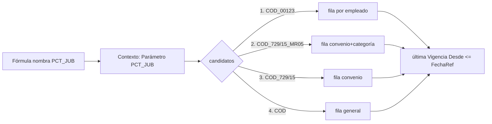

# Parámetros y vigencias

Un **parámetro** es un valor numérico configurable con historia, que las fórmulas leen por nombre
(`SMVM`, `TOPE_SIPA`, `PCT_JUB`, `BASICO`…). Son dos tablas:

| Tabla | ID | Rol |
|---|---|---|
| `Parámetro` | 60016 | La **cabecera**: `Código` (≤20), `Nombre Variable`, `Descripción`, `Antigüedad Máxima Vigencia`, `Edad Máxima Familiar` |
| `Parámetro Vigente` | 60008 | Cada **valor**: clave `(Cód. Parámetro Base, Cód. Parámetro, Vigencia Desde)`, `Valor`, `Moneda`, y los ejes de alcance `No. Empleado` / `Cód. Convenio` / `Cód. Categoría` |

Notas de la tabla en el modelo de datos: [[Tabla - Parámetro Vigente]].

## Nombre Variable y token `_ESFCY`

- El `Nombre Variable` de la cabecera es el token de fórmula. En blanco = el parámetro **no se carga** al contexto. Debe ser único en todo el espacio de nombres ([[Nombres de variables y conflictos]]) y **en mayúsculas** (la fórmula se pasa a mayúsculas; uno en minúsculas no se encuentra nunca).
- Cada parámetro expone además **`<NOMBRE>_ESFCY`** = `1` si el valor resuelto está cargado en moneda extranjera (la fila tiene `Moneda`), `0` si no. Permite `IF(BASICO_ESFCY, BASICO * TC_VENDEDOR, BASICO)`. Por eso un parámetro `X` **ocupa también `X_ESFCY`**: `ExigirLibre` rechaza que otro origen use ese nombre.
- Un parámetro **sin valor vigente resuelve a `0`, no a error**. La defensa en la fórmula es `IFZERO(...)`; ver [[Evaluador de fórmulas - funciones]].

## Clave derivada y cascada de alcance

La clave `Cód. Parámetro` de cada fila **se calcula siempre** (`Claves Parámetro Liq.`.`ArmarDeFila`, a partir de los campos completos) y no se tipea:

| Fila con… | Clave | `Nivel` |
|---|---|---|
| nada | `COD` | 0 |
| convenio | `COD_<convenio>` | 1 |
| convenio + categoría | `COD_<convenio>_<categoría>` | 2 |
| empleado | `COD_<empleado>` (el empleado limpia convenio y categoría) | 1 |

El motor resuelve **de la más específica a la menos** y gana la primera con valor cargado (`Candidatos`/`Resolver`):

```
COD_<empleado>  →  COD_<convenio>_<categoría>  →  COD_<convenio>  →  COD
```

- Se cargan sólo las **excepciones**: lo que no tiene excepción cae en la fila general.
- `Armar` falla si la clave supera 50 caracteres (*"recortarla dejaría dos parámetros distintos compartiendo la misma clave"*).
- `Resolver` trabaja contra el mapa ya cargado; `ResolverEnTabla` va a la base (lo usan Reabrir, el catálogo del editor, etc.).
- Las tres banderas viejas de `Parámetro` (`Sufijo CCT`, `Sufijo Empleado`, `Sufijo Convenio`) están **obsoletas**: la cascada ya no las mira. Ver [[system-variables-conventions]].
- `EffectiveKey` (Cod50016) normaliza filas cuyo código no empieza con el base: `base + '_' + código`.
- La unicidad: dos filas con la misma clave derivada y la misma vigencia se rechazan (`ValidarClaveLibre`) en alta, modificación y rename.



## Vigencia

`BuildParametroCache` hace **una pasada** por `Parámetro Vigente` con `Vigencia Desde <= FFechaRef`; queda, por clave efectiva, la última (la lista viene ordenada ascendente por `Cód. Parámetro, Vigencia Desde`). No hay `Vigencia Hasta`: un valor rige hasta que otro con fecha posterior lo reemplaza. Agregar una versión nueva = insertar fila con fecha posterior; **las liquidaciones viejas deben poder reproducirse**, por eso no se pisa el valor. (Es la contracara de [[Versionado de conceptos y fórmulas]], que sí tiene `Vigencia Hasta`.)

## `En Uso` y `Uso Parámetro Liq.`

Al terminar de calcular, el motor llama `MarkEnUso(log)`: por cada variable realmente leída (entradas `VAR:` del log) marca `Parámetro Vigente."En Uso" = true` y escribe una fila en **`Uso Parámetro Liq.`** (`No. Liquidación`, `Nombre Variable`, base, clave, vigencia). El registro se **rehace entero** en cada cálculo (`BorrarUsoParametros`).

- Una fila `En Uso` **no se puede modificar ni borrar** si hay liquidaciones bloqueantes (`Calculada`/`Aprobada`/`Contabilizada`; si la fila es por empleado, sólo las de ese empleado). Si no hay, el `OnModify`/`OnDelete` la libera solo.
- `Parámetro`.`OnDelete` rechaza borrar un parámetro con filas `En Uso` y borra el resto.
- **Reabrir** (`Gestión Liquidación`.`Reabrir`) libera las marcas: camino rápido por el registro (`LiberarEnUsoPorRegistro`, dos consultas indexadas por versión, sólo mira liquidaciones activas); para liquidaciones calculadas antes de que existiera la tabla, cae al camino viejo, que lee los tokens `VAR:` de `Fuente Parámetros` de todas las líneas ajenas.
- `Parámetro`.`OnRename` y `CopiarEn` reconstruyen la clave derivada con el prefijo nuevo.

## Avisos de vigencia

Con `Antigüedad Máxima Vigencia` (un `DateFormula` **negativo**, ej. `-1M`, `-35D`; uno que no retrocede se rechaza al cargarlo) el motor avisa si la última `Vigencia Desde` es anterior a `CalcDate(fórmula, FechaRef)`. Y avisa "no tiene ningún valor cargado" sólo cuando la **base** no tiene **ninguna** versión vigente (`FBasesConFilas`); que un parámetro por convenio/empleado no resuelva para alguien ajeno a su alcance **no** avisa. Ver [[Avisos y advertencias del cálculo]] y [[antiguedad-maxima-vigencia-avisa-de-mas]].

## Parámetros especiales

- `VALOR_FRANCO`, `COEF_FRANCOS`: bases reservadas de [[francos-fifo-ledger]]. El concepto franco puede declarar su parámetro de valor, atributo de precio y divisor (`Cód. Parámetro Valor`, `Cód. Tipo Atributo Precio`, `Divisor Valor`).
- Los parámetros de tipo de deducción de Ganancias (códigos como `HIJO`, `CONYUGE`) se leen **por código exacto** en `CalcDeduccionesGanancias` (fila con `Cód. Parámetro = Cód. Parámetro Base`).
- Dos parámetros con el mismo `Nombre Variable`: gana el último; ver [[dos-parametros-mismo-nombre]]. Parámetro vs atributo: [[parametro-y-atributo-mismo-nombre]].

## Cuidado al cambiar de par convenio/categoría

Los parámetros son lo único que `UsarParCCT` recarga. Ver [[Par convenio-categoría por concepto]].

## Relacionado

[[Contexto de liquidación y variables]] · [[Grossing-up y tipo de cambio]] · [[Tabla - Parámetro Vigente]] · [[configpackage-campos-faltantes]]

**Tablas relacionadas:** [[Tabla - Parámetro]] · [[Tabla - Uso Parámetro Liq]]
