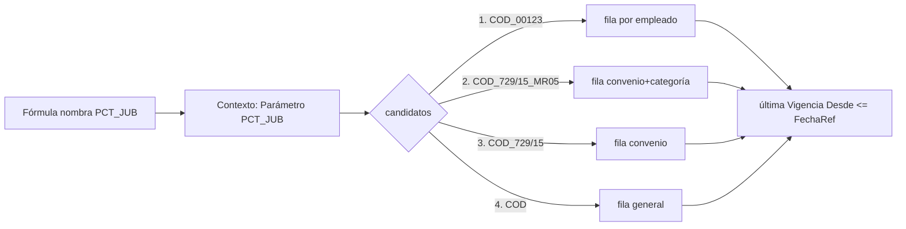

# Parámetros y vigencias

Un **parámetro** es un valor numérico configurable con historia, que las fórmulas leen por nombre
(`SMVM`, `TOPE_SIPA`, `PCT_JUB`, `BASICO`…). Son dos tablas:

| Tabla | ID | Rol |
|---|---|---|
| `Parámetro` | 60016 | La **cabecera**: `Código` (≤20), `Nombre Variable`, `Descripción`, `Antigüedad Máxima Vigencia`, `Edad Máxima Familiar` |
| `Parámetro Vigente` | 60008 | Cada **valor**: clave `(Cód. Parámetro Base, Cód. Parámetro, Vigencia Desde)`, `Valor`, `Moneda`, y los ejes de alcance `No. Empleado` / `Cód. Convenio` / `Cód. Categoría` |

Notas de la tabla en el modelo de datos: [[Tabla - Parámetro Vigente]].

## Nombre Variable y token `_ESFCY`

- El `Nombre Variable` de la cabecera es el token de fórmula. En blanco = el parámetro **no se carga** al contexto. Debe ser único en todo el espacio de nombres ([[Nombres de variables y conflictos]]) y **en mayúsculas** (la fórmula se pasa a mayúsculas; uno en minúsculas no se encuentra nunca).
- Cada parámetro expone además **`<NOMBRE>_ESFCY`** = `1` si el valor resuelto está cargado en moneda extranjera (la fila tiene `Moneda`), `0` si no. Permite `IF(BASICO_ESFCY, BASICO * TC_VENDEDOR, BASICO)`. Por eso un parámetro `X` **ocupa también `X_ESFCY`**: `ExigirLibre` rechaza que otro origen use ese nombre.
- Un parámetro **sin valor vigente resuelve a `0`, no a error**. La defensa en la fórmula es `IFZERO(...)`; ver [[Evaluador de fórmulas - funciones]].

## Clave derivada y cascada de alcance

La clave `Cód. Parámetro` de cada fila **se calcula siempre** (`Claves Parámetro Liq.`.`ArmarDeFila`, a partir de los campos completos) y no se tipea:

| Fila con… | Clave | `Nivel` |
|---|---|---|
| nada | `COD` | 0 |
| convenio | `COD_<convenio>` | 1 |
| convenio + categoría | `COD_<convenio>_<categoría>` | 2 |
| empleado | `COD_<empleado>` (el empleado limpia convenio y categoría) | 1 |

Las candidatas van **de la más específica a la menos** (`Candidatos`):

```
COD_<empleado>  →  COD_<convenio>_<categoría>  →  COD_<convenio>  →  COD
```

> [!important] Gana la de **vigencia más reciente**; la especificidad sólo desempata
> Desde el 13/10/2026. Entre las candidatas que tengan valor cargado, `Resolver` se queda con la de
> `Vigencia Desde` mayor, y sólo cuando dos empatan en fecha gana la más específica. Un parámetro se
> lee entonces como lo que es —un registro cronológico de decisiones—: **una fila genérica con
> vigencia de febrero significa «desde febrero esto vale para todos»**, aunque exista una fila por
> convenio de enero.
>
> **Antes ganaba siempre la más específica sin mirar la fecha.** Eso hacía imposible expresar un
> cambio que alcanza a todos sin repetirlo fila por fila: la vigencia nueva se cargaba, no pasaba
> nada, y no había error ni aviso. Ver [[generica-nueva-pisa-especifica-vieja]].
>
> **El precio:** una fila específica **vieja** pierde contra una genérica **nueva** aunque nadie haya
> querido pisarla. «Vieja» pasa a leerse como «superada». Al cambiar la regla, `PCT_ANTIG_372/04`
> —vigencia 2023, 0,01, correcta contra Meta4 en 11 de 11— perdía contra la genérica de 2026 (0,25).
> Se arregló **fechando la fila específica**, no volviendo atrás con la regla.

- Se cargan sólo las **excepciones**: lo que no tiene excepción cae en la fila general.
- `Armar` falla si la clave supera 50 caracteres (*"recortarla dejaría dos parámetros distintos compartiendo la misma clave"*).
- `Resolver` trabaja contra el mapa ya cargado; `ResolverEnTabla` va a la base (lo usan Reabrir, el catálogo del editor, etc.).
- Las tres banderas viejas de `Parámetro` (`Sufijo CCT`, `Sufijo Empleado`, `Sufijo Convenio`) están **obsoletas**: la cascada ya no las mira. Ver [[system-variables-conventions]].
- `EffectiveKey` (Cod50016) normaliza filas cuyo código no empieza con el base: `base + '_' + código`.
- La unicidad: dos filas con la misma clave derivada y la misma vigencia se rechazan (`ValidarClaveLibre`) en alta, modificación y rename.



## Vigencia

`BuildParametroCache` hace **una pasada** por `Parámetro Vigente` con `Vigencia Desde <= FFechaRef`; queda, por clave efectiva, la última (la lista viene ordenada ascendente por `Cód. Parámetro, Vigencia Desde`). No hay `Vigencia Hasta`: un valor rige hasta que otro con fecha posterior lo reemplaza. Agregar una versión nueva = insertar fila con fecha posterior; **las liquidaciones viejas deben poder reproducirse**, por eso no se pisa el valor. (Es la contracara de [[Versionado de conceptos y fórmulas]], que sí tiene `Vigencia Hasta`.)

## `En Uso` y `Uso Parámetro Liq.`

Al terminar de calcular, el motor llama `MarkEnUso(log)`: por cada variable realmente leída (entradas `VAR:` del log) marca `Parámetro Vigente."En Uso" = true` y escribe una fila en **`Uso Parámetro Liq.`** (`No. Liquidación`, `Nombre Variable`, base, clave, vigencia). El registro se **rehace entero** en cada cálculo (`BorrarUsoParametros`).

- Una fila `En Uso` **no se puede modificar ni borrar** si hay liquidaciones bloqueantes (`Calculada`/`Aprobada`/`Contabilizada`; si la fila es por empleado, sólo las de ese empleado). Si no hay, el `OnModify`/`OnDelete` la libera solo.
- `Parámetro`.`OnDelete` rechaza borrar un parámetro con filas `En Uso` y borra el resto.
- **Reabrir** (`Gestión Liquidación`.`Reabrir`) libera las marcas: camino rápido por el registro (`LiberarEnUsoPorRegistro`, dos consultas indexadas por versión, sólo mira liquidaciones activas); para liquidaciones calculadas antes de que existiera la tabla, cae al camino viejo, que lee los tokens `VAR:` de `Fuente Parámetros` de todas las líneas ajenas.
- `Parámetro`.`OnRename` y `CopiarEn` reconstruyen la clave derivada con el prefijo nuevo.

## Limpieza de marcas huérfanas al reliquidar (13/10/2026)

Al cerrar el cálculo, después de reconstruir `Uso Parámetro Liq.` y guardar el estado
`Calculada`, el motor llama `Gestión Liquidación.ReconciliarEnUso(NoEmpleado, NoLiquidacionActual)`. Revisa todas
las versiones marcadas del empleado y las generales, aunque no aparecieran en el registro
de la corrida anterior. Sólo libera una marca si no hay una liquidación activa que use esa
versión exacta. Los registros de liquidaciones borradas o en Borrador no la sostienen.

Las liquidaciones antiguas sin registro siguen protegidas por tokens `VAR:` exactos en
`Fuente Parámetros` (incluido `_ESFCY`). En ese caso se conserva la marca de manera
conservadora, sin reconstruir una versión con la configuración actual. Un resumen de
variables del recibo no prueba que una fórmula haya leído el parámetro.

El recorrido toma una copia temporal de las candidatas antes de desmarcarlas, para no
modificar el campo filtrado mientras recorre la tabla real. No agrega llamadas a `Commit`:
la reconciliación queda dentro de la transacción del cálculo.

La causa observada fue que reabrir sólo liberaba marcas vinculadas al registro anterior
o a sus tokens, y el cálculo sólo agregaba marcas nuevas. Una marca sin ese vínculo no
se encontraba en ninguno de los dos caminos. Se confirmó con cinco versiones de
`USD_PUERTO` sin usos registrados ni trazas tras la reliquidación.

Cobertura de regresión: `Test Uso Parametros` (110073), con datos sintéticos y rollback;
ejecutor selectivo: `Runner Tests Liq.EjecutarUsoParametros`.

### Reconciliación optimizada (13/10/2026)

`ReconciliarEnUso` conserva las candidatas generales y del empleado. Para cada una, la
consulta `110000 "Versiones Parámetro En Uso"` une `Uso Parámetro Liq.` con la cabecera
activa de `Liquidación` y filtra por la versión exacta: base, clave derivada y vigencia.
`TopNumberOfRows = 1` permite cortar en el primer consumidor activo. Sigue habiendo una
consulta por versión, pero ya no un `Get` de cabecera por cada registro de uso. No se
agrupan ni cuentan todos los consumidores.

Las candidatas sin consumidor activo registrado conservan la búsqueda histórica filtrada en SQL sobre
`Fuente Parámetros`. La comprobación sigue siendo por tokens exactos: nombre actual o
código base, incluidos sus sufijos `_ESFCY`. Una cabecera activa con cualquier registro
de uso se resuelve por sus versiones registradas; sus trazas no habilitan ese respaldo.

Sólo durante una llamada a `ReconciliarEnUso` se guardan en memoria las respuestas por
alias y empleado, y si una cabecera admite el respaldo histórico. No se reutilizan entre
recibos ni llamadas: el estado y los usos pueden cambiar durante la corrida.
`TieneUsoActivo` conserva la estructura anterior y sirve de oráculo de equivalencia,
pero comparte la corrección del filtro histórico descrita abajo.

La primera ejecución de las pruebas en BC detectó que `SetFilter('*%1*', Nombre)` dejaba
`%1` literal dentro de ese patrón y no encontraba las trazas esperadas. Ambos caminos
históricos construyen ahora el patrón con `StrSubstNo` antes de pasarlo a `SetFilter`;
después siguen comprobando el token exacto. Esto corrige la protección `En Uso` de
versiones consumidas por liquidaciones antiguas sin registro. No recalcula importes ni
reescribe las trazas: cambia la detección del consumidor que debe mantener la marca.

El cambio conserva el punto de llamada al cerrar el cálculo, los registros de uso y las
trazas; no agrega `Commit`. Nueve pruebas nuevas comparan las marcas con el oráculo y
cubren estados, alcances, versiones, trazas y llamadas sucesivas. La optimización se
publicó y la primera corrida AL terminó con 17 de 22 pruebas aprobadas; los cinco fallos
correspondían al respaldo histórico, incluido uno ya documentado antes de la optimización.
Después de corregir el filtro se volvió a publicar la versión `1.0.0.655` y las 22 pruebas
pasaron con rollback en BC252/ArbuTest. La corrección resolvió los cinco fallos históricos
de la primera corrida. Sigue pendiente medir el rendimiento de un cálculo real comparable.
Ver [[Tests automatizados]].

### Precarga de usos de la liquidación actual (19/10/2026)

El overload de dos argumentos permite reutilizar la evidencia que acaba de escribir el cálculo.
Lee una vez la cabecera y recorre sus registros de `Uso Parámetro Liq.` con carga parcial de
base, clave derivada y vigencia. Sólo acepta esa evidencia si la cabecera existe, corresponde
al empleado solicitado y está Calculada, Aprobada o Contabilizada. Un documento vacío,
inexistente, Borrador o de otro empleado conserva las comprobaciones del camino general.

Las versiones confirmadas se guardan en un `Parámetro Vigente` temporal, usando su PK completa
(`Cód. Parámetro Base`, `Cód. Parámetro`, `Vigencia Desde`). Así se deduplican variables que
usan una misma versión sin concatenar claves ni confundir bases o fechas. Para esas coincidencias
positivas se omite `TieneUsoExactoActivo`; para todas las demás se mantienen la consulta exacta
y el respaldo histórico anteriores. La lista de candidatas y las escrituras que liberan marcas
no cambian. No se agregan escrituras de uso, trazas, fórmulas, importes ni llamadas a `Commit`.

La precarga es local a cada invocación. No conserva respuestas negativas ni se comparte entre
liquidaciones. La cabecera se lee con `ReadIsolation = UpdLock` en esa instancia, y los usos
conservan el `LockTable` del método. La precarga sucede antes de bloquear/leer las candidatas
de `Parámetro Vigente`, con orden efectivo cabecera → usos → valores. El método público de un
argumento se mantiene y delega con documento vacío; no hace lecturas de precarga.

Implementación publicada el 19/10 en BC252, versión 1.0.0.673, paquete
`39854D29-6104-444D-9F98-E22790CA039A`. Pasaron las 26 pruebas de parámetros en la empresa
aislada `TEST_ORDEN_20261017`, incluidas las cuatro regresiones nuevas. Esa empresa comparte
aplicación con ArbuTest, pero las pruebas no se ejecutaron sobre sus datos operativos. Los nueve
controles de cantidad y revisión máxima de ArbuTest se conservaron entre el preflight y el fin
de las pruebas. El primer perfil posterior (Session26) muestra 74,735 → 69,787 s en conciliación,
incluida la precarga: 6,62 % menos. Cambiaron la ruta y parte del conjunto procesado; es una
diferencia observada y no una prueba controlada de mejora global.
Ver [[Tests automatizados]] y [[Rendimiento y caché del cálculo]].

### Reutilización de usos de un recibo testigo (19/10/2026, instalada y probada)

`ReconciliarEnUso` amplía la precarga positiva sin cambiar la consulta exacta. Si una candidata
todavía no está confirmada, `TieneUsoExactoActivo` ejecuta el mismo TOP1 por base, clave y
vigencia. Cuando encuentra un consumidor activo, utiliza el número de ese recibo como
**testigo** y lee una vez todos sus registros de uso, sólo con los campos de la versión.
Las candidatas posteriores que ese documento ya acredita se resuelven en memoria.

El temporal conserva la PK completa y sólo vive durante la llamada. Un diccionario local
evita releer un testigo ya completado. La precarga del documento actual permanece antes de
capturar las candidatas; no se registra como testigo una precarga rechazada. Una candidata
ausente conserva TOP1 y, si no hay consumidor exacto, el respaldo histórico sin modificaciones.
No se cachean negativos ni se filtra el empleado de la cabecera del testigo: cualquier
liquidación activa puede acreditar una versión candidata, igual que antes.

La query conserva `ReadExclusive`, `ReadWrite`, TOP1 y los estados Calculada/Aprobada/
Contabilizada. La cabecera testigo queda protegida por esa consulta; la lectura de sus usos
restablece filtros/clave, pide `UpdLock` explícito y filtra por número de documento.
El número se consume sólo si `Read()` devuelve una fila y el documento se marca como cargado
después de completar la lectura. No se agregan ni mueven `Commit`, ni se escriben usos o trazas.
La carga conjunta retiene más filas de uso de ese recibo que el TOP1 anterior; falta validar
concurrencia en ejecución, aunque ya no se recorre el conjunto de todas las cabeceras activas.

La compilación completa de 364 fuentes termina sin errores, versión 1.0.0.673 sin cambios.
Se agregan cuatro regresiones y el runner exige 30 pruebas; **30/30 aprobadas** en la empresa
aislada `TEST_ORDEN_20261017`, sin cambios en los conteos y máximos rowversion de sus 65 tablas.
Sólo cambian Gestión Liquidación, la suite y su mínimo en el runner dentro de esta optimización.
Query, tablas, permisos, fórmulas, histórico y oráculo conservan su contenido previo.
Ver [[Tests automatizados]] y [[Rendimiento y caché del cálculo]]. Evidencia en
`artifacts/conciliacion-usos-conjunto-20261019/`.

Al atender la publicación se comprobó que el paquete activo
`B3169B4B-9C28-4C44-824B-B3DE5292B4ED` ya incluía estos cambios, junto con otra entrega de
SIRADIG. Los 361 objetos AL extraídos de metadata coincidieron con el workspace, normalizando
sólo BOM y saltos de línea. Se conservó ese paquete y no se hizo otro POST. La suite de 30
pruebas pasó en 4,08 s y el Package ID permaneció igual antes y después. Evidencia de esta
verificación en `artifacts/publicacion-testigos-conciliacion-20261019/`.

### Precargas según candidatas pendientes (19/10/2026, publicado y 35/35)

El nuevo ajuste conserva `Candidatas` como cursor inmutable y agrega un temporal local
`Pendientes`, con la misma PK completa. Se inicializa sólo con las versiones que la precarga
propia no confirmó. La candidata actual sale de ese temporal **antes** del TOP1, pero conserva
su consulta exacta y el respaldo histórico aunque sea la última pendiente.

`ConfirmarPendientesDeTestigo` lee el documento protegido con los mismos campos y `UpdLock`.
Sólo elimina triples todavía pendientes; no almacena versiones ajenas ni vuelve a incorporar
las ya resueltas. Los alias duplicados cuentan una sola vez. Si no quedan pendientes termina
antes de `Next`; una consulta exacta positiva sin otras pendientes no hace la lectura adicional.

La política de precarga se adapta a cada base: cuando una **lectura ejecutada** no confirma
ninguna pendiente adicional, se omiten las siguientes precargas disparadas por esa base.
Cada candidata desconocida sigue pasando por TOP1 y, si da negativo, por histórico. Es una
decisión sobre lecturas adicionales, no una respuesta «sin uso». La PK explícita agrupa las
bases, un Boolean se reinicia al cambiar de base y todo el estado termina con la llamada.
Un TOP1 negativo, un documento ya cargado o una lectura omitida no desactivan la política.

La precarga propia permanece antes del bloqueo de valores. Se conservan cabeceras activas,
consumidores de cualquier empleado, triples exactas, permisos, query, histórico, oráculo,
escrituras de uso y trazas, fórmulas y `Commit`. El conjunto de bloqueos puede variar al cambiar
la mezcla de TOP1 y lectores; las pruebas funcionales no certifican concurrencia.

La medición de cobertura y el balance de consultas figuran en [[Rendimiento y caché del cálculo]].
Se agregaron cinco regresiones, mínimo **35** en el runner; compilación de 367 fuentes sin
errores. El ajuste se publicó con `Synchronize`, versión **1.0.0.673**, Package ID
`F31EB089-105C-475C-8961-8C45BCC65E7D`. Las **35/35 pruebas pasaron en 4,73 s** en
`TEST_ORDEN_20261017`, con el mismo paquete antes y después y sin cambios en los controles
de las 65 tablas aisladas. La primera corrida comparable (Session24 frente a Session4(4))
reduce la conciliación completa de 64,011 a 60,419 s (5,61 %), aunque el rango del lote
sube 8,27 %. Ver el alcance y los límites en [[Rendimiento y caché del cálculo]].
Evidencia de implementación en `artifacts/conciliacion-testigos-utiles-20261019/` y de
publicación/pruebas en `artifacts/publicacion-testigos-utiles-20261019/`. Ver [[Tests automatizados]].

## Avisos de vigencia

Con `Antigüedad Máxima Vigencia` (un `DateFormula` **negativo**, ej. `-1M`, `-35D`; uno que no retrocede se rechaza al cargarlo) el motor avisa si la última `Vigencia Desde` es anterior a `CalcDate(fórmula, FechaRef)`. Y avisa "no tiene ningún valor cargado" sólo cuando la **base** no tiene **ninguna** versión vigente (`FBasesConFilas`); que un parámetro por convenio/empleado no resuelva para alguien ajeno a su alcance **no** avisa. Ver [[Avisos y advertencias del cálculo]] y [[antiguedad-maxima-vigencia-avisa-de-mas]].

## Parámetros especiales

El **control previo de preparación** permite revisar las entradas antes de crear recibos.
Inspecciona filas y versiones reales; no usa el cero del contexto de validación como prueba
de presencia. Reutiliza la cascada de `Claves Parámetro Liq.` con fecha y ejes explícitos,
y la antigüedad máxima se compara contra `CalcDate(fórmula, FechaRef)`. No marca `En Uso`.
Desde el 21/10/2026, una regla explícita de fecha incumplida se muestra como error de
preparación aun sin lector léxico. Se revisa la fila elegida por la cascada en contextos
elegibles y se consolida por clave física y fecha de referencia. No se exige una fila
personal a quienes quedan fuera del alcance de las filas existentes; el cero informado
es válido. Una regla no evaluable o con límite futuro también se muestra, sin silenciar
el fallo. La igualdad con el límite está admitida. Es un control de configuración de
vigencia, sin modificar la regla ni concluir que el importe sea incorrecto.
La conversión automática se comprueba para todas las filas resueltas en divisa, porque
el contexto convierte los parámetros antes de saber qué fórmulas los leerán. Las divisas
mezcladas o fuentes que necesitan contexto no disponible quedan como revisión, sin
inventar una cotización. Ver [[Flujo operativo mensual de liquidación]].

- `VALOR_FRANCO`, `COEF_FRANCOS`: bases reservadas de [[francos-fifo-ledger]]. El concepto franco puede declarar su parámetro de valor, atributo de precio y divisor (`Cód. Parámetro Valor`, `Cód. Tipo Atributo Precio`, `Divisor Valor`).
- Los parámetros de tipo de deducción de Ganancias (códigos como `HIJO`, `CONYUGE`) se leen **por código exacto** en `CalcDeduccionesGanancias` (fila con `Cód. Parámetro = Cód. Parámetro Base`).
- Dos parámetros con el mismo `Nombre Variable`: gana el último; ver [[dos-parametros-mismo-nombre]]. Parámetro vs atributo: [[parametro-y-atributo-mismo-nombre]].

## Cuidado al cambiar de par convenio/categoría

Los parámetros son lo único que `UsarParCCT` recarga. Ver [[Par convenio-categoría por concepto]].

## Relacionado

[[Contexto de liquidación y variables]] · [[Grossing-up y tipo de cambio]] · [[Tabla - Parámetro Vigente]] · [[configpackage-campos-faltantes]]

**Tablas relacionadas:** [[Tabla - Parámetro]] · [[Tabla - Uso Parámetro Liq]]

## Edición desde empleado, convenio, categoría y atributos

La página Parámetros Vigentes admite apertura contextual y propone los campos del origen
al cargar una fila nueva. Mantiene las validaciones y bloqueos de uso existentes.
Ver [[Carga de atributos y parámetros desde las fichas]].

## Ver dónde se usa un valor "En Uso" (14/10/2026)
Acción **Dónde se usa** en la ficha del valor (`Pag110014`), en el árbol de parámetros (`Pag110013`) y en la subpágina de valores vigentes (`Pag50137`). Abre `Pag110066 "Usos Valor Parámetro"` sobre `Uso Parámetro Liq.` filtrada por (`Cód. Parámetro`, `Vigencia Desde`): las liquidaciones que resolvieron esa versión, con empleado, período, tipo y estado, y drilldown a la ficha. Una en Borrador ya no bloquea.
**Límite:** sólo ve liquidaciones calculadas con el registro de uso. El resumen avisa cuántas liquidaciones activas del motor (sin contar `HIST_REMUN`) no tienen registro —74 de 1.122 al 14/10/2026—: de ésas no se sabe qué versiones usaron, así que un valor puede seguir "En Uso" por una de ellas aunque la lista salga vacía. Recalcularlas las incorpora.
