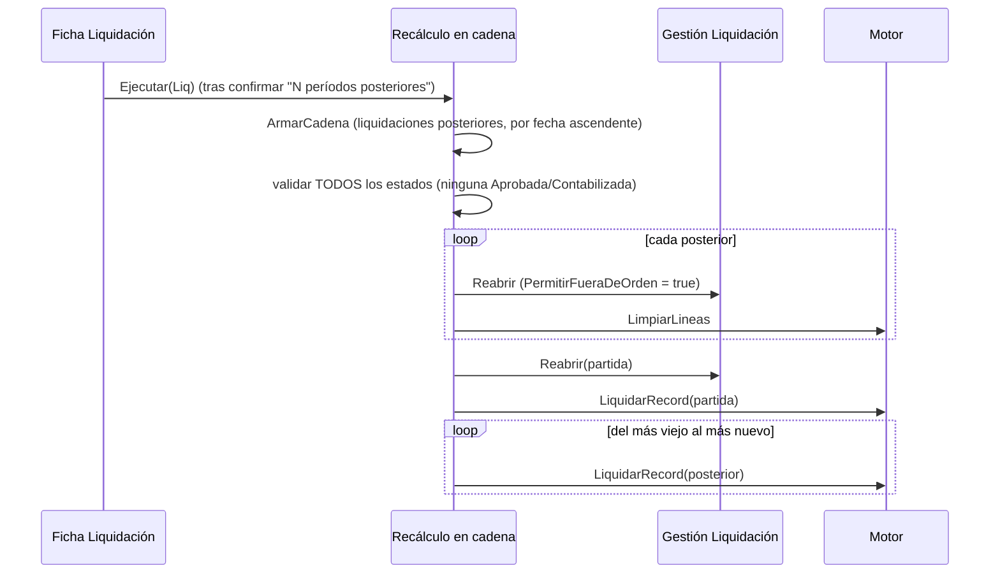

# Recálculo en cadena

`Recálculo En Cadena Liq.` (Cod110031) **rehace una liquidación y todas las posteriores del mismo
empleado, en orden**. Es la salida del **control de orden cronológico**: sin ella ese control sería una
trampa.

## El problema que resuelve

El motor mira **hacia atrás sin techo**: el ledger de francos (`TotalConsumido`) cuenta todo el consumo
del empleado sin filtro de fecha, los acumuladores anuales y el YTD de Ganancias hacen lo mismo. Recalcular
marzo con abril ya liquidado hace que marzo vea el consumo de abril como si ya hubiera ocurrido: el FIFO
se saltea lotes que en marzo estaban disponibles y marzo se paga con los lotes equivocados. **El número
que sale no es el que ese mes habría dado en su momento, y nada lo delata.**

Por eso hay **dos puertas cerradas**, simétricas:

| Puerta | Dónde | Qué impide |
|---|---|---|
| **Calcular** | `Motor.ValidarOrdenCronologico` (al arrancar `LiquidarRecord`) | calcular una liquidación si el empleado tiene líneas no-Borrador en un período posterior |
| **Reabrir** | `Gestión Liquidación.ValidarSinPosteriores` | reabrir una liquidación con posteriores: reabrir libera novedades y desmarca cuotas de préstamo, y la posterior las volvería a tomar (misma cuota descontada dos veces); además sus líneas quedan en Borrador y los acumuladores excluyen Borrador |

Pero **no hay forma de sacar del medio las líneas de abril sin recalcularlo, y recalcular abril no arregla marzo**: ahí entra la cadena.

## Qué es una "posterior" (`FiltrarPosteriores`: la única definición del sistema)

La usan el control del motor, el de reapertura y la cadena (estaba escrita tres veces, con tres sutilezas):

1. Se compara contra el **fin del período** (`Período."Fecha Hasta"`), no contra la fecha de referencia: dentro de un período conviven Regular, Devengados y Cierre de Marea (éste fechado el día de arribo, o sea **antes** que las otras) y entre ellas no hay un orden establecido. Comparar por fecha bloquearía el Cierre por existir la Regular del mismo mes, que es trabajo normal.
2. Se buscan **líneas**, no cabeceras: una liquidación puede existir sin haberse calculado y lo que ensucia son las líneas. Clave `(No. Empleado, Fecha Liquidación, Tipo Concepto)`, filtro `Fecha Liquidación > Fecha Hasta` y `No. Liquidación <> la propia`.
3. El **Borrador** cuenta o no según la pregunta (`IncluirBorrador`): para **bloquear** no cuenta (una posterior sin calcular o reabierta no aporta a ningún acumulador); para **rehacer** sí (el ledger de francos lee líneas **sin mirar el estado**, así que las líneas de una posterior reabierta siguen teniendo tomados sus lotes y hay que borrarlas).

`PrimeraPosterior` devuelve la primera (para nombrarla en el mensaje); `CuantasPosteriores` cuenta la cadena (para la confirmación).

## Qué hace `Ejecutar(Liq)`

1. **Valida primero todos los estados**: si la de partida o cualquiera de la cadena está `Aprobada` o `Contabilizada`, error *"está … y no se puede rehacer. Revertí su aprobación antes de recalcular en cadena"* **antes de tocar nada** (cortar a mitad dejaría los primeros sin líneas).
2. **Reabre y limpia todas las posteriores antes de calcular la de partida**: son justamente sus líneas las que el control de orden no deja pasar. Reabrir pasa por `Gestión Liquidación.Reabrir` (que además libera parámetros `En Uso`, revierte cuotas y devuelve las novedades a disponibles); sin eso las novedades quedarían `Aplicada` contra un cálculo deshecho y la cadena **no las volvería a tomar**.
3. `Gestión Liquidación.PermitirFueraDeOrden(true)`: puerta lateral sólo para este llamador (se prende sobre la instancia del codeunit, no se filtra a otros).
4. Calcula la de partida y luego las posteriores **del más viejo al más nuevo**: cada una tiene que ver el ledger como lo dejó la anterior.

Devuelve cuántas se recalcularon (la de partida incluida). Se invoca desde la acción **Recalcular en cadena** de la *Ficha Liquidación* (Pag50117).

## Todo en una transacción

`Ejecutar` llama a `LiquidarRecord` **directamente** (no `LiquidarConRegistro`): si un período de la cadena falla, el `Error` se propaga y **se revierte la cadena entera**. Dejarla a medio rehacer sería peor que el problema original (períodos sin líneas y nadie sabría cuáles). Contrasta con los lotes, donde cada liquidación tiene su transacción ([[Transaccionalidad y errores del cálculo]]).

## Cuidado

- Un `Aprobada` en el medio de la cadena **bloquea todo**: hay que revertir la aprobación (acción de la ficha, con confirmación) y volver a intentar.
- Las posteriores se calculan con el motor completo (incluido el grossing-up): una cadena larga puede tardar. La ventana de progreso (`Progreso Liq.`) sólo se mueve si el llamador la abrió.
- Las novedades de un período posterior que **no** estaban aplicadas siguen disponibles; las aplicadas a las rehechas se devuelven y se vuelven a tomar.

## Relacionado

[[Ciclo de cálculo de una liquidación]] · [[Estados y transiciones de una liquidación]] · [[Procesos por lotes y progreso]] · [[orden-calculo-del-lote]] · [[francos-fifo-ledger]] · [[novedades-pre-liquidacion]]
