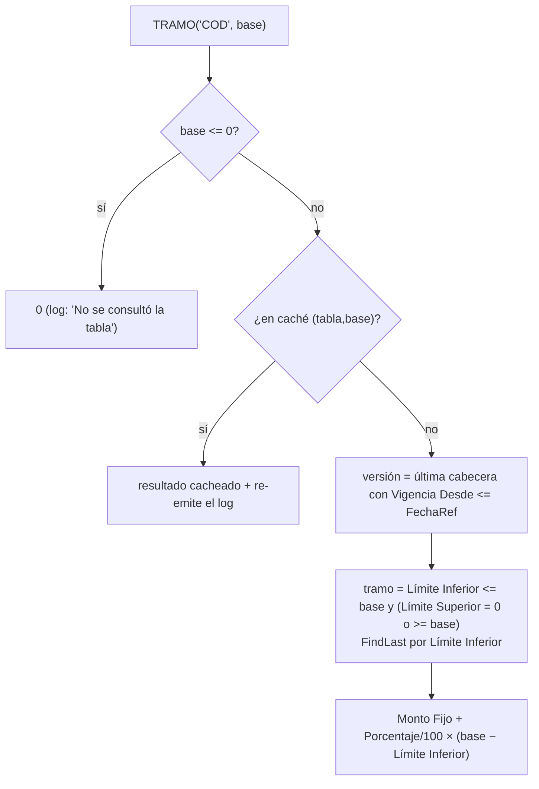

# Tablas escalonadas

Las **tablas escalonadas** (por tramos) dan importes progresivos: la escala del impuesto a las ganancias
de cuarta categoría (`TAB_IMP_4CAT`), escalas de productividad, topes. Se consultan desde las fórmulas
con **`TRAMO('CÓDIGO', base)`** ([[Evaluador de fórmulas - funciones]]).

## Estructura

| Tabla | ID | Clave | Contenido |
|---|---|---|---|
| `Tabla Escalonada` | 60013 | `Código`, `Vigencia Desde` | cabecera de **una versión completa e inmutable**; `Cant. Tramos` es un FlowField |
| `Tabla Escalonada Det.` | 60014 | `Código`, `Vigencia Desde`, `No. Tramo` | `Límite Inferior`, `Límite Superior` (0 = sin límite), `Monto Fijo`, `Porcentaje` ("% sobre excedente"), `Descripción`. Clave secundaria `Código, Vigencia Desde, Límite Inferior` |

`Tabla Escalonada Det.` valida en alta y modificación que `Límite Superior = 0` o `>= Límite Inferior`.
Borrar la cabecera **borra sus tramos** (`DeleteAll(true)`).

## Cómo resuelve `TRAMO` (`EvalTramo`)



- **La versión** es la de la última cabecera con `Vigencia Desde <= FechaRef` (se cachea por tabla durante la liquidación).
- **El tramo** es el de mayor `Límite Inferior` que contiene la base: en el borde exacto entre dos tramos gana el **siguiente**.
- **No acumula**: `importe = Monto Fijo + (Porcentaje / 100) × (base − Límite Inferior)`. Por eso el `Monto Fijo` de cada tramo debe traer **el impuesto ya devengado en los anteriores**. Ejemplo de la guía: tramo 1 `0..800.000 / fijo 0 / 0 %`, tramo 2 `800.000..1.200.000 / fijo 0 / 9 %`, tramo 3 `1.200.000.. / fijo 36.000 / 12 %` (36.000 = 9 % de los 400.000 del tramo 2).
- Los resultados se cachean por `(código, base)` con la base en formato invariante `Format(x, 0, 9)`.
- Cada consulta deja una **entrada de log** `TRAMO:CÓDIGO~valor~detalle[~base~límite~fijo~porcentaje~vigencia]` que el motor guarda como fila en `Detalle Variable Línea Liq.` (nombre `TRAMO(CÓDIGO)`, sufijo ` #2`… si la misma tabla se consulta con bases distintas en una línea). Con los campos de *snapshot* se puede **reproducir la consulta años después** aunque la escala haya cambiado (`SembrarTramoGuardado`). Ver [[Detalle del cálculo y trazabilidad]].

### Errores y casos borde

| Situación | Normal | Validación / tolerante |
|---|---|---|
| Código sin ninguna versión vigente | error *"No se encontró la tabla escalonada X vigente al …"* | 0 (tolerante) / error (validación: es estructural) |
| Base sin tramo (huecos entre límites) | error *"El valor … no corresponde a ningún tramo"* | 0 |
| Base ≤ 0 | 0, sin error | 0 |
| Modo histórico y la escala no se conservó | error *"No se conservó la escala aplicada a esta base"* | — |

> [!warning] Huecos entre tramos
> Si el `Límite Superior` de un tramo es menor que el `Límite Inferior` del siguiente, los valores del
> medio no caen en ningún tramo y la liquidación falla. Cargar los tramos **contiguos** (el superior de
> uno = el inferior del siguiente).

## Versionado

Es **append-only por versión completa**: no se edita una escala vigente; se agrega una versión nueva con `Vigencia Desde` posterior y todos sus tramos. La acción **Nueva Vigencia** de la lista (`Pag50131`) duplica la cabecera y los tramos de la versión seleccionada con `Vigencia Desde = WorkDate()` para editar los valores de la copia. Las liquidaciones ya calculadas se reproducen con la versión que usaron.

> [!tip] Nueva Vigencia usa `WorkDate()`
> La copia nace con la fecha de trabajo, no con una fecha pedida. Si cargás una escala con vigencia
> retroactiva (enero) trabajando en otra fecha, hay que corregir `Vigencia Desde` a mano en la cabecera
> **y** en los tramos.

## Ganancias: cómo se usa

Fórmula típica (de la guía; los nombres son configuración, no del motor):

```
TRAMO('TAB_IMP_4CAT', MAX(BASE_IG4 * 12 - MNI_ANUAL, 0)) / 12
```

La presentación del detalle de Ganancias reconoce la escala por el literal `TRAMO('TAB_IMP_4CAT',` en la fórmula guardada y por el nombre `TRAMO(TAB_IMP_4CAT)` en el detalle de variables (`Presentación Cálculo Liq.`.`EsGanancias`): **renombrar el código de esa tabla rompe la pantalla de detalle de Ganancias** (cae al respaldo `Etiqueta Det. Ganancias`). Ver [[Detalle del cálculo y trazabilidad]].

## Relacionado

[[Evaluador de fórmulas - sintaxis]] · [[Rendimiento y caché del cálculo]] · [[Tabla - Tabla Escalonada]] · [[grossing-up-tapa-errores]]

**Tablas relacionadas:** [[Tabla - Tabla Escalonada Detalle]]
