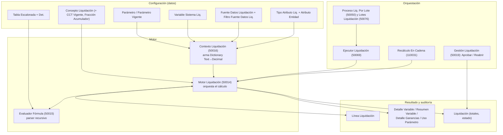

# Visión general de la arquitectura

La extensión *Liquidación Sueldos Pesca* es un **motor paramétrico**: el AL sólo conoce un vocabulario
chico y fijo (los `Cód. Cálculo` de las variables de sistema, las `Función Agregado` de las fuentes de
datos, los tokens de filtro, las funciones del evaluador). Todo lo demás —conceptos, fórmulas,
parámetros, acumuladores, escalas, fuentes de datos— es **dato configurado**. Ver [[avoid-tables-principle]]
y [[un-valor-una-fuente]].

## Capas y flujo

Lectura del diagrama:

1. El **contexto** convierte la configuración en un diccionario plano `Nombre → Decimal` para una
   liquidación concreta (un empleado, un período, a una fecha de referencia). Ver [[Contexto de liquidación y variables]].
2. El **evaluador** sólo sabe resolver una expresión contra ese diccionario. No toca la base salvo para
   `TRAMO` (tablas escalonadas) y para `@`/`#` (conceptos). Ver [[Evaluador de fórmulas - sintaxis]].
3. El **motor** recorre los conceptos en `Orden Cálculo`, evalúa condición y fórmula, escribe
   `Línea Liquidación`, alimenta los acumuladores y al final totaliza. Ver [[Ciclo de cálculo de una liquidación]].
4. Los **procesos por lotes** crean y calculan muchas liquidaciones; cada una corre en su propia
   transacción vía `Ejecutor Liquidación`. Ver [[Procesos por lotes y progreso]].

## Objetos principales

| Objeto | ID | Archivo | Rol |
|---|---|---|---|
| Motor Liquidación | 50014 | `Cod50014.MotorLiquidacion.al` | Orquesta el cálculo, grossing-up, auditoría |
| Evaluador Fórmula | 50015 | `Cod50015.EvaluadorFormula.al` | Parser/evaluador de fórmulas y condiciones |
| Contexto Liquidación | 50016 | `Cod50016.ContextoLiquidacion.al` | Arma el diccionario de variables |
| Gestión Liquidación | 50019 | `Cod50019.GestionLiquidacion.al` | Aprobar, reabrir, revertir aprobación |
| Proceso Liq. Por Lote | **50050** | `Cod50018.ProcesoLiqPorLotes.al` | Crear/calcular en lote |
| Ejecutor Liquidación | 50069 | `Cod50069.EjecutorLiquidacion.al` | Envoltorio `Codeunit.Run` por liquidación |
| Catálogo Variables Liq. | **50064** | `Cod50060.CatalogoVariablesLiq.al` | Catálogo del editor, funciones y operadores |
| Gestión Variables Sistema | 50077 | `Cod50077.GestionVariablesSistema.al` | Siembra las variables de sistema |
| Control Orden Acumuladores | 50067 | `Cod50067.ControlOrdenAcumuladores.al` | Control estático de orden |
| Historial Fórmulas Liq. | 50070 | `Cod50070.HistorialFormulasLiq.al` | Auditoría de cambios de fórmula |
| Claves Parámetro Liq. | 50071 | `Cod50071.ClavesParametroLiq.al` | Cascada de claves de parámetro |
| Recálculo En Cadena Liq. | 110031 | `Cod110031.RecalculoEnCadenaLiq.al` | Rehace una liquidación y sus posteriores |
| Progreso Liq. | 110032 | `Cod110032.ProgresoLiq.al` | Ventana de progreso (SingleInstance) |
| Formateador Fórmula Liq. | 110033 | `Cod110033.FormateadorFormulaLiq.al` | Forma canónica del texto de fórmula |
| Detalle Cálculo Línea | 110044 | `Cod110044.DetalleCalculoLinea.al` | Paso a paso de una línea |
| Nombres Variables Liq. | 110051 | `Cod110051.NombresVariablesLiq.al` | Un nombre de variable, un dueño |
| Presentación Cálculo Liq. | 110055 | `Cod110055.PresentacionCalculoLiq.al` | Despacha la pantalla de detalle |

> [!warning] El nombre de archivo no siempre coincide con el ID del objeto
> `Cod50018.ProcesoLiqPorLotes.al` declara `codeunit 50050` y `Cod50060.CatalogoVariablesLiq.al`
> declara `codeunit 50064`. Para referenciar un objeto en AL manda el **nombre** del codeunit; para
> reservar IDs, mandan los que declara el archivo, no los de su nombre. Ver [[rangos-licencia-objetos]].

## Principios de diseño que se ven en el código

- **Todo cálculo es reproducible.** La línea guarda la fórmula aplicada, la vigencia del concepto, el
  par convenio/categoría con el que se calculó y el detalle de variables. Ver [[Detalle del cálculo y trazabilidad]].
- **Nada falla en silencio si se puede evitar** (aunque quedan huecos, ver cada nota): variables de
  sistema desconocidas avisan, las fuentes sin filtros avisan, los parámetros desactualizados avisan,
  el control de orden de acumuladores avisa. Ver [[Avisos y advertencias del cálculo]].
- **Versionado por fecha, no por booleano.** Conceptos (`Vigencia Desde/Hasta`), parámetros, fracciones,
  convenios por concepto y tablas escalonadas se resuelven por la fecha de referencia. Ver
  [[Versionado de conceptos y fórmulas]] y [[conceptos-tres-vigencias]].
- **Cada liquidación, su transacción.** Un lote no se cae por una liquidación que falla. Ver
  [[Transaccionalidad y errores del cálculo]].
- **AL no cortocircuita**: todo el código del motor separa `ContainsKey` de `Get`. Ver [[al-sin-cortocircuito]].

## Relacionado

[[Índice Arquitectura y motor]] · [[Tabla - Concepto Liquidación]] · [[Tabla - Línea Liquidación]] · [[Tabla - Liquidación]] · [[Tabla - Parámetro Vigente]]
