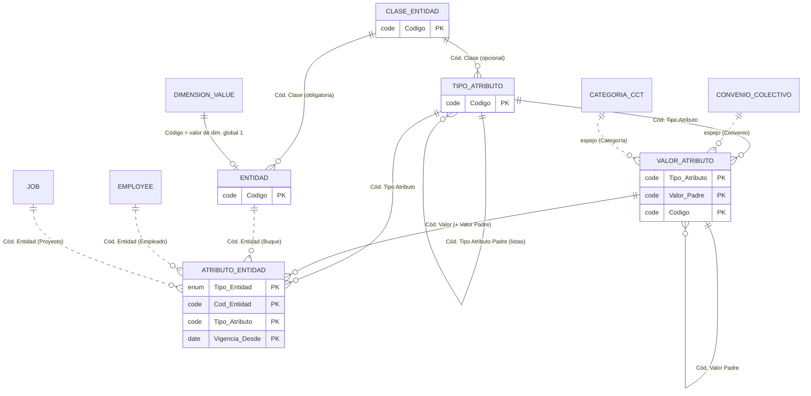
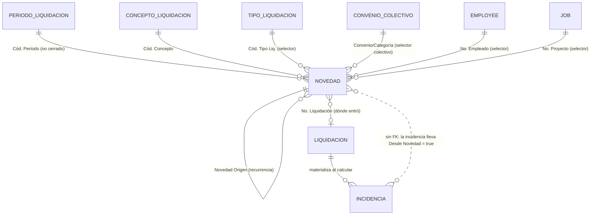
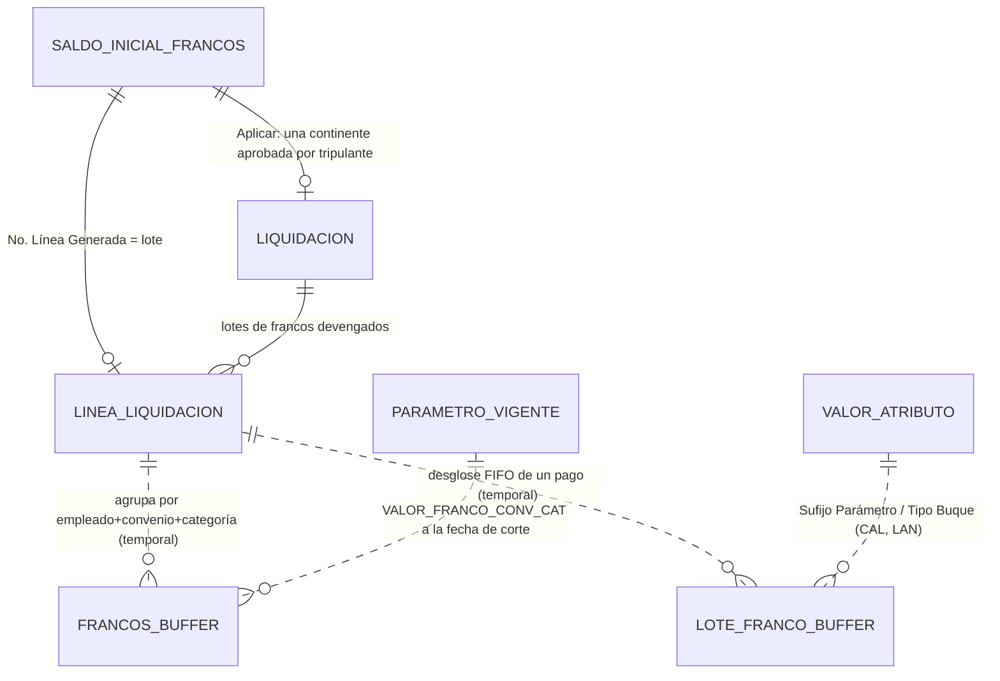
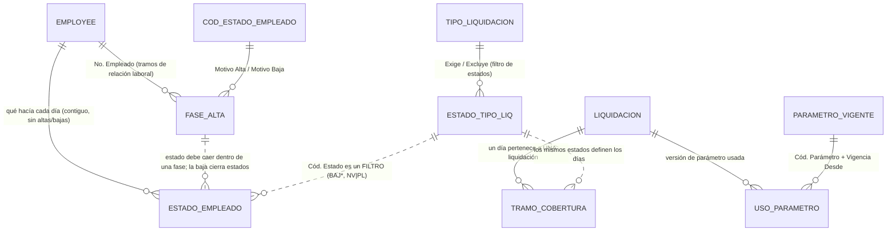
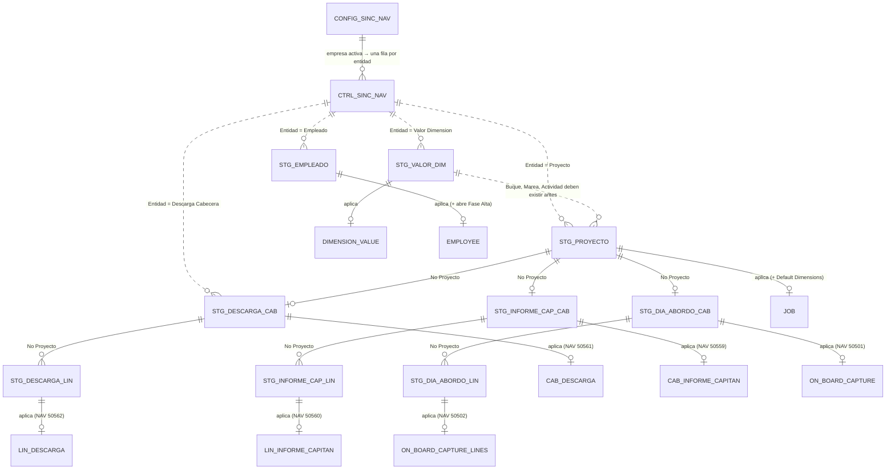
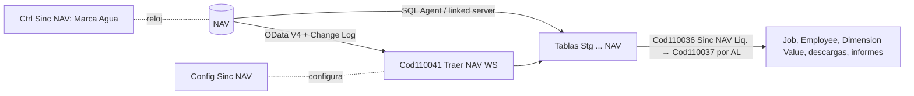
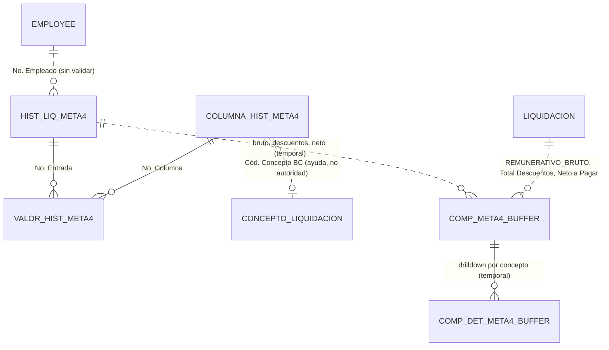
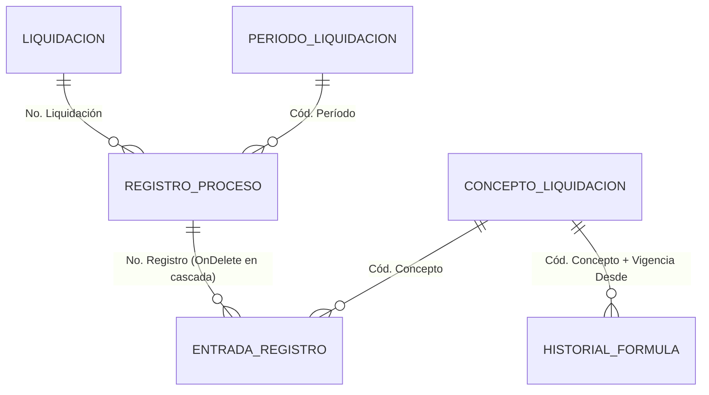

# Mapa del modelo de datos - atributos, novedades, francos y sincronización

Diagramas de las tablas **110000–110061**. Para las tablas 50xxx/60xxx (`Liquidación`, `Línea Liquidación`, `Concepto Liquidación`, `Estado Empleado`...) ver su propia sección de [[Índice Modelo de datos (110xxx)]]. Notación: `||--o{` = uno a muchos; una línea punteada (`..`) = relación **sin `TableRelation` real** (se resuelve por código en ejecución).

## 1. Atributos tipados y entidades

Dimensiones con historial que llegan a la fórmula sin tocar el motor ([[atributos-tipados]]).

| Diagrama | Tablas |
|---|---|
| CLASE_ENTIDAD | [[Tabla - Clase Entidad Liq]] |
| ENTIDAD | [[Tabla - Entidad Liq]] |
| TIPO_ATRIBUTO | [[Tabla - Tipo Atributo Liq]] |
| VALOR_ATRIBUTO | [[Tabla - Valor Atributo Liq]] |
| ATRIBUTO_ENTIDAD | [[Tabla - Atributo Entidad Liq]] |

**Cómo llega a una fórmula.** `Contexto Liquidación` recorre los `Tipo Atributo Liq.` con `Nombre Variable`, resuelve la entidad de *esta* liquidación (empleado, proyecto o buque = `Job."Global Dimension 1 Code"`), busca la vigencia a la fecha de referencia con `Atributo Entidad Liq.`.`Vigente` y mete el `Valor Numérico` congelado en el diccionario de variables. Si ya existe una variable con ese nombre (parámetro, fuente, sistema) **el atributo no entra** ([[parametro-y-atributo-mismo-nombre]]).

## 2. Novedades pre-liquidación

Una novedad se carga **contra el período**, sin que exista la liquidación. Al calcular, `Gestión Novedades Liq.` evalúa `NovedadAplica` (tipo, empleado o convenio/categoría, proyecto, fecha contra la **cobertura** guardada), acumula por concepto y escribe una `Incidencia Liquidación` marcada `Desde Novedad`. Recalcular borra esas incidencias y devuelve las novedades a `Pendiente`. Ver [[Tabla - Novedad Liquidación]] y [[novedades-pre-liquidacion]].

## 3. Francos (ledger FIFO, carga inicial y buffers)

El ledger **no tiene tabla propia**: son líneas de [[Tabla - Línea Liquidación]] (cada lote sellado con convenio y categoría).

- [[Tabla - Saldo Inicial Francos Liq]] (persistente) → genera lotes y es reversible.
- [[Buffers temporales - francos y antigüedad]] (temporales) → sólo visualización.
- Reglas: francos no fungibles, consumo FIFO, valor por terna tipo de buque + convenio + categoría ([[francos-fifo-ledger]], [[valor-franco-por-terna]]).

## 4. Fases, estados, tipos de liquidación y cobertura

La selección de quién entra a un lote y qué días cubre cada liquidación.

Tablas: [[Tabla - Fase Alta Empleado]], [[Tabla - Estado Tipo Liq]], [[Tabla - Tramo Cobertura Liq]], [[Tabla - Uso Parámetro Liq]]. Tres preguntas del lote: asignación a proyecto, **fase de alta** y **estados** ([[tres-capas-fase-estado-asignacion]], [[cuando-corresponde-una-liquidacion]]).

## 5. Sincronización NAV

Flujo y orden de dependencia en [[Patrón de las tablas de staging NAV]]; configuración en [[Tabla - Config Sinc NAV]]; reloj en [[Tabla - Ctrl Sinc NAV]]. Los nombres entre `STG_*` son las nueve tablas `Stg ... NAV`.

## 6. Archivo de historia Meta4 y comparador

Archivo **literal**: el motor no lo lee. Ver [[Tabla - Hist. Liq. Meta4]], [[Tabla - Valor Hist. Meta4]], [[Tabla - Columna Hist. Meta4]] y [[Buffers temporales - comparador Meta4 y auxiliares]].

## 7. Bitácora y auditoría

[[Tabla - Registro Proceso Liq]] · [[Tabla - Entrada Registro Liq]] · [[Tabla - Historial Fórmula Concepto]].

## Relacionado
[[Índice Modelo de datos (110xxx)]] · [[Patrón de las tablas de staging NAV]] · [[avoid-tables-principle]]
