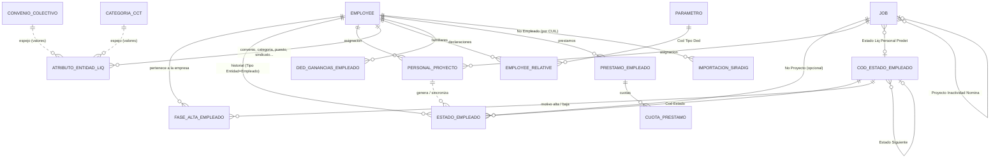
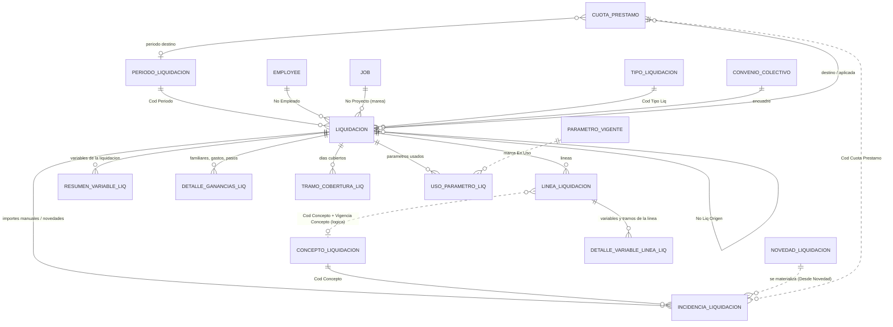

# Mapa del modelo de datos - configuración y empleado

Diagramas por dominio de las tablas 60xxx y 50578–50580 (más las extensiones de tablas base de BC). Las tablas 110xxx (atributos, entidades, fases de alta, novedades, sincronización NAV, registro de procesos…) están en las notas de su propia área; aquí aparecen sólo como nodos de conexión. Detalle de cada una en su nota `Tabla - …`; índice en [[Índice Modelo de datos (60xxx)]].

> [!note] Cómo leer los diagramas
> Las relaciones son las **TableRelation reales** del código, salvo las marcadas "lógica" (por código/clave derivada sin TableRelation: la clave derivada de parámetros, `Cód. Concepto` de las líneas, `Cód. Entidad` del historial de estados). Los nombres con acento se escriben sin acento para Mermaid.

---

## 1. Configuración (qué se calcula y con qué valores)

```mermaid
erDiagram
    CONVENIO_COLECTIVO ||--o{ CATEGORIA_CCT : "tiene"
    CONVENIO_COLECTIVO ||--o{ CONCEPTO_CCT_VIGENTE : "restringe conceptos"
    CATEGORIA_CCT ||--o{ CONCEPTO_CCT_VIGENTE : "restringe (opcional)"
    CONCEPTO_LIQUIDACION ||--o{ CONCEPTO_CCT_VIGENTE : "aplica a"
    CONCEPTO_LIQUIDACION ||--o{ FRACCION_ACUMULADOR : "aporta (Cod Concepto)"
    CONCEPTO_LIQUIDACION ||--o{ FRACCION_ACUMULADOR : "recibe (Cod Acumulador)"
    PARAMETRO ||--o{ PARAMETRO_VIGENTE : "valores (Cod Parametro Base)"
    CONVENIO_COLECTIVO ||--o{ PARAMETRO_VIGENTE : "eje convenio"
    CATEGORIA_CCT ||--o{ PARAMETRO_VIGENTE : "eje categoria"
    EMPLOYEE ||--o{ PARAMETRO_VIGENTE : "eje empleado"
    CONCEPTO_LIQUIDACION }o--o| VARIABLE_SISTEMA_LIQ : "acumulador / concepto"
    CONCEPTO_LIQUIDACION }o--o| TIPO_ATRIBUTO_LIQ : "detalle / precio"
    FUENTE_DATOS_LIQUIDACION ||--o{ FILTRO_FUENTE_DATOS_LIQ : "filtros"
    TABLA_ESCALONADA ||--o{ TABLA_ESCALONADA_DET : "tramos"
    TIPO_LIQUIDACION ||..o{ CONCEPTO_LIQUIDACION : "Tipos Liq Aplicables (texto, logica)"
    TIPO_LIQUIDACION ||--o{ ESTADO_TIPO_LIQ : "exige / excluye estados"
    COD_ESTADO_EMPLEADO ||--o{ ESTADO_TIPO_LIQ : "estado"
    COD_ESTADO_EMPLEADO }o--o| VARIABLE_SISTEMA_LIQ : "Cod Estado"
    HUMAN_RESOURCES_SETUP }o--o| CONCEPTO_LIQUIDACION : "Neto Garantizado / Acum Gravados"
    DED_GANANCIAS_VIGENTE ||..o{ DED_GANANCIAS_EMPLEADO : "Cod Tipo"
```

Cosas que el diagrama no dice:
- **Conceptos**: tres líneas de tiempo independientes — fórmula (`Concepto Liquidación`), distribución (`Fracción Acumulador`) y convenios (`Concepto CCT Vigente`). Ver [[conceptos-tres-vigencias]].
- **Parámetros**: `Parámetro Vigente` tiene PK `(Cód. Parámetro Base, Cód. Parámetro, Vigencia Desde)`; la **clave derivada** `Cód. Parámetro` se arma desde convenio/categoría/empleado y no tiene TableRelation.
- **Fórmulas** ↔ configuración: el evaluador resuelve nombres contra `Parámetro."Nombre Variable"`, `Variable Sistema Liq.`, `Fuente Datos Liquidación`, acumuladores y `Tabla Escalonada` (función `TRAMO`). Un nombre inexistente vale **cero** ([[acumuladores-orden-calculo]]).

### Notas de este dominio
[[Tabla - Concepto Liquidación]] · [[Tabla - Fracción Acumulador]] · [[Tabla - Concepto CCT Vigente]] · [[Tabla - Convenio Colectivo]] · [[Tabla - Categoría CCT]] · [[Tabla - Parámetro]] · [[Tabla - Parámetro Vigente]] · [[Tabla - Variable Sistema Liq]] · [[Tabla - Fuente Datos Liquidación]] · [[Tabla - Filtro Fuente Datos Liq]] · [[Tabla - Tabla Escalonada]] · [[Tabla - Tabla Escalonada Detalle]] · [[Tabla - Tipo Liquidación]] · [[Tabla - Ded. Ganancias Vigente]] · [[Extensión - Human Resources Setup]] · [[Extensión - Unit of Measure]]

---

## 2. Empleado, estados y asignación (quién está dónde y cuándo)

Reglas del dominio:
- **Tres capas** independientes: *fase de alta* (cuándo pertenece), *estado* (qué hace cada día) y *asignación* (a qué proyecto). Se limpian **de arriba hacia abajo**. Ver [[tres-capas-fase-estado-asignacion]].
- `Estado Empleado` sirve a **empleados y buques** (`Tipo Entidad`); `No. Empleado` guarda el código de la entidad sin TableRelation.
- El historial es **contiguo** (`Fecha Fin` mantenida) y admite **un estado por fecha**. Ver [[estado-empleado-effective-dated]].
- **Convenio y categoría** del empleado son atributos con historial (espejo de las tablas maestras); los campos de la ficha ([[Extensión - Employee]]) son respaldo.
- `Employee Relative` ([[Extensión - Employee Relative]]) apunta a un **Parámetro** (`Cód. Tipo Ded.`), no a `Ded. Ganancias Vigente`.

### Notas de este dominio
[[Tabla - Estado Empleado]] · [[Tabla - Cód. Estado Empleado]] · [[Tabla - Personal Proyecto]] · [[Tabla - Ded. Ganancias Empleado]] · [[Tabla - Préstamo Empleado]] · [[Tabla - Cuota Préstamo]] · [[Tabla - Importación SIRADIG]] · [[Tabla - Cue SIRADIG]] · [[Extensión - Employee]] · [[Extensión - Employee Relative]] · [[Extensión - Job]] · [[Extensión - Dimension Value]] (obsoleta)

---

## 3. Transaccional (el recibo)

Reglas del dominio:
- **Cabecera → líneas**: la línea **desnormaliza** empleado, período, proyecto, tipo, convenio, estado y fecha para consultar sin join; `Estado` se sincroniza al aprobar/reabrir.
- **Totales almacenados** en la cabecera (no FlowFields) para ser estables tras el cierre.
- **Borrador** es el único estado borrable/recalculable y el único que no bloquea configuración.
- `Línea Liquidación` **no tiene TableRelation** a `Concepto Liquidación` (el concepto es versionado y se conserva al darlo de baja): usa `Cód. Concepto` + `Vigencia Concepto`.
- Las tablas de detalle (`Detalle Variable Línea`, `Resumen Variable`, `Detalle Ganancias`) son evidencia del cálculo y se **regeneran** en cada recálculo.
- `Detalle Acumulador Liq.` (60028) es un buffer **temporal** de pantalla y no figura en el diagrama.

### Notas de este dominio
[[Tabla - Período Liquidación]] · [[Tabla - Liquidación]] · [[Tabla - Línea Liquidación]] · [[Tabla - Incidencia Liquidación]] · [[Tabla - Detalle Variable Línea Liq]] · [[Tabla - Resumen Variable Liq]] · [[Tabla - Detalle Ganancias Liq]] · [[Tabla - Detalle Acumulador Liq]]

---

Tablas 110xxx referenciadas arriba (documentadas por otra área): `Fase Alta Empleado` (110048), `Atributo Entidad Liq.` (110005), `Tipo Atributo Liq.` (110003), `Novedad Liquidación` (110038), `Estado Tipo Liq.` (110059), `Tramo Cobertura Liq.` (110061), `Uso Parámetro Liq.` (110009).
