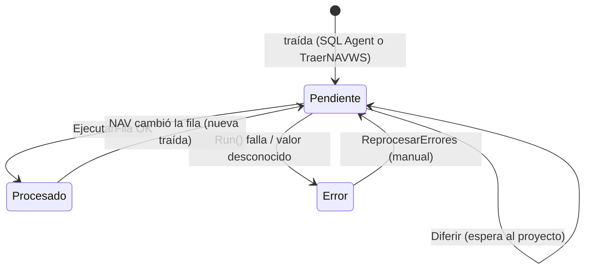

# Patrón de las tablas de staging NAV

Las nueve tablas `Stg ... NAV` (110042–110047, 110049–110052) comparten **un diseño común**. Esta nota lo explica una vez; cada tabla tiene su nota con lo propio (campos de datos y a qué tabla real se aplica).

## Principio de diseño
El transporte **sólo lleva filas hasta el staging**; el alta/modificación contra `Job`, `Employee`, `Dimension Value` y las tablas de descarga/informe la hace **AL** (`Cod110037 Aplicar Fila Sinc NAV`). Un `MERGE` directo por SQL sería más corto y estaría mal: no crearía la fase de alta ([[Tabla - Fase Alta Empleado]]), no materializaría las Default Dimensions de Buque y Marea, no dispararía el cierre de asignaciones al cargar la fecha de arribo y dejaría al service tier sirviendo caché viejo ([[sql-directo-deja-cache-rancia]]).

## Columnas comunes (números fijos 90–95)
| Campo | Tipo | Significado |
|---|---|---|
| `Estado Sinc` (90) | Enum `Estado Sinc NAV` | Pendiente (0) / Procesado (1) / Error (2) / Omitido (3). |
| `Observacion` (91) | Text[250] | Con Error es el motivo; con Procesado es un **aviso** (se aplicó pero algo quedó sin resolver). |
| `Intentos` (92) | Integer | Contador de reintentos de filas diferidas. |
| `Marca Origen` (93) | Text[20] | Rowversion de NAV de esa fila; lo llena el script SQL. `Cod110041` (Web Services) **no** escribe este campo (verificado por búsqueda): el reloj de ese transporte está sólo en `Ctrl Sinc NAV."Marca Agua"`. |
| `Traido El` (94) | DateTime | Cuándo llegó. |
| `Procesado El` (95) | DateTime | Cuándo se aplicó o falló. |

> [!warning] Los números 90–95 son contrato
> `Cod110036` accede por `RecordRef.Field(90/91/92/95)` para escribir el resultado en cualquiera de las tablas con **el mismo código**. Un campo nuevo no puede usar esos números, y renumerarlos rompe silenciosamente el motor común y el script T-SQL.

## Convenciones de nombres
Nombres de tabla y campo **sin puntos ni acentos** (`No Proyecto`, `Line No`, `Traido El`): el script T-SQL del Agent los referencia literalmente y un `Cód.` se convierte en `Cód_` del lado SQL. Además `LineNo` a secas es palabra reservada en T-SQL.

## Ciclo de vida de una fila

- **Traída** (`Cod110041 Traer NAV WS`, upsert idempotente con `Get`/`Insert`/`Modify`): deja `Estado = Pendiente` e `Intentos = 0`; si la fila no se pudo interpretar queda en Error con el motivo y el resto del lote sigue.
- **Aplicación** (`Cod110036 Sinc NAV Liq.`): `Commit()` antes de cada `Codeunit.Run` (BC prohíbe leer el retorno de `Run` con transacción de escritura abierta), `Run` de `Aplicar Fila Sinc NAV`, y `MarcarResultado` (relee con `Find('=')` y confirma cada fila). Una fila mala **no frena el lote** (ver [[codeunit-run-necesita-commit]]).
- **Diferir**: una fila que espera a su proyecto vuelve a Pendiente y suma intento; al llegar a `Máx. Intentos Sinc.` de `Human Resources Setup` (5 por defecto) pasa a Error.
- **Orden de dependencia** (`ProcesarTodo`): Valores de Dimensión → Empleados → Proyectos → Descargas cab/lín → Informe Capitán cab/lín → Diario de Abordo cab/lín. El ordinal del enum `Entidad Sinc NAV` **no** es ese orden (Valor Dimensión es el 4) y no se puede reordenar: está guardado en [[Tabla - Ctrl Sinc NAV]] y en el script T-SQL.

## Quién las lee y las escribe
- **Escribe (traída):** `Cod110041` (web services) o el job de SQL Agent (procedimiento `SincNAV_Traer`, fuera del repo AL).
- **Lee y marca:** `Cod110036`, `Cod110037`.
- **Páginas:** `Control Sinc. NAV` (110032) y una `Sinc. ... NAV` por tabla.
- **Reloj y configuración:** [[Tabla - Ctrl Sinc NAV]] y [[Tabla - Config Sinc NAV]].

## Trampas comunes
> [!warning] Las bajas en NAV no se propagan
> `Cod110041.Delta` junta `Bajas` desde el Change Log pero no las usa: una fila borrada en NAV no se borra ni se marca en el staging ni en BC. Si esto debe cambiar, hay que implementarlo.

> [!warning] ReprocesarErrores no cubre todas las entidades
> `Cod110036.ReprocesarErrores` hace `RecordRef.GetTable` sólo para Valor Dimensión, Empleado, Proyecto y las dos de Descarga. Con Informe del Capitán o Diario de Abordo la `RecordRef` queda sin tabla y el `Field(90)` falla en ejecución.

- `Omitido` existe en el enum pero ningún codeunit de sincronización lo asigna (verificado por búsqueda).
- Cambiar de transporte exige **vaciar `Marca Agua`** en `Ctrl Sinc NAV`: un rowversion leído como `Entry_No` da un número enorme que deja todo afuera ([[transporte-ws-sincronizacion]]).

## Tablas
[[Tabla - Stg Proyecto NAV]] · [[Tabla - Stg Empleado NAV]] · [[Tabla - Stg Valor Dim NAV]] · [[Tabla - Stg Descarga Cab NAV]] · [[Tabla - Stg Descarga Lin NAV]] · [[Tabla - Stg Informe Cap Cab NAV]] · [[Tabla - Stg Informe Cap Lin NAV]] · [[Tabla - Stg Dia Abordo Cab NAV]] · [[Tabla - Stg Dia Abordo Lin NAV]]

## Relacionado
[[Mapa del modelo de datos - atributos, novedades, francos y sincronización]] · [[nav-odata-ntlm]] · [[sincronizacion-valores-dimension]] · [[dim2-nav-actividad-bc-marea]]
