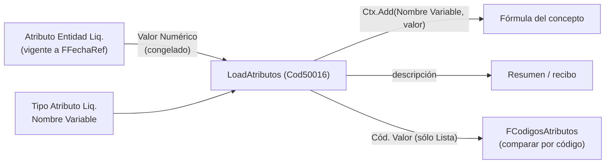

# Atributos tipados

El equivalente a las **Dimensiones** de BC, pero tipado y con historial: sirve para cargar datos que importan al cálculo (zona, sindicato, obra social, convenio, categoría, puesto, veda, proyecto de nómina…) **sin agregar campos ni código**. Es la aplicación del principio [[avoid-tables-principle]]: el motor se configura, no se programa. Lección de origen: [[atributos-tipados]].

| Tabla | Rol |
|---|---|
| `Tipo Atributo Liq.` (110003) | La "dimensión": qué se puede cargar. |
| `Valor Atributo Liq.` (110004) | El "valor de dimensión": lista cerrada para los de tipo Lista, con `Valor Numérico`. |
| `Atributo Entidad Liq.` (110005) | La asignación a una entidad, con `Vigencia Desde/Hasta`. |

## Tipo de atributo

- **`Tipo Dato`** (enum 50325): `Decimal`, `Entero`, `Lista`, `Texto`, `Fecha`. Cambiarlo con asignaciones cargadas está prohibido.
- **`Tipo Entidad`** ("Se carga en"): empleado, buque o proyecto (marea).
- **`Cód. Clase`**: acota el tipo a una clase de entidad (un buque no ofrece los atributos de una planta). Vacío = todas. Sólo tiene sentido para buques.
- **`Obligatorio`**: lo materializa la plantilla ([[Entidades y clases de entidad]]).
- **`Nombre Variable`**: si está cargado, el atributo **es una variable de fórmula** (ver abajo). Se fuerza a mayúsculas.
- **`Mostrar en Recibo` / `Etiqueta Recibo`**: el recibo imprime un bloque con los marcados; de un atributo de lista sale la **descripción**. Requiere `Nombre Variable`.
- **`Depende de`** (`Cód. Tipo Atributo Padre`) y **`Padre Según el Valor`**: encadenado (ver abajo).
- **`Espejo De`** (enum 50326): los valores se copian de un maestro (ver abajo).

## Cómo llega un atributo a la fórmula

1. `LoadAtributos` recorre los tipos con `Nombre Variable` y pone **un valor por liquidación** en el contexto. La entidad se resuelve sola: `Empleado` → el legajo; `Proyecto` → el `Job` de la liquidación; `Buque` → la dimensión global 1 de ese `Job` (sin proyecto en la liquidación, un atributo de buque queda en 0).
2. **No pisa** lo que ya esté en el contexto (parámetro, variable de sistema, Fuente de Datos): ese valor manda. Además `Nombre Variable` rechaza nombres tomados (`Nombres Variables Liq.`, control compartido por las cuatro tablas que alimentan el espacio de nombres). Ver [[dos-parametros-mismo-nombre]], [[parametro-y-atributo-mismo-nombre]].
3. **Proyección a número** según el tipo, calculada al asignar y congelada en `Valor Numérico`:

| Tipo | Lo que ve la fórmula |
|---|---|
| Decimal / Entero | el valor |
| Lista | el `Valor Numérico` del valor elegido |
| Texto | **1** si no está vacío, 0 si está vacío (bandera) |
| Fecha | **0** (los días dependen de la fecha de referencia, no se congelan) |

> [!warning] Fecha con Nombre Variable llega en cero
> Un atributo de tipo Fecha con `Nombre Variable` entra al contexto con 0. Para usar la fecha hay que declarar una **Fuente de Datos** de tipo Fecha (días hasta la fecha de referencia). Para preguntar por un texto puntual: Fuente `COUNT` con filtro por el texto (compara en SQL).

4. Para comparar por **código** de lista dentro de una fórmula existe el literal entre comillas a la derecha de `=`: [[atributo-comparar-por-codigo]].
5. Las Fuentes de Datos decimales sobre estas tablas no filtran vigencia solas: hacen falta los dos filtros de fecha a mano y el de `Vigencia Hasta` debe aceptar el blanco. Ver [[fuente-datos-apunta-por-numero]].

> [!danger] Tres campos silenciosos del tipo
> `Cód. Clase` lo esconde de la página, `Nombre Variable` lo borra del recibo y `Obligatorio` le crea vigencias a toda la clase. Ver [[tipo-atributo-tres-campos-silenciosos]].

## Vigencia: la regla temporal del sistema

`Atributo Entidad Liq.Vigente(tipo, tipoEntidad, entidad, fecha)` es **el único lugar** donde se define: la última vigencia con `Vigencia Desde <= fecha` y `Vigencia Hasta` vacía o `>= fecha`. Sin entidad o sin fecha devuelve `false` (leer todas las entidades y quedarse con la última devuelve un valor plausible de otro).

Contigüidad (parecida a la de conceptos, **distinta a la de estados**):
- Al insertar, la vigencia anterior se cierra el día previo **sólo si estaba abierta**; si ya tenía fin, se respeta (un hueco puede ser una decisión).
- La superposición se **rechaza**, nunca se corrige pisando una fecha puesta a mano.
- No se puede dejar abierta una vigencia si existe una posterior.
- Al borrar, se reabre la anterior **sólo si la había cerrado esta fila**.
- No hay red hacia adelante: un atributo que empieza después del cierre del período no rige en él.

Ver [[conceptos-tres-vigencias]]. El historial de estados, en cambio, es contiguo **siempre** ([[Estados de empleado y de buque]]).

## Atributos de lista, encadenados y espejos

- **Lista**: el código se valida contra `Valor Atributo Liq.` (por eso se prefiere sobre Texto: un código validado no se rompe en silencio como un literal).
- **Encadenado**: la categoría cuelga del convenio. El padre se **deriva**, nunca se tipea: es el valor del atributo padre que la entidad tenía **a la fecha en que empieza la vigencia**, y queda congelado en `Cód. Valor Padre` (el par de enero sigue siendo el de enero). La PK de `Valor Atributo Liq.` incluye el padre: el mismo código existe bajo dos padres (OF01 en 175/75 y en 768/19). Con `Padre Según el Valor` el padre lo trae el valor elegido (caso PUESTO).
- **Espejo** (`Espejo De`): `Convenio Colectivo`, `Categoría CCT` o `Puesto` (copia el mismo maestro de categorías; es un espejo aparte para que el par pueda distinguir los dos ejes). Los valores se **derivan** y no se editan; los triggers de `Convenio Colectivo` y `Categoría CCT` mantienen la copia en cada alta, cambio, renombrado y baja. `ResincronizarTodo` es para la carga inicial y reparaciones; copia y corrige pero **no borra** lo que sobra. Una baja con historial se corta en el maestro. Ver [[Convenios, categorías y par CCT]].
- `Sufijo Parámetro` del valor: texto que aporta al código de un parámetro (p. ej. `CAL`); lo lee `Gestión Francos` ([[valor-franco-por-terna]], [[parametros-somu-por-pesqueria]]).

## Carga y UI

- Se edita desde *Atributos de Entidad* (110011) y la subpágina de la ficha (110030); ambas pasan por `Atributos Entidad UI` (Cod110035) para interpretar lo tipeado, ofrecer la misma lista y proponer vigencias (`ProponerVigenciaLibre`, `FiltrarVigentes`, `FiltrarUltimaPorTipo`, que se topa en 200 ids por el límite de 2100 parámetros de SQL: [[copyfilters-solo-grupo-actual]]).
- Carga masiva: [[Altas masivas y migraciones de fechas]].
- `Alta Atributo Entidad Liq.` (Cod50079) inserta en su propia transacción (`Codeunit.Run`) para que un alta fallida no se lleve la corrida; el llamador hace `Commit()` antes ([[codeunit-run-necesita-commit]]).

## Atributos que el código nombra explícitamente

| Código | Dónde | Uso |
|---|---|---|
| `PROY_NOMINA` | `ProyectoNominaDe` (Cod50018) | Proyecto de nómina del **buque** y, para quien nunca embarcó, del **empleado**. |
| (por espejo) | `Convenio Categoría Liq.` | Convenio, categoría y puesto: se buscan **por su espejo**, no por nombre. |

Todo lo demás (zona, veda, sindicato, obra social…) se identifica por `Nombre Variable` y es configuración. Ver [[sindicato-obra-social-atributos]], [[veda-como-atributo-del-buque]].

Relacionado: [[Vision del dominio pesquero]], [[Convenios, categorías y par CCT]].

## Mejoras de carga del 11/10/2026

La búsqueda de un valor existente abre las alternativas sin filtrar por su código; el historial
se controla arriba de la lista y la ficha permite agregar vigencias. Los accesos a parámetros
respetan el origen y el eje del atributo. Ver [[Carga de atributos y parámetros desde las fichas]].

