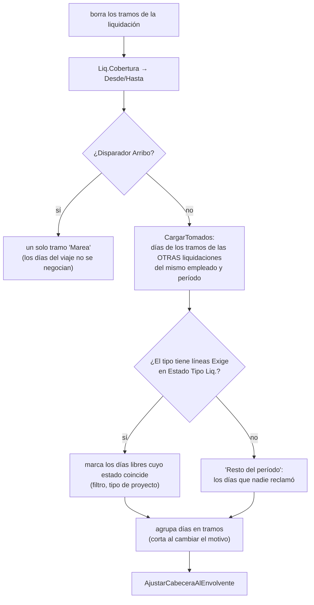

# Cobertura y tramos

**Regla: un día de estado se liquida UNA vez.** La *cobertura* es el conjunto de días que paga una liquidación. Lecciones de origen: [[cobertura-en-tramos]], [[ventana-liquidacion-es-cobertura]], [[cobertura-devengado-tapa-dias]].

Hay **tres capas** que conviene no confundir:

| Capa | Dónde | Es |
|---|---|---|
| **Ventana teórica** | `Liquidación.Cobertura(ref Desde, ref Hasta)` | Un intervalo calculable antes de insertar: período, o el tramo del proyecto. |
| **Tramos** | `Tramo Cobertura Liq.` (110061) | El reparto real, día por día, entre las liquidaciones del empleado. Quien manda para contar días. |
| **Envolvente** | `Cobertura Desde/Hasta` en la cabecera | El mínimo y máximo de los tramos. Es lo que muestra la ficha y lee el control. |

## 1. La ventana (`Liquidación.Cobertura`)

- Parte del período (`Fecha Desde`–`Fecha Hasta`).
- Si el tipo `CubreSoloElProyecto` (= `Tipo Proyecto` **Productivo**; *no* el disparador: el Devengado corre sobre mareas como el Cierre aunque no se dispare al arribo) y la liquidación tiene proyecto, se **recorta**:
  1. Primero a los días que **este empleado** estuvo en el proyecto (`RecortarAlTramoDelEmpleado`: primer inicio y último fin efectivo de sus estados con ese `No. Proyecto`). Las fechas del `Job` son las del barco, no las de la persona: el puerto de salida ya pertenece a la marea aunque zarpe al día siguiente.
  2. Si no tiene estados en ese proyecto, contra `Starting Date`/`Ending Date` del `Job`.
- El mismo procedimiento lo usan el motor (que lo guarda) y `Gestión Novedades` (que reparte novedades entre liquidaciones): dos definiciones de "qué días cubre" se separarían y una novedad entraría en una liquidación que el control da por no cubierta.
- `FechaReferenciaAprox` (fecha de liquidación, o fin de período, o `WorkDate`) es una aproximación para pantalla y prellenado; la definitiva la fija el motor (fin de período o arribo).

## 2. Los tramos (`Cobertura Tramos Liq.`)

`Recalcular(var Liq)` corre **antes de armar el contexto** en cada cálculo (el contexto lee los tramos para acotar las variables de período).

- **Declarar un estado dice cuáles días te interesan, no que sean tuyos si ya son de otro.** Antes sólo el tipo que recoge "lo que sobra" miraba lo ya reclamado: 196 solapamientos en enero de 2026 (Devengados volvía a tomar los días de navegación del Cierre; Vacaciones y Regular se peleaban los AU9).
- **El `Orden` del tipo decide quién reclama primero.** Sólo cuentan las liquidaciones que **ya tienen tramos**: una que todavía no se calculó no reclamó nada. Sin orden determinista el reparto dependería de quién se calculó antes ([[orden-calculo-del-lote]]). Ver advertencia en [[Tipos de liquidación]] sobre los Órdenes sembrados.
- El disparador de arribo escribe su tramo **sin consultar**: funciona porque el Cierre tiene el `Orden` más bajo.
- `Origen` (texto del tramo) no lo lee nadie: está para responder "¿por qué pagó 20 días y no 30?".
- Los tramos **se borran con la liquidación** (`OnDelete`); si sobrevivieran, la próxima que pregunte "qué días quedan libres" los vería tomados por una que ya no existe.
- `Recalcular` **no graba** la cabecera: la pasa por referencia y el que llama hace su `Modify`. Un `Get+Modify` aparte cambia el timestamp debajo de la instancia que el motor ya tiene y el `Modify` final muere con "hay información que no está actualizada".

### Cómo los usa el motor
`DiaEnLaVentana` (Cod50016) es la bifurcación general: **con tramos** suma contra cada uno; **sin tramos**, contra la ventana única `[FPeriodoFechaDesde, fecha de referencia]`. Los feriados se cuentan día por día (`FeriadosDelTramo`, recortando el estado contra el tramo antes de recorrer) y su respaldo sin tramos es **distinto**: la cobertura de la cabecera (`VentanaDesde/Hasta`), y el período sólo si la cabecera no tiene cobertura calculada. `CargarTramos` carga ambas cosas.

> [!warning] Cero tramos = período entero
> Una liquidación sin ningún tramo en el mes (p. ej. un anticipo de vacaciones que empiezan al mes siguiente) cae en el camino sin tramos y se calcula como si cubriera el mes completo. Está documentado como causa abierta del doble pago mensual en [[exclusividad-vacaciones]].

## 3. El control de días liquidados (`Control Cobertura Liq.`)

Contesta lo que ninguna liquidación sola puede: **a quién le falta liquidar**. Parte de los **estados** (no de las liquidaciones: así detecta al que no tiene ninguna) y trabaja **por día**:

1. Población: empleados con estados en el rango **y** una fase de alta que lo toque (`EstuvoActivoEntre`), el mismo filtro que aplica el lote; sin él un estado abierto desde 2001 arrastra a su dueño a todos los períodos (legajo 02678).
2. Techo por ficha: `Employment Date` y `Termination Date` recortan el rango.
3. Un día está **cubierto** si lo cubre una liquidación **no Borrador**; una en Borrador se anota aparte (*existe, falta calcularla*).
4. El detalle agrupa los huecos en tramos legibles ("del 21 al 31 NV"). Las columnas de días por estado son dinámicas (una por `Cód. Estado` que aparezca).
5. `CompletarCoberturas` rellena `Cobertura Desde/Hasta` de liquidaciones anteriores a que el campo se guardara; junta las claves **antes** de escribir (el bucle no puede modificar el campo por el que filtra).

> [!warning] El control mira el envolvente, no los tramos
> `ArmarEmpleado` marca como cubierto todo `[Cobertura Desde, Cobertura Hasta]` de cada liquidación. Para una liquidación con huecos (la Regular que cede los días de vacaciones: tramos 1–4 y 26–31) el envolvente es 1–31, así que el control **da por cubiertos días que esa liquidación no paga**. La lección [[cobertura-en-tramos]] ya advertía que el envolvente "se comería los días de los huecos". Hoy el único consumidor de tramos reales es el motor. Sin verificar si otra pantalla compensa.

Relacionado: [[Control de períodos liquidados]] (la pantalla de este control), [[Mareas y ciclo de la marea]], [[Cuándo corresponde una liquidación]], [[Lotes de liquidación]], [[Estados de empleado y de buque]], [[Vision del dominio pesquero]].
