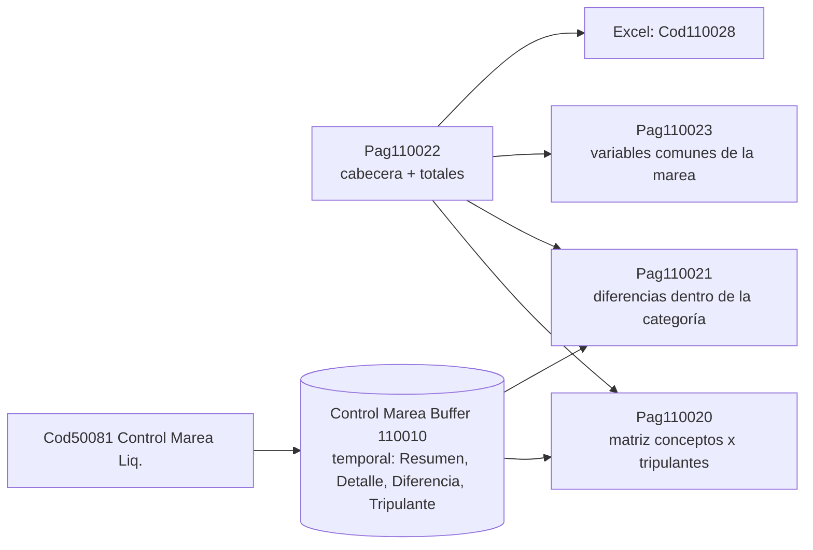

# Control de marea (Excel y matrices)

Es la versión hecha por el sistema de lo que el liquidador armaba **a mano en Excel**: exportar las líneas de cada liquidación de una marea, pegarlas debajo de otra y recién ahí comparar contra el sistema anterior. Acá sale **toda la tripulación de una vez**, con los conceptos en el **orden de cálculo** del motor.

Se abre desde la ficha o la lista de **Proyectos** (acción *Control de Liquidación*) → página `Control Liquidación Marea` (110022, Card sobre `Job`).

## Principio: lee lo que el motor ya calculó

Todo sale de las líneas y cabeceras **guardadas**; no recalcula nada. Un control que recalcula puede diferir del recibo y entonces no controla nada: dice lo que *habría* dado, no lo que dio. Entran **todas las liquidaciones del proyecto, en cualquier estado** (un control que escondiera los borradores sólo serviría después de aprobar, cuando ya no se puede corregir).

## Piezas

| Pieza | Qué muestra |
|---|---|
| **Cabecera** | proyecto, salida, arribo, horas de zarpada/arribo (regla de las 12:00), **zona desfavorable**, y los **datos de cálculo**: días de navegación (`DIAS_PROYECTO`), de puerto (`DIAS_PUERTO`), feriados a bordo (`DIAS_FERIADOS_MAREA`), **tipo de cambio** usado |
| **Netos** | mínimo, promedio y máximo del `Neto a Pagar` (detecta un neto fuera de rango) |
| **Totales** | cantidad de liquidaciones, Haberes, Descuentos, Contribuciones, Neto — **de las cabeceras**, no de sumar el detalle: si alguna vez no coincidieran con la suma de líneas, eso mismo es lo que hay que mirar |
| **Matriz** (110020) | una fila por concepto, una columna por tripulante; celdas en cero en blanco; los conceptos en cero para toda la tripulación no son fila; el pie dice cuántas filas se ocultaron y cuánto suman (los totales no usan ese filtro y siguen coincidiendo con las cabeceras) |
| **Diferencias** (110021) | quién cobró distinto que la mayoría de **su misma categoría** |
| **Variables comunes** (110023) | variables con el mismo valor en **todas** las liquidaciones (kilos del buque, parámetros del convenio, fuentes de datos no dependientes del tripulante) |

Filtros de cabecera: **Convenio** y **Categoría** (la categoría debe pertenecer al convenio). Acciones: *Actualizar*, *Ver cantidades*, *Mostrar todos los conceptos*, *Columnas anteriores/siguientes* y *Control de Liquidación (Excel)*.

> [!note] 32 columnas
> La matriz usa el patrón de matriz de BC (`CaptionClass '3,...'`), con tope de **32 columnas**. Una marea más numerosa se recorre con *Columnas siguientes*; el rango visible figura siempre en la cabecera para que una tripulación cortada no pase por completa.

## El "valor habitual" (regla única)

`Control Marea Liq.ValorHabitual` devuelve el valor que **más se repite** entre los tripulantes de una categoría; ausentes cuentan **cero**; ante empate gana el primero visto. Pantalla y Excel usan **la misma implementación**: si decidieran por separado, el día que difirieran nadie sabría cuál creer.

- Los tripulantes **sin** línea del concepto cuentan cero **a propósito**: si a seis de ocho no les salió, lo habitual es no cobrarlo y los dos que lo cobraron son lo que hay que mirar.
- Sólo conceptos con **importe y que imprimen en recibo**: sin ese filtro cada diferencia real en un haber arrastraba su contribución patronal y sus acumuladores (un caso = tres o cuatro filas).
- Antes la celda mostraba el importe de un "representante" (el de menor número de legajo); si justo era el que se apartaba, la matriz mostraba su número como el de toda la categoría y las diferencias listaban a todos los demás.
- **Vacío es una respuesta**: significa que todos los de cada categoría cobraron lo mismo y la matriz se lee categoría por categoría.

## El Excel (`Control Marea Excel Liq.`)

Acción *Control de Liquidación (Excel)*; respeta los filtros de convenio y categoría (`SetFiltro` **antes** de `Generar`).

1. Hoja `Control <proyecto>`: cabecera (proyecto, salida, arribo, cantidad de liquidaciones y de categorías, **marca del filtro** — un Excel sin ella se archiva y nadie sabe si faltaba media tripulación), los cuatro datos de cálculo + netos, y la **matriz de conceptos por categoría**: dos filas de encabezado (categoría y cuántos tripulantes representa), columnas de mayor a menor **% de escala** (Capitán primero; el % de escala es la jerarquía del convenio) y columna **TOTAL MAREA**. Filas de total: remunerativo, no remunerativo, descuentos, seguridad social, contribuciones. Cada celda es el **valor habitual de la categoría**, no la suma.
2. Al final de la misma hoja: las variables comunes (son cientos; en la cabecera empujaban la matriz fuera de vista).
3. Hoja `Diferencias` (sólo si hay alguna; una segunda hoja vacía hace dudar de si el informe corrió): una fila por tripulante que se apartó, **ordenada por tamaño de la diferencia** (lo que más plata mueve, primero).

> [!danger] Excel Buffer: una variable por hoja
> La segunda hoja se arma en un buffer **aparte** (`LibroDif`): vaciar el buffer con `DeleteAll` para reusarlo deja sin writer al libro y `SelectOrAddSheet` muere con "No se pudo crear el libro de Excel". `WriteSheet` va una sola vez (primera hoja); las siguientes con `SelectOrAddSheet` + `WriteAllToCurrentSheet`. Ver [[excel-buffer-writer-en-la-variable]].

## Detalles del cálculo del control

- **Tipo de cambio**: no se elige la moneda; se descubre desde los parámetros que las liquidaciones realmente usaron (`Uso Parámetro Liq.` → `Parámetro Vigente.Moneda`), y la cotización sale de `Motor.TipoCambioVendedor` a la fecha de la liquidación. `ExchangeRate` **no** sirve: devuelve la inversa y resuelve contra el comprador. Si hay varias monedas salen todas. Ojo: la producción se liquida al *comprador* y los sueldos en divisa al *vendedor* ([[que-tc-usa-cada-concepto]]), así que este número es el vendedor.
- **Parámetro Vigente por clave secundaria**, no `Get`: la PK arranca por `Cód. Parámetro Base` (Code[20]) y un `Get` con la clave derivada (Code[50]) la mete en el campo equivocado ([[get-con-menos-argumentos]]).
- **Variables comunes** exigen estar en **todas** las liquidaciones con el mismo valor (la que a alguien le dio distinto es justo lo que hay que mirar al detalle; la que falta en alguna no es dato de la marea).
- La **matriz por categoría** usa el par del **encuadre** de la cabecera (`Convenio/Categoría Empleado`), mientras el detalle muestra el par de la **línea** (los conceptos liquidados con el convenio de la asignación no coinciden con el del empleado).

## Gemelo por período

`Control Liquidación Período` (110056) reusa la misma matriz y las mismas diferencias pero recorta por **período** (siempre acota; arranca vacía hasta elegir uno, porque recorrer las líneas de un mes cuesta) y admite siete filtros más. Ver [[Control de períodos liquidados]].

Relacionadas: [[Mareas y ciclo de la marea]], [[Índice Dominio - marea y pagos]].
