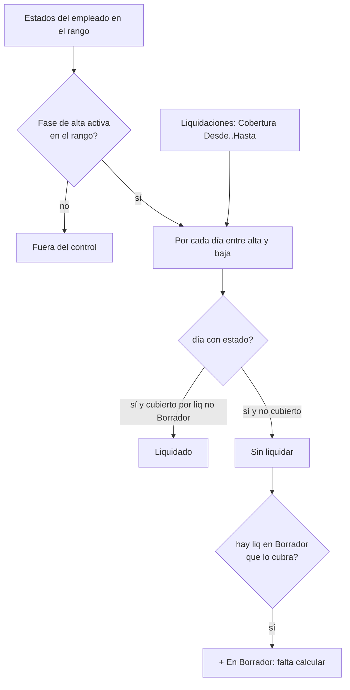

# Control de períodos liquidados

Dos controles contestan preguntas distintas sobre un **período**. Conviene no confundirlos:

| Control | Pregunta | Página |
|---|---|---|
| **Días liquidados por empleado** (control de cobertura) | ¿**a quién le falta** liquidar algún día? | `Control de Cobertura Liq.` (110026, caption *Días Liquidados por Empleado*) |
| **Control de liquidación por período** | ¿**cuánto se pagó** y a quién le cambió algo? (matriz concepto × empleado) | `Control Liquidación Período` (110056) |

El segundo es el gemelo por período del control por marea y está explicado en [[Control de marea (Excel y matrices)]]; abre desde la página de Períodos de Liquidación (acción *Control de liquidación*). Esta nota trata el primero.

## Días liquidados por empleado

Una liquidación demuestra que esos días se hicieron; **los que no se hicieron no dejan rastro en ningún lado**, y antes la única forma de enterarse era que la persona reclamara. La planilla da **una fila por empleado**, **una columna por estado** (con los días que pasó en él, 32 columnas máximo, *Estados siguientes/anteriores*) y al final **cuántos días quedaron sin liquidar**.

### La unidad es el día, no el período

Un tripulante en dos mareas del 1 al 20 de julio tiene dos liquidaciones de julio: por período el mes figura cubierto cuando del 21 al 31 no se le liquidó nada. Por eso el control recorre **día por día**.

### Cómo lo arma `Control Cobertura Liq.`

- **Se parte de los estados, no de las liquidaciones**: partir de éstas dejaría afuera al que no tiene ninguna, el caso más grave.
- **Población**: sólo empleados con **fase de alta activa** en el rango (`Fase Alta Empleado.EstuvoActivoEntre`), el mismo filtro que aplica el lote al crear liquidaciones. Sin él, un estado que nunca se cerró arrastraba a su dueño a todos los períodos (el legajo 02678 tenía un Franco abierto desde 2001 y figuraba pendiente en enero de 2026).
- **Techo por alta y baja** (`Employment Date`, `Termination Date`): quien entró el 15 no debe la primera quincena.
- Una liquidación en **Borrador no cubre nada** (no hay importes), pero se registra aparte para decir "creada, falta calcular" — un faltante con otra solución que "no existe".
- Columnas del buffer `Cobertura Liq. Buffer` (110013): `Días del Rango`, `Días con Estado` (si es menor que los del rango hay un agujero en el **historial**, un problema anterior al de liquidación), `Días Liquidados`, `Días sin Liquidar`, `Tramos sin Liquidar` (uno al final del mes es un olvido; varios desperdigados suele ser historial mal cargado), `Días en Borrador` y `Detalle Sin Liquidar` (texto "21/07..31/07 ORDENES").

### Cobertura guardada: `Completar fechas de cobertura`

El control lee `Cobertura Desde/Hasta` de la cabecera de cada liquidación. Los dos campos se empezaron a guardar al calcular, así que lo viejo los tiene en blanco; sin ellos el control lee "no cubre ningún día" y marca a toda la empresa como no liquidada. La acción **Completar fechas de cobertura** (`CompletarCoberturas`) los deriva del período, el tipo y el proyecto (`Liquidación.Cobertura()`), **sin recalcular ni tocar importes**. La página avisa una vez por apertura cuántas liquidaciones siguen sin cobertura, porque mientras haya, los faltantes son en parte inventados.

> [!danger] Recalcular las coberturas ya guardadas tras un cambio de regla
> `CompletarCoberturas` sólo llena las que están en **blanco** (`Cobertura Desde = 0D`). Después de corregir la regla de cobertura del Devengado (29/9/2026) las 90 existentes conservaron el valor viejo hasta recalcularse ([[cobertura-devengado-tapa-dias]]). Además el bucle junta primero las claves y recién después escribe: recorrer un filtro sobre `Cobertura Desde` mientras se completa ese mismo campo saca el registro del conjunto y el proceso cortaba tras uno solo ([[bucle-modifica-campo-filtrado]]).

### Uso

Abre **sin rango y sin cargar** (la carga es una matriz de todos los empleados por todos los estados; el período de la fecha de trabajo casi nunca es el que se quiere mirar). Elegir *Período* (fija el rango) o editar *Desde/Hasta* a mano (limpia el código de período), con *Período anterior/siguiente* recorriendo el **calendario real de períodos** y no meses de calendario. Acciones: *Sólo los que tienen faltantes*, *Liquidaciones del empleado*, *Estados del empleado*; drill-down de cada celda abre el historial de ese estado.

> [!warning] No poner el rango en el futuro
> Los días que todavía no se liquidaron porque el mes no cerró aparecen como faltantes.

### Relación con los tramos de cobertura

La regla "un día de estado se liquida **una vez**" se reparte entre liquidaciones en `Tramo Cobertura Liq.` ([[Cobertura y tramos]], [[cobertura-en-tramos]], `Cod110054`). Este control lee **`Cobertura Desde/Hasta`** de la cabecera, y `CoberturaTramosLiq.AjustarCabeceraAlEnvolvente` lleva esos campos al **envolvente** de los tramos (de la primera a la última fecha). Consecuencia verificada en código: una liquidación con dos tramos (p. ej. Regular del 1 al 4 y del 26 al 31) figura cubriendo **todo el intervalo intermedio**, así que un hueco entre tramos que ninguna otra liquidación cubra **no aparece** como "sin liquidar" en este control.

Tablas: [[Tabla - Tramo Cobertura Liq]]. Relacionadas: [[Mareas y ciclo de la marea]], [[Cuándo corresponde una liquidación]], [[cuando-corresponde-una-liquidacion]], [[Tabla - Período Liquidación]], [[Índice Dominio - marea y pagos]].
