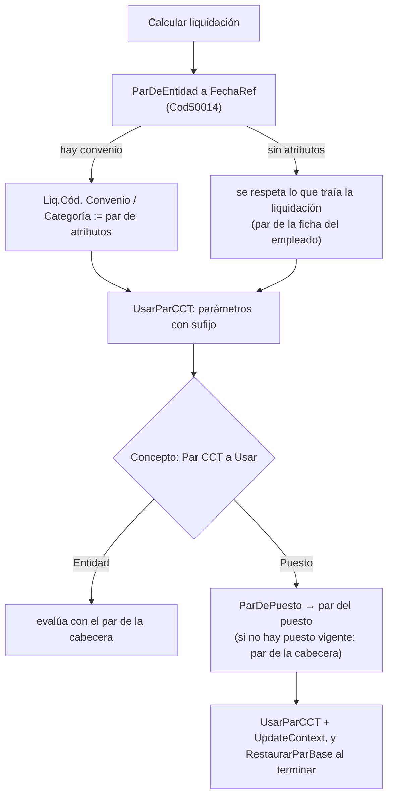

# Convenios, categorías y par CCT

Casi todo lo que se paga depende de **un par** `(Cód. Convenio, Cód. Categoría)`: el motor arma los parámetros con sufijo `CONVENIO_CATEGORÍA`, busca `Categoría CCT.Get(convenio, categoría)` para `PCT_ESCALA` y filtra conceptos por CCT. Un par que no existe **no da error: da importe cero**. De ahí que todo el diseño apunte a que el par no pueda armarse mal.

## Los maestros

| Tabla | Clave | Lo importante |
|---|---|---|
| `Convenio Colectivo` (60004) | `Código` | `Tipo Empleado` (Tripulante/Mensualizado/Jornalizado: **decide qué conceptos y qué documentos le tocan a la gente del CCT**; en blanco = Todos = no filtra), `Cód. Calendario` (feriados propios del convenio; blanco = el del período), `No. CCT`, `Sindicato`, `Cámara`. |
| `Categoría CCT` (60006) | `Cód. Convenio` + `Código` | `% Escala` (alimenta `PCT_ESCALA`). El mismo código puede existir en dos convenios. Mover una categoría de convenio **renombrándola está prohibido** (cambiaría de padre el historial de quien la tiene). |

Ambas tablas son la **fuente de verdad** y mantienen, desde sus triggers, los atributos que las espejan ([[Atributos tipados]], `Espejo Atributos Liq.`). Ver [[Tabla - Convenio Colectivo]], [[Tabla - Categoría CCT]].

> [!note] Feriados por convenio
> El feriado se resuelve con el convenio vigente a la **fecha de referencia**, no día por día: un cambio de convenio a mitad de mes cuenta los feriados de todo el mes con el del cierre. Está documentado como limitación aceptada.

## De dónde sale el par: dos ejes

El empleado tiene **dos ejes independientes** y pagan cosas distintas ([[puesto-vs-categoria-cct]]):

| Eje | Atributo (por espejo) | Paga | Resuelve |
|---|---|---|---|
| **Encuadre** (convenio + categoría) | `Convenio Colectivo` y `Categoría CCT` | Sueldo, navegación, puerto, antigüedad, sindical… | `ParDeEntidad` |
| **Puesto** | `Puesto` (espejo del mismo maestro de categorías) | La producción | `ParDePuesto` |

`Convenio Categoría Liq.` (Cod50080) **no nombra los tipos de atributo**: los encuentra por su espejo (`TipoConEspejo`), se llamen como se llamen en cada instalación.

- **`ParDeEntidad(empleado, fechaRef, rangoDesde, rangoHasta, ref convenio, ref categoría)`**. 1) Busca la vigencia a la fecha de referencia. 2) Si no hay, usa **la red del rango**: la **primera** vigencia que se solape con el período (cubre el Cierre de Marea, donde la referencia es el arribo y puede ser anterior a una vigencia cargada más adelante en el mismo período). Devuelve `false` si no hay convenio; la categoría es **opcional** (hay personal sin categoría), lo inverso no.
- **`ParDePuesto`** devuelve el **par completo**: el convenio sale del **padre del valor** del puesto (`Padre Según el Valor`), no de la cabecera. Un oficial encuadrado en 768/19 que navega de Patrón de Pesca tiene el puesto `FE01`, que cuelga de `ESP`; cruzarlo con el convenio de la cabecera armaría `(768/19, FE01)`, que no existe.
- Ambas devuelven convenio y categoría **de la misma fila**: separarlas permitiría la categoría de una vigencia con el convenio de otra.

> [!warning] Discrepancia código vs. documentación vieja
> El comentario del enum `Par CCT Liq.` (valor `Puesto`) y la lección [[puesto-vs-categoria-cct]] dicen que el puesto "cambia sólo la categoría, no el convenio". **El código actual hace lo contrario** (`ParDePuesto` y `AplicarParDeConcepto` usan el convenio del padre del puesto). Manda el código.

## Cómo lo usa el motor

- **La cabecera se resincroniza en cada cálculo** (también al recalcular), contra la fecha de referencia real. `Liquidación.ResolverParDeAtributos` sólo da un valor inicial al crear (pantalla, no plata).
- **`Concepto."Par CCT a Usar"`** (enum 50327): `Entidad` (0, el predeterminado) o `Puesto` (2). El valor 1 (*asignación al proyecto*) **se eliminó el 18/9/2026** junto con los campos `Cód. Convenio`/`Cód. Categoría` de `Personal Proyecto`; el número **no se reutiliza** porque hay liquidaciones viejas cuyo registro de fórmula aplicada se leyó con ese par. Los 13 conceptos de producción se pasaron a `Puesto`.
- Cada `Línea Liquidación` guarda el par **con el que se calculó** (`ConvenioEval`/`CategoriaEval`), que en los conceptos de puesto no es el de la cabecera: la línea es el comprobante de su propio cálculo.
- El **tipo de empleado** de la liquidación (`TipoEmpleadoDe`) sale del convenio de la **cabecera**, no del par alterno de un concepto: valorizar bajo otro CCT no convierte a la persona en otra cosa.
- Conceptos con `@CÓDIGO` re-evalúan con el par de quien llama, no con el del otro concepto: [[arroba-ignora-el-par-del-concepto]].
- Con la categoría de lista: el mismo código de categoría puede ser dos categorías distintas según el convenio ([[convenio-of-depende-de-la-categoria]]).

## La ficha del empleado todavía importa

`Employee` conserva `Cód. Convenio` y `Cód. Categoría` (extensión 52000; cambiar el convenio blanquea la categoría). Hoy son **respaldo y migración**:
- `InsertarLiquidacionEmpleado` los pone al crear la cabecera y `ResolverParDeAtributos` los pisa si hay atributos.
- El **control de cobertura** los muestra de la ficha, no de los atributos.
- `Migrar Convenio y Categoría a Atributos` (reporte 50046) los vuelca como atributos con una vigencia inicial común; ver [[Altas masivas y migraciones de fechas]].
- La sincronización con NAV **nunca** toca convenio, categoría ni zona: quedan en blanco en el alta, y esa es la marca de "pendiente de completar".

> [!danger] Sin convenio no hay conceptos
> Una liquidación con `Cód. Convenio` en blanco descarta todos los conceptos restringidos por CCT, sin error. Ver [[enfermedad-sin-convenio-paga-cero]], [[migracion-atributos-cct-meta4]].

Relacionado: [[Convenios del sector (CCT 729-15, 768-19, 175-75, 372-04, SOMU)]] (el contenido de cada convenio), [[Vision del dominio pesquero]], [[Atributos tipados]], [[sindicato-obra-social-atributos]], [[cct-768-19-anexos]], [[cct-729-15-articulos]], [[cct-175-75-remuneracion-navegacion]].
