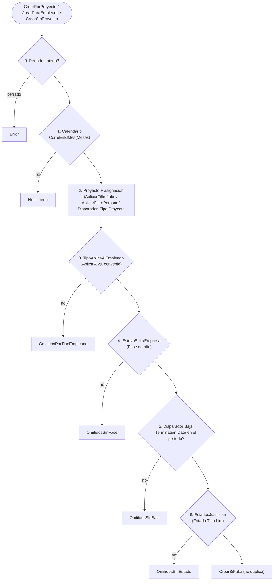

# Cuándo corresponde una liquidación

Si una liquidación corresponde se decide **antes de crearla**, con preguntas que salen de la **configuración del tipo** y no del código; calcular para enterarse sería pagar una liquidación completa para descartarla. La red de seguridad es el descarte de vacías ([[crear-y-calcular-descarta-vacias]]). Lección de origen: [[cuando-corresponde-una-liquidacion]].

## Las preguntas, en orden (de la más barata a la más cara)

Los omitidos se **cuentan** (nunca se descartan en silencio) y `AvisarOmitidos` los informa por categoría con la acción a tomar.

### 1. Calendario
`Tipo Liquidación."Meses"`: filtro de BC sobre el mes de `Período."Fecha Hasta"`. Es la única pregunta que no mira al empleado (`6|12` para el aguinaldo).

### 2. Disparador y proyecto
`AplicarFiltroJobs` arma el conjunto de `Job` desde el tipo:
- `Tipo Proyecto` > 0 ⇒ filtra `Job.Tipo` (1 Productivo, 2 Improductivo; los ordinales son los de `Job.Tipo`).
- **Arribo**: proyectos cuyo `Ending Date` cae **dentro del período**.
- Resto: `Starting Date <= fin del período` (en blanco pasa: los proyectos de nómina no tienen), y con **MareaEnCurso**, además `Ending Date` vacío o posterior al cierre. **El `Status` del proyecto no se usa**: no se mantiene (en enero de 2026 estaba mal en las dos direcciones). Ver [[cobertura-devengado-tapa-dias]].
- `AplicarFiltroPersonal`: asignaciones con `Fecha Baja` vacía o `>=` inicio del período y alta `<=` fin del período; para el arribo, baja vacía o `>=` el inicio del proyecto. Es "estuvo asignado durante lo que se liquida", **no** "sigue asignado hoy" (los Devengados se liquidan *después* de que la marea cerró).

### 3. Clase de empleado
`TipoAplicaAlEmpleado`: el `Aplica A` del tipo contra el `Tipo Empleado` del convenio **resuelto con `ParDeEntidad` a la fecha de fin del período**, el mismo criterio que usará el motor. `Todos` de cualquiera de los dos lados no filtra; sin convenio tampoco (criterio permisivo: un documento de más se ve, uno de menos no lo nota nadie).

### 4. Fase de alta
`Fase Alta Empleado.EstuvoActivoEntre`. **Sin fases devuelve `true`**. Ver [[Fases de alta]]. Existe porque `Personal Proyecto` tiene **una fila por par empleado+proyecto**: quien estuvo en el mismo barco en dos temporadas tiene una asignación que atraviesa el hueco (en enero de 2026, 46 empleados entraban sin fase que cubriera el mes y generaron 47 liquidaciones sin una línea).

### 5. Baja
Sólo si el disparador es `BajaEmpleado` (Liquidación Final): `Employee."Termination Date"` dentro del período. Corre todos los meses y sale sólo para quien se fue, en lugar de fabricar una por empleado. Lee la **ficha**, no la fase.

### 6. Estados que lo justifican
Tabla `Estado Tipo Liq.`. **Regla**: se crea si **alguna** línea `Exige` encuentra estado y **ninguna** `Excluye` lo encuentra. Las `Exige` se combinan con **O**. Sin líneas, el tipo no tiene condición y pasa. Cada línea:

| Campo | Significado |
|---|---|
| `Modo` | `Exige` / `Excluye` |
| `Cód. Estado` | **Un filtro**, no un código: `NV`, `NV\|PL\|PS`, `BAJ*`, `<>OI`. En blanco = **cualquiera** (pero exige al menos uno). `OnValidate` avisa si no coincide con ningún código. |
| `Ventana` | `Cobertura` (días que cubre la liquidación), `Período`, `MesSiguiente` |
| `Tipo Proyecto` | Del **proyecto del estado** (no el de la liquidación). Estado sin proyecto = improductivo; proyecto con tipo 0 (sin clasificar) o inexistente **no bloquea**. |
| `Empieza en la Ventana` | El estado debe **arrancar** en la ventana, no rozarla. |

Detalles que importan:
- **Se decide por estado, no por empleado** (`EstadosJustifican` recorre cada estado): una exclusión de NV no debe sacar a quien navegó parte del mes y además tuvo dos días de guardia (99 empleados, 307 días en enero de 2026).
- `Cobertura` como ventana usa **la misma definición** que guarda el motor (`Liquidación.Cobertura`), resoluble antes de insertar porque sólo depende de período, tipo y proyecto.
- Caso testigo `VACACIONES`: `Exige AU9`, ventana `Período`, `Empieza en la Ventana = Sí`: el recibo aparte va **en el mes en que las vacaciones empiezan** ([[exclusividad-vacaciones]]). La `MesSiguiente` sembró recibos un mes antes (medido contra Meta4).
- La `REGULAR` pide un estado del período cuyo proyecto **no** sea productivo: los días de marea los paga su Cierre.

## Quién entra sin proyecto

Para los tipos con `Agrupa por Empleado`, `CrearSinProyecto` recorre además los estados del período y evalúa a los que el recorrido por proyectos no vio (`FIntentados`): personal de tierra sin asignación (9 empleados en enero de 2026) o que arranca el año de vacaciones. Las mismas guardas, con proyecto en blanco. Para el Cierre de Marea **no** aplica: la liquidación es de la marea.

## Lo que esto no puede saber

- Si un concepto va a dar importe distinto de cero: sólo se sabe calculando ([[crear-y-calcular-descarta-vacias]]).
- La **Reliquidación** no se condiciona por estados: la dispara un cambio posterior al cálculo, no un hecho del empleado. Queda fuera de la corrida automática.

Relacionado: [[Tipos de liquidación]], [[Lotes de liquidación]], [[Cobertura y tramos]], [[vacio-en-tipos-liq-aplicables-es-comodin]], [[ventana-liquidacion-es-cobertura]], [[job-tipo-cero-no-bloquea]].
