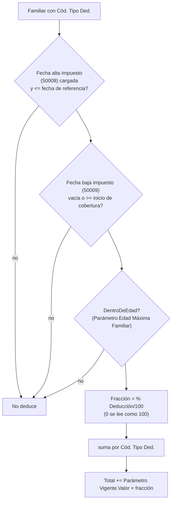

# Deducciones de Ganancias y familiares

La variable de sistema `DEDUC_GANANCIAS` (resuelta por `CalcDeduccionesGanancias`, Cod50016) devuelve el **total anual de deducciones personales** del empleado a la fecha de referencia: cargas de familia más gastos deducibles. Alimenta el cálculo de Ganancias 4ª categoría (proyección anual). Lo que sigue es lo que el código hace hoy.

## Parte 1: cargas de familia (`Employee Relative`)

Fuente: la tabla estándar `Employee Relative` extendida (`TabExt52002`, más campos de la extensión *Final Version*). Se recorren los familiares con `Cód. Tipo Ded.` cargado.

Puntos que cuestan caro si se olvidan:

1. **El Tipo de deducción es un Parámetro**, no una fila de `Ded. Ganancias Vigente`. `Cód. Tipo Ded.` tiene `TableRelation` a `Parámetro`; el motor busca el `Parámetro Vigente` con `Cód. Parámetro Base = Cód. Parámetro = tipo` y `Vigencia Desde <= fecha` (último) y usa su `Valor` como importe **anual** de la deducción. Ver [[get-con-menos-argumentos]] (la PK de `Parámetro Vigente` empieza por `Cód. Parámetro Base`).
2. **Sólo la fecha de alta de impuesto habilita.** Un familiar en la ficha **no** deduce: la ficha sirve también para asignaciones familiares y obra social. `Fecha alta impuesto` vacía = *nunca se declaró* (el F.572), no "vigente desde siempre". Hay **tres pares de fechas** y sólo uno cuenta: `Fecha inicial/final` (vigencia del vínculo, cargada para todos), `Fecha alta/baja familiar a cargo` (asignaciones) y `Fecha alta/baja impuesto` (Ganancias). Ver [[familiar-alta-impuesto]].
3. **Es todo o nada por período**: método de proyección anual de AFIP; la deducción anual completa aplica si el familiar es válido, sin prorrateo por meses. Lo que sí se aplica como coeficiente es `% Deducción`.
4. **`% Deducción` = 0 no anula**: el motor lo lee como "sin cargar" y aplica 100. Para excluir a un familiar: vaciar `Cód. Tipo Ded.` o cargar `Fecha baja impuesto`. (Al validar `Cód. Tipo Ded.` con alta impositiva y % en 0, se completa 100.)
5. **Tope de edad** (`DentroDeEdad`): el `Parámetro` del tipo lleva `Edad Máxima Familiar` (hijo menor de edad con 18; hijo incapacitado y cónyuge sin tope). Se deduce **el mes del cumpleaños** y se deja de deducir al siguiente. Se mide contra el **inicio del período**, no el de la cobertura: Ganancias se liquida por mes, y con dos liquidaciones el mismo mes el hijo no puede deducirse en una y en otra no. **Sin tope o sin fecha de nacimiento, deduce** (no se le quita una deducción a nadie por un dato que falta).
6. La **baja** se compara contra el inicio de la **cobertura** (`FPeriodoFechaDesde`), el alta contra la fecha de referencia.

## Parte 2: gastos deducibles (`Ded. Ganancias Empleado`)

Declaraciones por empleado, versionadas por `Vigencia Desde`. El motor toma **la última versión** con `Vigencia Desde <= fecha de referencia` (el conjunto completo de filas que comparten esa fecha) y suma las filas con **`Importe Fijo > 0`** (prepaga, intereses hipotecarios, servicio doméstico…). Se edita desde la subpágina de la ficha del empleado; la importación SIRADIG también escribe acá.

> [!warning] Lo que la tabla promete y el código no hace
> `Ded. Ganancias Empleado` (comentario de cabecera) y `Ded. Ganancias Vigente` ("Tabla Deducciones Ganancias (AFIP)") describen el camino `Importe Fijo = 0 ⇒ Importe Anual de la tabla × Cantidad`. **El motor no lo recorre**: filtra `Importe Fijo > 0` y no lee `Ded. Ganancias Vigente`. Esa tabla sólo sirve hoy de `TableRelation` de `Cód. Tipo` y de lista de consulta (Role Center). Una fila de cantidad con `Importe Fijo = 0` **no deduce nada**. Los importes de las cargas de familia viven en `Parámetro Vigente`.

## Detalle persistido

Con liquidación guardada (`FLiqNo <> ''`) se escribe `Detalle Ganancias Liq.` (60025), una fila por deducción activa, `Orden = 500`:

| `Tipo` | `Código` | `Cantidad` | `Importe Unit. Anual` | `Importe Total` |
|---|---|---|---|---|
| Familiar | tipo de deducción | fracción acumulada | `Valor` del parámetro | `Valor × fracción` |
| Gasto | `Cód. Tipo` | 0 | 0 | `Importe Fijo` |
| Paso de cálculo | lo escribe `Motor Liquidación` (Cod50014) al armar el desglose de Ganancias | | | |

Se borra y regenera en cada recálculo. El comentario de `Cantidad` ("months_active/12 × custody_pct/100") es de una versión anterior: hoy es sólo `% Deducción/100` sumado por tipo.

## Historia que explica el estado actual

- `Cod50082 "Migracion Fechas ImpFam"` **quedó vacío el 22/9/2026**. Aplanaba los tres pares de fechas en `Fecha inicial/final` y por eso todo familiar de la ficha deducía (cónyuge a 186 empleados en BC contra 135 en Meta4). Se conserva la codeunit (con su upgrade tag) para que no se vuelva a disparar en entornos donde no corrió. La acción de página "Migrar fechas de familiares" también se quitó.
- `Fecha Ingreso/Egreso Impuesto` (50211/50212, extensión propia) están `ObsoleteState = Pending` y vacías: ya no se leen ni como respaldo.
- Los campos 50008/50009/50000/50010 se leen **por número de campo** vía `RecordRef` y `FieldExist` (no por nombre), y devuelven vacío si el campo no existe en el entorno.
- El grossing-up puede **tapar** un error de deducción: el neto sale bien igual; comparar bruto y base ([[grossing-up-tapa-errores]]). Embargos y cuota alimentaria como Retención rompen `YTD_RETENIDO_ANUAL` ([[embargo-cuota-alimentaria-como-retencion]]).

## Dónde seguir

La importación SIRADIG y el F.572 se documentan en `04 Integraciones`. Los tipos de deducción (`DED_CONYUGE`, `DED_HIJO…`, según los ejemplos de los comentarios del código) son **parámetros** con vigencia: su configuración vive en el modelo de parámetros, no en esta capa.

Relacionado: [[Vision del dominio pesquero]], [[Índice Dominio - empleado y condiciones]].
