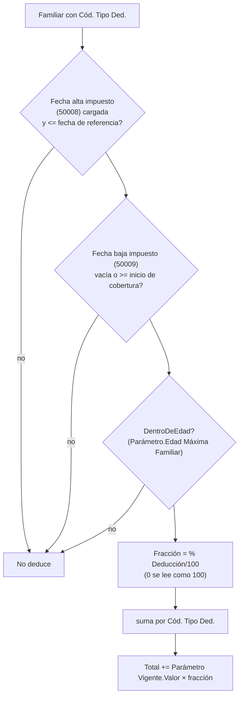

# Deducciones de Ganancias y familiares

La variable de sistema `DEDUC_GANANCIAS` (resuelta por `CalcDeduccionesGanancias`, Cod50016) devuelve las cargas de familia más los gastos deducibles del empleado a la fecha de referencia. Las cargas usan parámetros **mensuales**; en `LIQ_FINAL` el motor los multiplica por doce. Los gastos fijos se suman sin ese factor. La fórmula mensual de Ganancias acumula las deducciones. Lo que sigue es lo que el código hace hoy.

## Foto mensual original de Meta4

Antes de leer los familiares actuales, el motor consulta FAM_HIST_M4 para el empleado
y el inicio exacto del mes. Con foto usa su total familiar, incluso cero; sin foto
conserva la lectura habitual. No se arrastra al mes siguiente ni se usa en LIQ_FINAL.
Los gastos de la parte 2 se suman en ambos caminos. Ver
[[ganancias-familiares-meta4-vs-recibo-historico]] para origen, alcance y pruebas.

La configuración aplicada el 16/10/2026 agrega **doce fotos desde 01/02/2026**. Los
originales de febrero guardan deducciones familiares acumuladas: el valor mensual
equivalente es `(IG_CONYUGE_REM + IG_HIJOS_REM) / 2`, incluidos los ceros comprobados.
Se contrastaron las corridas originales con Oracle y el archivo literal. Las fotos de enero
y el maestro familiar actual se conservan. `Obtener` ya admite el mes exacto; los métodos
de importación de CU110068 limitados a enero no se reutilizaron para esta carga.

## Parte 1: cargas de familia (`Employee Relative`)

Fuente: la tabla estándar `Employee Relative` extendida (`TabExt52002`, más campos de la extensión *Final Version*). Se recorren los familiares con `Cód. Tipo Ded.` cargado.



Puntos que cuestan caro si se olvidan:

1. **El Tipo de deducción es un Parámetro**, no una fila de `Ded. Ganancias Vigente`. `Cód. Tipo Ded.` tiene `TableRelation` a `Parámetro`; el motor busca el `Parámetro Vigente` con `Cód. Parámetro Base = Cód. Parámetro = tipo` y `Vigencia Desde <= fecha` (último). Su `Valor` es **mensual**, con factor doce sólo en `LIQ_FINAL`. Ver [[get-con-menos-argumentos]] (la PK de `Parámetro Vigente` empieza por `Cód. Parámetro Base`).
2. **Sólo la fecha de alta de impuesto habilita.** Un familiar en la ficha **no** deduce: la ficha sirve también para asignaciones familiares y obra social. `Fecha alta impuesto` vacía = *nunca se declaró* (el F.572), no "vigente desde siempre". Hay **tres pares de fechas** y sólo uno cuenta: `Fecha inicial/final` (vigencia del vínculo, cargada para todos), `Fecha alta/baja familiar a cargo` (asignaciones) y `Fecha alta/baja impuesto` (Ganancias). Ver [[familiar-alta-impuesto]].
3. **La inclusión es binaria por período**: si el familiar es válido se toma el valor mensual completo, sin prorratear días. La acumulación mensual pertenece a la fórmula de Ganancias. Lo que sí aplica el motor como coeficiente es `% Deducción`.
4. **`% Deducción` = 0 no anula**: el motor lo lee como "sin cargar" y aplica 100. Para excluir a un familiar: vaciar `Cód. Tipo Ded.` o cargar `Fecha baja impuesto`. (Al validar `Cód. Tipo Ded.` con alta impositiva y % en 0, se completa 100.)
5. **Tope de edad** (`DentroDeEdad`): el `Parámetro` del tipo lleva `Edad Máxima Familiar` (hijo menor de edad con 18; hijo incapacitado y cónyuge sin tope). Se deduce **el mes del cumpleaños** y se deja de deducir al siguiente. Se mide contra el **inicio del período**, no el de la cobertura: Ganancias se liquida por mes, y con dos liquidaciones el mismo mes el hijo no puede deducirse en una y en otra no. **Sin tope o sin fecha de nacimiento, deduce** (no se le quita una deducción a nadie por un dato que falta).
6. La **baja** se compara contra el inicio de la **cobertura** (`FPeriodoFechaDesde`), el alta contra la fecha de referencia.

## Parte 2: gastos deducibles (`Ded. Ganancias Empleado`)

Declaraciones por empleado, versionadas por `Vigencia Desde`. El motor toma **la última versión** con `Vigencia Desde <= fecha de referencia` (el conjunto completo de filas que comparten esa fecha) y suma las filas con **`Importe Fijo > 0`** (prepaga, intereses hipotecarios, servicio doméstico…). Se edita desde la subpágina de la ficha del empleado; la importación SIRADIG también escribe acá.

La importación asigna `Cód. Tipo` sin `Validate`, así que `Descripción` queda vacía en las filas importadas. La subpágina ([[Pag50152]]) muestra la propia si está cargada y, si no, la de `Ded. Ganancias Vigente` (la vigente a la `Vigencia Desde` de la línea); es un campo calculado y no toca los datos. **No hay vínculo estructurado con el familiar**: la clave de la tabla no tiene campo de familiar. Desde el 23/10/2026 el parser también lee `descBasica` ("CUIT - proveedor"; el `nroDoc`/`denominacion` del `<deduccion>` es del proveedor, no de un familiar) y, en el gasto educativo (tipo 32), el `apellidoNombreFamiliar` de `<detalles>`, y el importador los escribe en `Descripción` (reimportar no pisa con vacío). **Una fila por `<deduccion>`**: la PK de `Ded. Ganancias Empleado` es empleado + vigencia + tipo + **`No. Línea`**; el importador numera desde 0 las repeticiones de un tipo (la primera es la línea 0, igual que las filas cargadas a mano o anteriores al campo), y reimportar actualiza cada línea por su número. El motor no cambió: suma todas las filas de la vigencia con `Importe Fijo > 0`. **Cambiar la PK exige ForceSync, que dropea la tabla**: antes de publicar se respalda (script de INSERTs fuera del repo) y después se restaura. Sólo el tipo 32 trae al familiar, y su `numeroDocFamiliar` coincide con el `nroDoc` de una `<cargaFamilia>` del mismo archivo (verificado en 2 de 2 casos): si algún día hace falta el vínculo, ese es el dato para buscar en `Employee Relative`.
> [!warning] Lo que la tabla promete y el código no hace
> `Ded. Ganancias Empleado` (comentario de cabecera) y `Ded. Ganancias Vigente` ("Tabla Deducciones Ganancias (AFIP)") describen el camino `Importe Fijo = 0 ⇒ Importe Anual de la tabla × Cantidad`. **El motor no lo recorre**: filtra `Importe Fijo > 0` y no lee `Ded. Ganancias Vigente`. Esa tabla sólo sirve hoy de `TableRelation` de `Cód. Tipo` y de lista de consulta (Role Center). Una fila de cantidad con `Importe Fijo = 0` **no deduce nada**. Los importes de las cargas de familia viven en `Parámetro Vigente`.

## Gastos históricos acumulados de febrero

La misma aplicación incorpora dos deducciones acreditadas por sus columnas originales:
servicio doméstico y cuota médico asistencial. Se guardan como **importes acumulados reales**
en `GAS_DOM_HIST` y `GAS_MED_HIST`, por empleado y mes. No se modifican las declaraciones
actuales de `Ded. Ganancias Empleado` ni se cargan novedades de impuesto.

`GASTOS_IG4_HIST` es una fuente SUM de `Parámetro Vigente.Valor`, filtrada por esos códigos,
empleado y `Vigencia Desde = {PERIODO_DESDE}`. No arrastra una foto a otro mes. Dos conceptos
virtuales, sin fracciones, devengo ni impresión, adaptan su unidad sin cambiar `5010`:

1. `GASTOS_IG4_BASE`, orden 0, conserva el valor original de la variable de sistema
   `DEDUC_GANANCIAS` y su detalle antes de sobrescribir el nombre.
2. `DEDUC_GANANCIAS`, orden 1, calcula:

```text
#GASTOS_IG4_BASE + GASTOS_IG4_HIST / (MES_ANUAL * (1 + 1 / 12))
```

La fórmula mensual de `5010` vuelve a multiplicar por mes y por la doceava: así descuenta
el gasto acumulado real, sin almacenarlo como un importe mensual ficticio. Ambos virtuales
sólo corren con gasto histórico positivo y en los tipos mensuales de `5010`; excluyen
AGUINALDO y LIQ_FINAL. Sin foto no generan línea ni cambian el contexto. Cada pasada de
grossing-up repone la variable de sistema original, evitando sumar el gasto repetidamente.

El gasto educativo inferido por identidad y regla de tope **no se cargó**: falta certificar
la entrada histórica. Una modificación retroactiva del maestro no prueba lo declarado
al emitir el recibo. Enero y la fórmula de `5010` permanecen intactos. La configuración quedó aplicada.
La captura final estable verificó las doce fotos familiares, los dos gastos acreditados,
los auxiliares materializados y la secuencia cierre→DEV. Junto con los cuatro casos de
contribución solidaria, se reconstruyeron 29 recibos de 18 empleados: diecisiete retenciones
mensuales coinciden con Meta4 con una tolerancia de dos centavos. El caso restante conserva
exactamente el residuo educativo previsto, separado del gasto médico aplicado.
Las dos fracciones fiscales de la contribución solidaria ya pagada también quedaron
aplicadas y verificadas: ver [[sin-sindicato-paga-segun-convenio]]. Evidencia privada en
`.snapshots/aplicar-netos-contribuciones-febrero-20261016/ganancias/`.

Ver [[sin-sindicato-paga-segun-convenio]], [[ganancias-devolucion-mensual-y-unidades]]
y [[grossing-up-tapa-errores]].

## Detalle persistido

Con liquidación guardada (`FLiqNo <> ''`) se escribe `Detalle Ganancias Liq.` (60025), una fila por deducción activa, `Orden = 500`:

| `Tipo` | `Código` | `Cantidad` | `Importe Unit. Anual` | `Importe Total` |
|---|---|---|---|---|
| Familiar | tipo de deducción | fracción acumulada | `Valor` del parámetro | `Valor × fracción` |
| Gasto | `Cód. Tipo` | 0 | 0 | `Importe Fijo` |
| Paso de cálculo | lo escribe `Motor Liquidación` (Cod50014) al armar el desglose de Ganancias | | | |

Se borra y regenera en cada recálculo. El comentario de `Cantidad` ("months_active/12 × custody_pct/100") es de una versión anterior: hoy es sólo `% Deducción/100` sumado por tipo.

## Historia que explica el estado actual

- `Cod50082 "Migracion Fechas ImpFam"` **quedó vacío el 22/9/2026**. Aplanaba los tres pares de fechas en `Fecha inicial/final` y por eso todo familiar de la ficha deducía (cónyuge a 186 empleados en BC contra 135 en Meta4). Se conserva la codeunit (con su upgrade tag) para que no se vuelva a disparar en entornos donde no corrió. La acción de página "Migrar fechas de familiares" también se quitó.
- `Fecha Ingreso/Egreso Impuesto` (50211/50212, extensión propia) están `ObsoleteState = Pending` y vacías: ya no se leen ni como respaldo.
- Los campos 50008/50009/50000/50010 se leen **por número de campo** vía `RecordRef` y `FieldExist` (no por nombre), y devuelven vacío si el campo no existe en el entorno.
- El grossing-up puede **tapar** un error de deducción: el neto sale bien igual; comparar bruto y base ([[grossing-up-tapa-errores]]). Embargos y cuota alimentaria como Retención rompen `YTD_RETENIDO_ANUAL` ([[embargo-cuota-alimentaria-como-retencion]]).

## Dónde seguir

El mapeo y la revisión contra el maestro actual de Oracle y los recibos históricos de enero
se documentan en [[ganancias-familiares-meta4-vs-recibo-historico]]. Meta4 4927 admite C y CC;
4929 evalúa la incapacidad mediante `INCAPAC_FAM`, separada del parentesco HI.

La importación SIRADIG y el F.572 se documentan en `04 Integraciones`. Los tipos de deducción (`DED_CONYUGE`, `DED_HIJO…`, según los ejemplos de los comentarios del código) son **parámetros** con vigencia: su configuración vive en el modelo de parámetros, no en esta capa.

Relacionado: [[Vision del dominio pesquero]], [[Índice Dominio - empleado y condiciones]].

## Unidad mensual verificada para febrero

MNI_ANUAL, DESP_4CAT y las cargas de familia se consumen en unidades mensuales,
aunque algunos nombres históricos digan anual. Sus vigencias de febrero a junio
habían sido importadas como acumulados enero..mes y se normalizaron: la fórmula
5010 acumula una sola vez mediante MES_ANUAL. Los gastos personales conservan su
importe declarado. La rama mensual permite devolver hasta el saldo ya retenido.
Ver [[ganancias-devolucion-mensual-y-unidades]]; no volver a cargar acumulados de
Meta4 en estos parámetros mensuales sin convertir su unidad.

## Cuota médico asistencial: una foto por mes (marzo 2026)

`GAS_MED_HIST` lleva la cuota médico asistencial **acumulada real** de Meta4 (`IG_CMASIS_REMUN`, concepto 5043) y la fuente `GASTOS_IG4_HIST` lee la fila con `Vigencia Desde = {PERIODO_DESDE}`: **cada mes necesita su propia fila**, y un mes sin foto deduce cero. Hoy el único caso es 90454: 259.304,58 (febrero), 525.003,17 (marzo, cargado el 19/10/2026 con `scripts/GastoMedicoHistoricoMarzo.sql`); Meta4 sigue acumulando (786.398,85 en abril). Para abril en adelante hay que cargar la fila de cada mes.

En Meta4 el 5043 no es un dato sino un resultado del 5002: `tcma = min(declarado, 5 % del subtotal)` y se resta de la base. Lo que BC carga ya es el valor topeado.

Pendiente: en febrero 90454 sigue 65.256 arriba en el impuesto aunque BC aplica los 259.304,58 completos; la base imponible de Meta4 (1.873.560) implica 826.428 de deducciones que ninguna de sus columnas explica. Sin deducción de la ley 27617 (`DED_IG_27617*` en cero para él).

### Gastos educativos (5599): la tercera foto histórica (19/10/2026)

El residuo de febrero de 90454 (65.256 de impuesto, 343.453,50 de base) **es** la deducción de gastos educativos de Meta4, y quedó certificado con el origen SIRADIG: `M4T_VAL_FASE_ALTA` (concepto 5599, 90454, vigencia 1/1 al 31/12/2026) declara 2.169.267,76 (el 4915 es la cuota médica y el 5067 los honorarios médicos). La fórmula del concepto 5599 (`DED_EDUC`, "Deducción gastos educativos") lee ese valor y lo topa: `tope = ganancia no imponible acumulada × 40 %`, `deducción = min(declarado, tope)`. Febrero 858.633,75 × 0,40 = 343.453,50; marzo 1.287.950,63 × 0,40 = 515.180,25; abril 1.717.267,50 × 0,40 = 686.907,00 — lo declarado supera siempre el tope acumulado, así que manda el tope. Enero no la tuvo y Meta4 la aplicó ya acumulada desde febrero.

Se carga como `GAS_EDU_HIST` (parámetro base + una fila por mes y empleado, importe acumulado real) y `GASTOS_IG4_HIST` suma ahora los tres códigos. Script: `scripts/GastoEducativoHistorico.sql`. Quedan cargados febrero y marzo de 90454; cada mes siguiente necesita su fila hasta que haya una regla en el motor (`min(declarado, 40 % × MNI acumulada)` leyendo la declaración SIRADIG de `Ded. Ganancias Empleado`).
