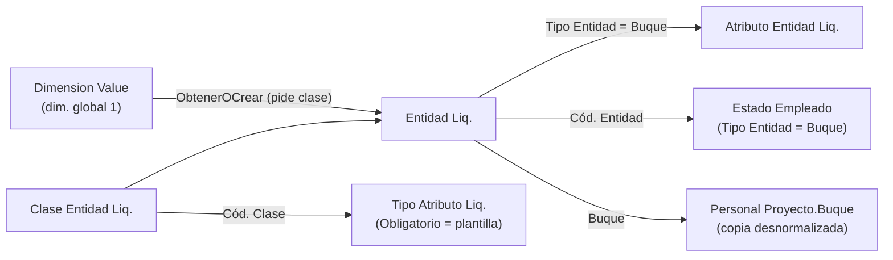

# Entidades y clases de entidad

## Qué es una entidad

`Entidad Liq.` (110008) es **el maestro operativo** de lo que no es una persona: un buque, una planta de proceso, una administración. Su `Código` **es siempre** el del valor de dimensión global 1 del que nace, y esa igualdad sostiene todo lo demás:

- los proyectos se vinculan al buque por `Job."Global Dimension 1 Code"`;
- los estados y los atributos guardan ese mismo string (`Tipo Entidad = Buque`);
- el día que 28.0 traiga el maestro compartido `Vessels`, la convergencia será un cambio de origen y no una migración (por eso la clave no cambia).

`Clase Entidad Liq.` (110006) es el catálogo de clases (buque, planta, administración…). Una clase define **qué atributos se esperan** de sus entidades: los `Tipo Atributo Liq.` con ese `Cód. Clase`. La clase es obligatoria al crear la entidad (`OnInsert` hace `TestField` y valida que exista el valor de dimensión).

## Alta controlada

Una entidad **no se da de alta suelta**: se crea desde el valor de dimensión.

1. La lista *Valores de Dimensión y Entidades* (página 50191, `Buques`) es el puente: sólo muestra el valor y si tiene entidad (`Sin entidad`). Hacer *drill-down* en el código llama a `ObtenerOCrear`.
2. `ObtenerOCrear` pregunta si crearla, abre el lookup de clases **antes** de insertar (la tabla exige clase, y abortar el alta con un error sería peor que preguntar) y recién ahí inserta.
3. Todo lo operativo (estados, atributos, plantilla) vive en la lista *Entidades* (110018) y la *Ficha Entidad* (110019): "un valor de dimensión sin entidad todavía no es un buque".

`Entidad Liq.` no se puede **borrar** si tiene atributos; `Clase Entidad Liq.` no se puede borrar si tiene tipos de atributo asociados.

## Renombrar el valor de dimensión arrastra todo

`Gestión Entidades Liq.` (Cod50075) se suscribe a `OnAfterRenameEvent` de `Dimension Value` (un `tableextension` no puede agregar `OnRename`). Sólo actúa si la dimensión es la **global 1** de la contabilidad. `Arrastrar(viejo, nuevo)` hace cuatro cosas:

| Qué | Cómo | Por qué así |
|---|---|---|
| `Entidad Liq.` | `Rename` | El código es clave primaria. |
| `Atributo Entidad Liq.` (buque) | Junta los `SystemId` y `Rename` uno por uno | `Cód. Entidad` está en la PK; renombrar mientras se recorre desordena el cursor. |
| `Estado Empleado` (`Tipo Entidad = Buque`) | `ModifyAll("No. Empleado", nuevo)` **sin** triggers | Ojo: en esta tabla el código del buque vive en `No. Empleado`. Sin triggers porque no se mueve ninguna fecha y el `OnModify` revalidaría contigüidad y liquidaciones. |
| `Personal Proyecto.Buque` | `ModifyAll` | Copia desnormalizada nuestra; BC arrastra la dimensión del `Job` pero esta columna no la toca nadie. |

> [!danger] Silencioso si falla
> Sin el arrastre no hay error: el histórico y los atributos del buque quedan colgando del código viejo, invisibles, y la entidad nueva aparece sin historia.

## Plantilla de atributos

`Plantilla Atributos Liq.` (Cod50073) materializa **sin crear tablas nuevas** la plantilla de una clase: crea una fila vacía por cada `Tipo Atributo Liq.` de esa clase con `Obligatorio = true` que la entidad todavía no tenga. Es idempotente y **no toca nada existente**, aunque esté vacío (una vigencia existente puede estar ya usada en liquidaciones). Si no se pasa fecha usa `WorkDate()`. `ContarFaltantes` alimenta el indicador de la lista. Se ejecuta con la acción *Aplicar plantilla de atributos*.

> [!note] Los obligatorios avisan, no bloquean
> Un atributo faltante no impide liquidar: debe avisar, no impedir que se pague. Ver [[Atributos tipados]].

## Tipo de entidad (enum 50317)

`Empleado`, `Buque` y `Proyecto (Marea)`. El historial de **estados** sólo usa los dos primeros; los **atributos** usan los tres. El valor 2 se agregó seguro porque ningún consumidor enumera de forma exhaustiva.

## Residuos

`tableextension 52005 "Clase en Dimension Value"` quedó **obsoleto (Pending)**: la clase nació colgada del valor de dimensión y se mudó a `Entidad Liq.`. No hay migración de datos porque la clase nunca llegó a cargarse ahí.

Relacionado: [[Estados de empleado y de buque]], [[Atributos tipados]], [[veda-como-atributo-del-buque]], [[proyecto-nomina-dos-fuentes]], [[Vision del dominio pesquero]].
