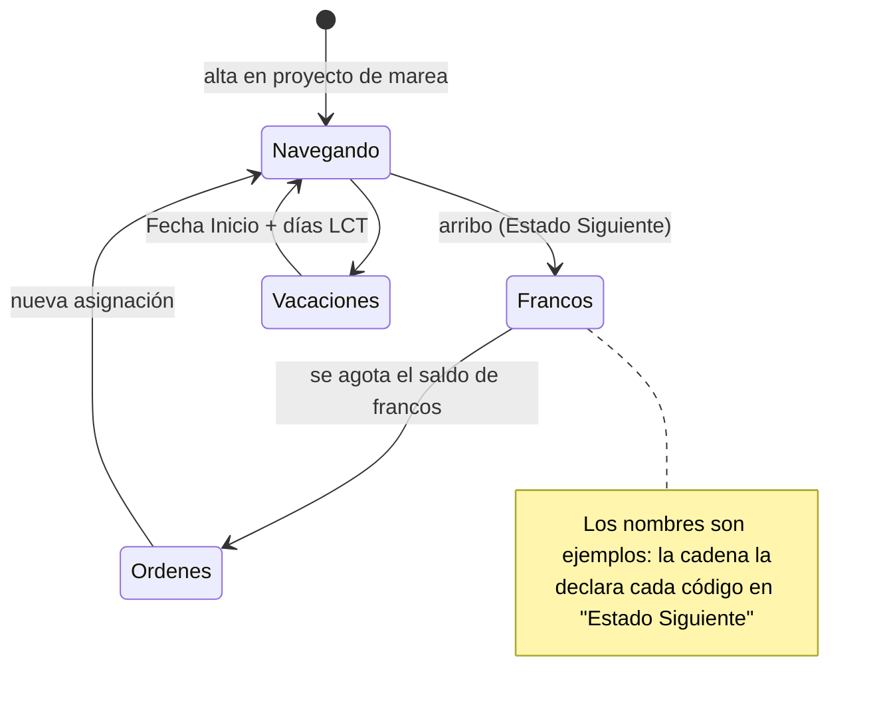

# Estados de empleado y de buque

`Estado Empleado` (60000) guarda **qué hacía cada día** una entidad. Una sola tabla sirve a empleados y buques (`Tipo Entidad`); el campo 1 (`No. Empleado`, caption *Cód. Entidad*) tiene el legajo o el código del buque. Detalle de campos: [[Tabla - Estado Empleado]] y [[Tabla - Cód. Estado Empleado]].

## El invariante: contiguo, sin huecos, sin solapes

- `Fecha Fin` es **inclusiva**; en blanco = abierto. Mientras exista un estado posterior de la misma entidad, el trigger la mantiene en *inicio del siguiente − 1* (`SincronizarContiguidad`).
- Editar `Fecha Fin` a mano **empuja** el inicio del siguiente (`EmpujarSiguienteEstado`). Se corta con error si el empuje lo deja sin días o pisa al sub-siguiente: esa decisión es de nómina, no de un trigger.
- Borrar un estado hace que el anterior absorba el tramo (`ReabrirAnteriorAlBorrar`); si era el último, el anterior queda abierto.
- Un solo estado por entidad y fecha de inicio (`ValidarUnEstadoPorFecha`), aunque la clave única K1 incluya `No. Proyecto`.
- **Leer siempre `FechaFinEfectiva()`**, nunca el campo crudo: devuelve `Fecha Fin`, o *inicio del siguiente − 1*, o 31/12/9999 si es el último. Ver [[estado-empleado-effective-dated]] y [[recorrer-estado-abierto-dia-por-dia]] (recorrer un estado abierto día por día desborda el tipo `Date`).
- `GetEstadoEntidad(tipo, entidad, fecha)` = el último con `Fecha Inicio <= fecha` **y** `fecha <= FechaFinEfectiva`. Sólo falla tras una baja o antes del primer estado. El motor corta con error si el empleado no tiene estado a la fecha de referencia (`ValidarEstadoExiste`).

## Validaciones al insertar y modificar

| Regla | Qué impide | Detalle |
|---|---|---|
| `ValidarNoEsAltaNiBaja` | Cargar códigos de `Tipo Estado` Alta/Baja | Van en [[Fases de alta]]. Es activa porque los códigos siguen en el mismo desplegable. |
| `ValidarDentroDeFaseDeAlta` | Estado de **empleado** fuera de toda fase | Sin ninguna fase → error; no la crea sola (la fecha de ingreso es un dato contractual). |
| `ValidarDentroDelProyecto` | Un estado `Transcurre en Marea` que empieza **después** del arribo del proyecto | Estricto, sin margen. Un proyecto sin `Ending Date` no restringe. |
| `ValidarNoHayLiquidacionesBloqueantes` | Tocar días ya cubiertos por una liquidación **no Borrador** del empleado | Sólo empleados; un Cierre de Marea cubre hasta su fecha de arribo, no hasta el fin del período. Revertir la liquidación primero. |
| Vacaciones | — | `Fecha Fin` se propone como `Fecha Inicio + días LCT − 1` (14/21/28/35 según antigüedad al 31/12, `CalcDiasVacaciones`). Es editable. |

> [!warning] Fecha de trabajo adelantada
> El 17/7/2026 se cargaron 29 estados NV con el `WorkDate` adelantado y la contigüidad les cerró lo que cada uno tenía abierto. `ValidarDentroDelProyecto` existe por ese incidente.

## Qué hace cada bandera de `Cód. Estado Empleado`

| Campo | Lo lee | Para qué |
|---|---|---|
| `Tipo Estado` (Normal, Alta, Baja, Vacaciones, Francos) | `Estado Empleado`, `AplicarAutoTransicion`, `AjustarEstadoFrancos` | Distingue vacaciones (tope LCT) y francos (se acotan al saldo). |
| `Ámbito` (Empleado, Buque, Ambos) | `SetEstadoBuque`, `PropagarEstadoAEmpleadosDeBuque` | Qué entidades pueden tomarlo. |
| `Estado Siguiente` | `EncadenarSiguienteAsignacion`, `AvanzarEmpleadosAEstadoSiguiente`, vacaciones, francos | La cadena de transición. En blanco = terminal. |
| `Devenga Francos` | Cascada de buque; francos | "¿está trabajando?" — **no** es "¿está a bordo?". Ver [[gp-devenga-francos-pero-es-improductivo]]. |
| `Transcurre en Marea` | `ResolverProyectoInactividad`, `ValidarDentroDelProyecto`, `ProyectoNominaDe` | "¿está a bordo, dentro de una marea?". Guardia en puerto, dique y pilotaje devengan francos pero **no** transcurren en marea. |
| `Promedia Ausencia` | `FechaInicioAusencia` (Cod50016) | Ancla la ventana del promedio de enfermedad/accidente. Ver [[ventana-promedio-ausentismo]]. |
| `Tipo Empleado` | Nadie en el motor | **Residual**: el tipo de empleado ahora sale del convenio. No tocarlo esperando efecto. |

## Cascadas que dispara un estado

1. **Salida de la marea** (`ResolverProyectoInactividad`, en `OnInsert`): si el estado nuevo no transcurre en marea y el anterior sí, asigna al empleado al `Proyecto Inactividad Nómina` de la marea (o, a falta, al `Proyecto Nómina` de Configuración de RR.HH.) y cuelga el estado de ese proyecto. La asignación al proyecto de nómina sólo se **crea** si ya existe la de la marea; el estado se cuelga del proyecto de nómina igual.
2. **Cierre de marea** (`Job.OnModify`): al pasar `Ending Date` de vacío a cargado, `CerrarAsignacionesDeProyecto` pone `Fecha Baja` en las asignaciones abiertas; el `OnModify` de `Personal Proyecto` cierra el estado y encadena la siguiente asignación (`EncadenarSiguienteAsignacion`): busca el **único** proyecto cuyo `Estado Liq. Personal Predet.` sea el `Estado Siguiente`; con cero o varios corta con error y revierte también el cierre.
3. **Vacaciones** (`AplicarAutoTransicion`): al insertar un estado de vacaciones con `Estado Siguiente`, inserta el de retorno en `Inicio + días de derecho`, salvo que otro estado ya interrumpa la ventana.
4. **Francos** (`AjustarEstadoFrancos`): antes de calcular, si el saldo de francos no cubre hasta la fecha de referencia, materializa el `Estado Siguiente` en `Inicio + saldo`. Ver [[francos-fifo-ledger]].

## Estados de buque y cascada a la tripulación

`Cod50072 Alta Estados Buque` crea (idempotente, no pisa) cinco códigos con `Ámbito = Buque`: `PESCA` (devenga francos), `NAVEGACION`, `PUERTO`, `AMARRADO`, `DIQUE`. Se dispara desde la acción *Crear estados de buque* de la lista de códigos.

`SetEstadoBuque(buque, estado, fecha)`:
- Si el buque venía de un estado con `Devenga Francos` y el nuevo no lo tiene → `AvanzarEmpleadosAEstadoSiguiente`: cada empleado de los proyectos del buque pasa al `Estado Siguiente` **de su propio estado vigente**, desde `fecha + 1`.
- En cualquier otro caso → `PropagarEstadoAEmpleadosDeBuque`, que **sólo actúa si el `Ámbito` del código incluye Empleado**.

> [!warning] Consecuencia
> Los cinco estados sembrados son `Ámbito = Buque`, así que fuera de la transición productivo→improductivo **no mueven a nadie**. Para que un estado de buque se refleje en la tripulación el código tiene que ser `Ambos`.

Se carga desde la lista *Entidades* (acción *Establecer estado*, `SetEstadoEnLoteEntidades`). El renombrado del valor de dimensión arrastra los estados: [[Entidades y clases de entidad]].

## Mantenimiento

- `Cod50062` (archivo `Cod50062.EstadoFechaFinUpgrade.al`; **el objeto es el codeunit 50065**) rellenó `Fecha Fin` en las filas anteriores a que el campo existiera. Es un `Upgrade` con tag `UAS-Payroll-EstadoEmpleado-FechaFin-20260807`; usa `Modify()` sin disparar la contigüidad por fila.
- Si dos filas contiguas idénticas aparecen partidas: [[algo-parte-estados-en-dos]].
- Carga masiva y por lote: [[Altas masivas y migraciones de fechas]].

Relacionado: [[Fases de alta]], [[Mareas y ciclo de la marea]], [[Francos - ledger FIFO]], [[tres-capas-fase-estado-asignacion]], [[Vision del dominio pesquero]].
