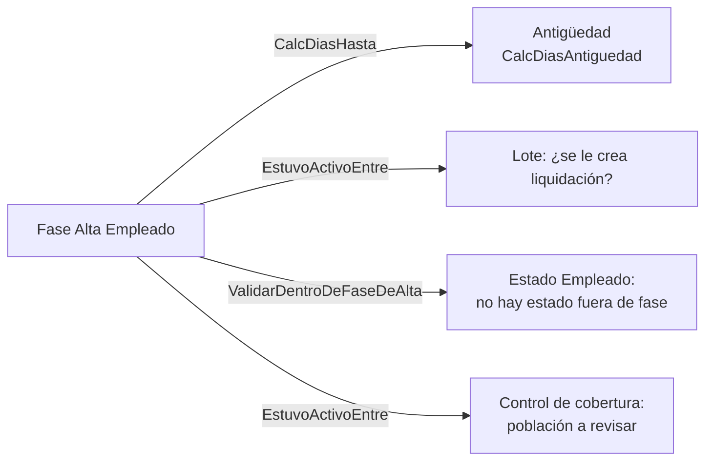

# Fases de alta

`Fase Alta Empleado` (110048) dice **cuándo la persona pertenece a la empresa**: una fila por tramo alta → baja. Es un eje distinto del [[Estados de empleado y de buque|historial de estados]] (qué hacía cada día) y por eso viven en tablas separadas: en la migración de enero de 2026, 153 filas competían por el mismo día (el del ingreso y el primer embarque) porque la tabla de estados admite uno por fecha. Meta4 también las tiene separadas (`M4T_FASES_ALTA` / `M4T_HIST_ESTADOS_EMPL`).

## Modelo

| Campo | Notas |
|---|---|
| `No. Empleado` + `No. Fase` (PK) | `No. Fase` correlativo **por empleado**; lo asigna `AbrirFase` (máximo + 1). |
| `Fecha Alta` / `Fecha Baja` | Baja vacía = fase abierta. |
| `Cód. Motivo Alta` / `Cód. Motivo Baja` | `TableRelation` a `Cód. Estado Empleado` filtrado por `Tipo Estado` Alta / Baja. El catálogo de motivos **no se duplica**: los códigos `ALT`, `BAJ-1`… se siguen cargando en [[Tabla - Cód. Estado Empleado]]. |
| `Días` | Se recalcula al guardar: `Baja − Alta + 1`. En la fase abierta es 0 (depende de "hoy"). |
| `Abierta` | Derivado de `Fecha Baja = 0D`. |

Reglas de la tabla (valen también para migraciones y ediciones a mano):
- La baja no puede ser anterior al alta (una fase de días negativos *resta* antigüedad sin error).
- Dos fases del mismo empleado **no se superponen** (la abierta cuenta como infinita). Si se superpusieran, los días compartidos se cuentan dos veces.
- Cerrar una fase (`CerrarEstadosPorBaja`) recorta con `Fecha Fin = Fecha Baja` los estados que **empiezan dentro de la fase** y quedaron abiertos o más allá de la baja. Usa `Modify(false)` a propósito: no empuja a siguientes ni se frena por liquidaciones ya hechas (la baja es el hecho; recalcular resuelve la liquidación vieja).

## Quién la consulta

- **Antigüedad.** `CalcDiasHasta(empleado, fechaRef)` suma las fases con `Fecha Alta <= fechaRef`; la abierta (o la que termina después) se mide contra la fecha de referencia, **no contra hoy**, y **ambos extremos cuentan** (una fase de un día es un día). `CalcDiasAntiguedad` (Cod50017) le suma `Antigüedad Reconocida × 365,25` (truncado) de la ficha. Si el empleado **no tiene ninguna fase** (días = 0) cae a `FechaRef − Employment Date` como red de seguridad: evita antigüedad cero silenciosa, pero no sabe de bajas ni reingresos.
- Con esos días salen `CalcAntiguedadAlFecha` (años completos; vacaciones LCT), `CalcAntiguedadFraccionAlFecha` (años + fracción redondeada a 0,0001; variable `AÑOS_ANTIGUEDAD`) y `CalcAntiguedadAl30Junio` (corte del Art. 32: de julio en adelante rige el 30/6 del mismo año; de enero a junio, el del anterior). Ver [[antiguedad-suma-de-fases]], [[antiguedad-dia-por-fase]], [[antiguedad-no-cuenta-dias-gp]], [[escala-antiguedad-meta4]].
- **Lote.** `EstuvoActivoEntre(empleado, desde, hasta)` es verdadero si alguna fase intersecta el rango. **Sin fases cargadas devuelve `true`**, a propósito: "no lo sabemos" no es "no estaba", y equivocarse hacia afuera es más caro (alguien no cobra) que hacia adentro (sobra una liquidación vacía que se descarta).

## Alta y baja en la práctica

- **Pantalla:** *Fases de Alta* (110028) filtra por legajo, muestra la antigüedad acumulada y es la fuente de verdad: lo que se ve acá es lo que se paga. También existe la subpágina en la ficha del empleado (110044).
- **Alta por sincronización NAV:** `AplicarFilaSincNAV` abre la fase con `Fecha Ingreso` y el motivo `Cód. Estado Alta (Sinc. NAV)` de Configuración de RR.HH. `AbrirFase` devuelve `false` y no hace nada si ya hay una abierta (la que existe vale más que la de NAV, que no sabe de reingresos). Ver [[Altas masivas y migraciones de fechas]].
- **Baja:** `CerrarFase` sobre la abierta; el motivo de baja sale del catálogo y de ahí se tipificarán los atributos indemnizatorios.

> [!warning] Motivo de baja: código de BC, no el número de Meta4
> Meta4 guarda `1`, `12`; BC usa `BAJ-1`, `BAJ-12`. Escribir el número crudo deja el lookup roto sin error (pasó con 38 filas). Ver [[fases-bc-contra-meta4]].

## Dos fuentes de "la baja" que conviene conocer

- Las **fases** deciden pertenencia, antigüedad y si un empleado entra al lote.
- La **ficha** (`Employee."Termination Date"` y `"Employment Date"`) decide el disparador *Baja del empleado* (Liquidación Final, `SeDioDeBajaEnElPeriodo`) y acota el control de cobertura (`ArmarEmpleado`). Si fase y ficha discrepan, cada proceso ve una verdad distinta: corregir las dos.

## Trampas conocidas

- Una fase abierta de alguien que ya se fue hace que BC le cree liquidación todos los meses (38 casos corregidos el 27/9/2026). Ver [[fases-bc-contra-meta4]].
- Las 22 fases viejas con `Días` menor a la resta traen un "días trabajados" de Meta4 y no la resta de la tabla; corregirlas mueve antigüedad.
- Comentarios de campo viejos: la extensión `Empleado Pesca Ext.` (`Antigüedad Reconocida`) todavía dice "since the last Alta state in Estado Empleado"; ya no es así.

Relacionado: [[Vision del dominio pesquero]], [[tres-capas-fase-estado-asignacion]], [[Tabla - Fase Alta Empleado]].
