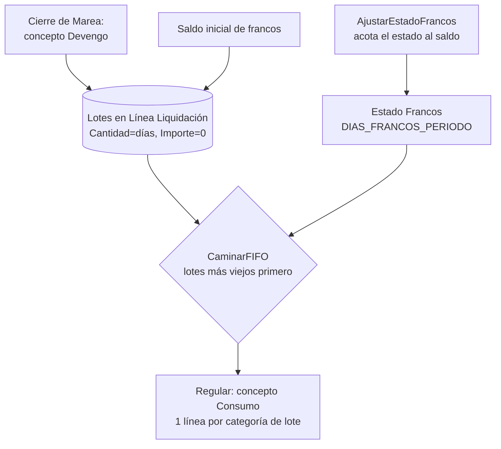

---
tipo: concepto
tags: [dominio, francos, fifo, ledger]
fuente: [src/Codeunits/Cod50053.GestionFrancos.al, src/Codeunits/Cod50014.MotorLiquidacion.al, src/Codeunits/Cod50017.GestionEstadoEmpleado.al, src/Enums/Enum50319.RolFrancoLiq.al, src/Tables/Tab110011.FrancosBufferLiq.al, src/Tables/Tab110014.LoteFrancoBufferLiq.al, src/Pages/Pag110024.FrancosPorTripulante.al, src/Pages/Pag110054.LotesFrancoConsumidos.al]
actualizado: 2026-10-20
---

# Francos: ledger FIFO

Los **francos** son días de descanso compensatorio que se **devengan navegando** y se **pagan cuando se gozan**, en puerto. Son **no fungibles**: cada día queda sellado con el convenio y la categoría con que se ganó, y se consume del más viejo al más nuevo (FIFO). Lo no fungible está en el *lote*; el *precio* se resuelve al consumir — ver [[Valor del franco]].

> [!note] No hay tabla de francos
> El ledger **es** [[Tabla - Línea Liquidación]] (principio de [[avoid-tables-principle]]). Las líneas de franco se reconocen por el enum `Rol Franco Liq.` (50319) del **concepto**: `Ninguno / Devengo / Consumo`. Ningún código de concepto está escrito en el motor.

## Las dos clases de línea

| | **Devengo** (lote) | **Consumo** |
|---|---|---|
| Concepto | `Rol Franco = Devengo` + `Es Devengo = Sí` (según snapshot, **1062** "Francos devengados y liquidados", sólo `CIERRE_MAREA`) | `Rol Franco = Consumo` (según snapshot, **1063** "Sueldo de franco", `REGULAR`) |
| Fórmula devuelve | **días** devengados: `REDONDEAR(COEF_FRANCOS * DIAS_ENROLAMIENTO + 1, 0)` | **días** a consumir: `DIAS_FRANCOS_PERIODO` |
| Qué guarda la línea | `Cantidad` = días; `Importe = 0` (el motor lo fuerza); lleva convenio/categoría de la liquidación | **una línea por categoría de lote**, con `Cantidad` e `Importe` = días × valor |
| Fecha | `Fecha Liquidación` del lote (ordena el FIFO) | fecha de la liquidación |

`COEF_FRANCOS` es un parámetro con sufijo de convenio: 0,52 en 768/19 y 0,50 en 729/15 (según [[francos-fifo-ledger]]; 0,4 + 0,12 por día navegado en 175/75, ver [[cct-175-75-remuneracion-navegacion]]).

> [!danger] La fórmula de un concepto de consumo devuelve DÍAS, no pesos
> El 1063 tenía una fórmula en plata y el motor la leyó como "días solicitados": entregaba el saldo entero y el recibo salía creíble. Por eso `GenerarLineasConsumoFranco` (Cod50014) **corta con error** si `DiasSolicitados > SaldoFrancos`. Pedir de más siempre es un error de configuración o falta el saldo inicial. El precio **no sale de la fórmula**: lo pone `Gestión Francos`.

## Flujo

## Cómo se camina el FIFO (`Cod50053.CaminarFIFO` y gemelos)

1. `TotalConsumido` = suma de `Cantidad` de las líneas de rol *Consumo* del empleado, **excluyendo la liquidación en curso** (`LiqActual`) — así un recálculo no se descuenta a sí mismo.
2. Se recorren los lotes (`FiltrarLotes`: rol *Devengo*, mismo filtro) por `No. Empleado, Fecha Liquidación`, ascendente, **saltando** los días ya consumidos.
3. Se toma de cada lote `min(disponible, restantes)` y se valúa ese tramo.
4. **El consumo no guarda de qué lote salió.** La atribución se deduce siempre por este recorrido; por eso `ResumenPorCategoria` (la grilla de control) usa **el mismo** recorrido: si usara otro criterio mostraría un saldo que el motor no va a pagar.

Variantes del recorrido, todas sobre el mismo ledger: `ValorPagoFrancosFIFO`, `FrancosConsumidos`, `CalcularConsumoDesglosado` (agrupa por categoría para el recibo), `DetallePorLote` (sin agrupar, para la auditoría).

### Selección literal de conceptos (20/10/2026)

Los cinco lectores del camino tradicional usan `Gestión Francos.FiltrarCodigos`.
Una lista de códigos exclusivamente numéricos conserva el OR SQL anterior. Para los demás,
se aplica `SetRange` a cada código y se reúnen las coincidencias con `Mark`/`MarkedOnly` sobre
la misma variable. Así `*`, `?`, `@`, comillas o separadores forman parte del código y no
ensanchan la selección. Encomillar una expresión de filtro no garantiza ese comportamiento.

La selección reemplaza sólo el filtro de conceptos del grupo activo y las marcas de esa
instancia; conserva los demás filtros/grupos, la clave y el sentido del recorrido FIFO.
Una lista vacía no incluye ninguna fila, ni siquiera líneas con concepto blanco. Al reutilizar
la variable se retiran las marcas anteriores, también al pasar a la ruta numérica.
Las marcas son temporales de la variable: no escriben líneas, consumos ni movimientos.

Los conceptos configurados con rol de franco en la captura operativa eran numéricos y conservan
su filtro anterior. La selección de códigos no modifica fórmulas ni dispara recálculos.
Pasaron la prueba original ampliada y tres regresiones, dentro de 56/56 en empresa aislada;
recibos y configuración se conservaron. Ver [[Tests automatizados]].

Referencias de plataforma: [SetRange](https://learn.microsoft.com/en-us/dynamics365/business-central/dev-itpro/developer/methods-auto/record/record-setrange-method)
y [marcas por variable](https://learn.microsoft.com/en-us/dynamics365/business-central/dev-itpro/developer/methods-auto/record/record-mark-method).

## Francos y estados: el saldo acota el estado

El empleado goza francos estando en un estado de `Tipo Estado = Francos`. Antes de calcular, el motor llama `Gestión Estado Empleado.AjustarEstadoFrancos`: si el saldo se agota antes del fin del período, inserta el **Estado Siguiente** del estado (p. ej. Francos → Órdenes) en `Fecha Inicio + SaldoFrancosAFecha`. Así `DIAS_FRANCOS_PERIODO` sólo cuenta días cubiertos y el resto cae en el estado siguiente.

- `SaldoFrancosAFecha(emp, fecha)` = devengado `<= fecha` − consumido `< fecha` (estable frente al consumo del propio período).
- `SaldoFrancos(emp, liq)` = devengado − consumido, **sin** la liquidación en curso.
- Los francos se gozan en puerto sin proyecto: el pago viaja en una **Regular** sin `No. Proyecto` (el motor se saltea la validación de proyecto). Ver [[Mareas y ciclo de la marea]].
- `Devenga Francos` es una bandera del estado y es distinta de que el trabajo sea productivo (GP devenga francos y es improductivo): [[gp-devenga-francos-pero-es-improductivo]].

## Pantallas

| Página | Para qué |
|---|---|
| `Francos por Tripulante` (110024) | saldo por tripulante + convenio + categoría a una fecha de corte, con `Importe a pagar si se liquidaran`; marca categorías sin valor de franco |
| `Lotes Franco Consumidos` (110054) | desde la línea de consumo: qué lote, a qué precio y qué proporción del valor pleno; se reconstruye, **no se guarda** |
| `Saldo Inicial de Francos` (110025) | carga inicial — ver [[Saldo inicial de francos]] |

El buffer `Francos Buffer Liq.` (110011) se llena por `(No. Empleado, Cód. Convenio, Cód. Categoría)`; `Lote Franco Buffer Liq.` (110014) es el desglose por lote. Ambos temporales.

> [!warning] El cero es silencioso
> Un valor de franco en cero **no da error**: el franco se paga en cero. La grilla de control cuenta las "categorías sin valor de franco".

## Discrepancias detectadas

- La lección [[francos-fifo-ledger]] dice que la categoría del precio es la del lote. **El código actual** valúa con la categoría de la **liquidación que paga** y sólo la pesquería sale del lote (`ParQuePagaElFranco`, ver [[Valor del franco]]).
- `ResumenPorCategoria` valúa con `ValorFrancoDia('', …)` (valor **pleno**, sin sufijo de pesquería): el "Importe Saldo" de la grilla de control sobrestima lo que se pagaría por lotes de tangonero (30%).

Tablas: [[Tabla - Línea Liquidación]], [[Tabla - Concepto Liquidación]]. Relacionadas: [[valor-franco-por-terna]], [[franco-porcentaje-por-pesqueria]], [[Índice Dominio - marea y pagos]].

## Evolución preparada: cuenta corriente (2026-10-12)

La afirmación anterior de que no hay tabla persistente aplica al camino tradicional. La implementación nueva conserva movimientos y contramovimientos por lote en `Movimiento Franco Liq.`, con activación explícita por empleado. Ver [[Cuenta corriente y matriz de francos]] para reconstrucción histórica, fórmulas por fila y reversión de cálculo/reapertura/eliminación. Preparado y compilado; pendiente de publicar y verificar en BC.

## La cuenta se corta en el alta de la fase (22/10/2026)

`Cod110059` (`Total` y `Matriz`) sólo mira movimientos con `Fecha Devengamiento` desde el alta de la fase vigente a la fecha de la liquidación (`InicioDeFase`, sobre `Fase Alta Empleado`). La baja paga el saldo con el 2803 pero ese concepto no tiene rol de franco, así que el ledger conservaba los lotes de la fase anterior y el reingreso los arrastraba: 04139 (33 días de la fase que cerró el 9/2) y 04889 (25) cobraban 49 y 54 días de indemnización contra 16 y 40 de Meta4, que reinicia el saldo en cada alta. Con el corte dan 16 y 40. Otros cuatro empleados de abril tienen saldo previo a su fase (04351, 04726, 04751, 04775) y cambiarán al recalcular. Límite conocido: una final fechada después del alta de un reingreso (mismo mes) quedaría sin sus propios lotes.

**Verificado tras publicar la 1.0.0.685 y recalcular (22/10/2026):** 04139 y 04889 coinciden con Meta4 en 2803, 2804 y bruto de la final (04139 16 días, 899.710; 04889 2.249.275, bruto a 1 peso).

## El valor del franco es una fórmula (23/10/2026)

`Cód. Parámetro Valor` del concepto de consumo (1063) dejó de ser un nombre de parámetro y pasó a ser una **fórmula** (campo de 250 caracteres). Los identificadores son nombres de parámetro y se resuelven **por lote**: `NOMBRE_<sufijo>_<convenio>_<categoría>` y, si no hay, `NOMBRE_<convenio>_<categoría>`. Un nombre solo (`VALOR_FRANCO`) vale lo de siempre. Admite `IFZERO(VALOR_FRANCO_EMP, VALOR_FRANCO)` y la comparación del tipo de liquidación por código: `IF(TIPO_LIQ = 'LIQ_FINAL', IFZERO(VALOR_FRANCO_EMP, VALOR_FRANCO), VALOR_FRANCO)`. Se evalúa en `Cod50053` (`ValorDeFormula`) con un evaluador propio y un contexto armado con los parámetros del lote; no puede ser un concepto informativo porque éstos se evalúan una vez por liquidación y el precio es del lote (convenio, categoría y pesquería distintos dentro de un mismo FIFO).

Motivo: en las finales Meta4 paga el 1063 y el 2803 al valor de empresa (1,2 × convenio en OF02 y OF04) y no paga el 2083; en la regular paga el de convenio y el 2083 completa. Datos y vigencia: `scripts/Concepto1063ValorFrancoFinalEmpresa.sql` (correr después de publicar). `Buscar usos` y `Control previo` leen el campo como texto.

**Dónde guarda Meta4 el valor del franco (23/10/2026).** El precio de convenio es el concepto 2082 `PR_FRANCO_ACDO` ("Precio Franco Acta Acuerdo") de `M4T_VAL_CONVENIO_CATEG_PUESTO`: USD por día por convenio `OF`, categoría y puesto, con vigencias (desde el 1/7/2025: OF01 115, OF02 100, OF03 90, OF04 85). El `PR_FRANCO` del recibo (1062) sale de ahí por el dólar de cada corrida, y un ajuste manual es una fila de `M4T_VAL_INCIDENCIA` con concepto 1062. En 2026 hay tres, del 23/4 (cargadas el 30/4): 04163 141.780, 04455 165.600 y 04836 141.780 por día = 1,2 × convenio; en 2025 hubo ocho (junio-julio). No existe una tabla de "valor de empresa": los `VALOR_FRANCO_EMP` de BC (3.500 en OF02 y 2.975 en OF04) son los valores de acta anteriores al 1/7/2025. Otras tablas: `M4T_SALDO_DS_FRANCO` (saldo en días) y `M4T_HIST_CENTR_COS_FRANCOS`.

**Reproducción de la decisión manual.** Un valor cargado para el EMPLEADO le gana al del par del lote: `VALOR_FRANCO_<empleado>` (el parámetro necesita `Sufijo Empleado`). Se cargaron 04163 y 04836 a 3.060 USD y 04455 a 3.600 desde el 23/4/2026 (`scripts/ValorFrancoManualFinalesTresOficiales.sql`). Es una decisión puntual de esos tres casos, no una regla.
