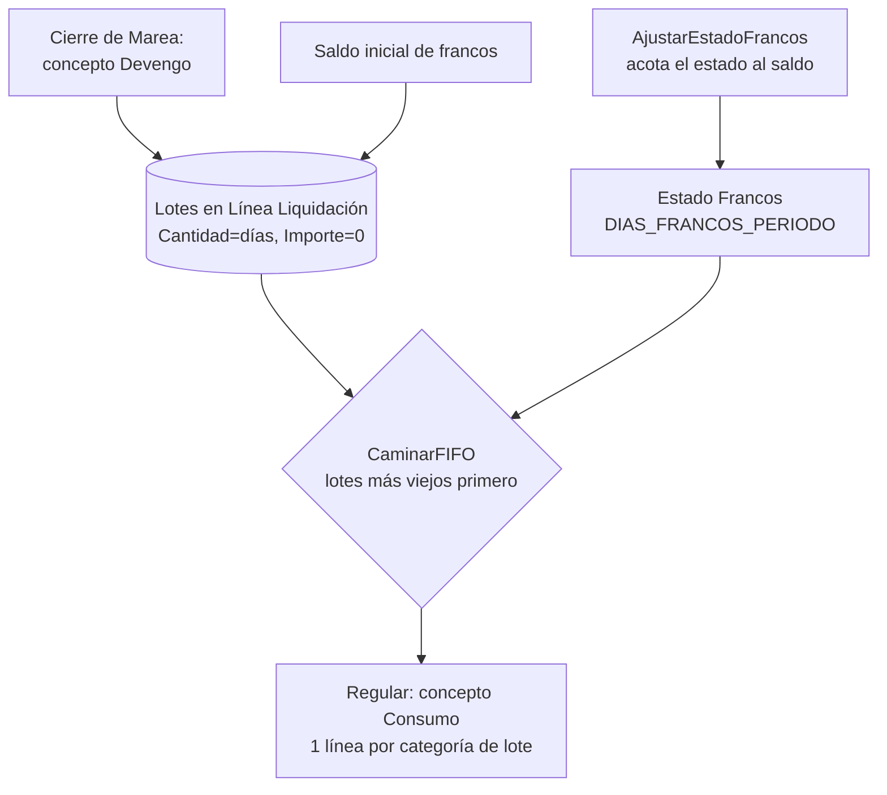

# Francos: ledger FIFO

Los **francos** son días de descanso compensatorio que se **devengan navegando** y se **pagan cuando se gozan**, en puerto. Son **no fungibles**: cada día queda sellado con el convenio y la categoría con que se ganó, y se consume del más viejo al más nuevo (FIFO). Lo no fungible está en el *lote*; el *precio* se resuelve al consumir — ver [[Valor del franco]].

> [!note] No hay tabla de francos
> El ledger **es** [[Tabla - Línea Liquidación]] (principio de [[avoid-tables-principle]]). Las líneas de franco se reconocen por el enum `Rol Franco Liq.` (50319) del **concepto**: `Ninguno / Devengo / Consumo`. Ningún código de concepto está escrito en el motor.

## Las dos clases de línea

| | **Devengo** (lote) | **Consumo** |
|---|---|---|
| Concepto | `Rol Franco = Devengo` + `Es Devengo = Sí` (según snapshot, **1062** "Francos devengados y liquidados", sólo `CIERRE_MAREA`) | `Rol Franco = Consumo` (según snapshot, **1063** "Sueldo de franco", `REGULAR`) |
| Fórmula devuelve | **días** devengados: `REDONDEAR(COEF_FRANCOS * DIAS_ENROLAMIENTO + 1, 0)` | **días** a consumir: `DIAS_FRANCOS_PERIODO` |
| Qué guarda la línea | `Cantidad` = días; `Importe = 0` (el motor lo fuerza); lleva convenio/categoría de la liquidación | **una línea por categoría de lote**, con `Cantidad` e `Importe` = días × valor |
| Fecha | `Fecha Liquidación` del lote (ordena el FIFO) | fecha de la liquidación |

`COEF_FRANCOS` es un parámetro con sufijo de convenio: 0,52 en 768/19 y 0,50 en 729/15 (según [[francos-fifo-ledger]]; 0,4 + 0,12 por día navegado en 175/75, ver [[cct-175-75-remuneracion-navegacion]]).

> [!danger] La fórmula de un concepto de consumo devuelve DÍAS, no pesos
> El 1063 tenía una fórmula en plata y el motor la leyó como "días solicitados": entregaba el saldo entero y el recibo salía creíble. Por eso `GenerarLineasConsumoFranco` (Cod50014) **corta con error** si `DiasSolicitados > SaldoFrancos`. Pedir de más siempre es un error de configuración o falta el saldo inicial. El precio **no sale de la fórmula**: lo pone `Gestión Francos`.

## Flujo

## Cómo se camina el FIFO (`Cod50053.CaminarFIFO` y gemelos)

1. `TotalConsumido` = suma de `Cantidad` de las líneas de rol *Consumo* del empleado, **excluyendo la liquidación en curso** (`LiqActual`) — así un recálculo no se descuenta a sí mismo.
2. Se recorren los lotes (`FiltrarLotes`: rol *Devengo*, mismo filtro) por `No. Empleado, Fecha Liquidación`, ascendente, **saltando** los días ya consumidos.
3. Se toma de cada lote `min(disponible, restantes)` y se valúa ese tramo.
4. **El consumo no guarda de qué lote salió.** La atribución se deduce siempre por este recorrido; por eso `ResumenPorCategoria` (la grilla de control) usa **el mismo** recorrido: si usara otro criterio mostraría un saldo que el motor no va a pagar.

Variantes del recorrido, todas sobre el mismo ledger: `ValorPagoFrancosFIFO`, `FrancosConsumidos`, `CalcularConsumoDesglosado` (agrupa por categoría para el recibo), `DetallePorLote` (sin agrupar, para la auditoría).

## Francos y estados: el saldo acota el estado

El empleado goza francos estando en un estado de `Tipo Estado = Francos`. Antes de calcular, el motor llama `Gestión Estado Empleado.AjustarEstadoFrancos`: si el saldo se agota antes del fin del período, inserta el **Estado Siguiente** del estado (p. ej. Francos → Órdenes) en `Fecha Inicio + SaldoFrancosAFecha`. Así `DIAS_FRANCOS_PERIODO` sólo cuenta días cubiertos y el resto cae en el estado siguiente.

- `SaldoFrancosAFecha(emp, fecha)` = devengado `<= fecha` − consumido `< fecha` (estable frente al consumo del propio período).
- `SaldoFrancos(emp, liq)` = devengado − consumido, **sin** la liquidación en curso.
- Los francos se gozan en puerto sin proyecto: el pago viaja en una **Regular** sin `No. Proyecto` (el motor se saltea la validación de proyecto). Ver [[Mareas y ciclo de la marea]].
- `Devenga Francos` es una bandera del estado y es distinta de que el trabajo sea productivo (GP devenga francos y es improductivo): [[gp-devenga-francos-pero-es-improductivo]].

## Pantallas

| Página | Para qué |
|---|---|
| `Francos por Tripulante` (110024) | saldo por tripulante + convenio + categoría a una fecha de corte, con `Importe a pagar si se liquidaran`; marca categorías sin valor de franco |
| `Lotes Franco Consumidos` (110054) | desde la línea de consumo: qué lote, a qué precio y qué proporción del valor pleno; se reconstruye, **no se guarda** |
| `Saldo Inicial de Francos` (110025) | carga inicial — ver [[Saldo inicial de francos]] |

El buffer `Francos Buffer Liq.` (110011) se llena por `(No. Empleado, Cód. Convenio, Cód. Categoría)`; `Lote Franco Buffer Liq.` (110014) es el desglose por lote. Ambos temporales.

> [!warning] El cero es silencioso
> Un valor de franco en cero **no da error**: el franco se paga en cero. La grilla de control cuenta las "categorías sin valor de franco".

## Discrepancias detectadas

- La lección [[francos-fifo-ledger]] dice que la categoría del precio es la del lote. **El código actual** valúa con la categoría de la **liquidación que paga** y sólo la pesquería sale del lote (`ParQuePagaElFranco`, ver [[Valor del franco]]).
- `ResumenPorCategoria` valúa con `ValorFrancoDia('', …)` (valor **pleno**, sin sufijo de pesquería): el "Importe Saldo" de la grilla de control sobrestima lo que se pagaría por lotes de tangonero (30%).

Tablas: [[Tabla - Línea Liquidación]], [[Tabla - Concepto Liquidación]]. Relacionadas: [[valor-franco-por-terna]], [[franco-porcentaje-por-pesqueria]], [[Índice Dominio - marea y pagos]].
