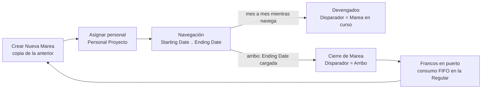

# Mareas y ciclo de la marea

Una **marea** es un viaje de pesca de un buque. En el sistema es un **Proyecto (`Job`)** de tipo *Productivo* cuyo número termina en el número de marea (p. ej. `PP-114-000302`) y que lleva la dimensión global 2 = **Marea**. El proyecto de nómina (`PN-<buque>-NOMINA`) es el otro tipo de proyecto: *Improductivo*, sin marea, y sirve de continente para guardia en puerto, francos y órdenes (ver [[Estados de empleado y de buque]], [[Tabla - Estado Empleado]] y [[gp-devenga-francos-pero-es-improductivo]]).

## Ciclo de vida

1. **Crear Nueva Marea** (`Gestión Marea.CrearNuevaMarea`, acción en la ficha y la lista de Proyectos): copia el proyecto, sus tareas, dimensiones por defecto y la dotación (`Personal Proyecto`). Incrementa con `IncStr` el número del proyecto y el valor de la dimensión Marea (creando el valor de dimensión si no existe). La nueva marea arranca el día **después** del arribo de la anterior. Se niega si el período que contiene esa fecha ya tiene liquidaciones **no Borrador**.
2. **Navegación**: mientras la marea no arribó, el sistema liquida **Devengados** (fijos mensuales que se acumulan en el mar).
3. **Arribo**: al cargar `Ending Date` (y las horas de zarpada/arribo) se crea el **Cierre de Marea** (`Proceso Liq. Por Lote.CrearCierreMarea`): el período se deriva de la fecha de arribo, sin preguntar. Sin `Ending Date` corta con error.
4. **Francos**: al llegar, el estado del empleado pasa a *Francos* (cascada del buque a la tripulación, `SetEstadoBuque`) y se consumen los lotes devengados — ver [[Francos - ledger FIFO]].

## Devengado vs Cierre de Marea

|  | **Devengados** (`DEVENGADOS`, `Orden` 60 en la siembra) | **Cierre de Marea** (`CIERRE_MAREA`, `Orden` 70 en la siembra; la lección [[tipo-liq-no-implementada]] lo da como 1 en la base) |
|---|---|---|
| Disparador | `MareaEnCurso`: sólo proyectos que al fin del período **todavía no arribaron** | `Arribo`: proyectos cuyo `Ending Date` cae en el período |
| Qué paga | fijos mensuales y SAC/cargas devengadas (sueldo, antigüedad, puerto, descuentos) | todo lo del viaje: producción, garantizado, a cuenta de futuros aumentos, devengo de francos |
| Producción | **no es comparable**: `PROD_KN_MAREA` son los kilos de la marea entera | sí: alcance igual al del garantizado |
| `Tipo Proyecto` | Productivo | Productivo |

La mirada sobre el arribo usa la **fecha** y no el `Status` del proyecto (el Status no se mantiene: en enero de 2026 estaba mal en las dos direcciones). Detalle de tipos en [[Tipos de liquidación]], [[Cuándo corresponde una liquidación]], [[cuando-corresponde-una-liquidacion]] y [[tipo-liq-no-implementada]].

## La ventana de liquidación es la cobertura

Una liquidación de marea vive dentro de un período mensual pero **cubre sólo sus días** (`Cobertura Desde/Hasta` en [[Tabla - Liquidación]]). Esa cobertura es el piso de **toda variable de período** (`DIAS_GP_PERIODO`, francos, vacaciones, Fuentes de Datos). Reglas vigentes:

- `Liquidación.Cobertura()` recorta al **tramo del empleado** en el proyecto (`RecortarAlTramoDelEmpleado`: sus estados en esa marea, que incluyen el *puerto de salida*) y, si no hay estados, al `Starting/Ending Date` del proyecto.
- Lo decide **`CubreSoloElProyecto`** = `Tipo Proyecto = Productivo`, no el disparador (el Devengado también cubre sólo la marea). Antes cubría el mes entero y "tapaba" días que nadie reclamaba más — ver [[cobertura-devengado-tapa-dias]] y [[ventana-liquidacion-es-cobertura]].
- Un día de estado se liquida **una vez**: el reparto entre liquidaciones del mismo empleado vive en `Tramo Cobertura Liq.` ([[Cobertura y tramos]], [[cobertura-en-tramos]]). El Cierre de Marea tiene el Orden más bajo y reclama sin consultar.
- Verificación operativa: [[Control de períodos liquidados]].

> [!warning] Convención de nombres, no validación
> Las Fuentes de Datos `*_PERIODO` no filtran por proyecto; `*_MAREA` y `PROD_*` filtran por `{JOB_NO}`. El motor no impide usar una variable de período en una fórmula de marea: la única defensa es la convención.

## Variables de marea que importan

| Variable | Qué es | Dónde |
|---|---|---|
| `DIAS_PROYECTO` | días de navegación en la ventana | Cod50016 |
| `DIAS_PUERTO` | días de puerto en los bordes del viaje | Cod50016 |
| `DIAS_MAREA` | `DIAS_PROYECTO + DIAS_PUERTO` | Cod50016 |
| `DIAS_FERIADOS_MAREA` / `DIAS_FERIADOS_GUARDIA` | feriados a bordo dentro / fuera de la marea (complementarios) | Cod50016 |
| `DIAS_ENROLAMIENTO` | días calendario enrolado en **toda** la marea en estados que devengan francos | Cod50016 |
| `TIPO_LIQ` | `Orden` del tipo de liquidación; permite que una fórmula se comporte distinto en cierre y devengado | Cod50016 |

**Regla de la hora de 12:00** (tooltips de `Control Liquidación Marea`): el día de zarpada cuenta como navegación si zarpó antes de las 12:00, si no como puerto; el día de arribo, al revés. Por eso los días de navegación no son la resta de fechas.

## Dónde entran las novedades

Una novedad sin proyecto cae en el Cierre o en la Regular según lo que el estado del empleado diga ese día (navegando → la marea; francos/órdenes → nómina). Ver [[Novedades pre-liquidación]].

Ver también: [[Vision del dominio pesquero]], [[Producción y premios]], [[Control de marea (Excel y matrices)]], [[Índice Dominio - marea y pagos]].
