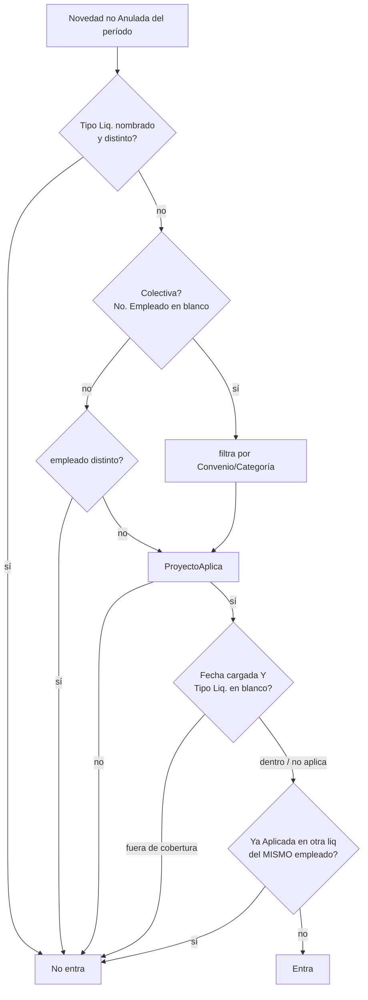

# Novedades pre-liquidación

Una **novedad** es un dato de entrada (horas extras, anticipo, descuento, ajuste) que se carga **contra un período, antes de que exista la liquidación**, y que el motor convierte en [[Incidencias|incidencia]] al calcular. Tabla `Novedad Liquidación` (110038), página `Novedades de Liquidación` (50013), codeunit `Gestión Novedades Liq.` (**objeto 50066**, archivo `Cod50061`).

| | Novedad | Incidencia |
|---|---|---|
| Clave | `No. Movimiento` (autoincremental) | `No. Liquidación` + `Cód. Concepto` |
| Existe | antes que la liquidación | sólo con la liquidación en Borrador |
| Alcance | selectores en blanco = "cualquiera" | una liquidación |
| Pantalla | `Novedades Liquidación` (menú del Role Center, ficha del empleado) | subpágina de la ficha de liquidación |

Reglas de diseño elegidas explícitamente: se aplican **automáticamente al calcular** (nunca por un paso manual); una incidencia ya cargada para ese concepto **se respeta** y la novedad queda Pendiente con el motivo; varias novedades del mismo concepto **se suman** en la única incidencia que admite la PK. Ver [[novedades-pre-liquidacion]].

## Campos y selectores

`Cód. Período` (obligatorio, el período no puede estar Cerrado) · `Fecha` (dentro del período; por omisión el fin de período) · `Cód. Tipo Liq.` · `Cód. Convenio` · `Cód. Categoría` · `No. Empleado` · `No. Proyecto` · `Cód. Concepto` (obligatorio) · `Cantidad` · `Unidad Cantidad` · `Valor Unitario` · `Importe` · `Observaciones` · `Recurrente` / `Períodos Restantes` / `Novedad Origen` · y los de seguimiento `Estado`, `No. Liquidación`, `Motivo No Aplicada`.

`Importe` se calcula `Cantidad × Valor Unitario` sólo si **ambos** son ≠ 0; escribir el importe a mano manda hasta volver a validar Cantidad o Valor Unitario.

## Los tres modos de carga

| Importe | Cantidad | Efecto en el motor |
|---|---|---|
| ≠ 0 | cualquiera | el importe **reemplaza** a la fórmula (el motor da precedencia a la novedad) |
| 0 | ≠ 0 | la fórmula **valoriza** la cantidad (horas extras: `CANT_INCIDENCIA`) |
| 0 | 0 | **cero explícito**: el concepto no paga y la fórmula ni se evalúa |

El tercero existe desde el 30/9/2026 ([[novedad-en-cero-no-apagaba-el-concepto]]); antes una novedad en cero quedaba *Aplicada* y la fórmula calculaba igual. Por eso los conceptos que se cargan a mano (anticipos 4803/4813/4823, 4115) están **sin fórmula a propósito** ([[anticipos-como-novedades]]), y darle fórmula a un concepto con novedades no duplica: la novedad gana ([[novedad-con-proyecto-queda-huerfana]]).

Un `Valor Unitario` cargado con cantidad 0 y sin importe materializa una incidencia en cero; el motor lo **avisa** (`RegNovedadSinImporteTxt`) pero no corta.

## Estados

`Estado Novedad Liq.` (enum 50315): **Pendiente** (todavía no entró en ninguna liquidación o el recálculo la liberó) · **Aplicada** (entró en `No. Liquidación`) · **Anulada** (excluida a mano: no se aplica, no se copia, no se recurre).

Una novedad **Pendiente con `Motivo No Aplicada`** es la que el motor evaluó y descartó, y es la que hay que mirar: alguien la cargó esperando que se pagara. Las Pendientes sin motivo son las que ninguna liquidación reclamó. Antes de cerrar el período las Pendientes tendrían que estar en cero.

Una novedad Aplicada a una liquidación no-Borrador **no se puede editar** (`ValidarEditable`): hay que reabrir.

## Regla de correspondencia novedad → liquidación (`NovedadAplica`)

Puntos finos (todos con su historia):

- **Convenio/categoría filtran sólo en colectivas.** Con empleado nombrado son el encuadre con que se cargó, dato y no condición: compararlos de más sólo podía excluir en silencio (el par de la liquidación sale de los atributos vigentes y no de la ficha).
- **Proyecto**: si la novedad lo nombra, manda. Si el proyecto nombrado **tiene liquidación del empleado en el período** y no es ésta, la novedad es de *aquélla*. Si **no se liquidó** (huérfana), cae al camino sin proyecto. Sin proyecto, decide el **historial de estados a la fecha de la novedad** (navegando → la marea / Cierre; francos u órdenes → nómina / Regular); si el estado apunta a un proyecto que no se liquidó, entra igual. Ver [[novedad-proyecto-sale-del-estado]], [[novedad-estado-apunta-a-proyecto-sin-liquidar]], [[novedad-con-proyecto-queda-huerfana]].
- **Fecha**: se compara contra la **cobertura guardada** de la liquidación (no contra el período), y **no filtra si la novedad nombra Tipo Liq.** (selector puesto a mano = decisión): [[novedad-tipo-liq-y-fecha-se-pelean]]. Una novedad sin tipo y con fecha fuera de toda cobertura sigue rechazándose; casi siempre el problema es una liquidación con cobertura en blanco.
- **Doble cobro**: se compara por **empleado**, no por número de liquidación — una colectiva debe entrar en la liquidación de cada tripulante; comparando números la primera se la llevaba entera y el resto no recibía nada.
- La novedad **colectiva** queda con el `No. Liquidación` de la **última** que la tomó; el rastro por liquidación está en las incidencias `Desde Novedad`.

## Dónde se engancha en el cálculo (`Cod50014`)

Orden en cada recálculo: `DeleteLineas` → `Préstamos.LimpiarParaRecalculo` → `Novedades.LimpiarParaRecalculo` → `Préstamos.AplicarCuotasEnLiquidación` → `Novedades.AplicarEnLiquidacion` → `CargarIncidencias`. Las novedades van **después** de los préstamos: una incidencia de cuota cuenta como manual y la novedad se saltea en vez de duplicarla. Es **idempotente**: cada corrida borra lo generado (`Desde Novedad = Sí`) y lo rearma. `Reabrir` / `Revertir Aprobación` / borrar la liquidación liberan las novedades (`RevertirLiquidacion`). Anular una novedad Aplicada limpia toda la liquidación para que el próximo cálculo la rearme sin ella.

## Acciones de la página

- **Importar de Excel/CSV**: una novedad por fila, columnas `No. Empleado, Cód. Concepto, Cantidad, Valor Unitario, Importe, Fecha, Cód. Tipo Liq., Observaciones, No. Proyecto`. Filas con empleado o concepto inexistente se omiten y se cuentan (la fila de encabezado cae sola por eso). Tolera `1.234,56` y `1,234.56`, separadores `;` `,` tab. Un proyecto inexistente se **ignora** sin rechazar la fila.
- **Copiar de otro período** (no duplica: equivalente = mismo empleado/concepto/tipo/convenio/categoría/proyecto) y **Generar recurrentes** (idempotente por `Novedad Origen`; `Períodos Restantes` descuenta 1 por período, 0 = indefinido).
- **Anular / Reactivar.**

> [!tip] Migración
> Al migrar novedades de Meta4 **dejar proyecto, convenio y categoría en blanco**: llenarlos inventa precisión que el origen no tiene y equivocarse deja la novedad sin entrar en ninguna liquidación, en silencio. Ver [[migracion-novedades-meta4]] y [[anticipos-cta-cte-meta4]] (excepción: los anticipos ANP/ANL/ANH vienen con proyecto).

Tablas: [[Tabla - Novedad Liquidación]], [[Tabla - Incidencia Liquidación]]. Relacionadas: [[Incidencias masivas]], [[Préstamos y cuotas]], [[Índice Dominio - marea y pagos]].
