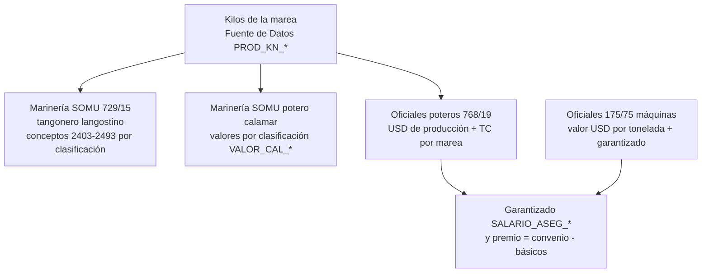

# Producción y premios

La plata que distingue a una liquidación embarcada de una de tierra es lo que **depende de lo pescado**: la producción de la marea paga un porcentaje a cada tripulante, y los CCT fijan un **garantizado** (piso) que la producción debe superar. Esta nota explica cómo entra el dato al motor y cómo se arman los premios. Las cifras y fórmulas concretas están en [[Rubros típicos de una liquidación embarcada]].

> [!note] Alcance de lo verificado
> La **entrada del dato** (Fuentes de Datos, variables) está verificada en el repo. Las **fórmulas de los conceptos** viven en la base: se citan del snapshot `Conceptos Liquidación.xlsx` (17/8/2026) y de las lecciones, y pueden haber cambiado después. Lo que no está en el repo se marca "según lecciones".

## Cómo entra la producción: Fuentes de Datos, sin código

Los kilos no son una tabla propia: son **Fuentes de Datos** (`Fuente Datos Liquidación`, ver [[Tabla - Parámetro Vigente]] para el otro lado) que consultan *cualquier tabla de BC* por `RecordRef`, con filtros guardados por número de campo y **tokens** (`{JOB_NO}` = proyecto de la liquidación, `{EMP_NO}`, `{FECHA_REF}`, `{LIQ_NO}`…). Según `scripts/RestaurarFiltrosFuenteDatos.sql`:

| Variable | Filtros | Significa |
|---|---|---|
| `PROD_KN_L1`…`L6`, `PROD_KN_C1`…`C3`, `PROD_KN_CR` | campo 1 = `{JOB_NO}` y campo 4 = código de artículo `LTBP-AA21-L1-12 K`, `LTBP-AB21-C1-12 K`, `LTBP-AC21-CR-12 K`… | **kilos netos** de la marea por clasificación de langostino: entero 1-6 (L), cola 1-3 (C), cola rota (CR) |
| `PROD_KB_*` | idem | kilos brutos |
| `PROD_KN_MAREA` | `{JOB_NO}` y fecha `<={FECHA_REF}` | kilos de la **marea entera** (no sólo de la liquidación) |
| `TC_CERCANO` | moneda y fecha `<={FECHA_REF}` | cotización (ver trampa abajo) |

Es una agregación sobre una tabla de BC filtrada por proyecto y por código de artículo, presumiblemente los movimientos de proyecto (la tabla exacta, `Id. Tabla`, no está en el repo: vive en la base; **sin verificar**). Para sumar **ligado a una marea** el filtro es siempre `{JOB_NO}`. Las fuentes `*_PERIODO` no filtran por proyecto.

> [!danger] Los 76 filtros desaparecieron una vez de la base
> `scripts/RestaurarFiltrosFuenteDatos.sql` existe porque los 76 filtros de `Filtro Fuente Datos Liq.` se perdieron y sin filtros cada Fuente suma **toda la tabla** (65 s de `ResolveFuente`). Ver [[fuente-datos-apunta-por-numero]] — el compilador no ve nada y se rompe en runtime.

La convención de nombres da el alcance: `PROD_*` y `*_MAREA` miran la marea ([[Mareas y ciclo de la marea]]); un `PROD_KN_*` copiado de otro (L4/L5/L6 de L3) arrastra sus filtros y se paga igual sin avisar.

## Cuatro familias, cuatro lógicas



### 1. Marinería de tangoneros (langostino)

Un concepto **por clasificación** (2403…2483 enteros/colas, 2493 cola rota). Forma, según el snapshot:

```text
(PROD_KN_L1/1000 * VALOR_L1_SOMU * PCT_NORM_TANG * IF(PCT_PROD<>0,PCT_PROD,1)/100 * 0.9 * TC_CERCANO) * COEF_TANGONERO
```

`VALOR_*_SOMU` son USD/tonelada por clasificación; `PCT_PROD` el porcentaje de la categoría (**guardado ×100**: `PCT_PROD_768/19_OF01 = 2,20`, no 0,022 — ver [[parametros-somu-por-pesqueria]]); `COEF_TANGONERO` el 30% del Dto 633/18 que se aplica a toda la base remunerativa. Cargas pendientes del lado langostino y la decisión sobre el valor base de puerto: ver [[Convenios del sector (CCT 729-15, 768-19, 175-75, 372-04, SOMU)]].

### 2. Marinería de poteros (calamar)

Se paga por kilo con **valores en pesos por clasificación**: `VALOR_CAL_ENT` (entero, base 10.000), `VALOR_CAL_REJ` (rejo sucio, 6.400), `VALOR_CAL_VAI` (vaina, 18.303), y de ahí **el índice SOMU** por categoría (100/85/80/75/70 sobre el básico de Marinero de Planta) — 30 celdas cargadas con vigencia 2026-01-01 y verificadas. Ver [[escala-somu-indice-70]]. Un error de redondeo del cociente (`1,4286` en lugar de la fracción exacta) movió 18 valores en −0,17 a +0,67 por tonelada: usar siempre la **fracción exacta** y redondear al final.

### 3. Oficiales de poteros (768/19)

Decodificado con `A28 59 CLC producción.xlsx` ([[produccion-oficiales-poteros]]). Insumos **por marea**: **USD de producción** y **TC acordado** (no es una cotización: [[tc-de-marea-no-es-cotizacion]]).

```text
bruto            = USD de producción × TC
total convenio   = bruto × COEF (0,90 = PCT_DOLAR_PROD 768/19)        base de PCT_PROD_CAPECA
total empresa    = producción empresa (USD/ton × puesto) + ASEGURADO   (sin coeficiente)
asegurado        = USD_MAREA × TC / 30 × DÍAS                           (prorrateo por días, no coeficiente)

PREMIO ADIC. ESP. DE PRODUCCIÓN (1534) = total convenio − (sueldo navegación + sueldo puerto + antigüedad + adicional art. 23)
A CUENTA FUTUROS AUMENTOS (2003)       = total empresa − total convenio
```

La producción de empresa es **USD por tonelada por puesto** (Pesca 32 · Capitán 16 · Jefe 16 · Garantía 20); parece un porcentaje sólo porque `USD_TON_PROD = 800` (32/800 = 4%). Por eso `PCT_PROD = (TON ENTERO + adicional)/8`. Condiciones individuales 2026 en [[condiciones-oficiales-poteros-2026]]: dos esquemas — **por tonelada con "compara con CCT, paga el mayor"** y **valores netos al 70%** (grossing-up a mano; BC no distingue los dos grupos, ver [[oficiales-netos-al-70]] y [[grossing-up-tapa-errores]]). El adicional de 10 USD/ton del Patrón de Pesca lo paga `ADIC_PROD_PESCA`, no el parámetro.

> [!warning] El 1534 y el tapón se mueven juntos
> El 1534 lee el garantizado del **CCT** (`SALARIO_ASEG_CAL`), no el acordado (`USD_MAREA`); corregirlo solo empeora el bruto porque el 2003 es el **tapón** del grossing-up. Cambiar los dos en el mismo cambio ([[cuatro-conceptos-sin-disparar]]).

### 4. Oficiales de máquinas (175/75) y el 2073

El garantizado (cláusula primera: "Remuneración en Navegación", USD al **comprador**, proporcional a los días) **absorbe todo lo devengado en la marea hasta su concurrencia** (cláusula tercera), de modo que el 2003 de 175/75 es el resto de una absorción, no un adicional ([[cct-175-75-remuneracion-navegacion]]). El **2073** *Adicional tareas mecánicas* es el 15% del garantizado prorrateado ([[adicional-tareas-mecanicas]]).

## A cuenta de futuros aumentos: una familia, tres variantes

El nombre del concepto es el mismo patrón: **garantizado prorrateado − lo ya liquidado**, con guarda sobre el *driver* (días) y no sobre el precio, porque si no con precio cargado y cero días paga **negativo**.

| Concepto | Contexto | Fórmula | Fuente |
|---|---|---|---|
| **2013** (puerto) | guardia en puerto, marinería y oficiales | `SALARIO_ASEG_* /30 × DIAS_GP_PERIODO × COEF_GUARDIA_PUERTO(1,4) × TC_COMPRADOR − (#1083 + #1023 + #1053)`; 27 vigencias al 1/1/2026 | [[a-cuenta-futuros-aumentos-puerto]] |
| **2083** (francos) | jefe y primer oficial de máquinas de tangoneros | `VALOR_FRANCO_ACDO/30 × DIAS_FRANCOS_PERIODO × TC_COMPRADOR − (#1063 + #1053)`; empresa 3.500/2.975 USD vs convenio 3.000/2.550 | [[a-cuenta-futuros-aumentos-francos]] |
| **2003** (marea) | oficiales: el tapón del neto pactado | ver arriba | [[produccion-oficiales-poteros]] |

## Trampas conocidas

- **La producción no se prorratea**: `PROD_KN_MAREA` es la marea entera; el garantizado sí está prorrateado por días. En un Cierre coinciden; en un **Devengado** a mitad de marea no, y un `MAX()` entre ambos pagó 12 M de premio a un tripulante con 3 días ([[produccion-no-se-prorratea]]). Discriminar con `TIPO_LIQ` (devuelve el `Orden` del tipo: Cierre de Marea 70, Devengados 60 en la siembra de `Gestión Tipo Liq.`; el código de `Cod50016` la resuelve y `Cod50077` la siembra, así que la lección [[tipo-liq-no-implementada]] **quedó desactualizada**; los Órdenes reales hay que mirarlos en la base, ver [[Tipos de liquidación]]).
- **TC_CERCANO no es lo que dice**: es un `LOOKUP` sin fecha que devuelve la última cotización cargada, no la más cercana; la rama langostino de 2498 lo usa y puede valorizar con un TC equivocado.
- Un precio en **USD cargado como pesos** no da error: da un importe congelado ([[que-tc-usa-cada-concepto]]).
- Un concepto que **lee un acumulador** de la producción debe ordenarse **después** de quienes aportan ([[acumuladores-orden-calculo]], [[control-precedencia-formulas]]).

Tablas: [[Tabla - Fuente Datos Liquidación]], [[Tabla - Filtro Fuente Datos Liq]]. Relacionadas: [[Valor del franco]], [[Índice Dominio - marea y pagos]].
