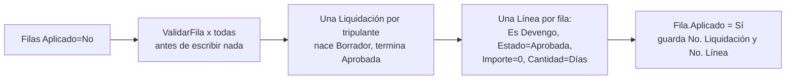

# Saldo inicial de francos

Los francos que la gente ya tenía ganados **antes de la puesta en marcha** no están en ninguna liquidación, y el [[Francos - ledger FIFO|ledger]] sólo conoce lo que el motor liquidó. La carga inicial los convierte en **lotes**.

## Dos pasos: hoja de carga y aplicación

1. **Hoja de carga** — tabla `Saldo Inicial Francos Liq.` (110012), página `Saldo Inicial de Francos` (110025). Se llena a mano, se pega desde Excel o con `scripts/ImportarSaldoInicialFrancos.sql`. Es una tabla (y no un proceso directo) a propósito: cargar saldos escribe en el ledger, que es plata; tener la carga "en firme" permite revisarla de a dos, corregirla y revertirla.
2. **Aplicar** (`Codeunit 110029 Saldo Inicial Francos Liq.`) — genera los lotes. **Revertir** los borra.

PK de la hoja: `(No. Empleado, Cód. Convenio, Cód. Categoría, Fecha Devengo)`. Una fila = un lote: un tripulante que ascendió necesita **dos filas** porque cada lote se paga a su categoría.

## Qué genera `Aplicar`

- Se exige **exactamente un** concepto con `Rol Franco = Devengo`; con cero o con varios corta con error (los lotes de dos conceptos convivirían y el error aparecería meses después).
- `SetDestino(período, tipo de liquidación, fecha cabecera)` es obligatorio. Conviene un tipo propio (`SALDO INICIAL`, orden 0) para distinguir estas liquidaciones de las reales.
- La cabecera **nace Borrador y se pasa a Aprobada al final**: ningún proceso del motor la vuelve a tocar. Si quedara Borrador, el primer *Calcular por lote* le borraría las líneas (`DeleteLineas`) y el saldo de toda la empresa desaparecería sin aviso.
- La **línea** lleva su propia `Fecha Liquidación` = `Fecha Devengo` (no la de la cabecera): es la fecha por la que ordena el FIFO. Con la misma fecha para todos los lotes serían indistinguibles justo en lo que decide a qué precio se paga el próximo franco.
- `Importe = 0`: un lote no es plata hasta que se consume.
- `Fórmula Aplicada` = "Carga de saldo inicial de francos" y `Fórmula Evaluada` explica días, categoría y fecha.

## Reversión

`Revertir` borra cada línea por su **clave exacta** (`No. Liquidación Generada` + `No. Línea Generada`), no "los francos del tripulante": los francos devengados liquidando no los puso este proceso. Si una cabecera generada queda sin líneas, se pasa a Borrador y se borra. Una fila `Aplicado` **no se puede modificar ni borrar** (`OnModify`/`OnDelete`): primero hay que revertir.

## La carga real (31/12/2025)

Según el encabezado de `scripts/ImportarSaldoInicialFrancos.sql` (fuente `Saldo francos 31-12-25.xlsx`):

- 214 filas en el archivo, **74 con saldo > 0, 4.279 días**; las de saldo 0 no se cargan (no son un lote y `ValidarFila` las rechaza).
- **Categoría** del *puesto del archivo* traducido por tabla (no de los atributos del empleado): difieren en 19 de los 74 casos y el lote se paga a la categoría en que se ganó.
- **Convenio** de los atributos vigentes al 31/12/2025.
- **Fecha de devengo** 31/12/2025 para todos: quedan al principio de la cola FIFO, antes de cualquier franco devengado desde 2026.
- Legajos con 3-4 dígitos se completan a 5 (`00191`).
- **Los saldos iniciales no tienen proyecto** — por eso el buque del lote se reconstruye desde el historial de estados (ver [[Valor del franco]]). Eran la mayor parte del saldo del sistema (74 lotes / 4.279 días frente a 90 lotes / 1.143 días con proyecto).

> [!warning] Dato sin uso
> `Valor Franco Estimado` (campo 13 de la hoja) está declarado como "sólo informativo" pero **ningún código lo llena** ni la página lo muestra (verificado por búsqueda en `src/`). El valor real sale recién al consumir; para ver cuánto valen los saldos usar `Francos por Tripulante` (acción *Ver saldos*).

Tablas: [[Tabla - Saldo Inicial Francos Liq]]. Relacionadas: [[Valor del franco]], [[fases-bc-contra-meta4]], [[Índice Dominio - marea y pagos]].
