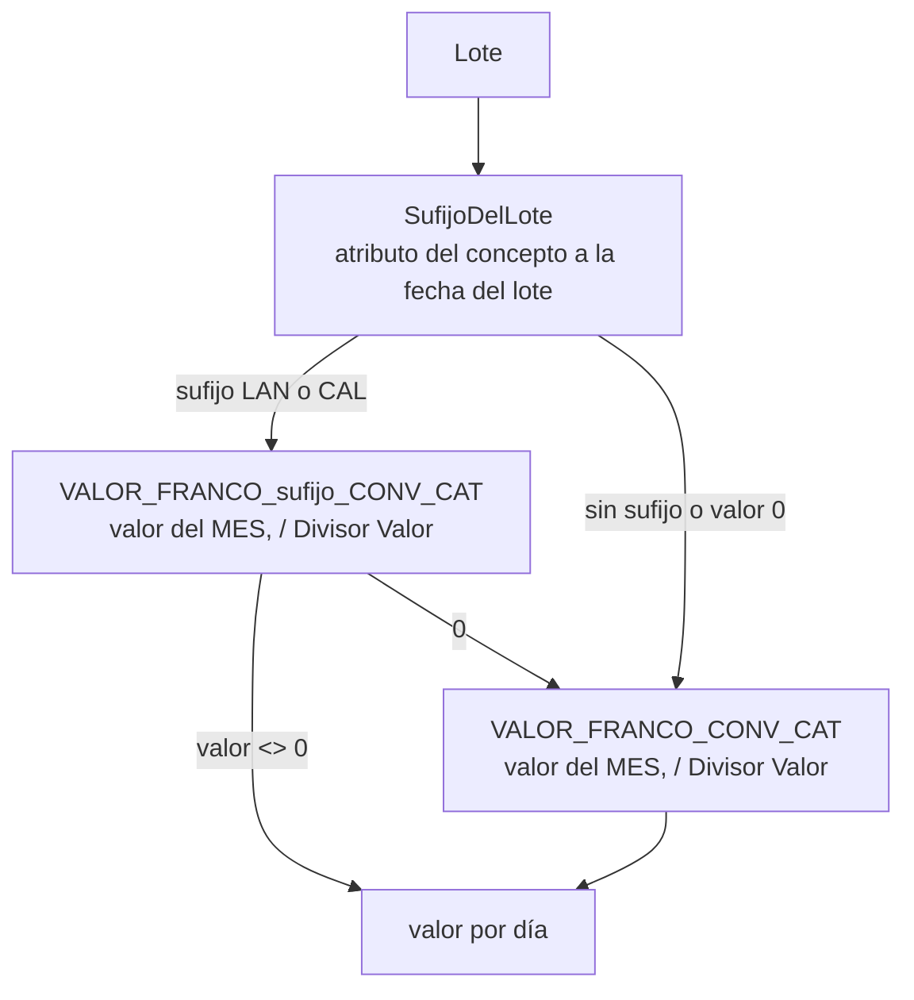

# Valor del franco

El precio de un día de franco **no está en la fórmula del concepto** (que devuelve días): lo resuelve `Gestión Francos.ValorFrancoDia` cuando se **consume** un lote. Depende de tres cosas a la vez:

> **pesquería del lote** (de dónde se devengó) + **convenio y categoría de la liquidación que paga** + **fecha de pago**

Medido contra enero de 2026 ([[valor-franco-por-terna]]): marinería 729/15 en tangonero cobra el **30%** del valor pleno; marinería en potero, **100%**; los oficiales 175/75 embarcados en los mismos tangoneros, **100%**. Resolverlo sólo por buque rompe a los oficiales y sólo por convenio rompe a la marinería de los poteros. Ver también [[franco-porcentaje-por-pesqueria]].

## Cómo se resuelve (en orden)

1. `VALOR_FRANCO_<CAL|LAN>_<CONVENIO>_<CATEGORÍA>` (p. ej. `VALOR_FRANCO_LAN_729/15_MR05`): pesos del **mes**, se divide por `Divisor Valor` (30). El divisor es **fijo** (mes comercial), no los días reales: con días reales el mismo franco valdría distinto en febrero que en marzo.
2. `VALOR_FRANCO_<CONVENIO>_<CATEGORÍA>`: también del **mes**, y también se divide. Es el "valor pleno" y el que mantiene andando lo ya cargado: sólo hace falta declarar el primero donde la pesquería cambia el valor. Un lote sin pesquería rastreable cae acá (el descuento hay que poder justificarlo).

> [!warning] Hasta el 7/10/2026 este segundo camino **no dividía**, y como no existe ninguna fila con sufijo de pesquería era el único que corría: el `Divisor Valor` del concepto era configuración muerta y las trece filas estaban cargadas **por día** para compensar. Ahora **el parámetro es mensual siempre** y las dos ramas dividen. Para SOMU el cambio fue neutro —×30 en el dato y /30 en el código—, y de paso los valores volvieron a ser los del CCT (`729/15 MR01` = 1.936.494 en vez de 64.549,80).

Las dos unidades **no son la misma** (1.708.670/mes = 56.955,67/día). La búsqueda se hace por `Parámetro Vigente` con `Vigencia Desde <= FechaPago` y `FindLast` ([[Tabla - Parámetro Vigente]]).

## Todo configurable, nada en el motor

Tres campos del [[Tabla - Concepto Liquidación|concepto]] de consumo (`Rol Franco = Consumo`) dicen cómo valuar; `CargarConfigValuacion` toma el primer concepto de consumo que los tenga cargados:

| Campo | Qué dice |
|---|---|
| `Cód. Parámetro Valor` | parámetro base, p. ej. `VALOR_FRANCO` |
| `Cód. Tipo Atributo Precio` | atributo cuyo valor aporta el sufijo (`TIPOACTIVIDAD` del buque) |
| `Divisor Valor` | 30 si el parámetro es mensual y el concepto paga por día; 0 = ya está en la unidad del concepto |

**Sin `Cód. Parámetro Valor` el motor no inventa un parámetro**: corta con error que dice qué cargar (un cero silencioso pagaría el franco en cero con un recibo creíble). Sin ningún concepto de consumo, también error.

## De dónde sale el sufijo (pesquería)

`SufijoDelLote`: se resuelve el tipo de atributo, se toma la **entidad del lote** según el `Tipo Entidad` del atributo (Empleado / Buque / Proyecto), se busca el atributo **vigente a la fecha del lote** y se lee el `Sufijo Parámetro` del valor del catálogo. Para `TIPOACTIVIDAD` de buque la convención de las fórmulas es: valor 1 → `CAL` (calamar, potero), otro → `LAN` (langostino, tangonero). Ver [[atributos-tipados]].

**`BuqueDelLote`** tiene dos caminos:
1. el buque (`Global Dimension 1 Code`) del **proyecto del lote**;
2. si el lote no tiene proyecto (**todos los saldos iniciales**, ver [[Saldo inicial de francos]]), el del **estado del empleado vigente a la fecha del lote** (incluso estados de nómina, que llevan el buque en la dimensión 1).

> [!warning] Dos trampas de fecha
> - `TIPOACTIVIDAD` de los 12 buques estaba vigente desde 1/1/2026 (fecha de carga) y los lotes iniciales son del 31/12/2025: ningún lote encontraba su pesquería. Se retrotrajo a 2023-01-01. Un atributo de buque con vigencia posterior al lote hace que el franco se pague entero **sin error**.
> - El sufijo se busca a la fecha del **lote**; el parámetro, a la fecha de **pago**.

## La categoría del precio es la de la liquidación que paga

`ParQuePagaElFranco`: un franco no gozado se salda como vacaciones o SAC, **a la remuneración vigente cuando se paga**. Antes cada lote se valuaba con su propia categoría; en enero 2026, 5 líneas de 33 eran descensos y BC pagaba 135.174,26 de más que Meta4 (03985: 56.955,67 contra 53.158,67 por día). Si la liquidación no tiene par, se cae al par del lote. **Lo que sigue saliendo del lote es la pesquería**, no la categoría.

El importe se acumula **lote por lote** y no sobre el slice agrupado por categoría: dos lotes de la misma categoría pueden venir de pesquerías distintas.

## Divisa

Si el valor está en moneda extranjera, la unidad correcta es dólares y no pesos: ver [[que-tc-usa-cada-concepto]] y [[parametros-somu-por-pesqueria]]. Las seis filas de oficiales —`175/75 OF02/OF04`, `768/19 OF01/OF03` y `ESP FE01/FE02`— estuvieron cargadas en pesos **congelando el dólar a 1415**, que es exactamente la trampa de [[control-moneda-es-asimetrico]]: 162.725 = 115 × 1415, 127.350 = 90 × 1415. Meta4 usa `USD × TC del día` (su columna `PR_FRANCO`), así que BC acertaba sólo mientras el TC no se moviera. Desde el 7/10/2026 están en USD con `Cód. Variable TC` = `TC_COMPRADOR`.

**El ledger no pasa por el contexto, así que la conversión hay que prestársela.** `Cod50053.ValorParametro` lee `Parámetro Vigente` directo —tiene que buscar el precio con el convenio y la categoría **sellados en cada lote**, no con el par de la liquidación, que es lo que hace al franco no fungible—, y por eso se saltea `ConvertirParametrosEnDivisa`. `BuildContext` le pasa las cotizaciones con `PublicarTiposCambio` después de `LoadDynamicSources`, que es donde nacen las `TC_*`, y el ledger convierte leyendo `Moneda` y `Cód. Variable TC` de la misma fila. Los tres casos que no pueden convertir cortan, igual que en `Cod50016`. **Una Fuente de Datos no sirve acá**: resuelve un valor por liquidación y lo que hace falta es uno por lote.

Para oficiales existe además el acuerdo de empresa, que alimenta el 2083 *A cuenta de futuros aumentos francos* ([[a-cuenta-futuros-aumentos-francos]], [[Producción y premios]]). Al 28/10/2026 el parámetro se llama `VALOR_FRANCO_EMP` (no queda ningún `VALOR_FRANCO_ACDO`) y sólo existe para 175/75, en USD por mes: `EMP_LAN_175/75_OF02` 3.500, `EMP_CAL_175/75_OF02` 3.600 del 1/1 al 4/1/2026 y 3.500 desde el 5/1, y `EMP_175/75_OF04` 2.975. Para 768/19 no hay acuerdo y el 2083 paga cero por la guarda. **La provisión de francos del asiento no lo incluye**: valoriza al convenio. Ver [[planilla-francos-no-es-meta4]].

## Auditoría

`Lotes Franco Consumidos` (110054): lote, fecha, buque/pesquería (`Tipo Buque`), días tomados, valor y **coeficiente** (valor del lote / valor pleno de la categoría). El coeficiente ya no multiplica nada: se muestra porque es la pregunta de quien mira el recibo ("¿por qué éste cobra menos?").

Relacionadas: [[Francos - ledger FIFO]], [[Índice Dominio - marea y pagos]].
