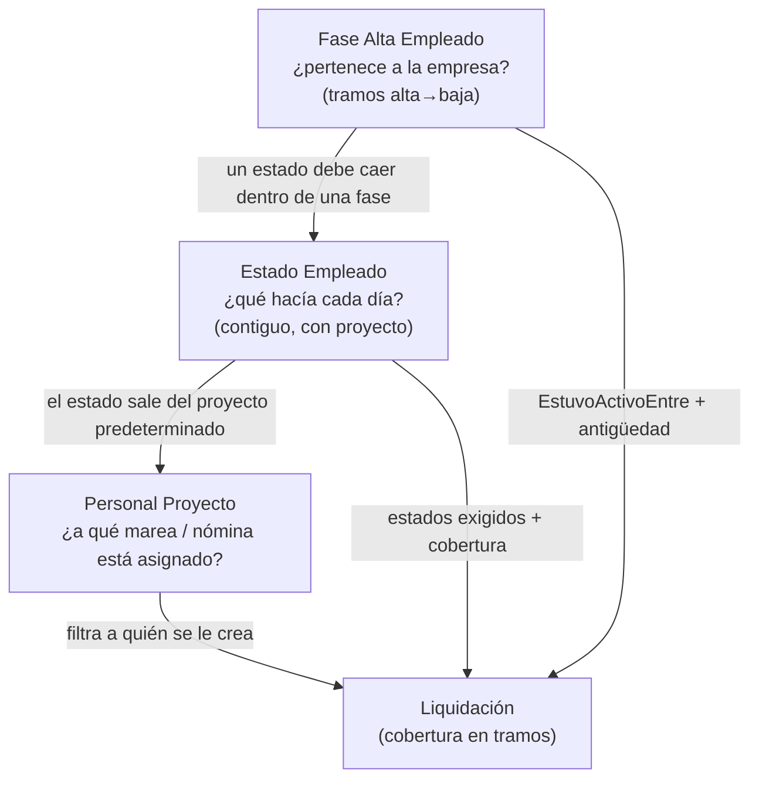

# Visión del dominio pesquero

El motor de liquidación no sabe de barcos: sabe de **quién es el empleado, qué hacía cada día y bajo qué condiciones se lo liquida**. Esta nota es el mapa de esa capa. Cada concepto tiene su nota; acá se ve cómo encajan.

## Vocabulario

| Término del negocio | Cómo vive en Business Central |
|---|---|
| **Buque** (o planta, o administración) | Un valor de la **dimensión global 1** + su registro en `Entidad Liq.` con una **clase**. El código de la entidad *es* el del valor de dimensión. Ver [[Entidades y clases de entidad]]. |
| **Marea** | Un `Job` (proyecto). Su dimensión global 1 es el buque y la global 2 la marea. Tiene `Starting Date` (zarpada) y `Ending Date` (**arribo**). Es un proyecto *productivo*. |
| **Proyecto de nómina** | Un `Job` que no termina (`PN-…`): es la "casa" del empleado cuando no navega. Es *improductivo*. Lo declara el buque con el atributo `PROY_NOMINA`. |
| **Tripulante / mensualizado / jornalizado** | `Convenio Colectivo."Tipo Empleado"` (enum `Aplica A Liq.`: Todos, Tripulante, Mensualizado, Jornalizado). Es de la **persona**, no del día. Ver [[Convenios, categorías y par CCT]]. |
| **Alta / baja** | Tramos en `Fase Alta Empleado`. Ver [[Fases de alta]]. |
| **Qué hacía cada día** (navegando, franco, vacaciones, enfermo…) | `Estado Empleado`, contiguo y sin huecos. Ver [[Estados de empleado y de buque]]. |
| **Asignación a una marea o nómina** | `Personal Proyecto` (empleado + proyecto). |
| **Encuadre** (convenio, categoría, puesto, sindicato, obra social, zona…) | Atributos con vigencia. Ver [[Atributos tipados]]. |
| **Documento de pago** (mensual, cierre de marea, vacaciones, SAC…) | `Liquidación` de un `Tipo Liquidación`. Ver [[Tipos de liquidación]]. |

## Las tres capas del personal

Cada capa se deriva de la anterior; el síntoma suele aparecer **una capa más abajo** que el problema ([[tres-capas-fase-estado-asignacion]]).



> [!note] Dos direcciones
> En régimen, la **asignación genera el estado**: al dar de alta a alguien en un proyecto, `SincronizarEstadoDesdeProyecto` crea el `Estado Empleado` con el `Estado Liq. Personal Predet.` del `Job`. Las migraciones desde Meta4 fueron al revés (derivaron asignaciones de los estados) y de ahí salieron varios problemas: [[nomina-no-es-intervalo-presencia]], [[migracion-estados-meta4]].

## Del embarque al recibo

```mermaid
sequenceDiagram
    participant Job as Job (marea)
    participant PP as Personal Proyecto
    participant EE as Estado Empleado
    participant Liq as Liquidación
    Job->>PP: se asigna al tripulante (Fecha Alta Asignación)
    PP->>EE: crea el estado predeterminado (p. ej. navegando)
    Note over Job: se carga Ending Date (arribo)
    Job->>PP: cierra asignaciones abiertas (Fecha Baja = arribo)
    PP->>EE: cierra el estado y encadena el "Estado Siguiente"<br/>(franco, órdenes…) en el proyecto que lo tenga como predeterminado
    EE->>Liq: Cierre de marea al arribo; Regular con los días de tierra
```

## Mensualizado vs. embarcado

- El **embarcado** (tripulante) tiene una cadena de estados que alterna marea (`Transcurre en Marea`) y tierra (francos, guardia en puerto, órdenes, vacaciones) y paga con documentos separados: un Cierre por marea más una Regular por lo que no es marea.
- El **mensualizado** (personal de tierra) casi no embarca: cobra el haber en el recibo mensual y no recibe el documento de Vacaciones aparte (`Tipo Liquidación."Aplica A"`). Ver [[Tipos de liquidación]].
- El filtro `Aplica A` de cada concepto se compara con el tipo de empleado **del convenio** de la cabecera, no con el estado del día (`TipoEmpleadoDe`, Cod50014): [[Convenios, categorías y par CCT]].

## Dónde seguir

- La marea y su ciclo (zarpada, arribo, cierre, devengados): [[Mareas y ciclo de la marea]]. Francos: [[Francos - ledger FIFO]]. Novedades: [[Novedades pre-liquidación]].
- Qué hace que una liquidación se cree: [[Cuándo corresponde una liquidación]], [[Lotes de liquidación]].
- Qué días paga cada una: [[Cobertura y tramos]].
- Deducciones personales: [[Deducciones de Ganancias y familiares]].
- Cargas y migraciones: [[Altas masivas y migraciones de fechas]].
- Índice completo: [[Índice Dominio - empleado y condiciones]].
