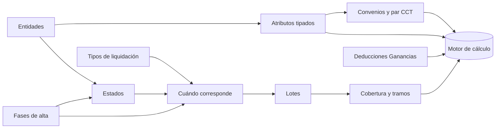

# Índice Dominio - empleado y condiciones

La capa **"quién es el empleado y bajo qué condiciones se liquida"**. Para francos, mareas, novedades y préstamos ver las demás notas de `03 Dominio pesquero` ([[Mareas y ciclo de la marea]], [[Francos - ledger FIFO]], [[Novedades pre-liquidación]], [[Préstamos y cuotas]]).

## Empezar por acá
- [[Vision del dominio pesquero]] — vocabulario (buque, marea, nómina, fase, estado) y las tres capas.

## Quién es y qué hacía
| Nota | Responde |
|---|---|
| [[Fases de alta]] | ¿Cuándo pertenece a la empresa? Antigüedad. |
| [[Estados de empleado y de buque]] | ¿Qué hacía cada día? Contigüidad, cascadas, bandera por bandera. |
| [[Entidades y clases de entidad]] | ¿Qué es un buque para el sistema? Alta y renombrado. |

## Bajo qué condiciones se liquida
| Nota | Responde |
|---|---|
| [[Atributos tipados]] | ¿Cómo se agrega un dato con historial sin tocar código? ¿Cómo llega a la fórmula? |
| [[Convenios, categorías y par CCT]] | ¿Con qué convenio/categoría/puesto se valoriza cada concepto? |
| [[Deducciones de Ganancias y familiares]] | ¿Qué deduce Ganancias de cada empleado? |

## Qué documentos se generan y qué días pagan
| Nota | Responde |
|---|---|
| [[Tipos de liquidación]] | Los tipos, disparadores, órdenes y exclusividades. |
| [[Cuándo corresponde una liquidación]] | Las preguntas que deciden si se crea. |
| [[Lotes de liquidación]] | Crear, calcular, reabrir, aprobar y eliminar en lote. |
| [[Cobertura y tramos]] | Un día se liquida una vez; el control de días. Ver también [[Control de períodos liquidados]]. |

## Cargas
- [[Altas masivas y migraciones de fechas]] — reportes masivos, upgrades, altas desde NAV.

## Mapa de dependencias

## Lecciones de esta área (en `07 Lecciones`)
- **Estados y fases:** [[estado-empleado-effective-dated]], [[tres-capas-fase-estado-asignacion]], [[recorrer-estado-abierto-dia-por-dia]], [[algo-parte-estados-en-dos]], [[nomina-no-es-intervalo-presencia]], [[fases-bc-contra-meta4]], [[migracion-estados-meta4]], [[gp-devenga-francos-pero-es-improductivo]], [[proyecto-nomina-dos-fuentes]], [[puente-mayor-no-es-la-planta]].
- **Atributos:** [[atributos-tipados]], [[tipo-atributo-tres-campos-silenciosos]], [[atributo-comparar-por-codigo]], [[parametro-y-atributo-mismo-nombre]], [[sindicato-obra-social-atributos]], [[veda-como-atributo-del-buque]], [[copyfilters-solo-grupo-actual]].
- **Convenios y CCT:** [[puesto-vs-categoria-cct]], [[migracion-atributos-cct-meta4]], [[arroba-ignora-el-par-del-concepto]], [[convenio-of-depende-de-la-categoria]], [[enfermedad-sin-convenio-paga-cero]].
- **Tipos y selección:** [[cuando-corresponde-una-liquidacion]], [[exclusividad-vacaciones]], [[vacio-en-tipos-liq-aplicables-es-comodin]], [[lote-tipo-liq-en-blanco]], [[crear-y-calcular-descarta-vacias]], [[migracion-tipo-liq-incompleta]], [[tipo-liq-no-implementada]] (desactualizada), [[orden-calculo-del-lote]], [[job-tipo-cero-no-bloquea]].
- **Cobertura:** [[cobertura-en-tramos]], [[ventana-liquidacion-es-cobertura]], [[cobertura-devengado-tapa-dias]].
- **Ganancias y familiares:** [[familiar-alta-impuesto]], [[grossing-up-tapa-errores]].

## Discrepancias detectadas entre código y documentación (resumen)

> [!warning] Manda el código; las notas de arriba las explican
> 1. **`ParDePuesto` devuelve el par completo** (convenio del padre del puesto), pero el enum `Par CCT Liq.` y la lección [[puesto-vs-categoria-cct]] dicen "cambia sólo la categoría".
> 2. **Órdenes de los tipos**: el sembrador da REGULAR 10 / AGUINALDO 20 / CIERRE_MAREA 70; la base y las lecciones usan CIERRE 1 / VACACIONES 30 / REGULAR 100 / AGUINALDO 110.
> 3. **`TIPO_LIQ` sí está implementada y sembrada** (Cod50016, Cod50077): [[tipo-liq-no-implementada]] está desactualizada.
> 4. **`CodigoArribo()` lee la bandera obsoleta** `Liquida al Arribo`, no el disparador.
> 5. **`EntraEnCorrida` reenciende la bandera** en cada upgrade para seis tipos, contra lo que promete su comentario.
> 6. **Calcular en lote sólo toma Borrador**, aunque la ayuda del lanzador y el comentario del codeunit digan Calculada/Aprobada.
> 7. **El control de cobertura usa el envolvente**, no los tramos reales.
> 8. **`Ded. Ganancias Vigente` no la lee el motor** y las filas de `Ded. Ganancias Empleado` con `Importe Fijo = 0` no deducen, contra lo que describen sus comentarios.
> 9. **Nombres de archivo vs. IDs de objeto**: `Cod50062` es el codeunit 50065 y `Cod50018` el 50050.
> 10. **Estados de buque sembrados con `Ámbito = Buque`** no se propagan a la tripulación (sólo la transición productivo→improductivo lo hace).
