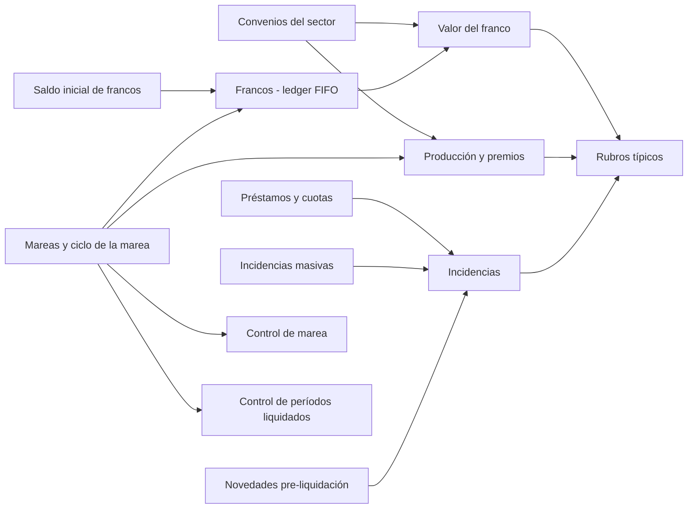

# Índice Dominio - marea y pagos

Segunda mitad del dominio pesquero: **qué pasó en la marea y qué se paga**. La primera mitad —quién es el empleado, qué hacía cada día y bajo qué condiciones se lo liquida— está en [[Índice Dominio - empleado y condiciones]] y [[Vision del dominio pesquero]].

## Notas de esta sección

| Nota | Para qué sirve |
|---|---|
| [[Mareas y ciclo de la marea]] | qué es una marea, Devengado vs Cierre, la ventana = cobertura, variables de marea |
| [[Francos - ledger FIFO]] | cómo se devengan, guardan y consumen los francos en `Línea Liquidación` |
| [[Saldo inicial de francos]] | carga de los francos previos a la puesta en marcha (74 lotes / 4.279 días al 31/12/2025) |
| [[Valor del franco]] | resolución del precio: pesquería + convenio + categoría + fecha |
| [[Novedades pre-liquidación]] | datos de entrada contra un período; regla novedad → liquidación; modos de carga; estados |
| [[Incidencias]] | el dato manual de una liquidación; cómo lo lee el motor |
| [[Incidencias masivas]] | cargar la misma incidencia en muchas liquidaciones (Rep50044) |
| [[Préstamos y cuotas]] | préstamos en cuotas descontadas como incidencias |
| [[Control de marea (Excel y matrices)]] | matriz concepto × tripulante, diferencias contra la categoría, Excel |
| [[Control de períodos liquidados]] | días sin liquidar por empleado; control de liquidación por período |
| [[Producción y premios]] | cómo entra la producción; poteros vs tangoneros; a cuenta de futuros aumentos |
| [[Convenios del sector (CCT 729-15, 768-19, 175-75, 372-04, SOMU)]] | contenido de los CCT y qué está implementado |
| [[Rubros típicos de una liquidación embarcada]] | tabla de conceptos clave con número, lógica y fuente |

## Recorrido típico de una marea (de punta a punta)

1. Se **crea la marea** (copia de la anterior) y se asigna la dotación — [[Mareas y ciclo de la marea]].
2. Mientras navega, los **Devengados** mensuales pagan fijos; las novedades que no son de la marea se cargan contra el período — [[Novedades pre-liquidación]].
3. Al **arribo** se crea el **Cierre de Marea**: producción, garantizado, a cuenta de futuros aumentos y **devengo de francos** — [[Producción y premios]], [[Francos - ledger FIFO]].
4. Se **controla** la marea (matriz, diferencias, Excel) y que ningún día haya quedado sin liquidar — [[Control de marea (Excel y matrices)]], [[Control de períodos liquidados]].
5. En puerto el tripulante **goza francos**: la Regular **consume el FIFO** valuado por pesquería y categoría — [[Valor del franco]].
6. Los anticipos y descuentos se recuperan por novedad o por cuotas — [[Préstamos y cuotas]].

## Lo que no está resuelto (resumen)

- Valor base de **puerto de mayo 2026** para SOMU langostino (tres números; decide nómina) y carga de 32 de 40 valores — [[Convenios del sector (CCT 729-15, 768-19, 175-75, 372-04, SOMU)]].
- **Oficiales netos al 70%** no están modelados ([[oficiales-netos-al-70]]); `M4T_HIST_PUESTOS` sin migrar ([[puesto-vs-categoria-cct]]).
- El **importe estimado** del saldo inicial no se llena y la grilla de francos valúa a valor pleno — ver las advertencias en [[Saldo inicial de francos]] y [[Francos - ledger FIFO]].
- El control de días liquidados lee el envolvente de la cobertura, no los tramos — [[Control de períodos liquidados]].
