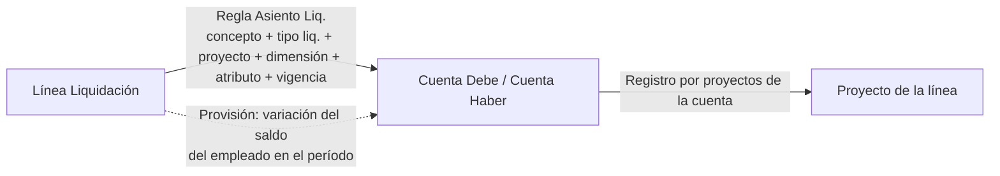

# Asiento de sueldos

Parametrización del asiento contable de la liquidación y su **previa** (cuentas, proyectos, debe y haber, avisos). **Todavía no escribe el diario ni registra**: eso es el paso siguiente. Reemplaza lo que hacía la interfaz de Meta4 en NAV (codeunit 50506 `Interfaz Meta4`, proyecto `MigrationCustomExtension/projects/Nomina/Meta4`).

> [!important] Es una actividad del período, no de la liquidación
> Nada corre al liquidar. El asiento se arma con el período cerrado, leyendo las liquidaciones como quedaron, y armarlo dos veces da lo mismo. `Tipo Liquidación."Genera Asiento"` sólo dice **qué tipos entran**: todos menos `HIST_REMUN` y `SALDO_INICIAL` (están Aprobadas y ya se contabilizaron en Meta4) y `ANTICIPO` (tesorería; Meta4 también dejaba afuera el tp 4). Una liquidación del período de un tipo sin la marca sale en los avisos. Decidido con el usuario el 26/10/2026.
>
> **Un período ya asentado que se recalcula hay que volver a asentarlo.** El siguiente parte del saldo recalculado, así que no absorbe la diferencia. Cuando exista el registro, marcar las liquidaciones como `Contabilizada` impide reabrirlas sin revertir antes el asiento.

## Lo que hacía Meta4

La interfaz leía de Oracle **columnas contables ya calculadas por Meta4** en `M4T_ACUMULADO_RL4`, una por cuenta (conceptos de Meta4 clase `C`, 96xx-98xx), y armaba una línea de diario por empleado, cuenta y proyecto (`ID_CTO_COST_NAV`). Después consolidaba por cuenta, fecha y proyecto en `DIA-GRAL/NOMINA` y mandaba la diferencia a la cuenta de redondeo.

| Columna Meta4 | Qué suma | Cuenta |
|---|---|---|
| `SDOS_JORN` / `REMUN_AB/AP/AC/PTA` | haberes sin asignaciones, partidos por convenio y centro de trabajo | 6110001 / 6311001, 6312001, 6313001, 6106001 |
| `CONTR_TA` / `CONTR_AB…` | `TOT_CONTRIB` − crédito fiscal IVA | 6110002 / 6311002… |
| `CRED_IVA_*` | `CREDITO_IVA_ST` = (5811 + 5821 + 5831) × `ALI_CRED_IVA_ST` / 100 | 1115314 (debe) |
| `PROV_SAC` / `SAC_*` | SAC devengado del mes; en la liquidación del SAC, **menos todo lo provisionado** | 6110026 / 2112010 |
| `CNT_PROV_SAC` | `PROV_SAC` × (619 + 624 + 626 + 628 + 630 + 631 + 6090 − 627) / 100 | 6110027 / 2113029 |
| `REM_PAG_TA/ADM/PTA` | `LIQUIDO` (neto) por convenio | 2112001 / 2112003 / 2112011 |
| `CS_SC_A_PAG` / `OTR_CONTR_A_PAG` | SUSS (retenciones + contribuciones) / el resto de las contribuciones | 2113001 / 2113005 |
| `CTA_SIN_A_PAG` | cuota sindical, una cuenta por sindicato | por dimensión `SINDICATOS` |
| `IMP_GCIAS`, `EMB_JUDIC`, `CTA_ALIM`, `ANT_DESC_*` | retenciones y anticipos | 2115006, 2113004, 2113002, 1115204 / 1115205 |

Las fórmulas LN4 están en `ARBPRO.M4_AUTODOC_CPTOS.FORMULA` (las dependencias de `M4SYS_DEPENDENCIAS` cierran en 2005). `ALI_CRED_IVA_ST` (627) da **1,45 · 6,50 · 7,30** para las zonas DGI 07 · 29 · 69, los mismos del tramo `ZONA_DESFAV` de BC. `M4T_VAL_ZONAS_DGI` dice 0 desde 2022, pero la fórmula los tiene cableados y es la que manda (coinciden con la escala de 2019; el fundamento legal no está verificado).

> [!important] La zona del crédito es `ZONA_DESFAVORABLE`, cargada a la tripulación desde Meta4
> Meta4 toma la zona DGI del **centro de trabajo** en cada liquidación (MP→07, PM/CR→29, PD→69), y cambia cuando el tripulante pasa de un buque de Mar del Plata a uno de Madryn. BC usa el atributo `ZONA_DESFAVORABLE` (`COD_ZONA`), elegido por el usuario el 26/10/2026; antes lo tenían sólo quienes cobran el adicional y el crédito daba 10,2 M. El mismo día se cargó a los **336 tripulantes** (`TIPOEMPLEADO = TRIPUL`, que coinciden uno a uno con MR/OF/FE de Meta4) con `scripts/MigrarZonaTripulantes_1/_2`: **360 tramos** (280 en 29, 80 en 07; 19 cambian de zona en 2026). Cada cambio arranca el día de la primera liquidación de Meta4 con la zona nueva; el primero, el 1/1/2026 o el alta si entró después. Con eso el crédito da **71,2 M contra 70,4 M**. No mueve el recibo: el 2703 sólo paga con `PCT_ZONA_DESF`, que existe para FA y 372/04 y ningún tripulante tiene ([[atributo-cargado-que-nadie-lee]]).

## El diseño en BC

- **`Regla Asiento Liq.` (Tab110067)**: concepto + filtros opcionales (tipo de liquidación, proyecto, una dimensión, un atributo del empleado o de la marea) + vigencia → **cuenta debe y cuenta haber**. Un importe negativo invierte el par. **Cada fila balancea sola**, así que el asiento balancea por construcción. Reemplazó a los rubros `ASI_` con fracciones (25/10, nunca aplicados) a pedido del usuario: "una tabla para el mapeo de conceptos, dimensiones y atributos a cuenta".
- **Resolución**: de cada variante de filtros, la última vigencia a la fecha; de las variantes que coinciden, **gana la que tiene más filtros**. Dos que coinciden con la misma cantidad son un aviso con el importe que quedó sin imputar. Por eso los filtros de proyecto de las sedes **no se pisan** (`PN-ADM*&<>PN-ADM-BAIRES&…` para el resto de la administración), y las contribuciones del aguinaldo van con tipo **y** sede en cada fila. Es al revés que los parámetros ([[generica-nueva-pisa-especifica]]).
- **Carga**: la página inserta al salir de la fila (`DelayedInsert`) y el `OnInsert` exige la fila completa. Después cada campo se guarda solo, así que los pares (dimensión y valor, atributo y valor, atributo y dimensión de la cuenta) no se validan en cada cambio: una fila que queda incompleta no se usa y la previa la avisa. Provisión y Conceptos que la liquidan se **propagan** a todas las filas del concepto, y una fila nueva las hereda; los lotes de francos sólo pueden estar en un concepto. Los atributos tienen que ser de lista (el asiento compara por el código del valor).
- **Dimensión del filtro**: la dimensión por defecto del proyecto y, si no la tiene, la del empleado.
- **Cuenta según atributo** (`Cód. Atributo Cuenta` + `Dimensión Cuenta` + `Lado Atributo`): el valor del atributo del empleado, a la fecha de los atributos del motor (`FechaAtributosDeCobertura`), se busca entre las dimensiones por defecto de las cuentas. Es la relación `SINDICATOS` que ya usaba NAV. Si no aparece, va a la cuenta fija del lado y avisa.
- **Proyecto de la línea**: el `Registro por proyectos` de la cuenta (`Sin código` sin proyecto, `Igual código` el de la cuenta, el resto el de la liquidación). **DEVENGADOS** lleva el proyecto de la marea en curso (`PP-128`, `PP-801`…), así que su gasto queda en la marea sin regla especial.
- **No contabiliza**: concepto mapeado sin asiento (retenciones sobre el SAC devengado, el anticipo 4813, el 2704 viejo). Un concepto con importe y sin regla sale en los avisos; un informativo sin regla, no.
- **Redondeo**: `General Ledger Setup.CuentaRedondeo` (6410003) con `No. proyecto ajustes`, igual que NAV. Más de 1 peso es un aviso.

### Provisiones por saldo

Una regla con `Provisión` no contabiliza el importe de la línea sino **cuánto se movió el saldo del empleado** entre el cierre del período anterior y el de este. La regla es una sola, del usuario (26/10/2026): **se registra el devengado hasta tener la liquidación; ahí se revierte el devengado y se conserva lo liquidado**. Correrlo dos veces da lo mismo.

**Se asienta por partida, no por empleado.** Cada devengado entra con la liquidación que lo originó, y se revierte con esa misma liquidación: el de una marea (cierre o devengados de la marea en curso) se registra y se revierte en esa marea, el de la nómina en la nómina. Cada lote de francos, con su liquidación de origen; si el origen ya no existe o es del saldo inicial, con la última liquidación del empleado.

| Provisión | Saldo del empleado | Debe / Haber | Efecto |
|---|---|---|---|
| SAC (`4750`) | devengado desde el último período en que se pagó 3613/3623/3813/3823/3814; ese período lo revierte entero | gasto SAC de la sede / 2112010 | el gasto de SAC queda por **lo liquidado**, como hacía Meta4 con `PROV_SAC` |
| Cargas del SAC (`CNT_SAC_DEV`) | ídem | cargas s/ SAC de la sede / 2113029 | las contribuciones del **aguinaldo** van a la misma cuenta (regla con `Filtro Tipo Liq. = AGUINALDO`) |
| Vacaciones (`VAC_DEVENG`) | devengado desde el último período en que se pagó 3553/3573/3973/3975; ese período lo revierte entero | gasto vacaciones / 2112013 | lo pagado va al mismo gasto de vacaciones, que queda por lo liquidado |
| Francos (`1062`, `Lotes de francos`) | días que le quedan a cada lote de la **cuenta corriente** de la fase vigente, **al valor por día del 1063 para la terna del lote** (ver abajo) | sueldos de la sede / **2112005 A CONFIRMAR** | cada consumo revierte los días del lote a su valor de devengo; lo que pagó el 1063 queda. La baja deja el saldo en cero desde el día de la baja (la paga el 2803, que no consume lotes) |

- Con **borradores** en la previa, los francos no cuentan su consumo (reabrir revirtió los movimientos de la cuenta corriente): sale un aviso.

- Vacaciones parciales: si se liquida una parte de los días, el devengado se revierte entero igual (es la regla). Con vacaciones anuales completas, como liquida hoy la tripulación, es lo mismo.
- **Valor de un lote (desde la 1.0.0.709): como el 1063, por la terna** ([[valor-franco-por-terna]]). `Gestión Francos.ValuarMatriz` con una fila del lote: pesquería del buque del lote (`PESQ_FRANCO`), convenio y categoría del lote, el par de la liquidación de origen como documento, a la fecha del lote y con las cotizaciones de esa fecha (`TiposCambioFrancosAFecha` + `PublicarTiposCambio`, como la matriz). Se multiplica por el `COEF_PESQUERIA` de la liquidación de origen, igual que `ROUND(FILA_CANTIDAD * FILA_VALOR_FRANCO * #COEF_PESQUERIA)` del 1063. Antes se leía `VALOR_FRANCO_DIA` de `Resumen Variable`, que sólo se guarda donde algo la usa: después del recálculo de enero la tenían 19 de 90 cierres y 56 días quedaban sin valor.
- **Respaldo**: si la terna no tiene precio a la fecha del lote (el saldo inicial del 31/12/2025 es anterior a los precios, o el par del lote es inválido), se valoriza con la fecha y el par de la **primera liquidación posterior** del empleado. Si tampoco hay, aviso `FRSINVALOR` con el último error de la matriz. Los lotes de liquidaciones borradas suman cero en la cuenta corriente (devengo y reversión) y no pesan.
- `FRANCO_DEVENG` **no** sirve como base: multiplica por `VALOR_FRANCO`, que es mensual, y da unas treinta veces de más (ver [[Hallazgos abiertos]]).
- **Saldo inicial**: si el período anterior no tuvo liquidaciones que contabilizan, el saldo con que arranca no es gasto del mes; sale como aviso, para asentarlo una vez contra resultados de ejercicios anteriores. En enero de 2026 son los francos del saldo inicial: **4.279 días, 313,3 M**. SAC y vacaciones arrancan en cero.
- En la **liquidación final** las contribuciones sobre el SAC proporcional no se separan del resto (el motor las calcula juntas): van a cargas sociales, y la cancelación de la provisión de cargas del SAC acredita la 6110027.

## Conceptos nuevos del motor (vigencia 2026-01-01, informativos)

| Concepto | Fórmula | Orden |
|---|---|---|
| `CRED_IVA_814` | base imponible de contribuciones (la del 7000: `#5811 + #5821 + #5831` con detracción) × `TRAMO('ZONA_DESFAV', COD_ZONA)` / 100, condición `COD_ZONA > 0` | 945 |
| `CNT_SAC_DEV` | `#4750` × (jubilación + ART + tarea diferencial + 19032 + 23660 + asig. familiares + FNE, estos cuatro si no es jubilado) − `#4750` × alícuota IVA / 100 | 944 |

El `2704` ("Crédito Fiscal adicional por zona desfavorable") calculaba sobre el `BASICO` y nadie lo leía: queda en No contabiliza. **Las liquidaciones ya calculadas no tienen líneas de los dos conceptos nuevos hasta recalcularlas**; la previa los muestra recién entonces. La simulación del script los calcula con la fórmula.

## Parametrización inicial (scripts/SembrarAsientoSueldos.sql)

Seis sedes: genérica (buques, cuentas 6110), Buenos Aires (`BAIRES|MARDEL`, 6311), Santa Cruz (`PTODDO`, 6312), Chubut (`COMRIV|PTOMDY`, 6313), resto de la administración (6110 con neto 2112003) y planta (`ARB/PCR/PPM`, 6106). MARDEL con Buenos Aires y PTOMDY con Chubut: **confirmado por el usuario**. ~1.500 reglas para 246 conceptos.

| Clase | Debe | Haber |
|---|---|---|
| Haber | sueldos de la sede | neto de la sede |
| SAC liquidado (3613, 3623, 3813, 3823, 3814; SAC s/ indemnizaciones 2804, 3904, 3944, 3974, 3976) | SAC de la sede | neto |
| Vacaciones pagadas (3553, 3573, 3973, 3975) | vacaciones de la sede | neto |
| Aporte (tipo 5) | neto | 2113001 |
| Descuento con destino | neto | su pasivo (sindicatos por dimensión, Ganancias, embargos, cuota alimentaria, anticipos 1115204 / 8870 a 1115205, recuperos de gasto) |
| Descuento que baja el sueldo (4121, 4140, 4723) | neto | sueldos |
| Contribución (tipo 3) | cargas sociales de la sede (cargas s/ SAC en AGUINALDO) | 2113001 si es F.931, si no 2113005 |
| `CRED_IVA_814` | 1115314 | cargas sociales de la sede |
| Provisiones | ver arriba | |

### Simulación de enero de 2026 (SQL, vuelta atrás)

**568 liquidaciones, debe = haber = 3.944.273.916,51**. La zona del crédito es el atributo vigente (lo que va a ver el recálculo) y `PCT_TAR_DIF` el de cada convenio (2 % en la tripulación).

| Cuenta | BC | Meta4 | |
|---|---|---|---|
| 2112001 + 2112003 (neto) | 1.323.352.088 | 1.323.352.462 (`LIQUIDO`) | ✓ |
| 2113001 SUSS | 710.188.680 | 710.052.918 | ✓ 0,02 % |
| 2113005 otras contribuciones | 22.744.670 | 22.744.670 | ✓ exacto |
| Sindicatos (8 cuentas) | 72.865.452 | 72.865.460 | ✓ |
| 2115006 Ganancias | 301.788.862 | 301.788.911 | ✓ |
| 1115204 / 1115205 anticipos | 117.680.586 / 2.250.000 | 117.680.586 / 2.250.000 | ✓ exacto |
| 1115314 crédito IVA | 71.168.891 | 70,4 M | ✓ 1 % |
| 2112010 provisión SAC | 160.392.927 | 160.362.141 | ✓ |
| 2113029 cargas s/ SAC | 45.202.065 | 45,3 M | ✓ |
| 2112013 provisión vacaciones | 81.486.328 | — | Meta4 no la tenía |
| 2112005 provisión francos (variación) | 74.182.564 | — | 5.395 días al 31/1; el saldo inicial (4.279 días, 313,3 M) va aparte. **Aproximación**: el SQL no valoriza por terna; la referencia es la previa (72.994.128) |

## Pendiente y a confirmar

> [!warning] Antes de registrar
> 1. **Cuenta de pasivo de la provisión de francos**: no hay una 2112 de francos en el plan; quedó 2112005 (`SDOS.EMB.A REGULAR`) a confirmar.
> 2. **Saldo inicial de francos** al 31/12/2025 (313,3 M): un asiento único contra resultados anteriores. Vacaciones y SAC arrancan en cero.
> 3. **Recalcular febrero y marzo** para que tengan líneas de `CRED_IVA_814` y `CNT_SAC_DEV` (enero se recalculó el 27/10).
> 4. **Dos lotes del saldo inicial con un par convenio/categoría que no existe** (175/75 con OF01, 111 días; 768/19 con OF02, 21 días: [[convenio-of-depende-de-la-categoria]]): la terna no tiene precio y se valorizan por el respaldo, con el par de la primera liquidación posterior. Corregir el par en la cuenta corriente para que no dependan del respaldo. (Los lotes sin valor por día se resolvieron en la 1.0.0.709 valorizando por terna.)
> 5. **Dos liquidaciones de enero sin proyecto** (una LIQ_FINAL y una REGULAR, ~2,7 M de haberes): sus gastos van a cuentas que exigen proyecto y la previa lo avisa ("lleva proyecto y hay liquidaciones sin proyecto"). Completarles el proyecto.
> 6. Cargas sociales sobre la provisión de vacaciones (2112014, 6110045…) y contribuciones sindicales sobre el SAC devengado (4755-4757): no se provisionan.
> 7. Planta: en 2026 no hay liquidaciones con proyecto `ARB/PCR/PPM`; las reglas quedaron cargadas por si vuelve.
> 8. FEC sale por la dimensión a **2113026**, no a la 2113024 que tenía cableada Meta4. SBA y UOM no tienen cuenta en la dimensión.

## Drilldown: de la previa a la liquidación (1.0.0.706, 27/10/2026)

En la previa, el drilldown de **Debe**, **Haber**, **Importe** o **Mensaje** (o la acción **Origen**) abre *Origen de la línea del asiento* (Pag110069): cada línea de liquidación, partida de provisión o lote de francos que aportó a esa cuenta y proyecto, o que disparó ese aviso, con su importe. El título dice cuántas son y su total, que es el importe de la línea antes del redondeo a centavos. Desde ahí, la liquidación abre su **ficha** y el concepto abre **la línea** con su fórmula aplicada y sus variables (*Líneas Liq. con Variables*); si el origen no es una línea (una partida de provisión sin línea, un lote del saldo inicial), las líneas de ese concepto en la liquidación.

| Origen | Qué es | Detalle |
|---|---|---|
| Línea | el importe de una línea de liquidación | — |
| Provisión: devengado | lo que el concepto devengó en esa liquidación, que entra en el mes | — |
| Provisión: reversión | un devengado anterior que se revierte porque se liquidó | el período del devengado |
| Lote de francos | la variación de un lote de la cuenta corriente | días al cierre anterior y a este, y el valor por día |
| Liquidación | una liquidación de un tipo sin `Genera Asiento` (aviso) | — |

- **No se guarda: se rearma.** `Asiento Sueldos Liq.Origenes(período, borradores, clave, var Origen)` vuelve a armar la previa siguiendo sólo la clave de la línea (`Clave Origen`: `cuenta|proyecto`, o la del aviso). Guardar el origen de todo serían decenas de miles de filas para mirar una; rearmarla son unos segundos y es el mismo cálculo.
- Desde el servidor: `DiagnosticarOrigenesJson('202601;1115314|')`. Verificado en enero: el crédito IVA son **550 orígenes por 71.168.890,93** y la provisión de francos **306 por −70.764.594,52** (316 por −72.994.127,74 desde la valorización por terna), iguales a sus líneas. Ojo: BC **trunca un mensaje de error largo** ("The error message is too long, so part of it has been deleted"), así que los totales van al principio del JSON y el detalle de una cuenta con cientos de orígenes llega cortado.

## Puesta en marcha (hecha el 27/10/2026)

1. Publicada la extensión (**1.0.0.704**; la 702 trajo la tabla 110067 y el campo 16 de Tipo Liquidación; la 706, el drilldown; la **709**, los francos por terna).
2. `scripts/SembrarAsientoSueldos.sql` aplicado: 2 conceptos, **1.511 reglas** (246 conceptos), `Genera Asiento` en 8 tipos. Servicio reiniciado.
3. Previa de 202601 corrida en BC con `Asiento Sueldos Liq.DiagnosticarPreviaJson('202601')` por `Invoke-NAVCodeunit` (el resultado vuelve en un error identificado `PREVIA_ASIENTO_JSON:…:FIN_PREVIA_ASIENTO_JSON`, como `DiagnosticarOrdenesJson`: el cmdlet descarta los valores de retorno). El cliente web no se abre desde el navegador integrado de Claude: da 401 (no hace autenticación integrada de Windows).

### La previa en BC contra la simulación (202601)

**568 liquidaciones, debe = haber, 0,04 al redondeo.** La previa neta debe y haber dentro de cada cuenta y proyecto, así que se compara el **saldo por cuenta**: igual al centavo en todas las cuentas, salvo lo esperado:

- **Crédito IVA y cargas s/ SAC devengado** (1115314, 2113029, 6110027, 6311026, 6313023 y las de cargas sociales): la previa lee las líneas y esos dos conceptos todavía no tienen (enero no se recalculó). Las diferencias en cargas sociales suman exactamente el crédito (71,17 M) y las de 611x027/631x026/631x023 las cargas s/ SAC (45,20 M).
- **192.388 de 2113003 a 2113012 (SOMU)**: la previa busca el sindicato a la fecha de atributos del motor (la cobertura) y la simulación a la fecha de liquidación. Manda la previa.
- **Avisos**: el saldo inicial de francos (313,3 M) y las cuentas con proyecto en las dos liquidaciones sin proyecto.

**Con enero recalculado** (el usuario, 27/10): el crédito IVA (71.168.890,93) y las cargas s/ SAC devengado (45.202.065,15) ya están en la previa e iguales a la simulación. La provisión de francos había bajado a 70.764.594,52 porque 56 días quedaron sin `VALOR_FRANCO_DIA`. **Con la valorización por terna (1.0.0.709)**: variación de **72.994.127,74** en 316 lotes, saldo inicial **313.291.131,80** aparte, ningún día sin precio, y los valores por día iguales a los del 1063 de las mismas liquidaciones. La simulación SQL ya no es la referencia para francos (no valoriza por terna). Fuera de eso, sólo la diferencia del sindicato por fecha.

> [!bug] Lo que ni el compilador ni la revisión vieron
> La primera corrida real falló con "An invalid argument was passed to a 'List' data type method": `OrdenarTexto` hacía `while (j >= 1) and (Lista.Get(j) > Actual)` y AL no cortocircuita ([[al-sin-cortocircuito]]). Corregido como `OrdenarClaves` de `Lotes Liquidación Liq.`, con el `while` partido y `break`. La revisión adversarial de 31 agentes no lo encontró: correrlo contra la base sí.

## Relacionado

[[Estados y transiciones de una liquidación]] (`Contabilizada` sigue sin camino) · [[Reporte SICOSS]] · [[Cuenta corriente y matriz de francos]] · [[Meta4 - acceso a Oracle y trampas de extracción]] · [[Sincronización NAV - entidades y mapeo]] · [[sindicato-obra-social-atributos]] · [[atributo-cargado-que-nadie-lee]]
