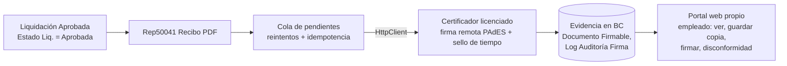

# Firma digital de recibos - decisión

**ADR-001** (`ADR_001_FIRMA_DIGITAL_RECIBOS.md`, 26/8/2026): modelo de firma para emitir **recibos de sueldo digitales** con validez probatoria equivalente a la de Humanage, TuRecibo o Intersoft.

> [!warning] Estado: PROPUESTO, no implementado
> No hay en `src/` ningún objeto de firma (se buscó `Documento Firmable`, `Firma Digital`, `PAdES`: sin resultados). Sólo existe el **recibo** (`Rep50041.ReciboDeSueldo`, layouts RDL/RDLC y `V2`, disparado desde `Pag50117.FichaLiquidacion`). Las ocho acciones del ADR están sin hacer y la primera es **bloqueante**.

## Los hechos que no conviene volver a investigar

1. **No existe una habilitación que tramitar.** La Res. 346/2019 eliminó la autorización de la Secretaría de Trabajo (Res. 1455/2011). Las plataformas no tienen una licencia, tienen un **stack**. Lo que sí exige la 346/2019: contenido de los arts. 138-140 LCT, **firma de ambas partes**, que el trabajador pueda **conservar copias** y **firmar en disconformidad**.
2. **SITRADIB (Res. MTGP 147/24, Buenos Aires) no alcanza a los recibos**: el manual oficial no menciona la palabra "recibo"; es rúbrica de documentación laboral y libro del art. 52 LCT. La integración con milegajo.com es opcional. Importa igual porque su criterio de sujeto es amplio (domicilio legal, fiscal *o* personal prestando servicios en PBA) y consume **el mismo certificado de firma digital**.
3. **AL no puede firmar PAdES** (no hay librería de firma de PDF): la firma ocurre fuera de BC; BC orquesta y custodia la evidencia. DotNet interop está disponible (`target: OnPrem`) pero se descartó: clava la extensión a on-premise y mete criptografía sensible en el proceso del servicio.
4. **El certificado de WSAFIP no se puede reutilizar**: el de WSAA es un certificado de sistema que emite AFIP para autenticar una máquina; no lo emite un certificador licenciado, no está atado a la identidad del representante legal y no encadena a la AC Raíz de firma digital. Firmar con él no produce firma digital Ley 25.506. Y `openssl cms -sign` (lo que usa `fntWSAA` en `Cod50513 "WS - AFIP"`, de la extensión Final Version) produce un CMS suelto, **no firma PDFs**. Ese código además guarda la clave privada en texto plano en el filesystem y arma PowerShell por concatenación: es, según el ADR, "la evidencia empírica" de cómo sale una firma construida en casa.

## Decisión propuesta: Opción A

**Firma digital remota vía API de un certificador licenciado** (Res. SIP 86/2020), con la integración **encapsulada tras una interfaz AL** (`interface` + implementaciones) para poder cambiar de proveedor sin tocar el motor.

| | A: API certificador | B: token/HSM + microservicio .NET | C: plataforma existente |
|---|---|---|---|
| Firma masiva desatendida | sí | sólo con HSM (caro) | provista |
| Riesgo | caída del proveedor: ruidosa, recuperable | firma mal construida: **silenciosa, diferida, masiva** | lock-in de datos y evidencia |
| Evidencia | queda en BC | depende de la implementación propia | en un tercero |
| Veredicto | **elegida** | descartada: ventaja económica aparente (HSM + TSA externa igual) | descartada: contradice el portal propio |

Razonamiento final: A y B no fallan igual de mal; el costo por documento de A es el precio de transferir ese riesgo a un tercero regulado. **El disparador natural** es el estado `Aprobada` de `Enum 50304 "Estado Liq."` (valores: Borrador, Calculada, Aprobada, Contabilizada).

## Precedente de modelado

Seguir el par `AFIP Interface Register` / `AFIP Interface Register detail` (cabecera con detalle y trazabilidad de campo / valor anterior / valor nuevo): es la forma que necesitan `Documento Firmable` y `Log Auditoría Firma`. Ese mismo par ya lo reutiliza la importación de SIRADIG ([[SIRADIG - modelo y parser]]).

## Riesgos abiertos

- **Bloqueante**: la Res. 346/2019 dice "firmado digitalmente por ambos". Literal exigiría certificado Ley 25.506 **por empleado**. La práctica de mercado es firma digital para la empresa y **firma electrónica para el trabajador** (la carga de la prueba recae en el empleador, art. 5 Ley 25.506). Es defendible pero **no es opinión legal**: falta el visto del asesor laboral; si lo rechaza, el circuito del empleado cambia y se reabre el ADR.
- **Conectividad de la tripulación**: se eligió un portal web propio como único canal y **la tripulación embarcada no tiene conectividad durante la marea** (el grupo más numeroso de la nómina). Hay que definir un circuito offline/presencial antes de implementar.
- Dependencia en tiempo de ejecución con un tercero: reintentos, idempotencia, timeouts, cola de pendientes, monitoreo. El proceso por lotes debe **recolectar las claves antes de iterar** ([[bucle-modifica-campo-filtrado]]).
- Proveedores: Encode emite certificados por software y token; Lakaut, Box Custodia y Digilogix **sólo por token** (el modelo A necesita software/remoto).

## Acciones (checklist del ADR, todas pendientes)
1. Opinión del asesor laboral (bloqueante). 2. Relevar dotación y jurisdicciones (Buenos Aires, Santa Cruz/Chubut, CABA). 3. Circuito para tripulación sin conectividad. 4. Cotizar con al menos dos certificadores (API REST, PAdES-B-LT, sello de tiempo, SLA, escalones de precio, sandbox). 5. Verificar si el certificado sirve para SITRADIB. 6. Diseñar la interfaz AL de firma. 7. PoC de firma de punta a punta con un verificador independiente. 8. Recién entonces, modelo de datos de evidencia y portal.

> [!note] Discrepancia con el código actual
> El ADR afirma "no hay uso previo de `HttpClient` en este repositorio". Desde el 12-13/9/2026 sí lo hay: `Cod110040 "Cliente NAV WS"` (OData contra NAV, Basic). Sigue sin ser un precedente de firma, pero es el primer cliente HTTP con clave en Isolated Storage, un patrón reutilizable para las credenciales del certificador ([[Sincronización NAV - transporte WS]]).

Resumen de memoria: [[firma-recibos-digitales]].

## Ver también

[[Perfiles, Role Center y permisos]], [[SIRADIG - importación]] (mismo precedente de auditoría AFIP), [[Índice Integraciones]].
