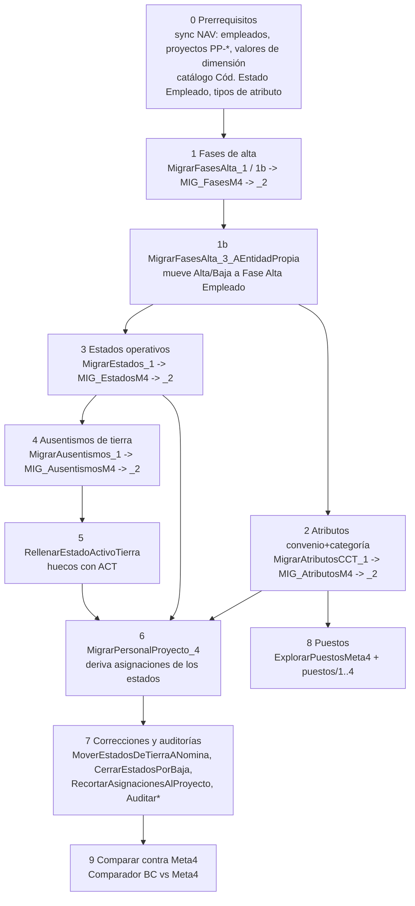

# Migración desde Meta4 - mapa y orden de ejecución

**Meta4** es el sistema de liquidación anterior (Oracle). Fue producción de enero a julio de 2026; BC corrió en paralelo y hoy lo reemplaza. Esta nota es el **mapa**: qué se trae, de qué tabla de Meta4, a qué tabla de BC, con qué script y en qué orden. El detalle por tema está en [[Migración Meta4 - estados y fases]], [[Migración Meta4 - atributos CCT, puestos y ausentismos]] y [[Migración Meta4 - correcciones y auditorías]]. Todos los scripts, uno por uno: [[Catálogo de scripts SQL y PowerShell]].

## El patrón de los tres tiempos

Meta4 es **Oracle** y BC es **SQL Server**: ninguna consulta lee las dos. Cada migración va en:

1. **Script `_1_..._Oracle`** contra la conexión **Meta4** (`m4-vm.arbumasa.net.ar:1521`, SID `Meta4`, esquema `ARBPRO`). Sólo SELECT.
2. **Transporte** del resultado a una **tabla puente** `dbo.MIG_*` en la base de BC (DBeaver: Exportar resultado -> Base de datos, mapeo **por nombre**; o `INSERT`s generados como texto, `MigrarFasesAlta_1b`).
3. **Script `_2_..._SqlServer`** contra la base de BC (`Migr2013R2` en `mimir`, ver [[conexion-sql-bc]]): pre-vuelo, inserción **comentada**, verificación.

Cada script empieza con un **guardián** (`SELECT ... FROM DUAL` en Oracle; `DB_NAME()` en SQL Server) para cortar de inmediato si el editor apunta a la conexión equivocada.

## Orden de ejecución

| # | Qué | Tabla origen Meta4 | Destino BC | Scripts | Volumen medido |
|---|---|---|---|---|---|
| 1 | Fases de alta/baja | `M4T_FASES_ALTA` | `Fase Alta Empleado` (vía `Estado Empleado` en el diseño viejo) | `MigrarFasesAlta_1`, `_1b`, `_2`, `_3` | 11.740 fases (27/9/2026) |
| 2 | Convenio y categoría con vigencia | `M4T_HIST_CONVENIOS`, `M4T_HIST_CATEGORIAS` | `Atributo Entidad Liq.` (Tab110005) | `MigrarAtributosCCT_1/_2` | ~21.000 filas; 285 de 330 activos resuelven el par |
| 3 | Estados operativos y ausencias de embarcados | `M4T_HIST_ESTADOS_EMPL` | `Estado Empleado` | `MigrarEstados_1/_2` | 244.010 filas desde 1999 |
| 4 | Ausencias de tierra | `M4T_AUSENTISMOS` | `Estado Empleado` | `MigrarAusentismos_1/_2` | 3.845 de tierra de 15.202 |
| 5 | Relleno `ACT` de tierra | (deriva de fases + ausencias) | `Estado Empleado` | `RellenarEstadoActivoTierra` | - |
| 6 | Asignación a proyecto | no existe en Meta4 | `Personal Proyecto` | `MigrarPersonalProyecto_4` | derivada de 240.956 estados |
| 8 | Puestos (eje de producción) | `M4T_HIST_PUESTOS` | atributo `PUESTO` | `puestos/1..4`, `MapearPuestosMeta4ACategorias` | 10.107 de 14.810 vigencias |

Otras cargas que **no** salen de una tabla de Meta4 sino de archivos Excel/PDF o de la especificación de Meta4: `CargarFraccionesMeta4` (1.208 fracciones de acumulador), `CargarValoresOficiales768` (de los recibos PDF), `ImportarSaldoInicialFrancos` (Excel `Saldo francos 31-12-25.xlsx`), y lo de [[Archivo literal de Meta4 en BC]].

> [!warning] Migraciones que **no** tienen script en el repo
> Quedaron hechas por scripts fuera del repositorio (scratchpad) y sólo existen documentadas en la memoria del proyecto:
> - La **carga del archivo literal** (485.000 cabeceras, ~117 M valores): ver [[Archivo literal de Meta4 en BC]].
> - La **historia de remuneraciones** `HIST_REMUN` 2024-2025 (`hist2024.sql`, `fix_base_promedio_nr.sql`): [[historia-remuneraciones-migrada]].
> - **Novedades** de `M4T_VAL_INCIDENCIA` (2.765 de 2026) y **anticipos** de `M4T_CTA_CTE_ANTICIPOS` (2.028): [[migracion-novedades-meta4]], [[anticipos-cta-cte-meta4]].
> - Familiares con fechas de impuesto: [[familiar-alta-impuesto]].

## Reglas transversales (valen para todos los scripts)

1. **Backup y nadie liquidando** antes de insertar. Las inserciones vienen **comentadas** o dentro de `BEGIN TRANSACTION` con el `COMMIT` comentado: se mira el control y se confirma a mano.
2. **Los INSERT por SQL saltean toda la lógica de AL** (contigüidad de `Fecha Fin`, un estado por fecha, transiciones, change log). Por eso cada script **recalcula a mano** lo que el trigger haría y trae un bloque de verificación que "tiene que dar CERO".
3. **Pre-vuelo con controles de invariante y dirección**, no de conteo ([[previsualizar-antes-de-migrar]]). Anotar las claves tocadas en una `#temp` antes del `UPDATE`.
4. **Doble carga de la puente = error silencioso.** Guardas 1.b en estados (246.920 filas donde tenían que ser 244.010), atributos y ausentismos. `TRUNCATE` la puente antes de recargar.
5. **Limpiar de arriba hacia abajo**: fase -> estado -> asignación ([[tres-capas-fase-estado-asignacion]]).
6. **Normalizar antes de filtrar**: el `LEAD` que cierra cada vigencia tiene que ver el historial completo.
7. **Reiniciar el service tier** tras `UPDATE`s directos ([[sql-directo-deja-cache-rancia]]).
8. **Hardcodeo de empresa y app**: casi todos los scripts de BC fijan `ArbuTest$<tabla>$d4f5a6b7-c8d9-4e0f-a1b2-c3d4e5f67890` (empresa `ArbuTest`, AppId de `app.json`) y `USE [Migr2013R2]`. Antes de correr contra otra empresa/base hay que editarlos.
9. Acceso a Oracle y trampas de extracción: [[Meta4 - acceso a Oracle y trampas de extracción]].

## Códigos y traducciones que se repiten

- Buques: `HF801`->`801`, `HF802`->`802`, `A14`->`114`, `A28`->`128` (`'1' + número`), `PM`->`PPM` (Puerto Madryn: es un puerto, no tiene mareas).
- Convenios: `MR`->729/15, `FE`->ESP, `EC`->130/75, `OF`->175/75 (tangoneros, buques 101-119) o 768/19 (poteros, resto), `JO`->JO, `FA`->FA. La categoría **no** se traduce (los códigos embarcados coinciden). La regla de los oficiales por rango de buque es un número mágico que debería ser un atributo `TIPO_BUQUE` ([[migracion-atributos-cct-meta4]], [[convenio-of-depende-de-la-categoria]]).
- Legajo: Meta4 `191` -> BC `00191` (rellenar con ceros).
- Proyecto: `PP-<buque>-<marea 6 dígitos>` (con marea) o `PN-<buque>-NOMINA`.
- `ID_SOCIEDAD = '01'` (con el cero; `'1'` devuelve cero filas sin error).

## Ver también

Modelo: [[Tabla - Fase Alta Empleado]], [[Tabla - Estado Empleado]], [[Tabla - Personal Proyecto]], [[Tabla - Atributo Entidad Liq]], [[Tabla - Cód. Estado Empleado]], [[Fases de alta]], [[Atributos tipados]], [[Altas masivas y migraciones de fechas]]. Notas hermanas: [[Archivo literal de Meta4 en BC]], [[Comparador BC vs Meta4]], [[Meta4 - acceso a Oracle y trampas de extracción]], [[Catálogo de scripts SQL y PowerShell]], [[Índice Integraciones]].
