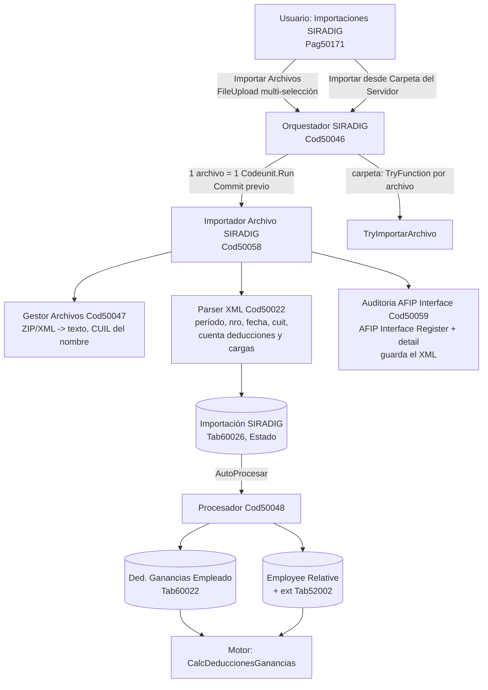

# SIRADIG - importación

**SIRADIG** es el sistema por el que cada empleado declara a AFIP/ARCA sus deducciones de Ganancias y sus cargas de familia (F.572 web). La extensión **importa los archivos de esas presentaciones** (`.xml` o `.xml.zip`) y actualiza dos cosas: las deducciones de Ganancias del empleado y sus familiares. Es una **importación de archivos**, no una llamada a un web service de AFIP. Modelo y parser: [[SIRADIG - modelo y parser]].

## Flujo

## Uso (usuario de RRHH)

1. Abrir **Importaciones SIRADIG** (también está en el Role Center de Payroll, con un Cue de *Pendientes*, *Con errores*, *Procesados* - Tab60027/Pag50173).
2. **Importar Archivos SIRADIG**: selector nativo de la PC (selección múltiple). O **Importar desde Carpeta del Servidor** (la carpeta se recuerda en `Human Resources Setup."Carpeta Importación SIRADIG"`).
3. Responder si se procesa automáticamente. Al final hay **un solo resumen** (importados, con error, deducciones y cargas procesadas, errores por archivo).
4. Si se difiere el procesamiento, el registro queda en `Pendiente Procesar`; acción **Procesar Importación**.
5. **Ver Registro AFIP WS** abre el `AFIP Interface Register` con el XML y el detalle campo a campo (valor anterior -> nuevo).

**Nombre de archivo**: `CUIL_PERIODO_presentacion_NRO.xml.zip` (o `.xml`), p. ej. `20666666667_2024_presentacion_001.xml.zip`. Al menos tres guiones bajos y la primera parte tiene que ser un CUIL de 11 dígitos (con o sin guiones). El CUIL se **normaliza a sólo dígitos**.

## Reglas del procesamiento

- **Empleado**: se busca por CUIL en `Social Security No.` y en **`CIF/NIF`** (donde de verdad vive en BC, ver [[cuil-vive-en-cif-nif]]), con y sin guiones; último recurso: recorrer todos los empleados comparando normalizado. No encontrado -> `Error en Procesamiento`.
- **Deducciones**: sólo los tipos `1,2,3,4,5,7,8,9,10,11,21,22,23,24,25,32,33,34,99`; el resto se ignora **sin avisar**. Por cada una se escribe `Ded. Ganancias Empleado."Importe Fijo"`.
- **Cargas de familia**: se busca el familiar por **nº de documento** y, si no viene, por apellido+nombre (más frágil). Si existe se **reemplaza conservando** `Line No.` y los datos que SIRADIG no informa (`Cód. Tipo Ded.`, fechas, `% Deducción`); si no, se crea con `Line No.` +10000.
- **Reimportar la misma presentación no duplica deducciones ni familiares** (se modifican en el lugar), **pero sí duplica el registro de importación**: `Importación SIRADIG` tiene `No.` autoincremental y su clave `K2` (CUIL + período + nº presentación) **no es única**, así que el control "El archivo ya ha sido importado anteriormente" (`if not Insert() then Error`) **nunca se dispara** (verificado leyendo Tab60026).
- Cada alta/modificación deja un detalle en `AFIP Interface Register detail` (`Table No.`, `Field No.`, tipo de cambio, valor viejo/nuevo, clave).

## Qué hay que saber antes de confiar en el resultado

> [!warning] Las deducciones importadas llevan el código numérico de SIRADIG
> El procesador asigna `Cód. Tipo := '1' | '4' | '32'...` por asignación directa. Pero `Ded. Ganancias Empleado."Cód. Tipo"` tiene `TableRelation` a `Ded. Ganancias Vigente.Código` (códigos de BC como `PREPAGA`, `HIPOTECA`, `SERV_DOM`, `HIJO_MENOR`). Sin `Validate`, la relación no se hace cumplir: la fila entra con descripción vacía y el motor la suma igual (`CalcDeduccionesGanancias`, parte 2: todas las filas con `Importe Fijo > 0` de la **última** vigencia, como `Gasto`). No hay tabla de equivalencia SIRADIG -> código BC.

> [!warning] Importar dos veces con tipos distintos puede perder deducciones
> Un tipo nuevo se inserta con `Vigencia Desde = Today()`; uno que ya existe se modifica **en su vigencia original**. El motor lee **sólo la vigencia más reciente** del empleado. Si una presentación posterior agrega un tipo nuevo, las filas de las vigencias anteriores quedan ignoradas por el cálculo (inferido leyendo Cod50048 + Cod50016; no ejecutado).

> [!warning] "Procesar Importación" no funciona sobre archivos subidos
> Los archivos subidos desde la PC guardan en `Archivo Origen` sólo el **nombre**, no una ruta de servidor, y `ProcesarImportacionActual`/`ProcesarImportacionesPendientes` leen el archivo del disco del servidor. Un registro pendiente de una subida falla con "El archivo ... no existe". El XML sí quedó guardado en `AFIP Interface Register.File`, pero ese camino de reproceso no lo usa.

> [!warning] La importación por carpeta usa `[TryFunction]` que escribe
> `Orquestador.TryImportarArchivo` escribe en base de datos dentro de un `[TryFunction]`; la ruta de archivos subidos se reescribió con `Codeunit.Run` porque el runtime rechaza esas escrituras en ese contexto (`NavNclTryFunctionWriteException`, ver comentario de Cod50058 y [[codeunit-run-necesita-commit]]). La ruta de carpeta quedó con el patrón viejo: **sin verificar** que funcione con varios archivos.

- **Una carga importada no deduce hasta completarla a mano**: sin `Cód. Tipo Ded.` y sin alta a efectos del impuesto (`Fecha alta impuesto`, campo 50008 de la extensión Final Version) el motor no la deduce ([[familiar-alta-impuesto]]).
- `Relative Code` recibe el código de parentesco de SIRADIG tal cual (`1` cónyuge, `3` hijo menor de 18, `30` hijastro, `31` hijo incapacitado, `32` hijastro incapacitado, `103` hijo de 18 a 24); `MapearCodigoParentesco` es un `CopyStr`.
- El estado `Procesado con Advertencias` está en el enum pero **nadie lo asigna**; las advertencias (`WarningDeduccionIgnorada`) están declaradas y sin uso.
- No hay Job Queue posible sobre `ProcesarImportacionesPendientes`: es un `procedure`, el codeunit no tiene `OnRun`. La sugerencia de `README_SIRADIG.md` ("Job Queue, función ProcesarImportacionesPendientes") no se puede cumplir tal cual.

## Documentación vieja del repo

Los seis `.md` de la raíz (`README_SIRADIG.md`, `IMPORTACION_SIRADIG_GUIA.md`, `INDICE_IMPORTACION_SIRADIG.md`, `IMPLEMENTACION_SIRADIG_RESUMEN.md`, `GUIA_PRUEBAS_SIRADIG.md`, `SIRADIG_EJEMPLOS_Y_EXTENSIONES.md`) y `EJEMPLO_SIRADIG.xml` son de **11/6/2026** y hablan de **IDs que ya no existen**: `Cod50023/50024/50025` y `Pag50161`. En el código actual son `Cod50047` (gestor), `Cod50048` (procesador), `Cod50046` (orquestador) y `Pag50171`; además aparecieron `Cod50058`, `Cod50059`, `Tab60027` y `Pag50172/50173`. **Manda el código.** El resto del contenido de esos documentos (formato de archivo, códigos de deducción y parentesco, troubleshooting) sigue siendo válido salvo lo marcado arriba.

## Ver también

[[Tabla - Importación SIRADIG]], [[Tabla - Cue SIRADIG]], [[Tabla - Ded. Ganancias Empleado]], [[Tabla - Ded. Ganancias Vigente]], [[Extensión - Employee Relative]], [[Extensión - Human Resources Setup SIRADIG]], [[Deducciones de Ganancias y familiares]], [[SIRADIG - modelo y parser]].
