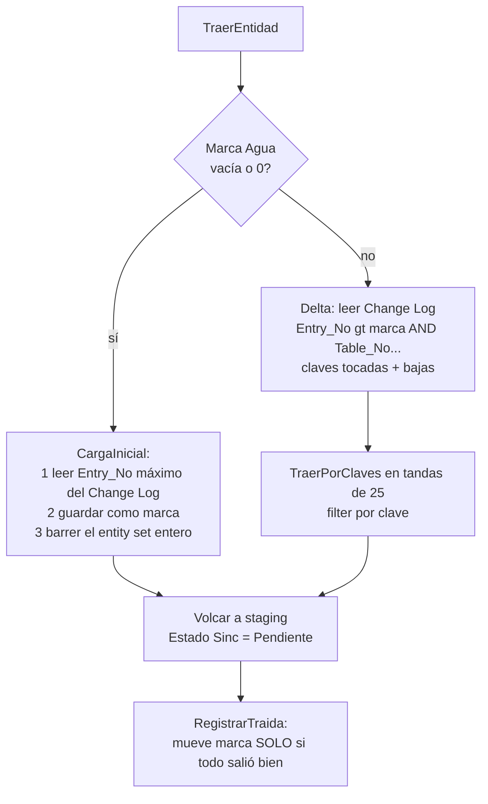

# Sincronización NAV - transporte WS

Transporte `Web Services` (ordinal 1): AL pide a NAV por **OData V4** y llena el mismo staging. No necesita linked server, pero sí una **segunda instancia de service tier** de NAV. Visión general: [[Sincronización NAV - visión general]]. Alternativa: [[Sincronización NAV - transporte SQL]].

## Por qué una segunda instancia

La instancia de producción responde `WWW-Authenticate: NTLM` y el `HttpClient` de AL sólo habla Basic/bearer. Se levanta otro service tier **sobre la misma base** con `NavUserPassword` (exige SSL y permiso de la cuenta de servicio sobre la clave privada del certificado), publicando sólo OData/SOAP. La clave de acceso a servicio web del usuario **no alcanza**: el credential type es de la instancia ([[nav-odata-ntlm]], [[transporte-ws-sincronizacion]]).

## Piezas

| Objeto | Rol |
|---|---|
| Cod110040 `Cliente NAV WS` | HTTP + JSON + paginado (`ObtenerPagina`, `ObtenerTodo`), `ProbarConexion`, `GuardarClave`. |
| Cod110041 `Traer NAV WS` | `TraerEntidad(EmpresaBC, Entidad)`: carga inicial o delta; volcado a staging. Devuelve filas o -1. |
| Cod110042 `Traer y Procesar NAV` | `TraerTodo` (sólo si `Activo` y `Transporte = Web Services`) y luego `Sinc NAV Liq.ProcesarTodo`. |
| Pag110039 `Clave Web Service NAV` | Diálogo para cargar la clave. |

La **clave** va en **Isolated Storage** (`Clave WS Cargada` es sólo la luz); nunca en un campo, para que no salga en exportaciones ni paquetes.

## Algoritmo de traída

- **Reloj = `Entry_No` del Change Log de NAV** (entity set `MovRegistroCambios`), uno solo para todas las tablas. Se guarda en la misma `Marca Agua`, **pero significa otra cosa que en SQL**.
- **El `Entry_No` va primero en el filtro**: `Table_No eq X` sobre 14,5 millones de filas tarda más de 2 minutos; con `Entry_No gt marca` primero es instantáneo.
- **La marca inicial se planta antes del barrido**: al revés, lo que cambia durante el barrido se pierde.
- El Change Log registra **un movimiento por campo**; se deduplican claves. Clave compuesta (sólo Valor Dimensión) se parte con `|` en `Primary_Key_Field_1/2`.
- **Descarga Cabecera** mira **dos tablas** del Change Log (50561 y 50562), porque una línea puede cambiar sin tocar la cabecera. **Descarga Línea no se pide aparte**: `DetalleDescargas` trae cabecera y línea en una fila plana y el traedor la parte en dos. `TraerTodo` por eso no la lista.
- Siempre se sigue `@odata.nextLink` (NAV pagina de a 20.000 sin avisar); `MaxPaginas` corta filtros mal armados con error, no en silencio.
- `HttpClient.Timeout` tope 5 minutos en BC; es por pedido, no por corrida.

> [!warning] Las bajas se detectan pero no se aplican
> `ClavesCambiadas` separa `Bajas` (Type_of_Change = Eliminación/Deletion) de `Claves`, pero `Delta` no usa `Bajas`: ninguna baja de NAV se propaga a BC (verificado leyendo Cod110041). La documentación del enum y de la memoria dice "detecta bajas"; es cierto sólo para la detección.

## Configuración (`Config Sinc NAV`, página 110037)

`URL Base NAV` (hasta `ODataV4`, sin empresa ni barra final), `Empresa OData` (nombre **lindo**, con puntos y espacios), `Usuario WS`, entity sets (`Entidad Proyectos` = `ListaProyectos`, `Entidad Descargas` = `DetalleDescargas`, `Entidad Change Log` = `MovRegistroCambios`, informe capitán `CabInfoCap`/`LinInfoCap`, diario de abordo `CabDiaAbordo`/`LinDiaAbordo`) y **números de tabla de NAV** (167 Job, 5200 Employee, 349 Dimension Value, 50561/50562 descargas, 50559/50560 informe, 50501/50502 diario). `PonerNombresPorDefecto` los completa sin pisar; **`Entidad Empleados` y `Entidad Valores Dim` no tienen default**: vacío = no se trae por este transporte.

> [!note] Empleados publicados sobre la ficha
> OData sólo expone los campos que la **página** muestra. `Employees` tiene que publicarse sobre la ficha del empleado, no la lista; sin fecha de ingreso no se abre la fase de alta y la antigüedad da cero.

## Trampas OData (ya resueltas en el código)

- **El documento de servicio de V4 devuelve cero entity sets** aunque existan: por eso `ProbarConexion` pide `$top=1` a un entity set real. V3 sí los lista pero da 400 con `$top` sobre Query: usar **V4**.
- Opciones llegan como **texto o como ordinal** en el mismo campo (`"Productivo"` vs `"0"`): se prueba el número primero. `Estado` ('Planificación'/'Planning', 'Presupuesto'/'Quote', 'Pedido'/'Order', 'Terminado'/'Completed') y `Tipo` (en blanco / Productivo=1 / Improductivo=2; el primer miembro de la opción está en blanco). Un texto desconocido **falla la fila** (queda en `Error`) en vez de asumir 0.
- Fecha vacía de NAV = `0001-01-01`, no nulo.
- `DetalleDescargas` duplica Buque, Marea, Puerto, Location y Actividad: sin sufijo = cabecera, con `Detalle` = línea.
- Nombres de campo codificados: `N_x00B0__proyecto` (el grado), `Cód_Proyecto` con acento tal cual y `P` mayúscula en cabecera / minúscula en líneas del diario.
- Falta `Pallets desde/hasta` en la Query: lo único que WS no cubre de lo que sí cubre SQL.
- El `Escapar` duplica apóstrofes; las condiciones por clave van **entre paréntesis** para que el `or` no regrupe.

## Qué falla se anota dónde

`TraerUna` (Cod110042) anota el motivo en `Ctrl Sinc NAV."Ultima Observacion"` y sigue con las demás entidades: una que no contesta no frena el resto. Si la traída falla, igual se aplica lo ya existente en staging.

## Ver también

[[Tabla - Config Sinc NAV]], [[Tabla - Ctrl Sinc NAV]], [[Patrón de las tablas de staging NAV]], [[Sincronización NAV - entidades y mapeo]], [[Sincronización NAV - operación y errores]].
