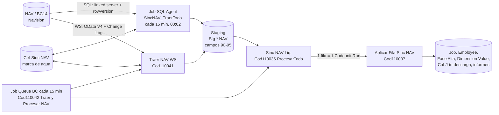

# Sincronización NAV - visión general

La extensión trae desde el sistema viejo (NAV, "2013R2" funcionalmente pero técnicamente un Business Central 14, ver [[nav-odata-ntlm]]) los **empleados, proyectos (mareas), valores de dimensión, descargas, informes del capitán y diario de abordo**. Es una integración **unidireccional NAV -> BC**, por **staging**, con dos transportes intercambiables.

## La división de trabajo (lo que sostiene todo el diseño)

| Capa | Quién la hace | Qué hace |
|---|---|---|
| **Transporte** | job de SQL Agent (transporte SQL) o `Traer NAV WS` (transporte WS) | Sólo lleva filas al **staging** (`Stg ... NAV`). No escribe una sola fila en `Job`, `Employee` ni en las tablas de descarga. |
| **Aplicación** | AL: `Sinc NAV Liq.` (Cod110036) + `Aplicar Fila Sinc NAV` (Cod110037) | Pasa cada fila de staging a la tabla real, con `Validate`, triggers y fases de alta. |

> [!danger] No hacer MERGE directo contra las tablas de BC
> Un INSERT por SQL contra `Job`/`Employee` no crea la **fase de alta** (sin ella la antigüedad da cero y los francos no devengan), no materializa las Default Dimensions de Buque y Marea, no dispara el cierre de asignaciones al cargar la fecha de arribo y deja al service tier con caché vieja (ver [[sql-directo-deja-cache-rancia]]). Por eso el staging existe.

## Flujo

## Piezas

| Objeto | Rol |
|---|---|
| Cod110036 `Sinc NAV Liq.` | Orquestador: recorre pendientes por entidad, llama al aplicador fila por fila, anota resultado. |
| Cod110037 `Aplicar Fila Sinc NAV` | Aplica UNA fila. Sin `TableNo`: el contexto entra por `SetContexto`. `Access = Internal`. |
| Cod110040 `Cliente NAV WS` / Cod110041 `Traer NAV WS` | Transporte WS, ver [[Sincronización NAV - transporte WS]]. |
| Cod110042 `Traer y Procesar NAV` | **Una sola entrada de Job Queue** para los dos transportes: con WS trae y aplica; con SQL sólo aplica. |
| Cod110043 `Sin Dialogo Dim Job` | `SingleInstance`; apaga el diálogo "Ha cambiado una dimensión" sólo durante la aplicación ([[job-confirm-dimension-inocuo]]). |
| Tab110041 `Ctrl Sinc NAV` | Una fila por entidad: `Habilitada`, `Marca Agua`, `Traido El`, `Filas Traidas`, `Procesado El`, `Filas Procesadas`, `Ultima Observacion`. |
| Tab110046 `Config Sinc NAV` | Una fila por par de empresas (BC/NAV). `DataPerCompany = false`. |
| `scripts/SincronizarNAV_2013R2.sql` | La mitad SQL, ver [[Sincronización NAV - transporte SQL]]. |

Entidades, mapeo campo a campo y orden: [[Sincronización NAV - entidades y mapeo]]. Operación diaria y errores: [[Sincronización NAV - operación y errores]].

## Estado de cada fila (`Estado Sinc NAV`, Enum50329)

| Valor | Significado |
|---|---|
| `Pendiente` (0) | Único estado que el proceso vuelve a mirar solo. |
| `Procesado` (1) | Aplicada; `Observacion` puede llevar un aviso (p. ej. nombre de dimensión distinto). |
| `Error` (2) | Requiere acción explícita (reintentar). Nada se reintenta solo en silencio. |
| `Omitido` (3) | Declarado en el enum, **no lo asigna ningún código** (verificado con grep). |

Lo que depende de algo que todavía no llegó **espera, no falla**: queda `Pendiente` con el motivo y suma un intento; al llegar a `Máx. Intentos Sinc.` (campo de `Human Resources Setup`, 5 por defecto) pasa a `Error`.

## Garantías de robustez

- **Una fila mala no frena el lote**: `Codeunit.Run()` por fila + `MarcarResultado` con `Commit()`. Requiere `Commit()` **antes** del `Run` ([[codeunit-run-necesita-commit]]).
- Las claves de las filas pendientes se **juntan antes** de aplicar, porque el filtro es por el campo que se escribe ([[bucle-modifica-campo-filtrado]]).
- `MarcarResultado` **relee** la fila (`RecRef.Find('=')`) antes de escribir, para que un fallo del `Run` no deje un Modify con versión vieja que tumbe todo el lote.

## Puesta en marcha (orden)

1. Publicar la extensión. 2. Abrir "Sincronización con NAV" (crea las filas de control). 3. Elegir transporte en "Configuración Sincronización NAV". 4. SQL: pasos 1-8 del script; WS: instancia de NAV con `NavUserPassword` + clave + probar conexión. 5. Job Queue `Cod110042` (o `Cod110036` si es SQL puro) cada 15 minutos.

Lecciones relacionadas: [[dim2-nav-actividad-bc-marea]], [[sincronizacion-valores-dimension]], [[transporte-ws-sincronizacion]], [[ares-topologia-bc]].

## Ver también

Modelo de datos: [[Patrón de las tablas de staging NAV]], [[Tabla - Config Sinc NAV]], [[Tabla - Ctrl Sinc NAV]], [[Extensión - Job]], [[Extensión - Employee]], [[Extensión - Dimension Value]], [[Tabla - Fase Alta Empleado]]. Notas hermanas: [[Sincronización NAV - transporte SQL]], [[Sincronización NAV - transporte WS]], [[Sincronización NAV - entidades y mapeo]], [[Sincronización NAV - operación y errores]], [[Catálogo de scripts SQL y PowerShell]], [[Índice Integraciones]].
