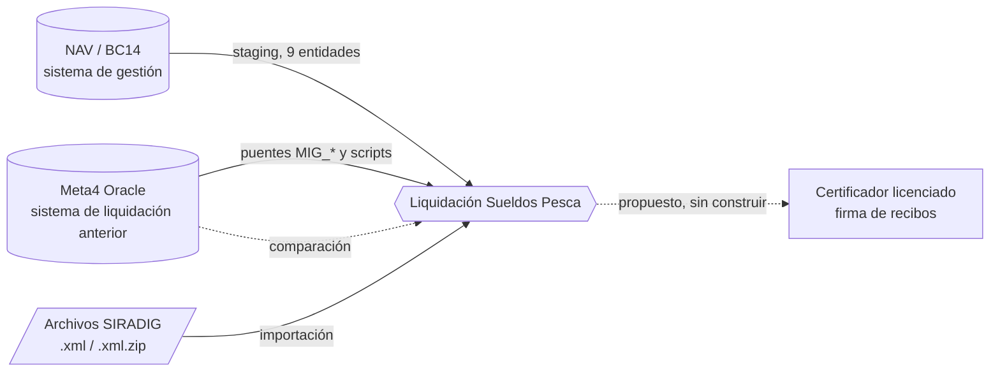

# Índice Integraciones

La extensión conversa con cuatro mundos externos. Esta es la entrada a todo lo que tiene que ver con ellos.

## 1. Sincronización con NAV

Unidireccional NAV -> BC, por **staging**, con dos transportes (SQL por linked server o Web Services OData) que llenan las mismas tablas.

| Nota | Para qué |
|---|---|
| [[Sincronización NAV - visión general]] | Arquitectura, piezas, estados, flujo. **Empezar acá.** |
| [[Sincronización NAV - transporte SQL]] | Linked server, rowversion, `SincronizarNAV_2013R2.sql`. |
| [[Sincronización NAV - transporte WS]] | OData V4, Change Log, segunda instancia de NAV. |
| [[Sincronización NAV - entidades y mapeo]] | Las 9 entidades, qué se escribe y cómo, dimensiones cruzadas. |
| [[Sincronización NAV - operación y errores]] | Páginas, reintentos, marca de agua, errores típicos, bugs conocidos. |

## 2. Migración desde Meta4 (Oracle)

| Nota | Para qué |
|---|---|
| [[Migración desde Meta4 - mapa y orden de ejecución]] | Qué se trajo de dónde, en qué orden, reglas transversales. **Empezar acá.** |
| [[Preparar un mes contra Meta4]] | Procedimiento reutilizable: fuentes, precios, proyectos, producción, entradas originales y conservación histórica. |
| [[febrero-2026-netos-contribuciones-aplicados]] | Correcciones de febrero, conservación de enero y validación de netos, promedios y contribuciones. |
| [[Migración Meta4 - estados y fases]] | `M4T_FASES_ALTA` y `M4T_HIST_ESTADOS_EMPL`. |
| [[Migración Meta4 - atributos CCT, puestos y ausentismos]] | Convenio/categoría, puestos, ausentismos de tierra, `ACT`, asignaciones. |
| [[Migración Meta4 - correcciones y auditorías]] | Lo que hubo que arreglar después y cómo se audita. |
| [[Meta4 - acceso a Oracle y trampas de extracción]] | Cómo consultar Meta4 y qué falla en silencio. |
| [[Archivo literal de Meta4 en BC]] | Las tablas 110054-110056 (485.000 cabeceras, ~117 M de valores). |
| [[Comparador BC vs Meta4]] | Método y pantallas 110051/110052 para validar el motor. |
| [[Catálogo de scripts SQL y PowerShell]] | **Todos** los scripts de `scripts/`: motor destino, cuándo usarlos, si son destructivos. |

## 3. SIRADIG / AFIP (Ganancias)

| Nota | Para qué |
|---|---|
| [[SIRADIG - importación]] | Flujo de uso, reglas y advertencias (leer los avisos antes de confiar). |
| [[SIRADIG - modelo y parser]] | Objetos, tablas, formato de XML esperado, cómo parsea. |

## 4. Firma digital de recibos

| Nota | Para qué |
|---|---|
| [[Firma digital de recibos - decisión]] | ADR-001 (propuesto, no implementado) y riesgos abiertos. |

## 5. Asiento de sueldos (contabilidad)

| Nota | Para qué |
|---|---|
| [[Asiento de sueldos]] | Qué contabilizaba la interfaz de Meta4, la matriz concepto → debe/haber, provisiones por saldo (SAC, vacaciones, francos), crédito IVA Dto. 814, previa y validación contra enero 2026. |

## Lecciones relacionadas (07 Lecciones)

- **NAV**: [[nav-odata-ntlm]], [[transporte-ws-sincronizacion]], [[dim2-nav-actividad-bc-marea]], [[sincronizacion-valores-dimension]], [[job-confirm-dimension-inocuo]], [[codeunit-run-necesita-commit]], [[bucle-modifica-campo-filtrado]].
- **SQL / infraestructura**: [[linked-server-leer-escalar-remoto]], [[sql-dinamico-truncado-4000]], [[sql-ares-dos-collations]], [[ares-topologia-bc]], [[conexion-sql-bc]], [[sql-directo-deja-cache-rancia]].
- **Meta4**: [[migracion-estados-meta4]], [[migracion-atributos-cct-meta4]], [[previsualizar-antes-de-migrar]], [[tres-capas-fase-estado-asignacion]], [[fases-bc-contra-meta4]], [[meta4-es-oracle]], [[meta4-conectar-desde-powershell]], [[meta4-number-castea-a-cero]], [[oracle-date-lleva-hora]], [[export-csv-decimal-con-coma]], [[migracion-novedades-meta4]], [[anticipos-cta-cte-meta4]], [[historia-remuneraciones-migrada]], [[puesto-vs-categoria-cct]], [[equivalencia-id-puesto-meta4]], [[gp-devenga-francos-pero-es-improductivo]], [[algo-parte-estados-en-dos]], [[nomina-no-es-intervalo-presencia]].
- **Ganancias / SIRADIG**: [[familiar-alta-impuesto]], [[cuil-vive-en-cif-nif]], [[grossing-up-tapa-errores]].
- **Firma**: [[firma-recibos-digitales]].
- **ConfigPackage**: [[configpackage-campos-faltantes]], [[rad-json-removed-peligroso]].

## Discrepancias y hallazgos abiertos (resumen)

Verificados leyendo el código; ninguno ejecutado. Detalle en cada nota.

1. `Sinc NAV Liq.ReprocesarErrores` no cubre Informe del Capitán ni Diario de Abordo (probable error de ejecución).
2. Las **bajas** de NAV se detectan (Change Log) pero **no se aplican**; `Estado Sinc NAV::Omitido` no lo asigna nadie.
3. El transporte SQL cubre 5 de 9 entidades; las demás son sólo WS.
4. `MigrarEstados_2` asigna el proyecto por `Devenga Francos` (ya sabido erróneo); `MigrarFasesAlta_2` describe el modelo viejo de alta/baja como estados; `MigrarFasesAlta_1` tiene `ID_SOCIEDAD = 'COMPLETAR'`.
5. Casi todos los scripts hardcodean empresa `ArbuTest`, base `Migr2013R2` y AppId; varios (`CargarFraccionesMeta4`, `CompletarFraccionesFaltantes`, `CorregirBaseIG4Duplicada`, `RestaurarFiltrosFuenteDatos`, `ImportarSaldoInicialFrancos_Datos`) escriben **sin transacción manual**.
6. SIRADIG: códigos de deducción SIRADIG sin equivalencia con `Ded. Ganancias Vigente`; importar tipos nuevos en fechas distintas puede dejar filas ignoradas (sólo cuenta la última vigencia); el control "ya importado" nunca dispara; "Procesar Importación" no funciona para archivos subidos; formato XML no verificado contra uno real de ARCA.
7. Documentación vieja de SIRADIG (11/6/2026) cita `Cod50023-50025` y `Pag50161` que ya no existen.
8. Firma de recibos: sólo el ADR; el ADR dice que no hay `HttpClient` en el repo y ya lo hay (`Cod110040`).
9. `meta4-es-oracle` (memoria) está desactualizada frente a `meta4-conectar-desde-powershell`; el índice de memoria dice que `M4T_HIST_PUESTOS` no se migró pero el script y su nota dicen que sí (18/9/2026).
10. El mecanismo de carga del archivo literal de Meta4, `HIST_REMUN`, novedades y anticipos **no está versionado** en el repo.
- [[Cotizaciones del BNA - carga automática]]
