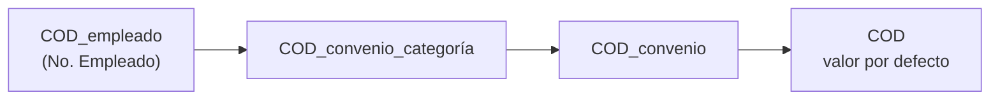

# Configurar un parámetro y su vigencia

Un **parámetro** es una variable de fórmula cuyo *valor cambia con el tiempo y con quién se liquida*: topes de SIPA, porcentajes de aportes, cotizaciones, precios por categoría. Se separa en **qué es** (tabla `Parámetro`: código, nombre de variable) y **cuánto vale** (tabla `Parámetro Vigente`: una fila por alcance y vigencia). Tablas: [[Tabla - Parámetro Vigente]].

> [!warning] Divergencia con la guía vieja
> `GUIA-LIQUIDACION.md` explicaba el parámetro con un check **"Sufijo CCT"** (`BASICO_729/15_MR00`). Esos checks (`Sufijo CCT`, `Sufijo Empleado`, `Sufijo Convenio`) están **obsoletos y sin uso**. Hoy la **clave** se deriva de los campos de alcance que cada *valor* tenga completos (empleado, convenio, categoría) y el motor consulta **todos** los ejes en cascada. Un mismo parámetro puede tener a la vez un valor por defecto, excepciones por convenio y otras por empleado.

## Cómo resuelve el motor un valor

Para cada parámetro con **Nombre Variable** cargado, en cada liquidación, de la clave más específica a la menos; **gana la primera que tenga valor** vigente:

Dentro de cada clave se toma la fila con **mayor `Vigencia Desde` ≤ fecha de referencia** (fin del período; la fecha de arribo en Cierre de Marea). Se cargan **sólo las excepciones**: el resto cae al genérico en vez de quedar en cero. Una combinación **sin ninguna vigencia a esa fecha** devuelve **cero** y las fórmulas que multiplican por ese parámetro dan cero **sin avisar** (por eso existe `IFZERO`).

La clave que se arma se llama **Clave Derivada** (`Cód. Parámetro` en la tabla); se calcula sola. Si supera 50 caracteres, el alta falla con "La clave de parámetro … tiene N caracteres y el máximo son 50" en vez de recortarse y pisar a otra (acortar el código base).

## Pasos

### 1. Alta del parámetro

*Parámetros* → **Nuevo** (ficha **Parámetro**, Pag50138):

| Campo | Qué es |
|---|---|
| **Código** | Identificador. Cambiarlo lo **renombra y arrastra todos sus valores**, reconstruyendo la clave de cada uno |
| **Descripción**, **Notas** | Libres |
| **Nombre Variable** | Cómo se llama en las fórmulas. **Vacío = no se carga automáticamente**. Debe ser único frente a otros parámetros, variables de sistema, fuentes de datos y tipos de atributo (se valida al guardar) |
| **Antigüedad Máxima Vigencia** | Fórmula de fecha (`-1M`, `-35D`). Si el último valor es más viejo que eso respecto de la liquidación, el cálculo **avisa**. Útil para lo que AFIP actualiza (MNI, deducción especial). Vacío = sin chequeo |
| **Edad Máxima Familiar** | Sólo para tipos de deducción por familiar: `HIJO` lleva 18, `HIJO_INC` ninguno. **Cero = sin límite** |

### 2. Cargar valores

Subpágina **Valores por alcance** (o *Parámetros Vigentes* para ver todos):

| Columna | Significado |
|---|---|
| **Alcance** | Calculado: *Valor por defecto*, *Convenio X*, *Convenio X, categoría Y*, *Empleado Z* |
| **Cód. Convenio** / **Cód. Categoría** | La categoría se carga **junto con el convenio** (primero el convenio) |
| **No. Empleado** | **Excluyente** con convenio/categoría: al completarlo se limpian |
| **Vigencia Desde** | Desde cuándo rige |
| **Valor** | El número (usa el separador decimal de **tu configuración regional** en la grilla; las *fórmulas* usan punto) |
| **Moneda** | Si se completa, el valor está en moneda extranjera y la fórmula puede convertirlo con la bandera `<VARIABLE>_ESFCY`. **No convierte sola** |
| **En Uso** | Marcado por el motor cuando una liquidación registrada lo usó |
| **Descripción Versión**, **Clave Derivada** | Informativas |

Para cargar de a varios, usar la **fila en blanco al final**; **Nuevo valor...** crea uno y abre su ficha (*Valor de Parámetro*, Pag110014) para completar el alcance. No puede haber **dos filas con la misma clave y vigencia**.

### 3. Cambiar un valor (nueva vigencia)

**Nunca se pisa un valor usado**: se inserta otra fila con fecha posterior. Acciones: **Nueva vigencia** (copia el valor del alcance de la fila seleccionada con otra fecha) o **Nuevo Valor** (en *Parámetros Vigentes*).

> [!note] Cómo funciona "En Uso"
> `En Uso` bloquea **modificar y borrar** ("No se puede modificar ni eliminar un parámetro que ya fue utilizado en una liquidación registrada"). El bloqueo es **conservador**: si existe **cualquier** liquidación *Calculada/Aprobada/Contabilizada* (de ese empleado, si el valor es por empleado) el valor en uso no se edita, aunque esa liquidación no lo haya usado. **Reabrir** libera automáticamente los *En Uso* que ninguna otra liquidación activa use. Acciones manuales: **Liberar "En Uso"** (en la ficha o la lista del parámetro) y **Limpiar bloqueos "En Uso"** (en *Parámetros Vigentes*, sólo cuando **no existen** liquidaciones calculadas, aprobadas o contabilizadas).

### 4. Revisar

| Herramienta | Para qué |
|---|---|
| **Árbol de Parámetros** | Los valores ordenados por especificidad: el defecto arriba y las excepciones colgando. Es la misma cascada que resuelve el motor. *Nueva especialización* crea un valor más específico heredando parámetro y alcance; *Recalcular niveles* es de una sola vez |
| **Claves de Parámetro a Revisar** (desde el Árbol → *Revisar claves inconsistentes*) | Valores cuya clave derivada **no coincide con sus campos de alcance**: son **inalcanzables** para el motor, que cae al valor genérico **sin ningún aviso**. *Aplicar interpretación* completa convenio y categoría y recalcula la clave (**cambia el resultado de los recálculos**) |
| **Revisar Nombres de Variable Duplicados** (en *Parámetros*) | Dos cosas con el mismo nombre: en una fórmula sólo gana una, según el orden en que el motor arma el contexto |
| Aviso al calcular | "*X*: el último valor vigente es del … (N día(s))" y "*X*: no tiene ningún valor cargado en Parámetros Vigentes" — ver [[Controles y avisos del cálculo]] |

## Trampas

- **Parámetro y atributo con el mismo nombre**: gana el parámetro y el atributo queda mudo ([[parametro-y-atributo-mismo-nombre]]); **dos parámetros con el mismo nombre**: gana el último por código y pisa con cero ([[dos-parametros-mismo-nombre]]).
- **Un valor, una fuente**: no duplicar un parámetro en una fuente de datos ni en otro parámetro ([[un-valor-una-fuente]]).
- **Un precio en dólares cargado como pesos** (sin *Moneda*) no da error: queda congelado al tipo de cambio de cuando se cargó ([[que-tc-usa-cada-concepto]]).
- **Parámetro fantasma** homónimo que tapa a una fuente de datos ([[tc-comprador-parametro-fantasma]]).
- Valores por convenio **sin categoría** caen para todas las categorías del convenio; si una categoría necesita otro valor, cargar la excepción convenio+categoría.

## Verificación

Calcular una liquidación y abrir la línea del concepto que lo usa → *Variables del cálculo* muestra el valor tomado; **Fuente Parámetros** lista `VAR:nombre`. En el **Asistente de Fórmulas**, cargar el contexto de un empleado y buscar el parámetro: si vale 0 con convenio/categoría cargados, falta la vigencia.

Relacionado: [[Configurar un concepto (guía paso a paso)]] · [[Configurar fuentes de datos]] · [[Mapa de páginas por menú]]

## Ver también

[[Parámetros y vigencias]] · [[Nombres de variables y conflictos]] · [[Tabla - Parámetro]] · [[Tabla - Uso Parámetro Liq]]
