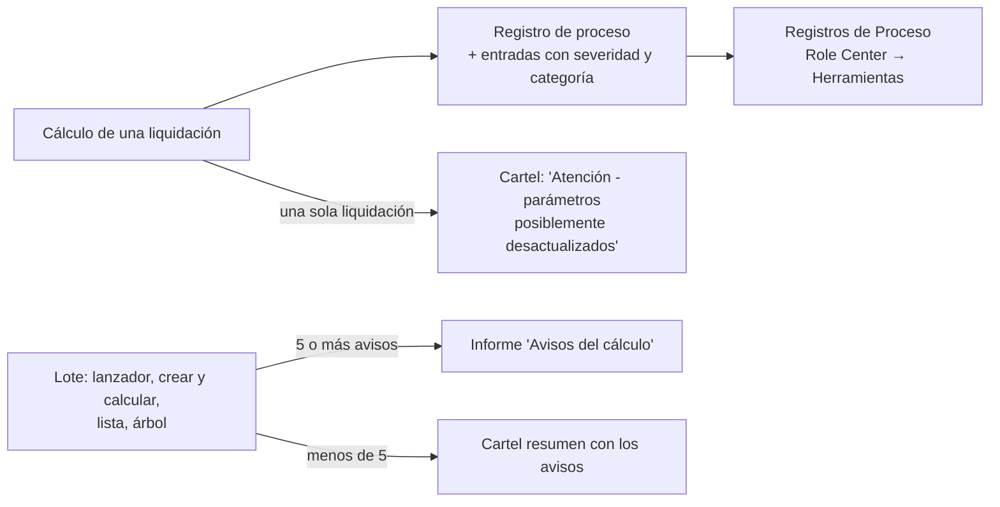

# Controles y avisos del cálculo

> [!note] Informe corregido en 1.0.0.660 (15/10/2026)
> El encabezado cuenta los avisos, procesos y liquidaciones de la selección completa y muestra sus períodos. Sólo identifica empleado y liquidación cuando la selección corresponde a un proceso. Los grupos cuentan procesos distintos, conservan mensajes completos en el detalle y excluyen procesos sin advertencias ni errores. Los avisos dinámicos de orden señalan una precedencia para revisar, sin afirmar por sí solos una diferencia económica: [[Avisos y advertencias del cálculo]].

El motor distingue **errores** (el cálculo se corta, la liquidación no se guarda) de **avisos** (calcula igual, pero algo merece mirarse). Los avisos son lo importante: **casi todos los problemas silenciosos del sistema** (importe bajo sin error, concepto en cero, base incompleta) tienen un aviso o un control que los delata, **si se mira**.

## Dónde aparecen

| Canal | Cuándo | Qué hacer |
|---|---|---|
| **Cartel** tras *Calcular* en la Ficha | Hay advertencias de parámetros | Leer; el detalle queda en el registro |
| **Informe "Avisos del cálculo"** (Rep50047, `ApplicationArea = All`) | Al final de un lote que dejó **cinco o más** avisos o errores (umbral que fija `MinimoParaInforme`) | Es de **la corrida entera** (por sesión), respetando los filtros de selección. Agrupa por severidad, categoría, concepto, variable, mensaje y detalle; muestra cantidad de procesos afectados y totales de la selección. Para identificar todas las liquidaciones de un grupo, consultar las entradas del registro |
| **Registros de Proceso** (110000) | Siempre: cada cálculo, aprobación, reapertura, reversión, eliminación, creación | Filtrar **Solo con error**; **Ver toda la corrida** (todos los de la misma sesión de lote); **Ver detalle** |
| Resumen del lote | "N calculada(s), M con error. Las que fallaron quedaron sin calcular; el motivo está en Registros de Proceso" | Ir al registro |

**Registros de Proceso**: columnas *Fecha Hora Inicio, Tipo Proceso* (Cálculo, Aprobación, Reapertura, Reversión de Aprobación, Eliminación, Creación, Importación de Novedades), *Resultado, No. Liquidación, Empleado, Período, Mensaje, Cant. Errores, Cant. Advertencias, Duración (ms), Usuario*. Su detalle (*Entradas*) tiene **Severidad** (Información / Advertencia / Error) y **Categoría** (General, Fórmula, Parámetro, Orden de Cálculo, Novedad, Incidencia, Préstamo, Estado Empleado, Francos, Grossing Up, Cambio de Estado). El informe sólo toma Advertencia y Error; la traza informativa (cientos de filas por liquidación) queda en el registro. **Depurar registros antiguos** borra los anteriores a una fecha: el histórico crece con cada cálculo.

## Catálogo de avisos (advertencias)

| Aviso (texto real, resumido) | Categoría | Qué significa | Qué hacer |
|---|---|---|---|
| "*X*: el último valor vigente es del *fecha* (*N* día(s) de antigüedad respecto a la liquidación)" | Parámetro | El parámetro tiene *Antigüedad Máxima Vigencia* y su última vigencia es más vieja | Cargar la versión nueva ([[Configurar un parámetro y su vigencia]]) o aceptar si no cambió. Lo evalúa cada parámetro con *Antigüedad Máxima Vigencia* cargada. Ojo con los avisos falsos: una fórmula de antigüedad que **no retrocede** (`+1M`) deja todo "desactualizado" ([[antiguedad-maxima-vigencia-avisa-de-mas]]); el campo hoy rechaza fórmulas no negativas |
| "*X*: no tiene ningún valor cargado en Parámetros Vigentes" | Parámetro | **No hay ninguna vigencia a esa fecha** (se omite si el parámetro tiene filas por convenio/empleado que no alcanzan a este empleado: eso es normal) | Falta una carga |
| "La variable *X* tiene el Cód. Cálculo "*Y*", que el motor no conoce: vale CERO en todas las fórmulas que la usen" | Parámetro | Variable de sistema mal sembrada | Revisar *Variables Sistema* → **Sembrar variables estándar** ([[variable-sistema-hay-que-sembrarla]]) |
| "La Fuente de Datos *X* no tiene ningún filtro cargado: está agregando la tabla entera" | Parámetro | Filtros perdidos | [[Configurar fuentes de datos]] |
| "Orden de cálculo: *concepto* lee *acumulador* en el orden N, pero todavía recibe K aporte(s) más tarde (el último es *concepto2*, en el orden M)" | Orden de Cálculo | Una lectura relevante se hizo antes de aportes efectivos; puede ser una lectura por etapas | Correr *Control de Orden de Cálculo* y revisar la propuesta y su motivo antes de aplicar. Si no existe un movimiento seguro, explica el impedimento ([[acumuladores-orden-calculo]]) |
| "Se cargó una cantidad de *N* en el concepto *X* pero el concepto no generó línea… Esa cantidad NO se pagó" | General | Incidencia/novedad **sólo con cantidad** sobre un concepto que no aplica (convenio, tipo de liquidación, condición) o sin fórmula | Revisar el concepto o la novedad |
| "La novedad del concepto *X* tiene Valor Unitario *V* pero Cantidad 0, así que su Importe quedó en cero y el concepto va a liquidar 0,00" | Novedad | Se cargó el unitario sin cantidad | Cargar Cantidad 1 o escribir el Importe |
| "Novedad NO aplicada al concepto *X*: la liquidación ya tenía una incidencia cargada a mano o por préstamos" | Novedad | La incidencia manual se **respeta** y la novedad queda *Pendiente* con motivo | Decidir cuál vale ([[Novedades e incidencias - carga operativa]]) |
| "El proceso anterior quedó sin cerrar (probablemente terminó en un error no controlado) y sus anotaciones se descartaron" | General | Una corrida previa murió a la mitad en esa sesión | Revisar qué liquidaciones quedaron sin calcular |

## Errores que cortan el cálculo

| Mensaje | Causa y salida |
|---|---|
| "El período %1 está cerrado. No se puede reliquidar" | Reabrir el período |
| "No se puede recalcular una liquidación contabilizada" | Estado *Contabilizada* |
| "…el empleado ya tiene líquidado el período %4 en la liquidación %3… Usá «Recalcular en cadena»" | Hay posteriores con líneas ([[Crear, calcular, aprobar y reabrir liquidaciones]]) |
| "El empleado %1 no tiene un estado definido para la fecha %2" | Falta estado a la fecha de referencia ([[estado-empleado-effective-dated]]) |
| "El empleado %1 no está asignado al proyecto %2. Asígnelo en Personal Proyecto antes de liquidar" | Asignación faltante |
| "Las siguientes fórmulas contienen errores. Corrija antes de calcular: …" | Fase 1 de validación: una fórmula no compila. Ver *Fórmulas con errores* |
| "Error al calcular el concepto %1: …" | Falló una fórmula en la fase 2 (variable inexistente, división por cero, tabla escalonada…) |
| "El concepto %1 pide consumir %2 días de franco y el empleado %4 tiene %3" | Consumo de francos mayor que el saldo: el concepto de consumo devuelve **días**, no importe |
| "El grossing-up de %1 no convergió en N iteraciones… No se guardó la liquidación" | Revisar fórmula del neto garantizado y descuentos sobre el complemento |
| "El neto garantizado de %1 está en %2 y no hay cotización de %2 al %3" | Cargar la cotización |
| "El concepto %1 está configurado como Neto Garantizado…pero su fórmula referencia COMPLEMENTO_GU" | Objetivo no fijo |

## Controles que se corren a pedido

| Pantalla | Qué detecta | Cuándo correrla |
|---|---|---|
| **Fórmulas con errores** (110045) | Conceptos cuya fórmula o condición **no parsea**. Es la misma validación de la primera fase del cálculo, sin necesitar liquidación. *Revisar de nuevo* reparsea todo | Tras tocar conceptos; "el día que se configura y no el día que hay que pagar" |
| **Control de Orden de Cálculo** (50014) | Compara aportantes y lectores del acumulador según vigencia, fracción y convenio. Para la fila seleccionada muestra concepto a mover, orden actual, orden propuesto y explicación. Usa la misma propuesta que la acción *Corregir orden*, prueba alternativas y respeta dependencias y vigencias futuras. No presenta el orden actual como arreglo; si no hay solución segura, deja vacía la propuesta y explica por qué | Tras cambiar órdenes, fórmulas o fracciones. Revisar primero si la lectura necesita el total o es deliberadamente parcial. Ningún orden se cambia al verificar: requiere usar la acción y confirmar su propuesta |
| **Días Liquidados por Empleado** (110026, caption del menú; objeto *Control de Cobertura Liq.*) | Una fila por empleado, una columna por estado con los **días** en él, y **Sin Liquidar**. Detecta lo que el período esconde: dos mareas del 1 al 20 dejan julio "liquidado" con once días sin liquidar. Filtros *Período, Fecha Desde/Hasta, Empleado*; botones *Período anterior/siguiente*, *Sólo los que tienen faltantes*, *Completar fechas de cobertura* (para liquidaciones previas a que se guardara la cobertura; no recalcula nada) | Antes de cerrar el mes. **No poner la fecha hasta en el futuro**: los días no liquidados aún aparecen como faltantes |
| **Control de Liquidación por Marea** (110022) | Matriz concepto × tripulante de **una marea**, datos de cálculo de la marea (días de navegación/puerto/feriados, tipo de cambio usado), neto mín/prom/máx, y **lista de quién cobró distinto que su categoría**. *Ver cantidades* (kilos, días, horas) es la primera pregunta cuando dos de la misma categoría cobraron distinto. *Control de Liquidación (Excel)* lo baja a Excel | Al cerrar una marea. 32 tripulantes por vez (*Columnas siguientes/anteriores*) |
| **Control de Liquidación por Período** (110056) | Lo mismo por **mes**: arranca vacía y **pide acotar** (empleado, concepto, proyecto, tipo, fechas, convenio, categoría) porque 300 empleados no entran en una pantalla. Filtrar por *concepto* contesta "¿a quién **no** le salió?" | Para "¿a quién le cambió el sueldo?" |
| **Versiones Inactivas a Revisar** (110006) | Versiones con `Activo = false`: **ahora calculan** o dejan de liquidar según el caso | Una vez, tras la migración a *Vigencia Hasta* |
| **Claves de Parámetro a Revisar** (110016) | Valores que el motor no puede alcanzar | Tras cargas masivas de parámetros |
| **Novedades de Liquidación** | *Pendientes* y *Con motivo de no aplicación* | Antes de cerrar |
| **Comparar BC contra Meta4** (110051) | Diferencias por empleado y mes durante la corrida en paralelo | Cada corrida de prueba |

> [!warning] Lo que un control agrupado puede ocultar
> Un control que agrupa por empleado miente con **dos liquidaciones** del mismo empleado en el mes; la categoría de una línea de franco es la **del lote**, no la del empleado ([[dias-sumados-donde-van-pesos]]). Y el **grossing-up tapa los errores**: el neto siempre sale bien; comparar el bruto y la base, nunca el neto ([[grossing-up-tapa-errores]]).

## Cómo interpretar un importe sospechoso

1. **Cero sin error** → condición falsa, concepto fuera de convenio/tipo, parámetro sin vigencia (`IFZERO`), variable que vale 0, o novedad con todo en cero ([[novedad-en-cero-no-apagaba-el-concepto]]).
2. **Bajo sin error** → revisar precedencias y bases con el aviso "Orden de cálculo"; el aviso por sí solo no prueba la causa ni el importe de la diferencia.
3. **Múltiplo entero exacto** (×2, ×5) → misma cosa contada varias veces: contar liquidaciones del empleado en el período antes de mirar la fórmula ([[lote-tipo-liq-en-blanco]]).
4. **Distinto de Meta4 por un proporcional** → buscar el concepto aguas arriba ([[antiguedad-formula-explicita]]).

Relacionado: [[Asistente de fórmulas y detalle del cálculo]] · [[Resolución de problemas frecuentes]] · [[Tabla - Registro Proceso Liq]] · [[Tabla - Entrada Registro Liq]] · [[control-precedencia-formulas]]

## Ver también

[[Avisos y advertencias del cálculo]] · [[Control de marea (Excel y matrices)]] · [[Control de períodos liquidados]] · [[Comparador BC vs Meta4]]
