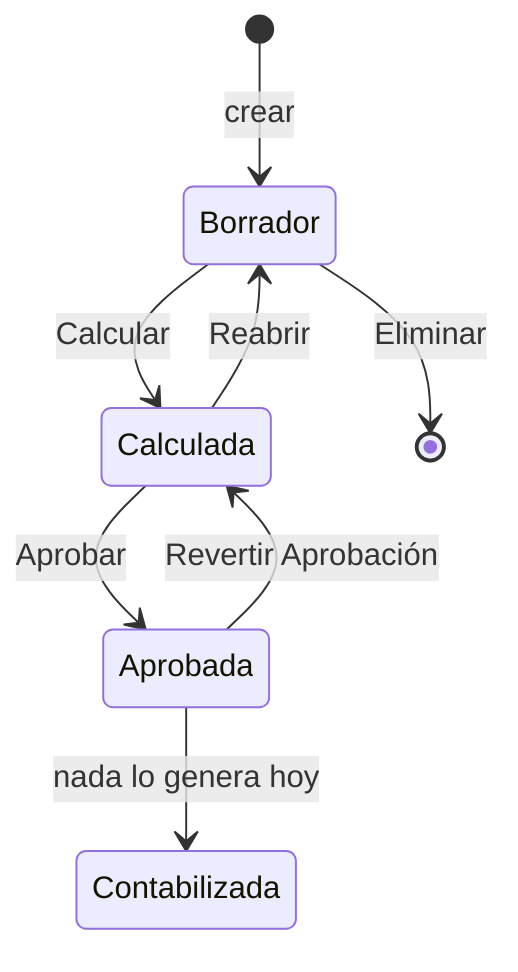

# Crear, calcular, aprobar y reabrir liquidaciones

## Objetivo

Operar **una** liquidación (o una selección) a lo largo de su ciclo de vida desde la *Ficha Liquidación* o la *Lista*. El proceso en lote del mes está en [[Lanzador de liquidaciones y lotes]]; la tabla en [[Tabla - Liquidación]].

## Estados

| Estado | Color en pantalla | Qué se puede hacer |
|---|---|---|
| **Borrador** | gris (*Subordinate*) | Editar cabecera e incidencias, **Calcular**, Eliminar |
| **Calculada** | verde (*Favorable*) | Revisar, **Aprobar**, **Reabrir**, Recalcular en cadena |
| **Aprobada** | negrita (*Strong*) | **Revertir Aprobación**, imprimir recibo. No se edita |
| **Contabilizada** | atención (*Attention*) | El motor se niega a recalcular ("No se puede recalcular una liquidación contabilizada"). **Ninguna acción asigna este estado hoy** |

> [!warning] Divergencia con la guía vieja
> `GUIA-LIQUIDACION.md` decía que una liquidación aprobada "no puede reabrir ni modificarse". En el código existe **Revertir Aprobación** (Aprobada → Calculada, con confirmación) y desde ahí se puede **Reabrir**. Lo único definitivo es *Contabilizada*, y hoy no se alcanza.

## Pasos

### Crear

Normalmente se crean por proceso (*Crear y Calcular*, *Lanzador*, acciones del Job). Alternativas individuales:

| Dónde | Acción | Qué hace |
|---|---|---|
| *Empleados* (Employee List) | **Crear Liquidación** | Abre el informe *Crear Liq. para Empleado* ([[Reportes y procesos masivos]]) |
| *Períodos* | **Crear Liq. para Empleado** | Igual, con el período ya elegido |
| *Personal Proyecto* (Job o empleado) | **Crear Liquidación** | Pide el **tipo** (no se infiere), usa el período que contiene la fecha de trabajo y abre la ficha; avisa si ya existe |

El número lo toma de la serie de **Config. RR.HH.** (*Serie Núm. Liquidaciones*). Sin serie, el proceso falla con "La serie de numeración de liquidaciones no está configurada".

La cabecera trae **empleado, período, tipo, proyecto, convenio y categoría**; el convenio/categoría se **re-resuelven en cada cálculo** a partir de los atributos del empleado a la fecha de referencia.

### Calcular

*Ficha* → **Calcular** (habilitado sólo en Borrador). Si falla, el error se muestra con el número de **registro de proceso** para ir al detalle; si hay advertencias de parámetros, aparece un cartel "Atención — parámetros posiblemente desactualizados".

Lo que hace el motor, en orden (resumen operativo; el detalle técnico está en las notas de motor):

1. Rechaza si está *Contabilizada* o si el **período está cerrado** ("El período %1 está cerrado. No se puede reliquidar").
2. Fija la **fecha de referencia**: fin del período; en *Cierre de Marea*, la fecha de arribo del proyecto. Calcula la **cobertura** (días que cubre).
3. Rechaza si el empleado ya tiene **líneas de un período posterior** (control de orden cronológico — ver Reabrir).
4. Resincroniza convenio/categoría; verifica que el empleado tenga **estado** a esa fecha y que esté **asignado al proyecto** (si la liquidación tiene proyecto).
5. **Fase 1: valida todas las fórmulas** sin tocar datos; si alguna no compila, corta con "Las siguientes fórmulas contienen errores. Corrija antes de calcular".
6. **Fase 2**: borra las líneas anteriores, aplica cuotas de préstamo pendientes y **materializa las novedades** del período como incidencias, evalúa los conceptos en `Orden Cálculo`, converge el grossing-up si corresponde, guarda totales y pasa a *Calculada*.

Cada cálculo deja un **registro de proceso** ([[Controles y avisos del cálculo]]).

> [!note] Calcular en lote sólo toma Borrador
> La acción *Calcular* de la Lista y del Árbol, el Lanzador y *Calcular Período* **omiten** lo que no esté en Borrador y avisan "N liquidación(es) del alcance quedaron sin calcular porque no están en Borrador… reabrilas si querés recalcularlas". Los tooltips de esas acciones dicen "Borrador o Calculada" o "Borrador, Calculada o Aprobada": **el código sólo calcula Borrador**.

### Revisar

Subpáginas de la ficha: **Líneas Liquidación** (ver *Mostrar importes cero / no imprimibles / acumuladores*), **Variables del Cálculo** (FactBox), **Días que cubre**, **Acumuladores**, **Contexto del Cálculo**, **Incidencias**, **Novedades aplicadas**. Para explicar un importe: [[Asistente de fórmulas y detalle del cálculo]].

### Aprobar

*Aprobar* sólo acepta *Calculada* ("Solo se pueden aprobar liquidaciones en estado Calculada"). Marca todas las líneas como Aprobada, registra el proceso y deja **aplicadas** las cuotas de préstamo. En la Lista, *Aprobar* actúa sobre la **fila actual**; para varias a la vez, usar el [[Árbol de liquidaciones]] (omite las que no están Calculada y las informa).

### Reabrir

Sólo desde *Calculada*. Vuelve a Borrador (cabecera y líneas), **revierte cuotas de préstamo** y **devuelve las novedades a disponibles**; además libera los parámetros marcados *En Uso* que ninguna otra liquidación activa use.

**Se bloquea si el empleado tiene un período posterior ya calculado**: "No se puede reabrir %1 (período %2) porque el empleado ya tiene liquidado el período %4…". Razón: francos, acumuladores anuales y Ganancias leen todo lo liquidado hacia atrás; reabrir una vieja dejaría novedades y cuotas sueltas que la posterior volvería a tomar (la misma cuota descontada dos veces). En lote (Lista, Árbol, *Revertir Calculadas*) las bloqueadas se **saltean y se cuentan**.

### Recalcular en cadena

*Ficha* → **Recalcular en cadena**. Es la forma correcta de corregir un período viejo: rehace esa liquidación **y todas las posteriores del mismo empleado, de la más vieja a la más nueva**, en una sola transacción (si una falla, se revierte toda la cadena). Previamente pide confirmación con la cantidad de posteriores. **No funciona si alguna está Aprobada**: hay que *Revertir Aprobación* antes ("La liquidación … está Aprobada y no se puede rehacer").

### Revertir Aprobación

*Ficha* o *Lista* → **Revertir Aprobación** (sólo desde *Aprobada*, con confirmación). Vuelve a *Calculada* y revierte las cuotas de préstamo; **no** libera novedades (la liquidación sigue calculada).

### Eliminar

Sólo en Borrador (*Eliminar Selección* en la Lista, *Eliminar* en el Árbol, *Eliminar Borradores* en Períodos). El borrado devuelve las novedades materializadas: **no borrar liquidaciones por SQL** (las novedades quedarían "Aplicadas" contra una liquidación inexistente y no entrarían nunca más; ver [[lote-tipo-liq-en-blanco]]).

## Verificación

- Tras Calcular: estado *Calculada*, *Neto a Pagar* distinto de cero (si corresponde) y sin errores en *Registros de proceso*.
- Tras Reabrir: estado *Borrador* y sus novedades otra vez *Pendiente*.

## Relacionado

[[Flujo operativo mensual de liquidación]] · [[Árbol de liquidaciones]] · [[Resolución de problemas frecuentes]] · [[Tabla - Línea Liquidación]] · [[Tabla - Registro Proceso Liq]] · [[acumuladores-orden-calculo]]

## Ver también

[[Estados y transiciones de una liquidación]] · [[Ciclo de cálculo de una liquidación]] · [[Recálculo en cadena]] · [[Transaccionalidad y errores del cálculo]]
