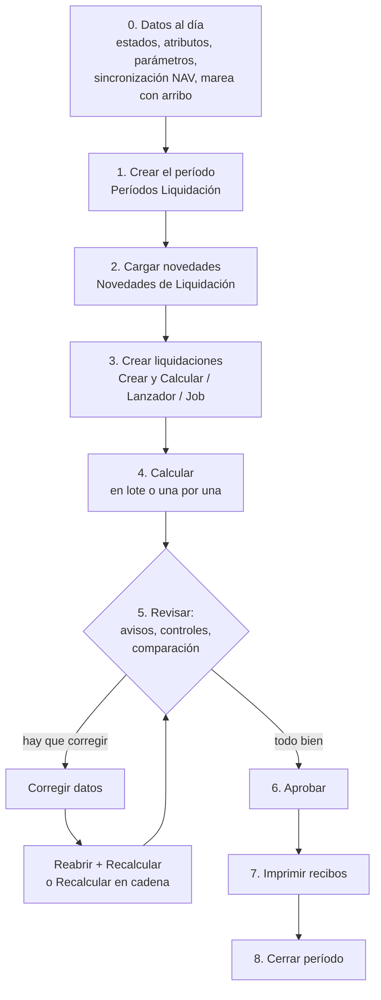

# Flujo operativo mensual de liquidación

## Objetivo

Llevar un mes desde "los datos están cargados" hasta "recibos impresos y período cerrado". Es la receta del liquidador; cada paso apunta a la nota que lo detalla.

## Pasos

### 0. Antes de empezar (datos al día)

Durante el paralelo, completar primero [[Preparar un mes contra Meta4]]: contrasta entradas originales, cobertura y parámetros, y conserva los meses ya calculados. Después continuar con los pasos operativos de esta nota.

Nada de esto lo hace el botón de liquidar; si falta, el cálculo sale vacío o corto **sin error**:

1. **Sincronización NAV**: abrir *Sincronización con NAV* y verificar que no haya filas pendientes ni en error (proyectos, empleados, descargas). Los empleados que llegan de NAV nacen **sin convenio ni categoría**: completarlos en la vista *Pendientes de completar (Sinc.)* de la lista de empleados; "hasta que los tengan, el motor no les arma ninguna liquidación". → [[Sincronización NAV - visión general]]
2. **Estados y fases de alta** de cada empleado (Historial de Estados, Fases de Alta): el motor exige estado a la fecha de referencia y las altas definen si el empleado "pertenecía a la empresa" ese mes. → [[estado-empleado-effective-dated]], [[tres-capas-fase-estado-asignacion]]
3. **Atributos** del empleado (convenio, categoría, zona, sindicato, obra social…) con vigencia al mes. → [[atributos-tipados]]
4. **Parámetros vigentes del mes** (topes SIPA, SMVM, cotizaciones, precios por categoría). El cálculo avisa si el último valor es más viejo que la *Antigüedad Máxima Vigencia* configurada. → [[Configurar un parámetro y su vigencia]]
5. **Mareas**: para Cierre de Marea el proyecto debe tener **fecha de arribo** (*Ending Date*); sin ella la acción está deshabilitada y el lote devuelve el error "El proyecto … no tiene fecha de arribo".
6. **Préstamos y SIRADIG** cargados ([[Importación SIRADIG - operación]]).
7. Correr **Fórmulas con errores** y **Control de Orden de Cálculo** si se tocó configuración. → [[Controles y avisos del cálculo]]

#### Revisión previa del período

**Períodos → Preparar → Revisar preparación**, o la misma acción del **Lanzador de
Liquidaciones**, abre **Preparación de liquidaciones** con el período seleccionado.
También se encuentra por búsqueda. Elegir tipo, empleado o proyecto si se quiere acotar
el alcance y pulsar **Verificar**; abrir la página no ejecuta el análisis.

La vista inicial es **Errores comprobados**. **Errores y revisiones** incorpora las
advertencias que requieren confirmar aplicación o alcance; **Diagnóstico completo**
añade la información de contexto. Alternar estas vistas conserva la misma captura,
sin volver a consultar la nómina. Los contadores corresponden sólo a las filas visibles
y respetan los filtros de la lista. Una vista sin errores comprobados no certifica
los importes ni convierte las revisiones pendientes en datos correctos.

La revisión inspecciona presencia, vigencias y configuración sin crear documentos ni
evaluar fórmulas de importe. Separa errores acreditados, advertencias y datos que aún
requieren contexto. Un cero con fila vigente cuenta como dato informado; una fuente de
incidencias sin filas no demuestra un faltante. Un resultado sin observaciones tampoco
certifica los importes futuros ni la conciliación con Meta4.

Incluye encuadre, atributos obligatorios según entidad/clase, parámetros referidos por
conceptos compatibles, antigüedad máxima de vigencias, configuración de fuentes y
cotizaciones verificables de la conversión automática. Respeta las claves y ejes del
resolvedor vigente y distingue fecha de referencia y fecha de cotización. Usa candidatos
por fases, estados y asignaciones: no simula la creación exacta, los días propios ni la
cobertura diaria de todos los cambios del mes. Las referencias `@`, matrices y datos
dependientes del número del futuro recibo quedan identificados como contexto pendiente.

**Abrir dato** lleva al parámetro, atributo o fuente de la fila; la carga se realiza por
las páginas normales y con sus permisos habituales. Después de corregir, volver a
**Verificar**. **Imprimir revisión** copia sólo las filas visibles, conservando vista,
filtros y fecha de la captura mostrada, sin volver a consultar la nómina. Ejecutado
directamente, el informe también comienza por **Errores comprobados**. Los resultados
son temporales y no dejan
registros de proceso ni marcas de uso. El informe también puede ejecutarse directamente
por búsqueda como **Preparación de liquidaciones**.

**Destino de nómina de las mareas (21/10/2026).** Un `PROY_NOMINA` vigente del
buque que apunta a un proyecto de nómina existente es un dato ya cargado. No se
exige copiarlo al campo `Proyecto Inactividad Nómina` de cada marea. El primer
chequeo implementado confundía esa copia con un requisito y se corrigió antes de
publicarlo. Los tres buques consultados tienen atributo válido y sus mareas
actuales de abril también tienen completo el campo de inactividad.

La revisión se limita a mareas candidatas después de aplicar fases, asignaciones,
estados, tipos y filtros; no barre todo el histórico. Una ruta incompleta para
una eventual transición de estados requiere contexto: por sí sola no demuestra
un error en el importe de la liquidación candidata. Los avisos de esa ruta quedan
como revisión opcional y se agrupan por proyecto, sin atribuirse al primer empleado.
**Abrir dato** abre la ficha del proyecto; verificar no escribe proyectos ni crea
estados.

Se conservan las rutas del motor: la creación agrupada prioriza el proyecto del
estado fuera de marea y luego el atributo vigente; la inserción de una salida de
marea en `ResolverProyectoInactividad` usa el campo de la marea y el respaldo de
Recursos humanos. El informe no unifica esas rutas ni modifica estados históricos.
Ver [[proyecto-nomina-dos-fuentes]].

La revisión agrupa lectores del mismo dato y muestra **Repeticiones** y
**Conceptos relacionados**. Conserva separados empleado, proyecto, tipo, encuadre,
fechas, vigencia y motivo; una diferencia en esos datos impide agrupar. Para una
misma ausencia de atributo, con idéntico alcance y causa, combina las severidades
conservando la más alta y todos los lectores y repeticiones. En las demás áreas,
la severidad sigue formando parte de la identidad del aviso.
Los contadores distinguen grupos de ocurrencias: ninguno equivale a personas o pagos
faltantes. La impresión y la exportación conservan los conceptos relacionados.

Un parámetro sin fila en una lectura directa queda como **advertencia para confirmar
su aplicación**, salvo el incumplimiento de una regla explícita de fecha: el catálogo no declara obligatoriedad general y el motor aporta cero cuando
no hay fila. Los selectores de cero, las alternativas explícitas y los auxiliares
informativos no acreditan por sí solos una carga necesaria. Las ausencias admitidas
por un selector o alternativa explícitos ya no generan aviso. Ser un concepto
informativo no basta para descartarlo: un auxiliar puede alimentar haberes,
acumuladores o retenciones. Un uso directo adicional conserva la advertencia.

**Reglas de fecha de los parámetros (21/10/2026).** La `Antigüedad Máxima Vigencia`
configurada se revisa para todos los parámetros que el motor carga automáticamente,
aunque ninguna fórmula los nombre directamente. La vista **Errores comprobados**
incluye una base sin ninguna fila vigente a la referencia, una regla de fecha no
evaluable o imposible, y una fila seleccionada por la cascada cuya fecha sea anterior
al límite configurado. Estos errores acreditan el incumplimiento de la regla de fecha;
no afirman que el importe almacenado sea incorrecto.

Se conserva una tarea por parámetro, clave física, vigencia, fecha de referencia y
causa, sin repetirla por cada empleado o tipo. Se muestra el alcance de la fila de
parámetro y no el del primer consumidor. Se respetan las fechas de arribo, los ejes
del día de baja frente al fin del mes, las claves históricas sin base y el cero cargado.
Si hay filas de la base pero ninguna corresponde al empleado, no se exige cargarle
una excepción; un encuadre no resuelto tampoco acredita una fila vencida.
El límite exacto es inclusivo, incluso con fórmulas ancladas como `<-CM>` el día 1.
Las ausencias sin regla temporal explícita conservan su revisión opcional.

También reconoce selectores compuestos seguros con `AND`, `OR` y `NOT`;
una entrada desconocida no autoriza a descartar la rama por cortocircuito. Los atributos
de lista conservan tanto el código como su valor numérico almacenado: la comparación
con un literal de texto válido usa el código y la comparación numérica usa ese valor,
siguiendo el motor. Nombres compartidos con
otros orígenes o precios pendientes de conversión mantienen el contexto sin resolver.
Las fuentes inactivas y las configuraciones que impiden ejecutar una lectura conservan
su error. Una fuente decimal que lee texto/código se señala como incompatibilidad de
configuración, sin afirmar que falta un pago ni aceptar esa fuente como cotización.

Los atributos obligatorios de empleado se revisan aunque tengan una clase cargada;
la restricción de clase se aplica a buques. Un atributo opcional ausente no equivale
a una carga exigida. La obligatoriedad global genera una revisión de catálogo,
no un error de pago de cada candidato. No se cambian las asignaciones ni el flag.
Los avisos de antigüedad de precios siguen siendo revisiones; no acreditan una tarifa
incorrecta. La mezcla de divisas se informa una vez por contexto, sin repetir el límite
por cada precio. Una cotización ausente o no positiva bajo filtros comprobados se
distingue de una fuente cuyo contexto no pudo resolverse.

La incompatibilidad de una fuente decimal que lee Code/Text se retira del resultado
si un censo conservador no encuentra consumidores en conceptos, parámetros, otras
fuentes, filtros, atributos, variables o configuración. No se desactiva ni borra la
fuente. Los defectos estructurales de fuentes activas se siguen validando aunque no
tengan lectores, porque el motor puede ejecutarlas al cargar el contexto.
Las fuentes con filtro de liquidación quedan como **resultado
no comprobado sin contexto**, tanto si ya existe el recibo como si todavía debe crearse.

### 1. Crear el período

*Períodos* → **Nuevo**: completar **Año** y **Mes**. El *Código* se arma solo como `aaaamm` (p. ej. `202610`) y las fechas Desde/Hasta se completan con el primer y último día del mes ([[periodos-aaaamm]]). El *Cód. Calendario* es opcional: define días no laborables para `DIAS_HAB`; vacío = lunes a viernes. Un período nuevo nace *Creado*; se abre cuando corresponde operarlo.

### 2. Cargar novedades

*Novedades de Liquidación* → elegir el período → importar de Excel/CSV, copiar del período anterior o generar recurrentes. **Antes de cerrar el período las pendientes tienen que estar en cero**: lo que quede pendiente "no se le pagó a nadie". → [[Novedades e incidencias - carga operativa]]

### 3 y 4. Crear y calcular

La forma habitual: *Períodos* → **Crear y Calcular Liquidaciones**. Crea, calcula y descarta las que salen vacías. Alternativas: *Lanzador de Liquidaciones* (por período y tipo), acciones del *Job* (por marea) o *Crear Liq. para Empleado*. → [[Lanzador de liquidaciones y lotes]]

Un lote puede tardar: muestra una ventana de progreso con la liquidación en curso, el paso y el tiempo. Al terminar, si hubo cinco o más avisos, abre el informe **Avisos del cálculo**. → [[Controles y avisos del cálculo]]

### 5. Revisar

En este orden suele rendir más:

1. **Registros de Proceso** con filtro *Solo con error*: qué liquidaciones fallaron y por qué.
2. **Avisos del cálculo** (informe) — parámetros desactualizados, acumuladores leídos antes de tiempo, novedades salteadas.
3. **Días Liquidados por Empleado**: días con estado que ninguna liquidación cubrió.
4. **Control de Liquidación por Período / por Marea**: matriz concepto × empleado y lista de quién cobró distinto que su categoría.
5. **Novedades de Liquidación**: pendientes y "con motivo de no aplicación".
6. Durante la corrida en paralelo, **Comparar BC contra Meta4**.
7. Abrir casos puntuales: *Ficha Liquidación* → líneas, *Detalle del cálculo*, variables. → [[Asistente de fórmulas y detalle del cálculo]]

### 6. Corregir

Cambió un dato → **Reabrir** (vuelve a Borrador y libera las novedades) → **Calcular** otra vez. Si el empleado tiene períodos *posteriores* ya calculados, reabrir se bloquea: usar **Recalcular en cadena**. → [[Crear, calcular, aprobar y reabrir liquidaciones]]

### 7. Aprobar

Lista o Ficha → **Aprobar** (sólo desde *Calculada*); en el Árbol, sobre el nodo del mes o del tipo. Al aprobar, las cuotas de préstamo asociadas quedan marcadas como aplicadas.

### 8. Imprimir recibos

*Imprimir Recibo* desde la Ficha, la Lista (uno o selección) o el Árbol (nodo entero). Activar **Solo liquidaciones aprobadas/contabilizadas** en la ventana del informe. → [[Recibo de sueldo (reporte)]]

### 9. Cerrar el período

*Períodos* → **Cerrar Período**. Pide confirmación y registra fecha y usuario. Un período cerrado no admite crear ni calcular.

> [!warning] El cierre no controla nada
> Cerrar Período **no verifica** que todas las liquidaciones estén aprobadas ni que no queden novedades pendientes: sólo cambia el estado. Esa revisión es manual (paso 5).

> [!note] El cierre sí se puede deshacer
> La confirmación dice "no se puede deshacer", y `GUIA-LIQUIDACION.md` también lo afirmaba, pero la acción **Reabrir Período** existe: devuelve a Borrador las liquidaciones *Calculada*/*Aprobada* que no tengan posteriores y reabre el período. Se **niega** si hay liquidaciones *Contabilizada* (aunque hoy nada genera ese estado, ver [[Qué es y para qué sirve este sistema]]).

## Verificación

- *Períodos*: el período figura *Cerrado* con fecha y usuario de cierre.
- *Árbol de Liquidaciones*: todos los nodos del mes en estado *Aprobada* y subtotales cuadrados contra lo esperado.
- *Novedades*: Pendientes = 0.
- *Días Liquidados por Empleado*: *Con faltantes* = 0 para el rango del mes.

## Relacionado

[[Mapa de páginas por menú]] · [[Resolución de problemas frecuentes]] · [[lote-tipo-liq-en-blanco]] · [[ventana-liquidacion-es-cobertura]]

## Ver también

[[Ciclo de cálculo de una liquidación]] · [[Tipos de liquidación]] · [[Cuándo corresponde una liquidación]] · [[Novedades pre-liquidación]] · [[Control de períodos liquidados]] · [[Runbook - tareas frecuentes]]
